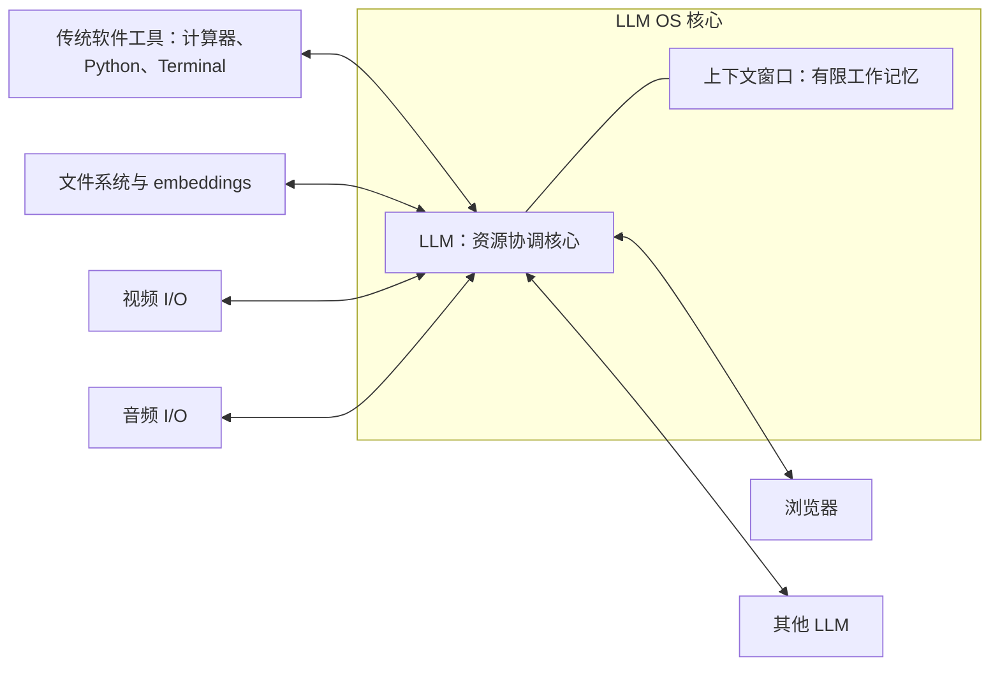

# LLM OS（大语言模型操作系统）

## 一句话定义

LLM OS 是 Andrej Karpathy 在 2023 年演讲中提出的计算架构类比：以大语言模型为资源协调核心，通过自然语言接口组织记忆、工具与外部模型完成任务，而非把模型仅视为聊天机器人。

## 英文缩写速查

| 缩写 | 英文全称 | 简要说明 |
|---|---|---|
| LLM | Large Language Model | 资源协调与语言生成核心 |
| OS | Operating System | 操作系统，此处为架构类比 |
| CPU | Central Processing Unit | 幻灯片中对应 LLM |
| RAM | Random Access Memory | 幻灯片中对应有限上下文窗口 |
| I/O | Input/Output | 视频、音频等输入输出 |
| RAG | Retrieval-Augmented Generation | 检索外部资料并供模型使用 |

## 核心架构

依据原演讲 [42:15–45:43](https://www.youtube.com/watch?v=zjkBMFhNj_g&t=2535s) 与该节幻灯片。

| 传统计算机角色 | LLM OS 类比 | 职责 |
|---|---|---|
| CPU / 核心过程 | LLM | 协调资源、生成与推理 |
| RAM | Context window | 有限的工作记忆，装载当前任务所需信息 |
| Disk | File system + embeddings | 持久资料与检索 |
| 传统软件工具 | Calculator / Python / Terminal | 外部计算、代码执行 |
| Peripheral I/O | Video / Audio | 多模态交互 |
| Ethernet / 外部连接 | Browser | 获取网络信息 |
| 外部协作对象 | Other LLMs | 专门模型之间的任务协作 |

## 流程总览

原幻灯片是模块关系图而非执行时序；以下 Mermaid 重绘保留双向交互，不补造调用协议。

## 为什么重要

- 上下文容量有限，外部文件与网页提供可按需选取的资料；讲者用内存分页帮助理解这种信息调度。
- 工具使用让模型能够借助传统软件执行计算，而不是只依赖生成文本。
- 多模态接口、专用模型和更长时间的推理是讲者对未来系统的设想；自我改进仅在具有可评价奖励的领域被讨论为可能性。

## 工程实践与机器人关联（知识库推论）

- 在 Agent 系统中，模型可承担高层任务决策，运行时负责工具执行、结果回传、权限与状态管理。可对照 [Coding Agent Orchestration](./coding-agent-orchestration-and-cognitive-oversight.md)。
- 在机器人系统中，可将语言任务层与感知、规划和底层控制分工；LLM 的非确定性输出需要由执行层做约束与验证。这是从类比延伸的工程建议，并非原演讲对机器人架构的实验结论。
- 文件检索与上下文管理可参照 [RAG](./retrieval-augmented-generation.md)；长期知识组织可参照 [LLM Wiki](./llm-wiki-karpathy.md)。两者不是同一概念。

## 局限与风险

- CPU / RAM / OS 均为类比，不代表上下文窗口等于物理内存，也不意味着 LLM 实现了传统操作系统的隔离、实时调度或内存保护。
- 2023 年演讲中的未来能力是展望，不作为当前性能或可复现性证据。
- 演讲紧接着讨论模型安全；工程上需区别外部资料与受信任指令，限制工具权限并验证执行结果。
- 本节未提供独立可运行 LLM OS 实现；源码运行时序图不适用。官方幻灯片 PDF 正文未取得，全片未逐段核对，保留草稿状态。

## 关联页面

- [Andrej Karpathy](../entities/andrej-karpathy.md)
- [RAG](./retrieval-augmented-generation.md)
- [LLM Wiki](./llm-wiki-karpathy.md)
- [Coding Agent Orchestration](./coding-agent-orchestration-and-cognitive-oversight.md)
- [VLA 纵深路线](../../roadmap/depth-vla.md) — 高层模型与工具使用的选读前置

## 参考来源

- [Intro to Large Language Models — 原始演讲归档及核对边界](../../sources/courses/karpathy_intro_llms_youtube.md)

## 推荐继续阅读

- [原始演讲：LLM OS（42:15）](https://www.youtube.com/watch?v=zjkBMFhNj_g&t=2535s)
- [作者发布的配套幻灯片](https://drive.google.com/file/d/1pxx_ZI7O-Nwl7ZLNk5hI3WzAsTLwvNU7/view)
