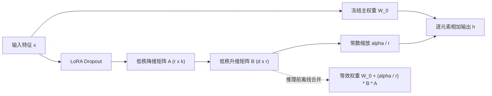

# LoRA (Low-Rank Adaptation，低秩适配)

**LoRA**（Hu et al., 2021）是一种参数高效微调（PEFT）机制：冻结预训练权重矩阵 $W_0$，仅对其权重更新量施加低秩分解约束 $\Delta W = BA$，使大模型能以极小可训练参数量完成下游任务、跨本体动力学或视觉外观适配，并在推理部署前无缝合并回原模型。

## 一句话定义

冻结原线性权重 $W_0 \in \mathbb{R}^{d \times k}$，只训练一对低秩旁路矩阵 $B \in \mathbb{R}^{d \times r}$ 与 $A \in \mathbb{R}^{r \times k}$（$r \ll \min(d, k)$），前向从 $W_0 x$ 变为 $W_0 x + \frac{\alpha}{r} B A x$，部署时离线合并为 $W' = W_0 + \frac{\alpha}{r} B A$ 以保持零额外推理延迟。

## 英文缩写速查

| 缩写 | 英文全称 | 简要说明 |
|------|----------|----------|
| LoRA | Low-Rank Adaptation | 以低秩矩阵分解近似权重增量的 PEFT 方法 |
| PEFT | Parameter-Efficient Fine-Tuning | 冻结主干参数、仅微调少量新增或局部参数的技术总称 |
| SVD | Singular Value Decomposition | 奇异值分解，用于衡量 LoRA 增量与原权重的子空间对齐与放大倍率 |
| QLoRA | Quantized LoRA | 将冻结基座量化至 4-bit 并叠加高精度 LoRA 旁路的显存压缩衍生法 |

## 为什么重要

- **大幅降低显存与存储门槛**：在 GPT-3 175B（Hu et al., 2021, §2 / §5.4）上，LoRA 将 Adam 微调总显存由 **1.2 TB** 降至 **350 GB**（最多节省约 **2/3**）；仅针对 $W_q, W_v$ 训练 $r=4$ 旁路时，单个下游检查点体积从 **350 GB** 压缩至 **35 MB**（约 **10,000×**），训练吞吐也由 32.5 提升至 43.1 tokens/s（**+25%**）。
- **推理阶段零额外延迟**：不同于在层间串行插入瓶颈层的 Adapter（GPT-2 medium 单卡 `batch=1, seq=128` 实测分别引入 **+20.7%** 与 **+30.3%** 推理延迟，见原论文 Table 1），LoRA 旁路可在上线前线性叠加回 $W_0$，前向计算图与原模型完全一致。
- **不动基座、面向动力学敏感模块微调**：在具身智能与机器人控制中，常冻结视觉-语言主干或世界模型基座的语义几何先验，仅对 Action Decoder、逆动力学模型（IDM）或局部运动控制头挂载 LoRA，从而用少量真机或目标域数据跨过外观与动力学鸿沟。

## 核心机制

对预训练层权重 $W_0 \in \mathbb{R}^{d \times k}$，LoRA 假设微调阶段的有效权重更新 $\Delta W$ 具有很低的“本征秩”（intrinsic rank），并将其显式参数化为两个窄矩阵之积：

$$
h = W_0 x + \Delta W x = W_0 x + \frac{\alpha}{r} B A x, \qquad B \in \mathbb{R}^{d \times r},\ A \in \mathbb{R}^{r \times k},\ r \ll \min(d, k)
$$

- **零起跳初始化与 $\frac{\alpha}{r}$ 缩放（§4.1）**：训练前使初始 $\Delta W = B A = 0$（原论文写为 $A \sim \mathcal{N}(0, \sigma^2)$、$B = 0$），保证第一步前向严格等价于预训练基座；随后旁路乘以常数超参 $\frac{\alpha}{r}$，当调整秩 $r$ 时输出与梯度的整体尺度变化更平缓，减少重调学习率的工作量。
- **真正学到的是“被抑制的任务特征放大”（§7.3–§7.4）**：原论文对 GPT-3 175B 学得的 $\Delta W_q$ 做奇异值分解并计算归一化 Grassmann 子空间相似度（Eq. 4），发现 $r=8$ 与 $r=64$ 在主右奇异方向重合度 >0.5；但计算特征放大倍数 $\|\Delta W_q\|_F / \|U^T W_q V^T\|_F$（$U, V$ 为 $\Delta W_q$ 的左右奇异向量，Table 7）时，$r=4$ 达 **$6.91 / 0.32 \approx 21.5\times$**（$r=64$ 时约 2×）。这表明 LoRA 并非重复放大 $W_0$ 原本最强的主方向，而是**精准放大预训练通用模型中原本权重较小、但对当前下游任务至关重要的特定子空间方向**。

## 实验与评测

基于 Hu et al. (2021) 原论文的基准与关键消融结论如下：

1. **跨架构持平或微超全量微调（Table 2–4）**：在 RoBERTa base/large（GLUE）、DeBERTa XXL（1.5B）、GPT-2 medium/large 与 GPT-3 175B 上均追平或超过全量微调（例如 GPT-3 175B 上 WikiSQL **74.0 vs FT 73.8**，MNLI-m **91.7 vs FT 89.5**）。
2. **参数预算优先平铺多层投影，而非单矩阵高秩（Table 5，GPT-3 175B ~18M 可训练参数预算）**：
   - 只微调 $W_q$（$r=8$）：WikiSQL **70.4** / MNLI **91.0**；
   - 只微调 $W_v$（$r=8$）：WikiSQL **73.0** / MNLI **91.0**；
   - 同时微调 $\{W_q, W_v\}$（$r=4$）：WikiSQL **73.7** / MNLI **91.3**；
   - 同时微调 $\{W_q, W_k, W_v, W_o\}$（$r=2$）：WikiSQL **73.7** / MNLI **91.7**。
3. **极低秩即接近饱和（Table 6 & Appendix H.2）**：在 GPT-3 $\{W_q, W_v\}$ 上仅 $r=1$ 即取得 WikiSQL **73.4** / MNLI **91.3**；GPT-2 E2E NLG 消融在 $r=4$ 达峰值 BLEU **70.38**（$r=16$ 时验证损失最低 **1.16**），大秩反而可能轻微过拟合或收益边际递减。
4. **低样本与正交组合（Appendix E & F.3）**：在每类仅约百条样本的 MNLI-100 上，LoRA（**63.8**）高于全量微调（**60.2**）并远超 PrefixEmbed（**37.6**）；与 Prefix-Embedding 叠加（`LoRA+PE`）在 WikiSQL 上可进一步提升至 **76.2**（单用 LoRA 为 73.7），而与 Prefix-Layer 叠加（`LoRA+PL`）则略微下滑。

## 源码实现剖析

官方仓库 [microsoft/LoRA](https://github.com/microsoft/LoRA)（核心位于 `loralib/layers.py`、`loralib/utils.py` 与 `examples/NLG/src/model.py`）展示了工程落地中的三处关键实现细节：

- **实际初始化与论文叙述的细微差异**：`loralib/layers.py` 中的 `Linear`、`MergedLinear` 与 `ConvLoRA` 实际对 `lora_A` 调用 **`nn.init.kaiming_uniform_(self.lora_A, a=math.sqrt(5))`** 并对 `lora_B` 调用 `nn.init.zeros_(self.lora_B)`（仅 `Embedding` 对 `lora_A` 置零而对 `lora_B` 用 `normal_`），虽然与论文 §4.1 所写的高斯初始化略有差别，但同样满足初始 $\Delta W = 0$。
- **打包 QKV 投影的分块掩码实现（`MergedLinear`）**：针对 [Transformer](./transformer.md) 常把 $Q, K, V$ 写进单个线性层（如 GPT-2 `Attention.c_attn`）的情况，`examples/NLG/src/model.py` 传入 `enable_lora=[True, False, True]` 只适配 $Q$ 与 $V$ 而冻结 $K$；内部使用 `F.conv1d(..., groups=sum(enable_lora))` 对激活分块计算低秩乘积，再按掩码 `lora_ind` 零填充（`zero_pad`）叠加到主路径。
- **训练/推理切换与参数过滤**：`train(mode)` 钩子在 `merge_weights=True` 时自动按 `merged` 状态机加减 `(lora_B @ lora_A) * scaling`；`loralib/utils.py` 提供 `mark_only_lora_as_trainable(model, bias=...)` 与 `lora_state_dict(model, bias=...)` 只冻结主权重并导出轻量增量权重。

## 在本库中的典型用法

| 页面 | LoRA 的角色 |
|------|-------------|
| [FADA](../entities/paper-fada-humanoid.md) | 冻结 $P$/$I$ 预训练权重，仅在逆动力学模型 IDM 上优化 LoRA $\Delta\psi$ |
| [Any2Any Cross-Embodiment WBT](../entities/paper-any2any-cross-embodiment-wbt.md) | 在 Action Decoder 等动力学敏感模块插 LoRA，$r$ 控制吸收跨本体动力学 gap 的容量 |
| [SONIC-Transfer](../entities/paper-sonic-transfer.md) | 冻结 GEAR-SONIC 全平台基座，仅在动力学解码器插 LoRA（约 0.25% 参数） |
| [M4World](../entities/paper-m4world.md) | few-clip 后训练阶段用 LoRA 绑定稀有外观/文本，保留基座几何与天气先验 |
| [mimic-video](../methods/mimic-video.md) | 视频阶段对骨干注入 LoRA，利用机器人域视频缩小外观与动力学域差 |
| [MorphAct](../entities/paper-morphact.md) | 按情境为共享 VLA 动态生成低秩参数更新，使视觉语言与动作两侧耦合适应 |

## 工程实践

- **模块选型先广后深**：在参数预算有限时，优先同时适配 $\{W_q, W_v\}$ 或 $\{W_q, W_k, W_v, W_o\}$ 与动力学解码层（小秩 $r=2\sim 8$），通常比把大秩 $r=32/64$ 集中给单一权重层性价比更高；在机器人 VLA 场景若动作头耦合强，还应配合 FFN/MLP 投影消融。
- **秩 $r$ 与 `lora_alpha` 设定**：微调域差较小的策略/风格迁移常从 $r=4\sim 8$、`lora_alpha` 设 $r$ 或 $2r$ 起步；需要大幅改写物理动力学或新动作词汇时扩至 $r=16\sim 32$ 并重新核查过拟合风险。
- **多任务部署切换 `merge_weights=False`**：若在线推理服务需要在同一批次（heterogeneous batching）同时响应多组不同 LoRA 适配器，应在构建层时设置 `merge_weights=False` 保留独立旁路分支，而非全部合进 $W_0$。
- **参数安全约束与检查点管理**：保存检查点优先调用 `lora_state_dict` 仅序列化增量权重；若需防止微调摧毁既有安全对齐或运动先验，可结合[安全 LoRA 投影更新](../formalizations/safe-lora-update-projection.md)将更新投影到安全子空间。

## 常见误区与局限

- **分布偏移过大时的低秩容量上限（§7 / 行业常见边界）**：LoRA 依赖下游解只需对预训练子空间做温和重加权与放大；当目标任务与预训练模态/语言/机器人动力学相差悬殊（如从零学习全新语种或全新自由度控制律）时，极低秩会欠拟合，需增大 $r$ 或回退局部/全量微调。
- **混淆“无额外延迟”的前提（§4.2 Footnote 6）**：只有单适配器离线合并（`W' = W_0 + scale * B @ A`）才能实现零额外推理开销；若同一推理请求批次内混用多个独立 LoRA，未合并时的旁路算子或分组路由依然带来额外显存访存与计算延迟。
- **误以为 LoRA 主要在放大 $W_0$ 的主奇异特征**：奇异值分析（Table 7）恰恰相反——$\Delta W$ 与 $W_0$ 顶部方向相关性很弱，而是数十倍地放大原先在 $W_0$ 中较微弱的任务特征。因此直接截断 $W_0$ 主分量并不能替代训练旁路。
- **注入层位敏感与多 LoRA 叠加干扰**：不同模型对挂载位置（Attention Q/V vs 全部注意力+MLP vs Action Decoder）极其敏感；多个分别训练的 LoRA 权重直接线性相加合并时易产生子空间冲突与性能塌缩。

## 关联页面

- [VLA](../methods/vla.md)
- [mimic-video](../methods/mimic-video.md)
- [Transformer](./transformer.md)
- [安全 LoRA 投影更新](../formalizations/safe-lora-update-projection.md)
- [FADA](../entities/paper-fada-humanoid.md)
- [Any2Any Cross-Embodiment WBT](../entities/paper-any2any-cross-embodiment-wbt.md)
- [SONIC-Transfer](../entities/paper-sonic-transfer.md)
- [M4World](../entities/paper-m4world.md)
- [WAM-TTT](../entities/paper-wam-ttt-human-video-test-time-steering.md)
- [RLDX-1](../entities/rldx-1.md)
- [MorphAct](../entities/paper-morphact.md)

## 参考来源

- [LoRA 一手精读与源码核对归档](../../sources/notes/lora.md)
- Hu et al., *LoRA: Low-Rank Adaptation of Large Language Models*, arXiv:2106.09685v2（2021）：<https://arxiv.org/abs/2106.09685>
- 官方代码库（`loralib/layers.py`, `loralib/utils.py`, `examples/NLG/src/model.py`）：<https://github.com/microsoft/LoRA>

## 推荐继续阅读

- [VLA 方法页](../methods/vla.md)
- [安全 LoRA 投影更新形式化](../formalizations/safe-lora-update-projection.md)
- [LoRA 原始论文（arXiv:2106.09685）](https://arxiv.org/abs/2106.09685)
