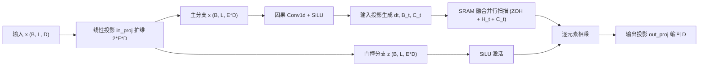

# Mamba

**Mamba**（Gu & Dao, 2023）是在结构化[状态空间模型（SSM）](./state-space-model-ssm.md)与 S4（Gu et al., 2022）基础之上提出的选择性状态空间序列架构（S6 + 同构门控块）：让离散化步长与状态投影参数随输入动态变化以实现内容筛选，并用硬件感知的片上 SRAM 融合并行关联扫描化解失去卷积等价性后的算力与显存瓶颈。

## 一句话定义

把结构化状态空间从“固定不变的时间滤波器”升级为“能根据当前输入决定写入或遗忘的选择性递推（S6）”，借片上 SRAM 核融合扫描维持线性训练复杂度与 $O(1)$ 单步推理状态，成为长序列建模中替代二次复杂度注意力的重要线性路线。

## 英文缩写速查

| 缩写 | 英文全称 | 简要说明 |
|------|----------|----------|
| SSM | State Space Model | 通过隐状态映射输入输出序列的连续/离散动态系统 |
| S4 | Structured State Space | 基于 HiPPO 与 NPLR 分解的线性时不变（LTI）高速 SSM 前驱 |
| S6 | Selective Scan Structured SSM | Mamba 核心层：带输入选择机制与并行扫描的时变 SSM |
| ZOH | Zero-Order Hold | 零阶保持离散化规则，将连续参数转化为离散递推系数 |
| LTI | Linear Time-Invariant | 线性时不变性质；使模型可写成全局卷积但丧失内容选择能力 |
| HBM / SRAM | High-Bandwidth Memory / Static RAM | GPU 高容量片外显存与高带宽片上缓存；融合算子成败关键 |

## 为什么重要

- **弥合线性序列模型与离散语义建模的鸿沟**：[Transformer](./transformer.md) 通过保存完整 KV cache 避免压缩丢失上下文，带来 $O(L^2)$ 训练与 $O(L)$ 推理缓存膨胀；而以 S4 为代表的 LTI SSM 虽凭 HiPPO-LegS 与 NPLR/Cauchy 核拿下 LRA 长程基准（Path-X 16k 达 96.35%），却因递推系数 $(\Delta, A, B, C)$ 跨时间恒定而无法在随机间隔中按内容过滤噪声，在语言等离散模态表现逊于注意力。Mamba 以选择机制破除该瓶颈，让 3B 级纯线性模型在零样本语言评测上首次匹敌两倍规模的传统 Transformer（如 Mamba-2.8B 胜过 Pythia-2.8B 并比肩 Pythia-6.9B）。
- **机器人长周期状态压缩与流式控制需求**：机械臂长时触觉历史、高频事件相机流、多步运动轨迹与实时视觉-语言-动作（VLA）策略均受严格控制周期和显存预算约束；Mamba 每步推理只需维持定长 `ssm_state`（无 KV cache 膨胀），本库已有 [Mamba SmolVLA Expert](../entities/paper-mamba-smolvla-expert.md) 与 [TrajMamba](../entities/paper-nit-trajmamba.md) 等具身探索。

## 核心机制

### 1. S4 的 LTI 约束与 S6 选择机制

连续多通道独立 SSM 为 $h'(t) = A h(t) + B x(t),\ y(t) = C h(t)$。S4 对全序列共享 $(\Delta, A, B, C)$，因此可用双线性离散化后展开为单次 FFT 全局卷积 $y = x * K$。Mamba（Algorithm 2）保留对角结构化矩阵 $A \in \mathbb{R}^{D \times N}$ 跨时间共享，令 $B_t, C_t, \Delta_t$ 成为当前输入 $x_t$ 的线性投影函数：

$$
B_t = s_B(x_t) = \mathrm{Linear}_N(x_t), \quad C_t = s_C(x_t) = \mathrm{Linear}_N(x_t), \quad \Delta_t = \mathrm{softplus}\big(\text{Parameter} + s_\Delta(x_t)\big)
$$

随后通过零阶保持（ZOH，Eq. 4）生成时变离散系统：

$$
\bar{A}_t = \exp(\Delta_t A), \qquad \bar{B}_t = (\Delta_t A)^{-1}\big(\exp(\Delta_t A) - I\big)\cdot \Delta_t B_t, \qquad h_t = \bar{A}_t h_{t-1} + \bar{B}_t x_t,\ y_t = C_t h_t
$$

- **RNN 门控的严格推广（Theorem 1）**：当取 $N=1, A=-1, B=1, s_\Delta=\mathrm{Linear}(x)$ 时，ZOH 离散化精确退化为经典门控循环 $g_t = \sigma(\mathrm{Linear}(x_t)),\ h_t = (1 - g_t) h_{t-1} + g_t x_t$。由此直接赋予 $\Delta_t$ 清晰物理含义：$\Delta_t \to \infty$ 相当于重置旧状态并聚焦当前输入，$\Delta_t \to 0$ 则忽略无关噪声、持久化历史记忆，使模型天然具备 **Variable Spacing**（跳过停顿/杂波）、**Filtering Context**（长上下文单调降困惑度）与 **Boundary Resetting**（多段样本或 RL episode 边界清零）能力。

### 2. 硬件感知并行扫描与简化同构块

由于 $(\bar{A}_t, \bar{B}_t)$ 随时间变化，S6 丧失了全局 FFT 卷积等价性；若按朴素 PyTorch 在 HBM 中实例化尺寸达 $(B, L, D, N)$ 的中间隐状态，访存带宽会立即堵死加速比。Mamba 综合三项硬件感知技术（§3.3 & Appendix D）：

1. **Kernel Fusion（SRAM 核融合）**：仅从慢速 HBM 读入 $O(BLD + DN)$ 大小的 $(\Delta, A, B, C)$ 至高速片上 SRAM，在 SRAM 内完成 ZOH 离散化、扫描递推及与 $C_t$ 的乘加收缩，直接写回 $(B, L, D)$ 输出，削减 $O(N)$ 倍显存读写。
2. **Work-Efficient Parallel Associative Scan**：利用时变一阶线性递推的结合律，以 Blelloch 并行前缀扫描替代串行循环，维持 $O(BLDN)$ 线性 FLOPs 并行训练（超长序列拆分为 chunk 并接力传递边界状态）。
3. **Recomputation（反向重算）**：前向不缓存体积庞大的 $(B,L,D,N)$ 状态张量，反向时随从 HBM 读回输入参数并在 SRAM 即时重算，将激活显存降至与 FlashAttention-2 同级。

在宏观网络层，Mamba 把 H3 序列块与 SwiGLU/Gated MLP 合二为一为单一同构块（默认扩展倍率为 $E=2$，两层串联对应 $12D^2$ 参数以对齐 Transformer 的 MHA + MLP 组合）：

## 实验与评测

依据 Gu & Dao (2023) 正文 §4 跨模态实测结果：

1. **合成任务外推至百万长度（Table 1–2）**：在需要跳过随机间隔的 **Selective Copying** 上，Mamba+S6 取得 **99.8%** 精度（而同块换 LTI 层 S4 仅 56.4%、Hyena 仅 28.4%）；在测试上下文联想记忆的 **Induction Heads** 上，仅以长度 256 训练即可零样本泛化至 **$2^{20}=1,048,576$（4000×）** 仍保持完美准确度（对比 Transformer 在 16k 全部 OOM）。
2. **语言建模与下游零样本（Fig. 4 & Table 3，The Pile / 300B tokens）**：在 125M–1.3B 尺度上成为首个纯线性时间模型全面匹敌强配方 Transformer++（RoPE + SwiGLU + RMSNorm）；零样本常识推理 **Mamba-2.8B** 平均 **63.3%**（优于 Pythia-2.8B 的 59.1% 与 RWKV-3B 的 59.6%，甚至微超 Pythia-6.9B 的 61.7%）。
3. **DNA 与音频（§4.3–§4.4）**：人类基因组 HG38 上控制总计算预算后，上下文从 1K 拉至 1M 时 Mamba 困惑度单调下降（HyenaDNA 在长上下文反而恶化）；SC09 语音生成 24.3M Mamba 获 **FID 0.67**（SaShiMi 1.42，DiffWave 1.92）。
4. **效率 benchmark（§4.5 & App. E.5，A100 80GB）**：融合扫描核比 PyTorch 朴素扫描快 **20–40×**，在序列超过 **2K** 时速度超越 FlashAttention-2；因推理期无需 KV cache 可开极大 batch，吞吐达同参数 Transformer 的 **4–5×**。
5. **关键消融（Table 6–10）**：选择性参数中 $\Delta_t$ 贡献最核心（10.93 → 10.15 ppl），联合 $(\Delta, B, C)$ 协同降至 **8.71 ppl**；加入选择机制后实数对角初始化 **S4D-Real**（$A_n = -(n+1)$，8.71 ppl）在语言建模上反超复数 S4D-Lin（9.16 ppl）；开启选择性 $B,C$ 后把状态维 $N$ 从 1 扩至 16 仅增加 ~1% 参数即下降 **>1.0 ppl**（9.73 → 8.71）。

## 源码实现剖析

逐文件核对官方仓库 [state-spaces/mamba](https://github.com/state-spaces/mamba)（`mamba_ssm/modules/mamba_simple.py`、`mamba_ssm/ops/selective_scan_interface.py`、`README.md`）：

- **`Mamba` 默认超参及张量维度**：默认 `d_state=16`、`d_conv=4`、`expand=2`、`dt_rank="auto"`（自动设为 $\lceil d_{\text{model}} / 16 \rceil$）。`conv1d` 设为深度可分离 `groups=d_inner` 并在前向执行 `conv1d(x)[..., :seqlen]` 保持严格因果；`x_proj` 单次映射出 `dt_rank + 2 * d_state` 后切分为 `(dt, B, C)`；`dt_proj` 将 `dt` 升维至 `d_inner`，其偏置初始化按 $\mathrm{softplus}^{-1}(\mathrm{Uniform}([0.001, 0.1]))$ 分布并附带 `_no_reinit = True` 保护标记。
- **`A_log` 数值稳定与权重衰减屏蔽**：源码并不直接存 $A$，而是以 **float32** 存储 `A_log = log(arange(1, d_state + 1))`，前向取 `A = -torch.exp(self.A_log.float())` 锁定负实部确保指数衰减稳定，同时给 `A_log` 与跳跃向量 `D` 均打上 `_no_weight_decay = True`。
- **训练快路径与推理 `step()`**：训练期无缓存时若开启 `use_fast_path=True` 即调用一体化 CUDA 融合算子 `mamba_inner_fn`（内部 `MambaInnerFn` 在 `checkpoint_lvl=1` 时反向重算 `conv1d_out` 与 `delta`）；自回归生成走 `Mamba.step()`，原地读写 `inference_params` 中的固定滚动卷积缓存 `conv_state`（长度 `d_conv`）及 `ssm_state`，存在 Triton 时自动调用 `causal_conv1d_update` 与 `selective_state_update`。

## 工程实践

- **严守主权重 FP32 混合精度规范**：官方 `README.md` 明确提示 Mamba 对低精度极其敏感——主参数须保持 FP32 并通过 PyTorch AMP（BF16/FP16）运行训练，切忌直接使用 DeepSpeed 纯 FP16 降维权重导致隐状态收敛发散或 `exp(dt * A)` 数值畸变。
- **短序列不盲目用纯 Mamba 替代注意力**：若实际控制或感知窗口长度在数百 token 以内，FlashAttention-2 往往在墙上时钟上依然具备竞争力（§4.5 拐点约在 2K 以上），工程上更常见“局部 Conv + 选择性 SSM + 少量全局 Attention”的混合骨架构筑。
- **非一维模态明确扫描序列化路径**：面对图像、点云或传感器网格时，本身不存在唯一因果一维序，需要针对任务设计双向或多方向扫描策略，可参考 [Vision Mamba (ViM)](../entities/vision-mamba-vim.md)、[VMamba](../entities/vmamba.md) 与 [VideoMamba](../entities/videomamba.md)。
- **调参优先级高于增大 $N$ 的局部收益**：在资源受限下优先确保 $\Delta, B, C$ 全部开启选择性与合理的 `dt_rank`；连续感知信号（如原始音频采样流）上如发现实数初始化欠佳，按论文 §4.4.1 可切换复数 S4D-Lin 参数化（需用分步 `selective_scan_fn` 路径支持）。

## 常见误区与局限

- **连续–离散谱的“无免费午餐”（§5）**：选择机制大幅增强了语言、DNA 等离散信号的内容筛选，但破坏了原生连续 LTI SSM 对平稳频谱的完美平滑偏置；部分连续音频/物理信号任务若直接沿用实数配置可能不如复数 SSM 或特定 LTI 卷积。
- **检索与精确召回瓶颈（KV cache 压缩代价）**：把上下文压入固定 $D \times N$ 隐状态虽然带来 $O(1)$ 推理显存，但在需要从超长历史中做高保真精确原文复制或密集多跳推理时，有限状态容量仍可能劣于保存完整 KV 的显式注意力。
- **线性复杂度不等于必然更快的实际工程壁垒**：在缺少原厂 CUDA/Triton 核（如部分边缘端嵌入式芯片或低算力 NPU）时回退至 PyTorch 循环实现会导致速度骤降；且当前 8-bit/4-bit 量化与 LoRA 生态工具链仍不及 [Transformer](./transformer.md) 成熟（§5）。
- **实验验证上限与大规模迁移未知（§5）**：原论文主实验上限集中在 130M–2.8B，7B 及以上超大规模训练配方稳定性、MoE 组合及长程 RLHF 行为在原论文阶段尚未全面验证，需要工程上结合最新混合模型实测确认。

## 关联页面

- [状态空间模型（SSM）](./state-space-model-ssm.md)
- [Transformer](./transformer.md)
- [循环神经网络（RNN / LSTM / GRU）](./recurrent-neural-network.md)
- [RNN vs CNN vs Transformer vs Mamba 对比](../comparisons/rnn-cnn-transformer-mamba.md)
- [Vision Mamba (ViM)](../entities/vision-mamba-vim.md)
- [VMamba](../entities/vmamba.md)
- [VideoMamba](../entities/videomamba.md)
- [Mamba SmolVLA Expert](../entities/paper-mamba-smolvla-expert.md)
- [TrajMamba](../entities/paper-nit-trajmamba.md)
- [AI 架构地图](../overview/ai-architecture-map.md)

## 参考来源

- [Mamba 与 S4 一手论文精读与源码核对归档（arXiv:2312.00752 & arXiv:2111.00396）](../../sources/papers/mamba_ssm_reading_arxiv_2312_00752.md)
- [Mamba（arXiv:2312.00752）来源索引](../../sources/papers/gu_mamba_arxiv_2312_00752.md)
- [S4（arXiv:2111.00396）来源索引](../../sources/papers/gu_s4_arxiv_2111_00396.md)
- [AI 架构地图一手论文簇](../../sources/papers/ai_architecture_foundations.md)
- Gu & Dao, *Mamba: Linear-Time Sequence Modeling with Selective State Spaces*, arXiv:2312.00752v2：<https://arxiv.org/abs/2312.00752>
- Gu, Goel & Ré, *Efficiently Modeling Long Sequences with Structured State Spaces*, arXiv:2111.00396v3：<https://arxiv.org/abs/2111.00396>
- 官方代码库（`mamba_ssm/modules/mamba_simple.py`, `mamba_ssm/ops/selective_scan_interface.py`）：<https://github.com/state-spaces/mamba>

## 推荐继续阅读

- [RNN vs CNN vs Transformer vs Mamba 对比](../comparisons/rnn-cnn-transformer-mamba.md)
- [状态空间模型（SSM）概念页](./state-space-model-ssm.md)
- [state-spaces/mamba 官方仓库](https://github.com/state-spaces/mamba)
