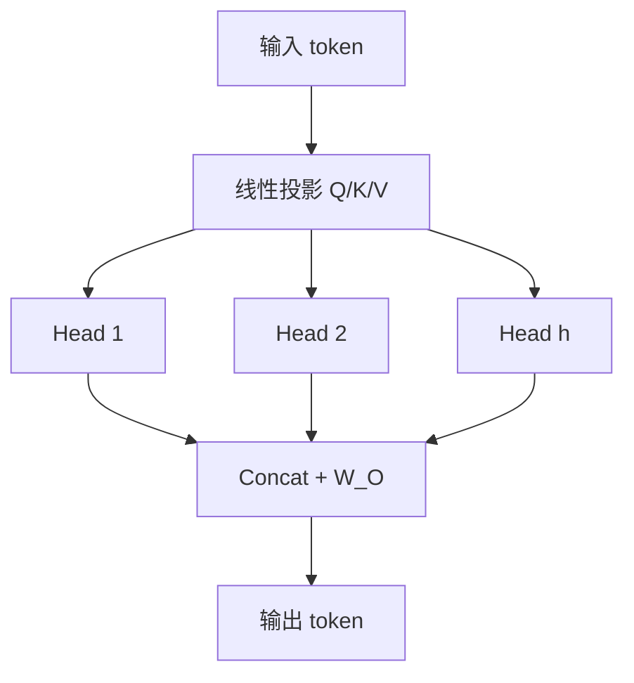

# 多头注意力（Multi-Head Attention）

## 一句话定义

**Multi-Head Attention（MHA）** 把 Query/Key/Value 投影到 $h$ 个子空间，各自做缩放点积注意力后拼接再投影，使模型在不同表示子空间 **并行关注不同关系模式**。

## 英文缩写速查

| 缩写 | 英文全称 | 简要说明 |
|------|----------|----------|
| MHA | Multi-Head Attention | 多头自/交叉注意力 |
| SDPA | Scaled Dot-Product Attention | 带 √d_k 缩放的点积注意力 |
| QKV | Query / Key / Value | 注意力三组投影 |
| Self-Attn | Self-Attention | Q/K/V 来自同一序列 |
| Cross-Attn | Cross-Attention | Q 与 K/V 来自不同模态或序列 |

## 为什么重要

- 是 [Transformer](./transformer.md) 与 [ViT](./vision-transformer.md) 的计算核心；作业 1 即实现并调试该模块。
- 机器人侧：ACT、RT 系列、VLA 视觉–语言–动作交互均建立在自注意力 / 交叉注意力之上。
- 与早期通道注意力（[SENet/DANet](../methods/channel-spatial-attention.md)）不同：MHA 直接对 **token 集合** 做内容寻址。

## 核心原理

$$
\mathrm{Attention}(Q,K,V)=\mathrm{softmax}\Big(\frac{QK^\top}{\sqrt{d_k}}\Big)V
$$

多头（Vaswani et al., 2017, §3.2.2）：

$$
\mathrm{MultiHead}(Q,K,V)=\mathrm{Concat}(\mathrm{head}_1,\dots,\mathrm{head}_h)W^O,\quad
\mathrm{head}_i=\mathrm{Attention}(QW_i^Q,KW_i^K,VW_i^V)
$$

其中 $W_i^Q,W_i^K\in\mathbb R^{d_{model}\times d_k}$，$W_i^V\in\mathbb R^{d_{model}\times d_v}$，$W^O\in\mathbb R^{hd_v\times d_{model}}$。原文取 $h=8$、$d_k=d_v=d_{model}/h=64$（$d_{model}=512$），每头维度缩小，所以总计算量与单头全维度注意力相近。动机：单头时加权平均会抑制模型同时关注不同表示子空间中的不同位置。

原文在 Transformer 里用多头注意力的三种方式：编码器-解码器注意力（Q 来自解码器上一层，K/V 来自编码器输出）、编码器自注意力、解码器带因果掩码的自注意力（把非法连接在 softmax 输入处置 $-\infty$）。自注意力中序列任意两位置路径长度为 $O(1)$，但每层复杂度为 $O(n^2 d)$，随长度平方增长。

## 工程实践

| 项 | 建议 |
|----|------|
| 实现 | 先写单头 SDPA，再 reshape 为多头；对齐 `torch.nn.MultiheadAttention` |
| 数值 | 务必除以 $\sqrt{d_k}$；半精度注意 softmax 溢出 |
| 掩码 | 因果掩码用于自回归；视觉 ViT 分类通常全连接无掩码 |
| 调试 | 可视化注意力图：是否塌缩到对角线/少数 token |
| 加速 | FlashAttention / SDPA 后端；长序列考虑窗口或可变形注意力 |

## 局限与风险

- **$O(n^2)$** 限制高分辨率密集视觉；需补丁化、窗口、可变形采样等。
- 多头并非「越多越好」——原文 Table 3 行 (A) 在计算量不变下改头数：单头比最优设置低 0.9 BLEU，头数过多（如 32 头、$d_k=16$）质量也下降；行 (B) 显示只缩小 $d_k$ 会伤害质量，作者据此猜测“兼容性函数不容易”，点积可能不是最佳形式。
- 原文是机器翻译实验；原文附录的注意力图显示不同头似乎学到不同任务（如长距离依赖、指代），属于定性观察，不是机制证明。视觉/机器人上的头功能需另行验证（推测）。
- 跨模态时应对齐哪侧做 Q（见 [跨模态注意力](../formalizations/cross-modal-attention.md)）。

## 关联页面

- [Transformer](./transformer.md)
- [Vision Transformer](./vision-transformer.md)
- [通道/空间注意力（SENet/DANet）](../methods/channel-spatial-attention.md)
- [Transformer CV 课程策展](../entities/transformer-cv-curriculum.md)

## 参考来源

- [Transformer 视觉应用课程大纲](../../sources/courses/transformer_cv_applications_syllabus.md)
- [Attention Is All You Need（sources）](../../sources/papers/attention_is_all_you_need.md)（原文通读：arXiv:1706.03762v7）

## 推荐继续阅读

- [Attention Is All You Need 论文实体](../entities/paper-attention-is-all-you-need.md)
- [Vaswani et al. Attention Is All You Need](https://arxiv.org/abs/1706.03762)
- [The Illustrated Transformer](https://jalammar.github.io/illustrated-transformer/)

高效注意力的快权重视角及压缩与路由组合，参见 [MiTA](../entities/paper-mita.md)。
