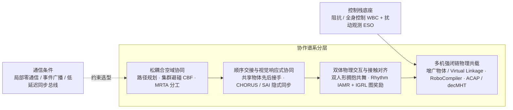

# 多机器人协作（Multi-Robot Collaboration）

**多机器人协作**研究多台自主机器人如何在共享空间、通信信道或物理接触界面上协同完成单机因载荷、几何跨度、工作空间或冗余能力受限而无法独立承担的任务（从避碰编队、任务交接直到强物理耦合的双/多机全身协同搬运与互作用）。

## 一句话定义

**多机器人协作是将单机自主能力跨越物理接触耦合、部分可观测博弈与机间通信异步边界，整合为可执行一致集体目标的建模、决策与控制体系。**

## 英文缩写速查

| 缩写 | 英文全称 | 简要说明 |
|------|----------|----------|
| MRS | Multi-Robot System | 多机器人系统总称 |
| MRTA | Multi-Robot Task Allocation | 多机器人任务分配与角色调度 |
| CTDE | Centralized Training, Decentralized Execution | 集中训练、去中心化执行的 MARL 范式 |
| VLA | Vision-Language-Action | 视觉–语言–动作具身策略；在 CHORUS 中微调为去中心化多本体共享策略 |
| CBF | Control Barrier Function | 控制障碍函数；用于多机安全避碰、队列保持与内力边界防护 |

## 为什么重要

- **物理上限突破：** 单个人形或移动操作臂受限于关节力矩峰值、步态稳定域与抓持臂展；多机通过共同托举大件刚体/柔体家具或串行接力，将负载质量、倾覆力矩与覆盖跨度在团队内部重新分配（例如 [decMHT](../entities/paper-decentralized-multi-humanoid-pickup.md) 将单机扩展至十机共搬 50 kg 物体）。
- **耦合维度跃迁：** 与单机自主规划不同，多机协作引入两类单机不会遇到的核心难点：一是接触闭链造成的**运动学过约束与挤压内力**（Khatib 1996 揭示刚性抓持下的内力如果不经正交解耦会破坏稳定性或压坏负载），二是去中心化运行时的**非平稳部分可观测与相位失配**（伙伴延迟或遮挡直接引发提前拉扯或跌倒）。
- **与仓储/制造/家庭具身落地对齐：** 无论多架带臂无人机协同搬运（[CALM](../entities/paper-calm-decentralized-aerial-manipulation.md)）、异构轮臂开门口协同搬篮（[CHORUS](../entities/paper-chorus.md)），还是企业级百台机群车队部署（[LWD](../methods/lwd.md)），均需要一套贯穿力学、通信、学习与安全护栏的完整工程栈。

## 核心原理

### 协作耦合适配谱系

多机器人系统并非所有问题都需要同一架构，设计前需按**物理接触紧密度**与**通信可用性**落在四象限内选型：

### 两大核心支柱问题

1. **物理交互侧——运动与内力解耦：**
   当多台移动操作臂或人形机器人的末端与同一负载刚性连接时，机械链条从开放树拓扑变为闭合运动链（closed kinematic chain）。按照 Khatib (1996) 提出的操作空间协同理论与 Virtual Linkage 模型，末端广义力必须正交分解为驱动负载运动的**合力偶（external/motion wrench）**与沿着机间连线相互抵消但不产生净运动的**内力（internal force）**；对于双足/人形还需进一步处理双脚切换造成的支撑边界跳变与浮动基惯量耦合（如 [RoboCompiler-Humanoids](../entities/paper-robocompiler-humanoids-composable-dynamics.md)）。
2. **学习决策侧——分布偏移与同步：**
   即使单台机器人各自精通孤立抓取，多机部署时也容易因为队友动作快慢不一致导致协作崩溃。解决思路分为三条支线：
   - **CTDE 多智能体强化学习（[MARL](../methods/marl.md)）：** 训练期允许集中 Critic 观测全局风扰/伙伴特权态（如 [Rhythm](../entities/paper-rhythm-dual-humanoid-interaction.md)、[CALM](../entities/paper-calm-decentralized-aerial-manipulation.md)），部署期靠本体与轻量交互表征执行；
   - **物体中心 / 视觉共享反应式去中心化：** 借助物体局部附着坐标抽象（[decMHT](../entities/paper-decentralized-multi-humanoid-pickup.md)）或共享预训练 VLA 权重加机器人身份 Prompt（[CHORUS](../entities/paper-chorus.md)），完全取消机间显式通信；
   - **单遥操作非对称模仿课程：** 通过“先训 A → B 对抗冻结 A → 稀疏干预修 A”的阶段演进（[SAI](../entities/paper-sai-sequential-asymmetric-imitation.md)），在不增加双人同步遥操作成本的前提下把伙伴延迟分布写进策略。

## 工程实践

- **先定交互边界，再选通信协议与同步频率：** 松散队列分发可运行在 [ROS 2](../concepts/ros2-basics.md) / [DDS](../concepts/dds-communication.md) `Best-Effort` 域发现上，而多机闭链力控与相位对齐常需低抖动消息（如 [LCM](../comparisons/ros2-vs-lcm.md) + IEEE 1588/NTP [时钟同步](../concepts/clock-synchronization-algorithms.md) + 相位比例软同步 $\dot{\phi}_{ego}=1+k(\phi_{peer}-\phi_{ego})$）。
- **分区分层解耦复杂系统：** 切忌用单个端到端低频网络硬接多机高频脚踝力矩与抓持力；推荐参考高层物体任务命令 + 冻结/经验证的底层行走/阻抗安全控制器架构（[Robot Control Architecture](../methods/robot-control-architecture.md)）。
- **多机实机安全围栏前置：** 上机联合测试前须配置硬件级急停互锁（[机器人安全状态机](../concepts/robot-safety-state-machine.md)）及机间相对距离/挤压极限 [Safety Filter](../concepts/safety-filter.md)，并用物理一致仿真器验证非对称失效工况（单机掉线、延迟 50 ms、一方突停）。

## 局限与风险

- **集中式策略维数诅咒：** 将全局所有机器人观测与动作直接拼接给单一策略（如集中式 VLA 或无约简联合全身求解器）会导致输入分布偏离单机先验且训练样本复杂度随机器人数量爆炸增长。
- **通信完全失效下的盲区风险：** 零通信去中心化策略强依赖“队友或负载状态落在局部视觉/力觉视野内”，当大型物体彻底遮挡队友、或环境要求毫秒级离散同步动作（如两夹爪同一帧释放易碎物）时，局部反应式策略仍会失效。
- **跨本体标准化评测基准稀缺：** 当前学术界分别在人机交接、人形牵手舞、双移动臂展被、空中篮筐共载各自建数据集与指标体系，跨任务直接比较绝对成功率容易误判机制优劣。

## 关联页面

- [协同物体搬运（Collaborative Object Transport）](./collaborative-object-transport.md)：深入闭链抓取力分配、Virtual Linkage、柔顺阻抗与多层仿真–实机协同搬运方案。
- [多机器人协同架构对比](../comparisons/multi-robot-coordination-architectures.md)：横向权衡集中优化、CTDE/有通信半去中心化与纯局部零通信反应式架构。
- [人形多机协调（Humanoid Multi-Robot Coordination）](./humanoid-multi-robot-coordination.md)：聚焦人形双足平衡限制下的协调模式与通信带宽分析。
- [Loco-Manipulation](../tasks/loco-manipulation.md)：双臂/多机在移动行走的同时维持接触与力交互的基础任务界定。
- [多智能体强化学习（MARL）](../methods/marl.md) 与 [CTDE vs 去中心化 MARL](../comparisons/ctde-vs-decentralized-marl.md)：学习侧核心算法与训练范式分歧。
- [Control Barrier Function（CBF）](./control-barrier-function.md) 与 [Safety Filter](./safety-filter.md)：多机群防碰撞与接触安全滤波底座。
- [多机器人协作纵深路线](../../roadmap/depth-multi-robot-collaboration.md)：本知识库第 32 条纵深学习路线入口（Stage 0–6 完整知识图）。

## 参考来源

- Khatib et al., *Coordination and Decentralized Cooperation of Multiple Mobile Manipulators*, JRS 1996 — [`khatib_1996_multiple_mobile_manipulators.md`](../../sources/papers/khatib_1996_multiple_mobile_manipulators.md)
- Duan et al., *Learning Multi-Humanoid Pickup and Transport via Decentralized Object-Centric Control*, arXiv:2609.17824 — [`decentralized-multi-humanoid-pickup_arxiv_2609_17824.md`](../../sources/papers/decentralized-multi-humanoid-pickup_arxiv_2609_17824.md)
- Doshi et al., *CHORUS: Decentralized Multi-Embodiment Collaboration with One VLA Policy*, arXiv:2606.12352 — [`chorus_arxiv_2606_12352.md`](../../sources/papers/chorus_arxiv_2606_12352.md)
- Chen et al., *Rhythm: Learning Interactive Whole-Body Control for Dual Humanoids*, arXiv:2603.02856 — [`rhythm_arxiv_2603_02856.md`](../../sources/papers/rhythm_arxiv_2603_02856.md)
- Heydari Shahna & Mattila, *Composable Dynamics for Cooperative Humanoids*, arXiv:2610.14237 — [`robocompiler_humanoids_composable_dynamics_arxiv_2610_14237.md`](../../sources/papers/robocompiler_humanoids_composable_dynamics_arxiv_2610_14237.md)
- Huo et al., *CALM: Decentralized Control of Cooperative Aerial Manipulation with MARL*, arXiv:2610.18425 — [`calm_arxiv_2610_18425.md`](../../sources/papers/calm_arxiv_2610_18425.md)

## 推荐继续阅读

- [多机器人协作纵深路线](../../roadmap/depth-multi-robot-collaboration.md) — 从 Stage 0 谱系定义到 Stage 6 车队安全的完整进阶路径
- [协同物体搬运（Collaborative Object Transport）](./collaborative-object-transport.md) — 闭链力学与多机搬运深度拆解
- [多机器人协同架构对比](../comparisons/multi-robot-coordination-architectures.md) — 架构选型对照表与决策树
