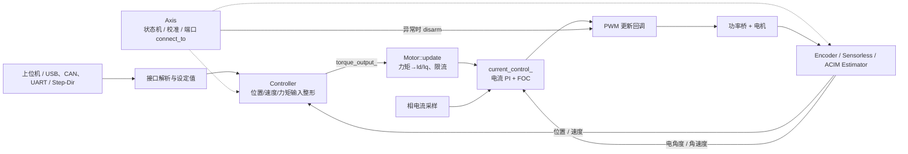
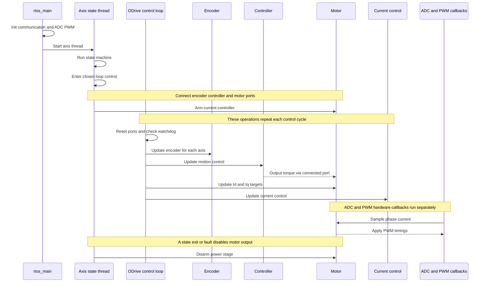

# ODrive 固件模块架构（ODrive Firmware 0.5.6 Architecture）

## 一句话定义

本页是 **ODrive 0.5.6 的模块职责划分与控制链路案例**，用于学习固件架构边界，非新的 ODrive 项目实体。**ODrive Firmware 0.5.6** 是经典开源多轴运动控制固件：使用 `Axis` 管理单轴状态与模块接线，`Controller` 负责位置/速度/力矩运动指令，`Motor` 一侧负责电气控制与功率输出，`Encoder` 提供闭环反馈。本文分析 **fw-v0.5.6 这一历史版本**，不代表后续 ODrive 产品的内部实现。

## 英文缩写速查

| 缩写 | 英文全称 | 简要说明 |
|---|---|---|
| ODrive | ODrive Motor Controller | 开源电机运动控制器项目及其经典固件 |
| FOC | Field-Oriented Control | 磁场定向控制，dq 电流闭环与调制 |
| PWM | Pulse-Width Modulation | 将控制电压转为逆变器开关占空比 |
| PI | Proportional–Integral | 速度环/电流环常用比例积分控制 |
| CAN | Controller Area Network | 上位机下发控制指令的总线之一 |
| ACIM | AC Induction Motor | 交流感应电机，涉及滑差与磁链估计 |
| SVM | Space Vector Modulation | 电压矢量到三相 PWM 的调制方法 |

## 为什么重要

ODrive 的核心价值不只是 FOC 算法，而是把**命令接口、运动目标、传感反馈、功率控制、校准状态机、故障失能**组织为可协作的固件。对机器人关节底软开发来说，研究“谁负责什么、不能做什么”，比照搬某个文件夹或类名更有用。

## 核心原理

### 七项功能映射到职责

| 对外能力 | 模块/对象 | 边界 |
|---|---|---|
| USB/UART/CAN 等命令 | `communication/`、协议适配 | 解析命令，修改设定值；不负责运动 PID/FOC |
| 位置/速度/力矩模式、轨迹输入 | `Controller`、`TrapezoidalTrajectory` | 运动控制计算到 `torque_output_` |
| 力矩转 dq 电流、限流及功率输出 | `Motor`、`current_control_`、FOC/PWM 回调 | 负责电流与电气侧实现 |
| 编码器与估计器 | `Encoder`、`SensorlessEstimator`、`ACIMEstimator` | 向使用者提供位置/速度/电角度或估计量 |
| 单轴生命周期 | `Axis` | 组织连接、校准、闭环运行、寻零和失能 |
| 配置持久化 | 各对象 `config_` + `ConfigManager` | 模块持有参数，系统层统一存取 |
| 安全与故障 | 子模块 `error_`、Axis 检查、`Motor::disarm` | 故障就地发现，失能动作集中至功率侧 |

### 流程总览（数据与控制流）

**信号是“接线”，调用是“调度”。** `Axis::start_closed_loop_control()` 使用 `InputPort::connect_to()` 接入来自编码器（可选另一轴的 load encoder）或无感估计器的数据，以及 Controller 的力矩输出。`OutputPort::present()/previous()/reset()` 限定数据的周期新鲜度，因此不能把端口理解成不受时序影响的普通指针。

### 源码运行时序图

基于官方 `fw-v0.5.6` 的 `Firmware/MotorControl/main.cpp`、`axis.cpp`、`motor.cpp` 及 `component.hpp`。**Axis 的状态机线程**与**周期中断控制回调**不同步调用；ADC/PWM 回调有另外的硬件节拍。

### 哪些是工程分层，哪些不是硬隔离？

- **命令链**：外部命令写入控制输入（位置/速度/力矩目标）。
- **运动级实时链**：`ODrive::control_loop_cb` 依次检查故障、更新 Encoder，再更新 Controller、OpenLoopController、Motor、current control。
- **电流/PWM 节拍**：`Motor::current_meas_cb` / `pwm_update_cb` 受 ADC/PWM 机制驱动，并非“通信包到来就运行一次 FOC”。
- **重要例外**：`main.cpp` 的周期回调确有 `uart_poll()`，所以只能说**架构职责分层、通信工作通常较低优先级**，不能说控制中断绝不执行通信相关代码。
- **ACIM 特例**：`ACIMEstimator` 独立存在，但 `Motor::update` 也参与励磁、转矩电流换算和估计器调用，说明设计边界会受时序与耦合影响。

## 工程实践

1. **从功能追代码**：上位机指令→`Controller::input_*`→`torque_output_`→`Motor::torque_setpoint_src_`→`Idq_setpoint_`→`current_control_`→PWM 回调。
2. **换反馈时看接线**：检查 `Axis::start_closed_loop_control` 中 `load_encoder_axis`、`enable_sensorless_mode` 及不同 phase source；重新验证极对数、方向、零位与限幅。
3. **看数据时效**：`present()` 表示当前控制周期数据有效；`previous()` 是上一周期值；`any()` 不保证新鲜。排查“值似乎有但没有控制输出”时先核对端口 reset/update 顺序。
4. **看安全停机**：检查 `Axis::do_checks`、watchdog 与 `Motor::disarm`；失能通过功率驱动与定时器主输出使能路径实施，不能依赖上位机停止发包。
5. **辨明版本**：给固件研究或真机控制移植锁定 tag，独立审查当前硬件及其官方文档，不要按遗留字段推断新固件兼容性。

## 局限与风险

- 文章的“Communication 不在实时控制环”是合理的**模块职责原则**，但不是 0.5.6 的绝对执行事实：周期函数含 `uart_poll()`。
- `Controller` 不直接实现电流 PI，并不表示完全不知道 `Motor`：控制律仍读取力矩/电气功率和 ACIM 相关参数，存在必要的横向耦合。
- 驱动器功率级安全强依赖电流传感器校准、时钟/PWM 调度、温度和母线保护；“代码可读”不代表满足机器人的功能安全要求。
- 源码与对外 API **仅按 `fw-v0.5.6` 核实**；不代表新版 ODrive S1/Pro/Micro 固件或其开源状况。

## 关联页面

- [FOC 磁场定向控制](../concepts/field-oriented-control.md) — 数学控制律与电气侧
- [电机驱动器底软通信协议总览](../overview/motor-drive-firmware-bus-protocols.md) — 外部协议/设定值
- [SimpleFOC](../entities/simplefoc.md) — 与单片机 FOC 库做架构对照
- [moteus](../entities/moteus.md) — 另一套开源关节驱动底软
- [控制环路延迟建模](../formalizations/control-loop-latency-modeling.md) — 周期/采样/PWM 时序
- [执行器驱动链选型闭环](../queries/actuator-drive-chain-selection-loop.md) — 从电机、驱动底软到关节通信/验收的知识链
- [力矩电机设计纵深路线（Stage 3）](../../roadmap/depth-torque-motor-design.md) — 从源码理解驱动器架构

## 参考来源

- [比特Z：从功能到模块，看 ODrive 是如何设计的（原文归档）](../../sources/blogs/wechat_bitz_odrive_modules_2026_09_17.md)
- [ODrive Firmware fw-v0.5.6 官方源码阅读记录](../../sources/repos/odrive_firmware_v0_5_6.md)
- [ODrive 官方 control.rst（fw-v0.5.6）](https://github.com/odriverobotics/ODrive/blob/fw-v0.5.6/docs/control.rst)
- [ODrive 官方 main.cpp 周期调度入口](https://github.com/odriverobotics/ODrive/blob/fw-v0.5.6/Firmware/MotorControl/main.cpp)

## 推荐继续阅读

- [ODrive 固件版本 fw-v0.5.6 源码树](https://github.com/odriverobotics/ODrive/tree/fw-v0.5.6/Firmware/MotorControl)
- [ODrive 官方控制模式说明](https://github.com/odriverobotics/ODrive/blob/fw-v0.5.6/docs/control-modes.rst)
