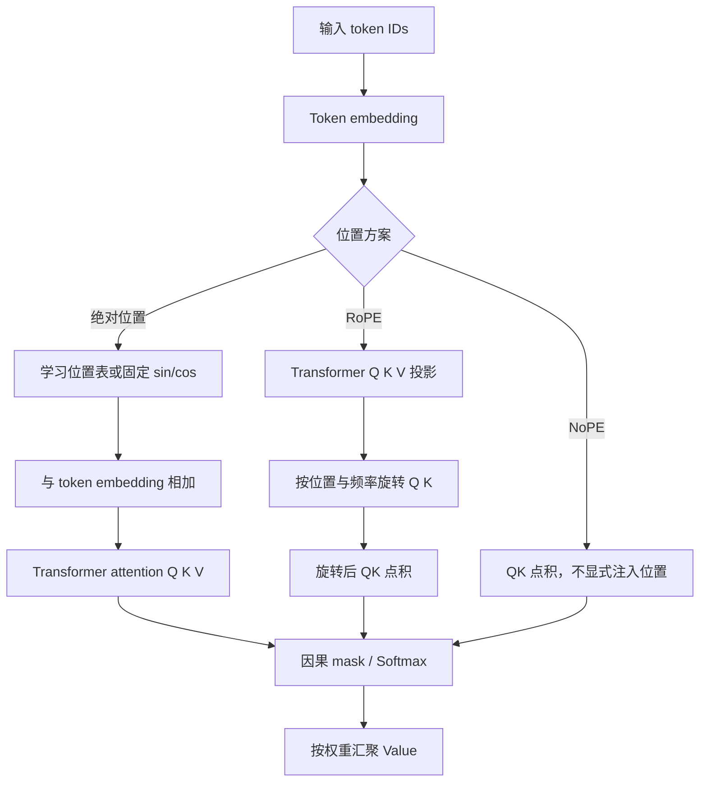
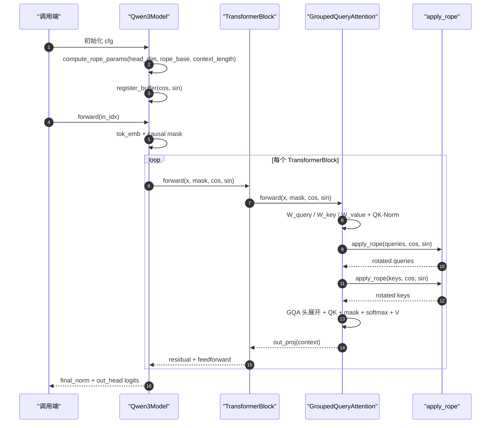

# 位置编码（Positional Encoding）：绝对位置、RoPE、NoPE 与相对偏置

## 一句话定义

**位置编码（Positional Encoding）** 为 Transformer 的 token 表示或注意力分数注入位置与距离信息，让内容相同、位置不同的序列能得到不同的交互关系；现代 LLM 既可采用绝对位置向量，也可采用相对旋转、隐式位置或可学习偏置。

## 英文缩写速查

| 缩写 | 英文全称 | 简要说明 |
|------|----------|----------|
| PE | Positional Encoding | 位置或相对距离编码的统称 |
| RoPE | Rotary Position Embedding | 旋转 query/key 向量，以相位差表达相对距离 |
| NoPE | No explicit Positional Encoding | 注意力层不显式注入位置编码 |
| QKV | Query / Key / Value | 注意力中的查询、键和值向量 |
| GQA | Grouped-Query Attention | 多个 query 头共享较少 KV 头的注意力 |
| MHA | Multi-Head Attention | 多头注意力，在各头内计算位置敏感的 q/k 点积 |

## 为什么重要

- 仅用无 mask 的内容自注意力无法直接知道序列先后；**因果 mask 会带来隐式顺序信息**，但并不能直接标明 token 间隔几步。
- 对 LLM、机器人动作序列和 VLA，输入长度、时间轴与 token 顺序会影响可建模的关系和推理代价。理解位置编码能避免把长上下文失效都归咎于 Transformer 容量。
- [Sebastian Raschka 的 2026-11-15 原文教程](../../sources/blogs/raschka_understanding_positional_embeddings_2026_11_15.md)按「位置向量 → RoPE → 变体」比较了编码所处位置与能力边界。

## 核心原理

### 1. 绝对位置：输入嵌入相加

GPT-2 使用训练得到的位置表，令输入

$$
h_m=E_{\mathrm{token}}(x_m)+P_m.
$$

原始 Transformer 使用固定正弦/余弦（并将 token embedding 乘以 $\sqrt{d_{\mathrm{model}}}$）：

$$
P_{m,2i}=\sin(m/10000^{2i/d_{\mathrm{model}}}),\quad
P_{m,2i+1}=\cos(m/10000^{2i/d_{\mathrm{model}}}).
$$

前者要为支持的位置建表，后者可以计算未见过的更大位置，但**可计算不等于长上下文性能有保证**。

### 2. RoPE：不在输入上加位置向量，而在注意力内旋转 Q/K

对单个 head 的第 $i$ 个二维特征对，旋转角为 $m\theta_i$，其中

$$
\theta_i=b^{-2i/d},\quad
R(\phi)=\begin{bmatrix}\cos\phi&-\sin\phi\\\sin\phi&\cos\phi\end{bmatrix}.
$$

位置 $m$ 的 query、位置 $n$ 的 key 分别是 $q'_m=R(m\theta_i)q_m$、$k'_n=R(n\theta_i)k_n$。于是：

$$
(q'_m)^\top k'_n=q_m^\top R((n-m)\theta_i)k_n.
$$

**关键前提**：当未旋转的 q/k 保持固定、两个位置一起平移时，这个二维特征对的内积仅依赖相对间隔。前缀改变真实隐藏状态时，注意力分数依旧可能变化。Value 不参与 RoPE 旋转。

原文的教学例子：从相同特征对 $(1,5)$ 出发，q 在位置 5、k 在位置 2，每 token 旋转 20°；最终内积 $26\cos(60°)=13$。若两个位置共同右移 3，且原始 q/k 不变，内积仍为 13。

### 3. 方案怎么比较

| 方案 | 位置信号注入点 | 相对关系与限制 |
|---|---|---|
| GPT-2 可学习绝对位置 | 初始 token embedding + learned table | 与训练位置范围绑定，扩长需要处理位置表 |
| 原始 Transformer 正弦 | 初始 token embedding + fixed sine/cosine | 结构具确定性位移关系；超训练长度泛化未保证 |
| Full RoPE | attention 内 Q/K 全旋转 | 固定 q/k 的点积取决于相对偏移 |
| Partial RoPE | attention 内只旋转部分 Q/K 维度 | 缩小 sin/cos 表；不等于缩小完整 KV cache |
| NoPE / RoPE-NoPE 混用 | 某些/全部层不显式编码 | 因果掩码带隐式顺序；实际长序列效果需实测 |
| Learned relative bias | softmax 前对 attention logit 加偏置 | 偏置可取决于距离以及 query 隐状态；Inkling 的设计与 T5 并不完全相同 |

文章用 SmolLM3「每 4 层跳过 1 层 RoPE」、MiniMax-M3「128 维 head 只旋转 64 维」举例；这是**特定配置**而非所有 LLM 的统一规则。

### 4. 计算流程总览

## 工程实践

1. **分清特征配对布局**：split-half 将两半各一维组成一对；interleaved 将相邻维组成一对。两者必须同步重排 query/key 才有等价点积；不同 checkpoint 的布局不能不经转换互换。
2. **先计算频率与 sin/cos**：典型公式 $\theta_i=b^{-2i/d}$，例子 $d=8,b=10000$ 得到 $[1,0.1,0.01,0.001]$。这些是教学参数，不能当所有模型的默认 base。
3. **只旋转 query/key**：注意 QK-Norm 与 RoPE 的先后、head_dim 与 rotary_dim、位置索引、缓存中 key 的旋转方式。Partial RoPE 节省旋转表大小，但完整 KV 仍要缓存。
4. **验证数学不变量**：固定随机 q/k，给所有位置同时加一个 offset，比较旋转后 attention score（浮点允许小公差），再用适当特征重排比较 split-half/interleaved。
5. **测试真实长度**：分别测训练窗内准确率、外推到更长上下文的表现、缓存显存/吞吐；只看 sin/cos 可以计算到多远没有意义。

### 配套源码运行时序图（阅读官方教学 notebook，未执行）

作者在原文链接的 [standalone-qwen3.ipynb](https://github.com/rasbt/LLMs-from-scratch/blob/main/ch05/11_qwen3/standalone-qwen3.ipynb) 中，Qwen3Model.__init__ 预先计算旋转参数；forward 按层调用 TransformerBlock，后者调用 GroupedQueryAttention.forward，再调用 apply_rope 旋转 Q/K：

该 notebook 是文章引用的**通用 Qwen3 教学代码**，不是本篇博客独立发布的训练工程。上述流程依据读取的函数源码描述；未在本次 ingest 中跑模型或验证性能数值。

## 局限与风险

- **共同平移相对不变**是对固定未旋转 Q/K 的数学性质，而非「任意插入前缀都不影响预测」。
- **外推失败风险**：训练位置之外的数值可计算不保证模型仍能正确利用相对距离。需要单独验证长上下文任务。
- **NoPE 不等于没有顺序**：在 causal attention 中，前缀长度与可见性可以提供信号；原文引述的 NoPE 实验不能直接推广到所有模型规模与任务。
- **Partial RoPE 取舍**：作者的 2026 架构图库显示采用比例变化，但样本是图库条目，不能将其解读为全行业统计；作者对收益的评价属于个人判断。
- **具身迁移需重新定义坐标**：机器人同时有视觉 patch、语言、动作及时间戳；如何使用多轴/时间位置编码需查对应 VLA 源码及实验，不能从一维语言 RoPE 直接推断成效。

## 关联页面

- [Transformer](./transformer.md) — 位置编码所在的整体网络架构
- [多头注意力](./multi-head-attention.md) — Q/K/V 与 head 维度
- [Attention Is All You Need](../entities/paper-attention-is-all-you-need.md) — 原始正弦编码与 Transformer 基线
- [LLMs-from-scratch（Sebastian Raschka）](../entities/llms-from-scratch-raschka.md) — 可读的 PyTorch 实现
- [模型架构纵深路线 Stage 1](../../roadmap/depth-model-architecture.md) — 学习路径入口

## 参考来源

- [Sebastian Raschka：Understanding Positional Embeddings in Modern LLMs，2026-11-15（原文通读归档）](../../sources/blogs/raschka_understanding_positional_embeddings_2026_11_15.md)
- [原始 Transformer 论文来源归档](../../sources/papers/attention_is_all_you_need.md)
- [Raschka LLMs-from-scratch 仓库归档](../../sources/repos/rasbt_llms_from_scratch.md)

## 推荐继续阅读

- [Understanding Positional Embeddings in Modern LLMs（原文）](https://magazine.sebastianraschka.com/p/understanding-positional-embeddings)
- [Qwen3 standalone notebook（原文引用的配套实现）](https://github.com/rasbt/LLMs-from-scratch/blob/main/ch05/11_qwen3/standalone-qwen3.ipynb)
- [RoFormer（RoPE 原论文）](https://arxiv.org/abs/2104.09864)
