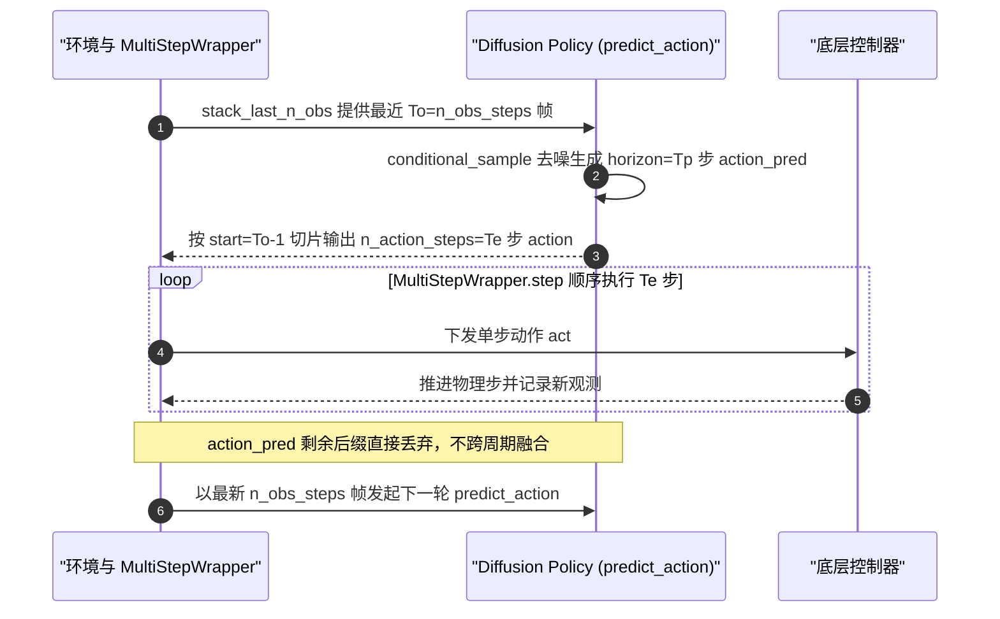
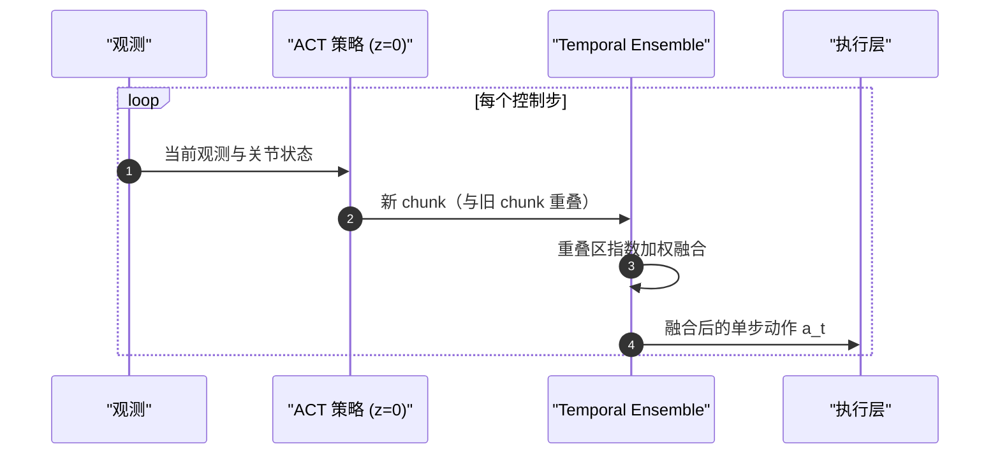

# 滚动预测执行（Receding-Horizon Policy Execution）

**滚动预测执行**：模仿学习 / VLA 部署里，策略 **不是每步只吐一个动作**，而是 **预测一段未来 action sequence**，**只执行其中前缀**，再在下一周期用 **更新后的观测重新预测** 下一段。[Diffusion Policy](../entities/paper-diffusion-policy.md) 把这一闭环写进方法设计；[ACT](../entities/paper-act.md) 也输出 action chunk，但默认 **Temporal Ensembling** 与经典 receding horizon **不是同一套执行协议**。

## 一句话定义

把控制论里的「滚动时域」搬到学习式策略：**有限视界预测 + 前缀执行 + 周期性重规划**，用闭环反馈抵消开环前缀误差。

## 英文缩写速查

| 缩写 | 英文全称 | 简要说明 |
|------|----------|----------|
| RH | Receding Horizon | 滚动时域：只执行预测序列前缀并重规划 |
| DP | Diffusion Policy | 以 receding horizon 为部署核心的扩散 IL 代表 |
| ACT | Action Chunking with Transformers | ALOHA 论文提出的 chunk 生成架构 |
| TE | Temporal Ensemble | ACT 默认：重叠 chunk 的指数加权融合 |
| \(T_p\) | Prediction Horizon | 单次推理预测的动作步数（代码中对应 `horizon`） |
| \(T_e\) | Execution Horizon | 两次重规划之间实际执行的步数（\(T_e \le T_p\)，代码中对应 `n_action_steps`） |

## 为什么重要

- **解耦推理与控制频率**：高计算开销的多步去噪策略（例如 5–20 Hz）可驱动高频底层控制器（50–1000 Hz），见 [控制/推理频率解耦](./control-inference-frequency-decoupling.md)。
- **降低逐步复合误差**：局部多步联合建模比「每步独立 BC」更平滑；但长开环前缀仍会在扰动下过期——[Why Action Chunking Improves BC](../entities/paper-why-action-chunking-improves-bc.md) 强调 **训练目标与执行协议可以分开设计**。
- **术语混乱成本高**：工程文档常把「用了 action chunk」一律叫 receding horizon；ACT 的 TE、VLA 的异步 buffer、MPC 的首步执行 **机制不同**，混称会导致错误的部署与消融。

## 核心原理

### 与控制论 MPC 的同名异构

[MPC](../methods/model-predictive-control.md) 的 receding horizon：每步解有限时域 OCP，**只执行第一个控制量**，再滚动。IL 滚动执行 **共享骨架**（有限视界 → 前缀执行 → 重规划），但 **无显式动力学约束优化**，而是神经网络生成动作序列。体系⑥总览见 [滚动优化与 ILC](../overview/robot-control-paradigm-receding-horizon-ilc.md)。

### 两个一手 canonical 对照

#### A. Diffusion Policy — 经典 receding horizon

[Diffusion Policy](../entities/paper-diffusion-policy.md)（Chi et al., RSS 2023 / IJRR 2024）明确把 **receding-horizon control** 作为核心设计（推理时延对照：论文 §3.4 举例如 DDIM 100 训练 / 10 推理步在 NVIDIA 3080 上约 0.1 s，Appendix A.4 真机配置用 100 训练 / 16 推理步）：

1. 给定观测上下文 \(T_o\) 步（`n_obs_steps`），在长度 \(T_p\)（`horizon`）上条件去噪生成动作序列 `action_pred`。
2. 从 `action_pred` 截取实际执行窗口：在 `DiffusionUnetHybridImagePolicy.predict_action` 与 `DiffusionTransformerHybridImagePolicy.predict_action` 中固定按 `start = To - 1`、`end = start + self.n_action_steps` 切片 `action = action_pred[:, start:end]`；低维版本 `DiffusionUnetLowdimPolicy.predict_action` 默认 `start = To`（当 `oa_step_convention=True` 时改为 `start = To - 1`，或 `pred_action_steps_only=True` 时直接预测执行段）。
3. 机器人 / 仿真封装 `MultiStepWrapper`（被 `RobomimicImageRunner` 与 `PushTImageRunner` 等使用；例如 `PushTImageRunner` 默认参数 `n_obs_steps=8, n_action_steps=8`）在其 `step(action)` 循环内**开环连续执行**这 \(T_e = \text{n\_action\_steps}\) 个物理步，把观测推入 `deque(maxlen=n_obs_steps+1)` 并通过 `stack_last_n_obs` 打包最新 `n_obs_steps` 帧，再重新调用 `policy.predict_action` 并**丢弃**上一轮未执行的后缀。

典型量级：\(T_p\) 16–32；\(T_e\) 依任务与算力预算常见 4–8 或更少。

#### B. ACT — chunk 生成 + Temporal Ensembling（≠ 经典 RH）

[ACT](../entities/paper-act.md)（Zhao et al., RSS 2023）同样 **一次预测 K 步 chunk**（推理阶段将 CVAE 隐变量固定设为 \(z = 0\)），但默认执行机制是 **Temporal Ensembling**：

- **每个控制时刻** 都发起新的 chunk 预测（即使上一 chunk 尚未「播完」）
- 对 **同一未来时刻** 的多条预测做 **指数加权平均**（\(w_i = \exp(-m \cdot i)\)）再下发
- 效果：**平滑抖动** + 隐式多模型集成；**不是**「执行固定前缀后整段丢弃重规划」

[Why Action Chunking Improves BC](../entities/paper-why-action-chunking-improves-bc.md) 进一步指出：ACT 式 **指数 TE** 会 **压近时刻权重**，与 **Randomized Delay Ensemble (RDE)** 的线性/随机时延集成 **机制不同**——读论文与复现时勿把三者混为一谈。

### 三轴分解（读任何 chunk 论文前先问）

| 轴 | 问什么 | 例子 |
|----|--------|------|
| **预测视界 \(T_p\)** | 一次 forward 输出几步？ | DP `horizon` 常取 16–32；ACT 常见 100（任务相关） |
| **执行视界 \(T_e\)** | 两次重规划之间开环几步？ | DP 显式 `n_action_steps`；ACT+TE 每步重预测，\(T_e\) 语义弱 |
| **重叠协议** | 旧计划未执行部分怎么办？ | DP **丢弃后缀**；ACT **指数加权融合**；异步 VLA **前缀条件化** |

## 工程实践

| 场景 | 推荐读法 | 备注 |
|------|----------|------|
| 桌面 visuomotor IL | DP 式 RH：\(T_e \ll T_p\) | 去噪耗时或扰动偏高时先核对 `start = To - 1` 对齐与 `n_action_steps` 取值 |
| 双臂 ALOHA 复现 | ACT 官方 TE 配方（50 Hz 遥操作与执行，\(z=0\)） | 改回 RH 需替换每步融合缓冲环，非 drop-in |
| 异步 VLA 部署 | 异步 chunk + 前缀条件化 | 见 [Action Chunking](../methods/action-chunking.md) |
| 接触丰富 / 动态扰动 | 缩短 \(T_e\) 或加长 `n_obs_steps` | [Revisiting Open-Loop Action Chunking](../entities/paper-revisiting-open-loop-action-chunking.md) |
| Flow VLA / WAM，固定 \(T_e\) 次优 | **动态 \(T_e\)**：test-time 读 attention 或 action-expert trace | [AutoHorizon](../entities/paper-autohorizon.md)；[ChunkTrust](../entities/paper-chunktrust.md)（速度谱 + 边界连续性 + Beta 记忆） |

**调试指标：** 重规划频率 \(1/T_e\)、chunk 边界 jerk、推理队列年龄、开环前缀内的跟踪误差。

## 局限与风险

- **开环前缀风险：** \(T_e\) 过大时环境或接触状态突变会使整段前缀失效；TE 通过每步重叠平均缓解跳变，但会引入 **相位滞后** 与 **隐式低通平滑**。
- **步序索引对齐风险：** `DiffusionUnetLowdimPolicy` 在 `oa_step_convention=False` 时取 `start = To` 而非 `To - 1`，错配观测与动作起止索引会导致闭环明显退化。
- **术语误用：** 把 TE 或异步动作缓冲统称 receding horizon，会掩盖 **是否丢弃旧计划后缀** 这一关键协议差异。
- **与 MPC 本质边界：** 学习式滚动执行 **不提供** 显式动力学方程与硬约束可行性保证；且注意 Diffusion Policy 原论文 §5.2 脚注提示 robomimic 评测实为 22 个初始条件（因代码缺陷未达原计划 50 个），复现比对时应对齐该协议细节。

## 与其他页面的关联

- [Action Chunking（动作块输出）](../methods/action-chunking.md) — chunk 训练与多种部署协议总览
- [Diffusion Policy](../methods/diffusion-policy.md) — 去噪生成 + RH 部署
- [Diffusion Policy 论文实体](../entities/paper-diffusion-policy.md)
- [ACT 论文实体](../entities/paper-act.md)
- [Why Action Chunking Improves BC](../entities/paper-why-action-chunking-improves-bc.md) — Delay / RDE vs TE
- [AutoHorizon](../entities/paper-autohorizon.md) — attention 动态 \(T_e\)
- [ChunkTrust](../entities/paper-chunktrust.md) — action-expert 证据动态 \(T_e\)
- [Revisiting Open-Loop Action Chunking](../entities/paper-revisiting-open-loop-action-chunking.md)
- [控制/推理频率解耦](./control-inference-frequency-decoupling.md)
- [MPC（模型预测控制）](../methods/model-predictive-control.md) — 控制论 receding horizon 对照
- [滚动优化与 ILC（体系⑥）](../overview/robot-control-paradigm-receding-horizon-ilc.md)
- [DiT-Block Policy](../entities/paper-robotic-dit-ingredients-dit-block-policy.md) — H=100 action chunk + 10 步确定性采样 + temporal ensembling 的执行配方
- [ACRO](../entities/paper-acro.md) — 固定 VLA 之上的恢复层：Critic 决定何时中止、回退到哪里再续做

## 参考来源

- [Diffusion Policy: Visuomotor Policy Learning via Action Diffusion（arXiv:2303.04137）](../../sources/papers/diffusion_policy_arxiv_2303_04137.md) — 原论文全文与实验超参核对
- [ACT: Learning Fine-Grained Bimanual Manipulation with Low-Cost Hardware（arXiv:2304.13705）](../../sources/papers/act_arxiv_2304_13705.md) — ACT / ALOHA 原文核对（TE 与 \(z=0\)）
- [receding_horizon_il_primary_refs.md](../../sources/papers/receding_horizon_il_primary_refs.md) — DP + ACT 一手对照索引
- [why_action_chunking_improves_bc_corl2026.md](../../sources/papers/why_action_chunking_improves_bc_corl2026.md)
- [chunktrust_arxiv_2609_39754.md](../../sources/papers/chunktrust_arxiv_2609_39754.md)
- 官方参考实现：`real-stanford/diffusion_policy`（`diffusion_unet_hybrid_image_policy.py`、`diffusion_transformer_hybrid_image_policy.py`、`diffusion_unet_lowdim_policy.py`、`multistep_wrapper.py`、`robomimic_image_runner.py`、`pusht_image_runner.py`）

## 推荐继续阅读

- Chi et al., [*Diffusion Policy*](https://arxiv.org/abs/2303.04137) — receding-horizon 设计的原论文
- Zhao et al., [*Learning Fine-Grained Bimanual Manipulation with Low-Cost Hardware*](https://arxiv.org/abs/2304.13705) — ACT + temporal ensemble
- [Diffusion Policy 项目页](https://diffusion-policy.cs.columbia.edu/)
- [ALOHA 项目页](https://tonyzhaozh.github.io/aloha/)
