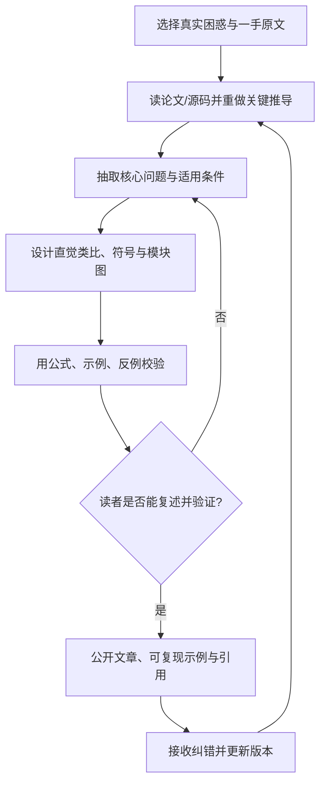

# 研究蒸馏与公开技术解释（Research Distillation & Public Research Portfolio）

## 一句话定义

**研究蒸馏（Research Distillation）**是把仍然难以理解的研究思想，经深入核对、抽象重组、可视化与实验交互，编译成后来者能理解、质疑和复用的知识；**公开技术作品集**是其可追溯的外部呈现，而非「写博客就能获得顶级职位或财富」的必然路径。

## 英文缩写速查

| 缩写 | 英文全称 | 简要说明 |
|---|---|---|
| RNN | Recurrent Neural Network | Olah 2015 图解介绍的序列网络 |
| LSTM | Long Short-Term Memory | 通过门控管理细胞状态的循环网络 |
| ML | Machine Learning | 技术解释及 Distill 所服务的领域 |
| CAD | Computer-Aided Design | Olah 早期 3D 打印软件经历涉及的工具 |
| IPO | Initial Public Offering | 股权估值事件，不能代替科研贡献评价 |

## 为什么重要

- 论文公开不等于 **核心思路容易被理解**。Olah 与 Carter 的 [Research Debt](../../sources/blogs/olah-carter-research-debt-distill-2017.md) 将难懂的表述、未消化的思想、糟糕抽象/符号、信息噪声列为科研社区的累积债务。
- 作为机器人知识库，解释「训练目标为什么这样设计」「控制/策略模块如何连接」「真实部署哪里失效」可减少下游重复理解和复现成本；但这种收益是研究传播的 **机制性分析**，不是 Olah 职业经历的对照实验。
- 可复现代码、单张流程图、正反例与适用边界，比二手转载的数字或空泛职业传奇更有检验价值。

## 一手案例：Chris Olah 的研究与传播路径

| 节点 | 一手证据 | 可以确认什么 |
|---|---|---|
| 非传统求学路径 | [本人 2020 博客](../../sources/blogs/chris-olah-university-2020.md)、[2021 访谈选段](../../sources/talks/chris-olah-80000hours-interview-2021.md) | 最初离校是参与熟人刑事案件支持，随后研究 3D 打印、开源 CAD 并获得 Thiel Fellowship；不是「为开 AI 公司直接辍学」 |
| 进入机器学习 | 2021 本人访谈 | Michael Nielsen 神经网络研讨班及自学发挥重要作用；Dario Amodei 是早期朋友，**不宜写成已证实的单独推荐人** |
| 2015 LSTM 图解 | [作者原文](../../sources/blogs/chris-olah-understanding-lstm-networks-2015.md) | RNN 递推 → 长时依赖难点 → 细胞状态直觉 → 遗忘/输入/输出门 → 变体；是优秀解释案例，不能证明「全球第一入门读物」 |
| DeepDream/Google Brain | [Google Research 2015 署名](https://research.google/blog/inceptionism-going-deeper-into-neural-networks/) | 作者身份写为 Software Engineering Intern，参与早期可视化；研究灵感先由 Alex Mordvintsev 探索，不能归功于 Olah 一人 |
| Distill | [Distill 官方 About](../../sources/sites/distill-clarity-journal.md) | Olah 与 Shan Carter 是 editors；该在线科研期刊 **2016–2021** 运营，目前为 indefinite hiatus |
| Research Debt | [Olah & Carter 2017 原文](../../sources/blogs/olah-carter-research-debt-distill-2017.md) | 解释与抽象本身需要研究级理解，好的介绍不仅降低读者成本，还改进思考方式 |
| OpenAI → Anthropic | [2021 本人访谈](../../sources/talks/chris-olah-80000hours-interview-2021.md)、[Anthropic 官方](https://www.anthropic.com/company/leadership) | Google 后加入 OpenAI 从事可解释性研究，后参与创立 Anthropic 并领导 interpretability 研究；各任职年份应按相应当时资料核对 |

### 关于「233 亿美元」的严格口径

[Anthropic 官方公告](https://www.anthropic.com/news/ipo-close)证实 **2026-11-19 开始上市交易、11-20 完成 IPO**；[Forbes 于 2026-11-19 收盘后更新的估算](https://tollbit.forbes.com/sites/mattdurot/2026/11/18/meet-the-biggest-billionaire-winners-of-anthropics-ipo/) 把七位联创的合计净资产估为约 **1630 亿美元**，平均约 **233 亿美元/人**。这些是特定交易日的估算及约数，**不是 Olah 的已兑现财富，也不是 2026-11-23 的实时身价，更不是博客直接导致估值的证据**。勿用这个数字作为本知识页的核心指标。

## 核心原理：从读懂到让别人真正读懂

下面是根据 2015 LSTM 图解、2017 Research Debt 和本库的编译流程归纳的 **知识传播工作流**，并非 Olah 当年运行过的代码管线。

### 2015 LSTM 解说的具体做法

1. **先问问题：** 为什么序列模型需要保留历史，朴素 RNN 为什么难学长距离依赖？
2. **先给直觉：** 将时间展开为同一网络复用的链，细胞状态比喻为信息传送带。
3. **逐步进入机制：** 遗忘门、输入门、候选新信息、状态更新、输出门，把一张复杂总图拆成局部决定。
4. **界定边界：** 标注 peephole / 耦合门 / GRU 变体与论文原始出处，不把某个 2015 年结论泛化为当代所有架构定论。

## 工程实践：适用于 Robotics_Notebooks 的实际操作清单（本站归纳）

1. **选小而难的主题：** 以一个具体控制/学习问题为单位（如 WBC 的接触约束、AMP 判别器奖励、VLA action chunk、Sim2Real 时延），不靠大而全的标题。
2. **证据链先行：** 读原始论文与代码，明示实验条件、图中模块对应代码入口以及哪些推断并未验证。
3. **层层解释：** 一句定义 → 为什么需要 → 控制/数据流 Mermaid → 关键公式与变量 → 最小实例 → 反例、局限与部署代价。
4. **把作品留在公共仓库：** 版本化文字、复现说明与交叉链接，让人能检查技术深度，而不只看到观点。
5. **以研究交流为目标写邮件：** 本人博客建议先认真读对方数篇论文，找到真实问题与共同兴趣，只发少量短而具体的邮件，不群发不索取无边界帮助。
6. **延续长期课题：** 可以围绕[机制可解释性](./mechanistic-interpretability.md)或机器人策略失败诊断积累实验；单纯制作漂亮可视化不能替代因果干预与部署评测。

## 误区、边界与个人经历的局限

- **不要把学历选择写成致富模板：** 作者在[大学选择原文](../../sources/blogs/chris-olah-university-2020.md)中明确提醒：多数询问者适合继续读大学；没有自驱、生活支持和导师网络时独立学习风险更大。
- **不要抹掉社交代价：** 作者强调友谊、恋爱及与同龄人共同成长的机会成本，不应被简化为一句「错过恋爱」。
- **不要以结果倒推因果：** 加入 Google、OpenAI 或 Anthropic 还涉及合作、导师、研究机会与领域时代背景，公开写作不是充分条件。
- **不要把 Distill 当成现在仍活跃收稿的期刊：** 官方自述自 2021 年后无限期休刊。
- **源码运行时序图：** 不适用；此页研究的是公开解释与知识编译方法，不是发布了训练/推理代码的独立技术项目。上面的 Mermaid 是基于原文归纳的**知识工作流**。
- **原文核对边界：** 2015、2017、2020 本人全文及 Distill About 已核读；80,000 Hours 2021 长访谈只按所述关键段落核对，未通读，故不计入本页 `original` 全文。

## 关联页面

- [RNN / LSTM / GRU](./recurrent-neural-network.md) — 优质解释的技术案例本体
- [机制可解释性](./mechanistic-interpretability.md) — Olah 长期研究方向与可验证边界
- [LLM Wiki / Karpathy 编译模式](./llm-wiki-karpathy.md) — 本库的 ingest/query/lint 长期记录框架
- [AI Auto-Research](./ai-auto-research.md) — 区分材料生成、可执行验证与研究价值

## 参考来源

- [Chris Olah: Do I Need to Go to University?（2020，全文核对）](../../sources/blogs/chris-olah-university-2020.md)
- [Chris Olah: Understanding LSTM Networks（2015，全文核对）](../../sources/blogs/chris-olah-understanding-lstm-networks-2015.md)
- [Olah & Carter: Research Debt（2017，全文核对）](../../sources/blogs/olah-carter-research-debt-distill-2017.md)
- [Distill About（官网状态核对）](../../sources/sites/distill-clarity-journal.md)
- [80,000 Hours #108（本人访谈关键段落核对，非全文）](../../sources/talks/chris-olah-80000hours-interview-2021.md)
- [Google Research 2015 DeepDream 署名](https://research.google/blog/inceptionism-going-deeper-into-neural-networks/)
- [Anthropic 领导团队官方资料](https://www.anthropic.com/company/leadership)
- [Anthropic 2026-11-20 上市完成公告](https://www.anthropic.com/news/ipo-close)
- [Forbes 2026-11-19 收盘股权估算（二手财经报道）](https://tollbit.forbes.com/sites/mattdurot/2026/11/18/meet-the-biggest-billionaire-winners-of-anthropics-ipo/)

## 推荐继续阅读

- [Research Debt（Distill 原文）](https://distill.pub/2017/research-debt/)
- [Understanding LSTM Networks（作者原文）](https://colah.github.io/posts/2015-08-Understanding-LSTMs/)
- [Do I Need to Go to University?（作者原文）](https://colah.github.io/posts/2020-05-University/)
