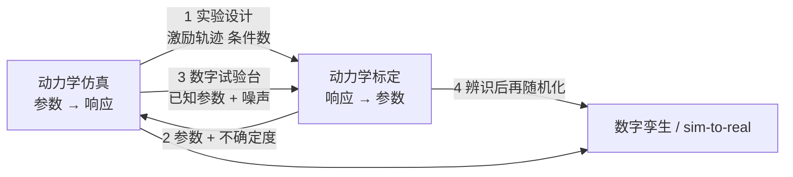

# 动力学仿真与动力学标定：区别与四个接口

## 一句话定义

**动力学仿真**在参数已知时推算机器人的响应（力矩、轨迹、接触力、功率）；**动力学标定**在运动与受力数据已知时反推机器人的参数（质量、质心、惯量、摩擦、传动与负载参数）。一个是正向题，一个是反问题（Zane Hub #388，2026-11-10，第三方工程解读）。

## 英文缩写速查

| 缩写 | 英文全称 | 简要说明 |
|------|----------|----------|
| CAD | Computer-Aided Design | 三维模型，其质量属性按均质密度积分 |
| ISO 9283 | — | 工业机器人性能准则与试验方法；国内对应 GB/T 12642-2013 |
| κ(Y) | condition number | 回归矩阵最大与最小奇异值之比，激励轨迹设计的目标量 |

## 为什么重要

- 项目里常把「仿真」和「标定」混着说：仿真差 20% 就怪软件，标定过了力控还是发飘，多半是把两件事的边界搞混了（作者观点）。
- 机器人学习里的 [sim2real](./sim2real.md) 差距，一部分就是这两件事没做好的症状：参数没辨识、结构没建模。
- 与本库已有的 [系统辨识](./system-identification.md)、[关节执行器参数辨识](../methods/joint-actuator-parameter-identification.md)、[重力补偿](./gravity-compensation.md)、[关节摩擦模型](./joint-friction-models.md) 互补：那些讲方法，本页讲两者的边界与接口。

## 核心原理

**两件事的差别（文章对比表要点）：** 方向（正向 / 反向）、输入（模型结构与激励 / 关节位置速度力矩与负载工况）、输出（力矩与轨迹 / 参数集与不确定度）、误差性质（参数性与结构性并存 / 参数偏差与噪声为主）、验收（对比实测与趋势合理性 / 独立验证轨迹上的力矩残差）。

**仿真为什么「看起来对、用起来不对」：**

- CAD 惯量不是真实惯量：线束、螺钉、涂胶、减速器内部件缺失。重力力矩与质心位置线性相关，本库自算：20 kg 连杆、质心偏 5 mm，最大重力力矩误差约 0.98 N·m。惯量误差集中在加减速段，匀速时几乎看不出。
- 关节不是理想铰链：Stribeck、滞回、换向死区；减速器有传动误差、背隙、扭转刚度、变效率；仿真常把传动链压成「减速比 + 效率」。
- 驱动与传感链：力矩常数温漂、电流环带宽与饱和、电机端编码器加减速器柔度。
- 求解器与假设：刚体 vs 柔性、接触刚度取值、步长与实机控制周期不一致。

**误差分类（文章表）：**

| 误差源 | 能否靠标定消除 | 处理 |
|--------|----------------|------|
| 质量 / 质心 / 惯量偏差 | 可以 | 称重、悬吊、参数辨识 |
| 关节摩擦 | 可以 | 摩擦模型辨识 |
| 减速器背隙与刚度 | 部分可以 | 背隙测量、刚度辨识 |
| 结构柔性 | 不能 | 柔性体建模、实验模态 |
| 接触模型 | 不能 | 接触参数试验、显式建模 |
| 传感与采样 | 不能 | 滤波、同步、提高分辨率 |

结构性误差当成参数问题去调，结果是参数越调越离谱（文章判断）。

**标定链条：** 建模（线性化 τ = Y(q,q̇,q̈)β，基参数不可直接当物理参数，需物理一致性约束）→ 激励轨迹（有限项傅里叶级数，最小化条件数）→ 采集（差分放大噪声，位置 / 速度 / 加速度滤波相位须一致，多路同步）→ 估计（加权最小二乘到鲁棒、带约束）→ 验证（独立轨迹、跨速度 / 负载 / 冷热机）。残差形状比数值更有信息（换向偏差 → 摩擦或背隙；低速偏大 → Stribeck 项；姿态相关恒定偏置 → 重力或质心）。

## 工程实践

- **选型（文章表）：** 方案评估与节拍用仿真；力控装配、打磨、拖动示教必须动力学标定；碰撞检测与安全验证用标定加仿真；同型号批量部署用参数模板加单机微调；小批量多品种用精简参数集加短轨迹。
- **末端负载最划算：** 工具质量、质心、传感器零点、安装倾角决定力控能否用；静置多姿态，最小二乘。
- **别把补偿当标定：** 补偿在控制器里加修正项让症状消失，标定让参数逼近真实；只做补偿的系统会积累互相打架的修正项（作者观点）。
- **验证与交付：** 交付「带版本号的参数表 + 不确定度 + 验证工况与残差口径」，并定期仿真与实测比对；技术协议里要把验证轨迹、负载、判据写清。
- **重复定位精度 ≠ 动力学精度：** 前者是几何 / 重复性指标，与摩擦、惯量没有直接关系。

## 局限

- **来源是单篇第三方文章，没有出处与实验：** 公式、周期、成本结构、工程数字都是作者经验，没有引用文献。
- **标准条款只核到一部分：** GB/T 12642-2013 与 ISO 9283:1998 的对应与内容范围检索核到，「等同采用」「五个位姿、循环三十次」未回标准原文核对；「动力学标定没有对应国际标准」未核。
- **文章笔误疑点：**「编码器分辨率十几个脉冲每转」按字面不合理，推测应为「十几位」，未向作者核实；本库自算 17 位编码器、1 ms 采样下二次差分的量化噪声量级约 48 rad/s²（20 位约 6 rad/s²）。
- **「先辨识再随机化」是作者判断，没有实验支撑：** 本库已有页面对此的取舍见 [域随机化](./domain-randomization.md) 与 [联合辨识实验设计](../methods/sim2real-joint-sysid-experiment-design.md)，本页不裁决。
- 与本库既有辨识页的差别：本页只讲边界与接口，没有给辨识算法细节与代码。
- 评论未读；文中 Adams、RecurDyn 的图是软件截图，不构成对精度的证据。

## 关联页面

- [系统辨识](./system-identification.md) · [关节执行器参数辨识](../methods/joint-actuator-parameter-identification.md) · [联合辨识实验设计](../methods/sim2real-joint-sysid-experiment-design.md)
- [重力补偿](./gravity-compensation.md) · [关节摩擦模型](./joint-friction-models.md) · [摩擦补偿](./friction-compensation.md) · [逆动力学模型](./inverse-dynamics-model.md)
- [人形闭环惯量标定](./humanoid-closed-loop-inertia-calibration.md) · [物理保真与 sim2real 差距](./physics-fidelity-sim2real-gap.md) · [Sim2Real](./sim2real.md) · [域随机化](./domain-randomization.md)
- [Adams](../entities/adams.md) · [MuJoCo](../entities/mujoco.md) · [Isaac Sim](../entities/isaac-sim.md)

## 参考来源

- [Zane Hub #388 来源归档（含本库核对）](../../sources/blogs/wechat_zanehub_dynamics_simulation_vs_calibration_2026-11-10.md)

## 继续阅读

- ISO 9283:1998 / GB/T 12642-2013 原文（本库未读）；机器人动力学参数辨识的经典文献（如基参数与激励轨迹设计，本库未读原文）。
