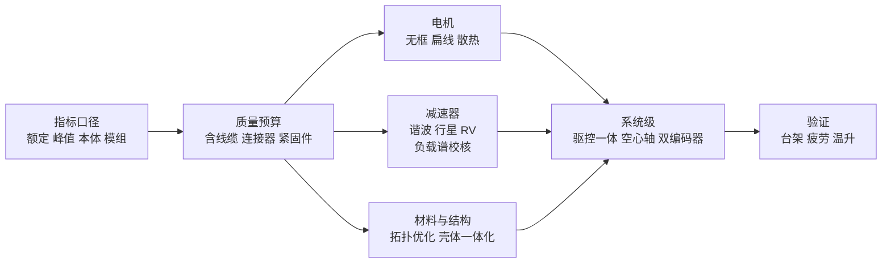

# 机器人关节模组轻量化设计

## 一句话定义

关节模组轻量化是**在满足刚度、精度与热边界的前提下，把每一克质量花在受力路径上**；它不是孤立的减重目标，刚度、传动精度、连续输出能力、寿命和成本任何一项退让都会否决方案（Zane Hub #389，2026-11-11，第三方工程解读）。

## 英文缩写速查

| 缩写 | 英文全称 | 简要说明 |
|------|----------|----------|
| K_T / K_Tp | torque density (rated / peak) | 额定 / 峰值转矩质量密度，N·m/kg |
| λ | inertia ratio | 负载惯量与电机惯量之比，伺服常要求 ≤ 3（文章说法） |
| f_n | natural frequency | 关节谐振频率，f_n = (1/2π)√(k / J_eff) |
| PEEK | Polyether Ether Ketone | 聚醚醚酮，文章提到的柔轮候选材料（仍在验证） |
| CSF / CSG | — | 哈默纳科谐波减速器系列，CSG 为较高转矩的后继系列 |
| L10 | rated life | 额定寿命（统计意义上 90% 单元存活的运行时间） |

## 为什么重要

- 人形整机减重压力最终传导到关节：文章称全身关节约占整机质量的一半、Optimus 关节部分成本占比约 55%（均为文章说法，本库未核）。
- 本库已有 [关节方案选型](./robot-joint-scheme-selection.md)、[减速器难点](./joint-module-reducer-difficulty.md)、[拓扑优化工具链](./humanoid-topology-optimization-toolchain.md) 等页，本页把它们放进「指标 → 预算 → 逐层挖潜 → 验证」的一条链上。

## 核心原理

**指标与口径：** 转矩质量密度 K_T = T_rated / m（N·m/kg）、峰值 K_Tp、功率密度 P_s = T·ω / m。额定转矩受温升限制，峰值只能维持数秒；比较前先问三件事：额定还是峰值、电机本体还是模组级、供电与冷却条件。文章称含减速器的模组稳定超过 30 N·m/kg 即第一梯队。减重改变转子惯量与结构质量分布：J_eff 下降让 f_n 上移，但前提是刚度 k 不同步劣化。

**质量预算与串联倍增：** 拆解称重列预算；线缆、连接器、紧固件常被漏算。近端关节每增加 1 克，进入所有下游关节的负载，所以先做末端与高力臂环节。

**电机：** 无框力矩电机省掉电机壳、端盖、独立轴承，代价是公差链变长（壳体从结构件升级为功能件）；扁线绕组槽满率 0.60~0.80（圆线 0.35~0.45）；散热决定连续转矩：ΔT ≈ P_loss / (h·A)，壳体减重必须把允许温升写进边界条件。

**减速器：**

| 特性 | 谐波 | 行星 | RV |
|------|------|------|----|
| 单级减速比 | 30~320 | 低，高比需多级 | 31~171 |
| 背隙 | 极低 | 低 | 低且稳定 |
| 扭转刚度 | 相对较低 | 较高 | 高 |
| 抗冲击 | 弱（柔轮疲劳） | 较强 | 强 |
| 质量体积 | 轻薄可中空 | 紧凑 | 偏大 |

肩、髋、膝等承受冲击的关节偏行星或准直驱，腕、踝偏谐波；轻量化常犯的错是按峰值转矩「贴线选型」，应用负载谱做连续转矩与寿命双校核。减速比、电机气隙直径、绕组参数应放进同一个优化问题，以模组级转矩质量密度为目标。

**材料与结构：** 拓扑优化五步（设计域与非设计区 → 多工况载荷谱 → 求解 → 光顺与可制造性修正 → 强度 / 刚度 / 疲劳 / 热复核）；量产件合理预期 15%~30%；壳体一体化减少零件，但公差链压到一个零件上。

**系统级与验证：** 驱控一体缩短线束；空心轴走线；电机端加输出端双编码器，用控制端补偿换更紧凑的传动链（「感知换质量」）。台架矩阵：额定 / 峰值转矩与保持时间、连续温升、回差与传动误差、扭转刚度回线、按负载谱的加速寿命。疲劳是生死线：柔轮、拓扑壳体的应力集中、波发生器轴承、线缆。

## 工程实践

- **散热数字（一手核对）：** Sandia 论文（ASME DSCC 2016，OSTI 1369514）：开放式框架壳体比标称设计传热提高 50%，强迫风冷 +79%、泵送水冷 +107%（均为传热系数）；强迫风冷使基础电机连续转矩密度提高 15%；液冷使连续转矩比标称设计高 44%；风扇共 180 g、液冷部件共 0.774 kg。引用时区分「传热系数」与「连续转矩密度」，并看冷却硬件质量是否计入。
- **材料比刚度（本库自算，GPa·cm³/g）：** 6061 约 25.9、7075 约 25.6、AZ91D 约 25.0、TC4 约 25.6，碳纤维单向约 88–147——换金属不改变比刚度，减重要靠几何或换成复材。
- **标准：** GB/T 30819-2024 替代 2014 版，2025-04-01 实施（检索核到）；GB/T 37165-2018、GB/T 35089-2018、GB/T 37718-2019 有效；2025 年 4 月后设计输入与采购协议应引用新版。
- **控制参数：** 减重后惯量与刚度变了，增益、陷波频点、前馈需重新整定，性能红利才能兑现。
- **五个误区：** 只对标峰值密度、口径混比、拓扑优化当银弹、漏算线缆紧固件、减重后不重整控制参数。

## 局限

- **来源是单篇第三方文章：** 公式、选型经验、设计流程大多是通行做法，文章没有引用文献或给出实验数据。
- **未核实的数字：** MIT 准直驱电机 27 对商用约 9 N·m/kg（检索没取到出处）、港科大（广州）35.7 N·m/kg、各厂商案例（铝钢复合谐波 0.81 → 0.54 kg、镁合金 ER4-550-MI、KUKA KR16 大臂 −40%）、Optimus 成本占比、电机功率密度 3.5 → 4.5 kW/kg。
- **文章内部不一致：** 槽满率由 0.35~0.45 升到 0.60~0.80，按此铜填充应提升约 33%–129%，与「提升约 20%~30%」对不上，文章没解释基准。
- **措辞偏差：** 文章把 CSG 的 10,000 小时说成「波发生器轴承寿命」，官方产品页说的是整机 L10（7,000 → 10,000 h，转矩 +30%）。
- 本页不含具体选型计算与代码，也没有核对五项国标的条款正文。
- 评论未读；3 张图（扁线定子渲染、两级行星减速器示意、拓扑优化前后对比）只是示意，不构成对数字的证据。

## 关联页面

- [关节方案选型](./robot-joint-scheme-selection.md) · [减速器难点](./joint-module-reducer-difficulty.md) · [拓扑优化工具链](./humanoid-topology-optimization-toolchain.md) · [膝关节谐波极限](./humanoid-knee-harmonic-drive-limits.md)
- [关节轴承选型](./robot-joint-bearing-selection.md) · [人形机械布局](./humanoid-mechanical-layout-design.md) · [关节自研流程](./joint-module-self-development-workflow.md) · [行星滚柱丝杠](./planetary-roller-screw-humanoid-leg-actuation.md)
- [Katz 低成本模块化执行器](../entities/paper-low-cost-modular-actuator-katz.md) · [Tesla Optimus](../entities/tesla-optimus.md)
- [执行器驱动链选型闭环](../queries/actuator-drive-chain-selection-loop.md) — 轻量化取舍放回电机—减速器—驱动器整链选型

## 参考来源

- [Zane Hub #389 来源归档（含本库核对）](../../sources/blogs/wechat_zanehub_joint_module_lightweight_design_2026-11-11.md)
- Mazumdar 等，*Improving Robotic Actuator Torque Density and Efficiency Through Enhanced Heat Transfer*，ASME DSCC 2016（OSTI 1369514）：https://www.osti.gov/biblio/1369514

## 继续阅读

- 五项国标正文（本库未读）；Sandia 论文的冷却系统质量与连续转矩密度口径；MIT 准直驱执行器相关论文中的转矩密度数据（本库未核）。
