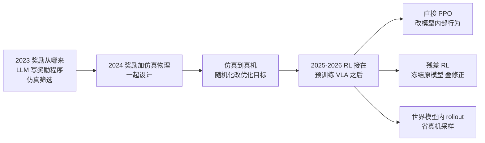

# 机器人强化学习三年观察（2023–2026）

## 一句话定义

深蓝学院「具身君」2026-11-08 的观察文章给出的论点是：这三年**变的不是优化器，而是强化学习被用在什么东西上**——从「教机器人做一个动作」变成「把一批已经会做的动作磨到可靠」；PPO 没被 GRPO、DAPO 取代，是因为问题的约束没变（作者表述）。本页整理该论点，并附上本库逐篇通读被引论文后的核对。

## 英文缩写速查

| 缩写 | 英文全称 | 简要说明 |
|------|----------|----------|
| RL | Reinforcement Learning | 强化学习 |
| PPO | Proximal Policy Optimization | 带裁剪的 on-policy 策略梯度，限制每次更新幅度 |
| GRPO | Group Relative Policy Optimization | 用同组多条回答的相对优劣估计优势，无价值网络 |
| DAPO | — | GRPO 系的改进方法（文章提及，本库未读原文） |
| DPO | Direct Preference Optimization | 直接偏好优化，离线偏好对 |
| VLA | Vision-Language-Action | 视觉语言动作模型 |
| LLM | Large Language Model | 大语言模型 |
| SFT | Supervised Fine-Tuning | 监督微调 |
| TD3 | Twin Delayed DDPG | 一种 off-policy 连续控制算法（残差 RL 论文用它） |

## 为什么重要

- 回答一个常见疑问：LLM 那边 PPO 已被视为「上一代」，机器人这边为什么还在用 PPO。
- 把三年里分散的工作放进一条线：奖励从哪来、仿真到真机怎么不崩、预训练模型之后 RL 怎么接。
- 提醒读综述类文章要回到论文：本库逐篇核对后发现文章对论文的描述有几处与原文不符（见「局限」），不能直接当引用依据。

## 核心原理

**PPO 为何还在（作者论证）：** GRPO 类方法的三个成立条件是采样便宜、奖励干净、同组样本互不影响；机器人真机一次尝试是分钟级、奖励常是稠密整形奖励、动作会改变后续物理状态，所以机器人 RL 的三个硬约束是采样贵、奖励脏、分布会漂，对应 PPO 的 on-policy 加信任域。对已有能力的预训练模型做 RL 时，第一步更新必须保守，也是 PPO 留下的原因。

**三条接在 VLA 后面的路线（文章图 7）：**

| 路线 | 做法 | 优势 | 代价 | 本库核对的论文 |
|------|------|------|------|----------------|
| 直接 RL（PPO） | 在预训练 VLA 上直接梯度更新 | 表达能力强，能改模型内部行为 | 采样贵，步子大了破坏预训练先验 | [VLA 泛化实证](../entities/paper-rl-vla-generalization-empirical-study.md)、[SimpleVLA-RL](../entities/paper-simplevla-rl.md) |
| 残差 RL | 冻结原 VLA，叠加小型修正策略 | 改动小、不破坏原能力 | 上限被原模型限制 | [物体中心残差 RL](../entities/paper-object-centric-residual-rl-vla.md) |
| 世界模型 rollout | 学环境动态，策略在预测轨迹上练习 | 省真机采样 | 长程误差累积 | [VLA-MBPO](../entities/paper-rcl-2603-20607-towards-practical-world-model-based-reinforcemen.md) |

**奖励与仿真：** [Eureka](../entities/paper-eureka-llm-reward-design.md)（LLM 写奖励，全仿真）→ [DrEureka](../entities/paper-dreureka-sim-to-real.md)（奖励 + 物理参数范围，串行三阶段，Go1 真机）。

## 工程实践

- 奖励设计：LLM 能把「从空白公式开始」变成「候选奖励 + 仿真检验」，但自动的只是搜索，策略究竟学会了什么仍要人看；Eureka 自动循环反馈的是奖励分量与成功率的训练统计，不是机器人动作。
- 仿真到真机：[域随机化](./domain-randomization.md) 把目标从「某环境最优」改成「一族环境都不崩」；DrEureka 的消融里去掉安全指令或物理先验后真机策略不可用（见该节点）。
- VLA 后训练：先有可用的 SFT 起点——SimpleVLA-RL 报告基础模型 0 条轨迹 SFT 时 RL 无效、起点太弱时增益很小；残差 RL 的增益与基座强弱相关（弱基座约翻倍，强基座 π0.5 在 Pick-and-Place 上真机持平）。
- 与本库已有的人形低层训练对照：[GR00T 全身控制](../entities/gr00t-wholebodycontrol.md) 记载 SONIC 用 PPO 加辅助损失在 Isaac Lab 中训练（支持「运动策略仍用 PPO」，本库没核到 NVIDIA 原始发布页）。

## 局限

- 文章没有给出任何论文名和出处，是本库用配图 + 检索识别后逐篇核对的；识别结果见[来源归档表](../../sources/blogs/wechat_shenlan_robot_rl_three_years_2026-11-08.md)。
- **文章与论文对不上的地方（逐篇通读后）：**
  - SimpleVLA-RL 是 **2025 年**论文，文章配文写「2026 年的 VLA 强化学习流程」；它用的是 **GRPO**，没有 PPO 对照，所以不能拿它支持「PPO 更好」，反而是「GRPO 在仿真 + 结果奖励下也能把 VLA 大幅提升」的例子，与文章主论点有张力（本库判断）。
  - VLA 泛化实证里 PPO 对 GRPO / DPO 只比了训练任务上的学习曲线；执行条件变化下的结论是 PPO 对 SFT；只有一个任务、2 个种子，解释是假设、没有消融。
  - Eureka 的 LLM 与人工奖励对比在论文图 4 而非图 1；转笔只在仿真里；论文没有分析奖励被钻空子。
  - DrEureka 不是「奖励与环境一起搜」，而是串行；四种真机地面是与人工奖励的对比，论文没有湿滑地面和斜坡。
  - 残差 RL 论文的任务是「关抽屉」不是「开抽屉」；「训练快」没有数据；「补不出新动作」与其局限（只能修正轻度偏差）及附录定性例子不完全一致。
  - VLA-MBPO 论文没有写「接触预测不准」，失败案例是部分可观测、大位移、织物形变；「预测越长越偏」只有间接证据。
- 「GRPO 的三个成立条件」「机器人 RL 的三个硬约束」是作者的论证，没有引用；本库未用实验检验。
- 文章结论（「PPO 还在」）是对近年发表趋势的观察，不是统计；本库没有系统梳理各机器人 RL 工作用的算法分布。
- DAPO 与 GRPO 的原始论文本库这次没读。

## 关联页面

- 算法：[PPO](../methods/ppo.md) · [GRPO](../methods/grpo.md) · [残差策略学习](../methods/residual-policy-learning.md) · [基于模型的 RL](../methods/model-based-rl.md) · [VLA](../methods/vla.md)
- 奖励与仿真：[奖励设计](./reward-design.md) · [人形策略奖励函数](./humanoid-policy-reward-functions.md) · [域随机化](./domain-randomization.md) · [Sim2Real](./sim2real.md)
- 论文节点：[Eureka](../entities/paper-eureka-llm-reward-design.md) · [DrEureka](../entities/paper-dreureka-sim-to-real.md) · [VLA 泛化实证](../entities/paper-rl-vla-generalization-empirical-study.md) · [SimpleVLA-RL](../entities/paper-simplevla-rl.md) · [物体中心残差 RL](../entities/paper-object-centric-residual-rl-vla.md) · [VLA-MBPO](../entities/paper-rcl-2603-20607-towards-practical-world-model-based-reinforcemen.md)
- 人形训练：[GR00T 全身控制](../entities/gr00t-wholebodycontrol.md)
- 知识链枢纽：[具身大模型分类学选型闭环](../queries/embodied-fm-taxonomy-loop.md) — 本文的「RL 接到预训练 VLA 之后」对应其 ③ VLA 动作执行层的后训练，世界模型内 rollout 对应 ⑤ WM 推演层

## 参考来源

- [深蓝具身君文章归档（含被引论文识别与核对表）](../../sources/blogs/wechat_shenlan_robot_rl_three_years_2026-11-08.md)

## 继续阅读

- GRPO（DeepSeekMath）与 DAPO 原始论文；DreamerV3 原文（本库已有 [DreamerV3 节点](../entities/paper-shenlan-wm-13-dreamerv3.md)）。
- 图 7 之外的 VLA + RL 平台：[RLinf-VLA](../entities/paper-rlinf-vla.md)。
