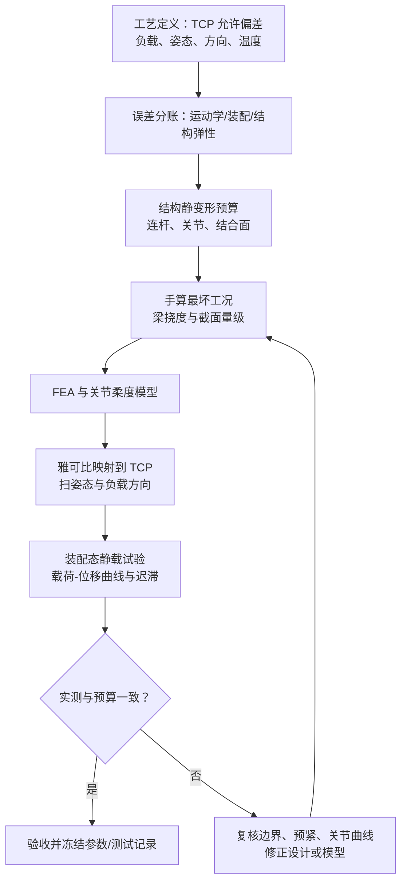

# 机器人结构静刚度与末端变形预算（Robot Structural Static Stiffness and Deflection Budget）

## 一句话定义

**结构刚度校核（structural stiffness check）**不只问零件会不会屈服，还要问**在规定姿态、负载与方向下，连杆、关节和结合面的弹性变形传到工具中心点（TCP）后，是否仍小于工艺允许偏差**；最终用手算、有限元和静载试验对账。

## 英文缩写速查

| 缩写 | 英文全称 | 简要说明 |
|------|----------|----------|
| TCP | Tool Center Point | 工具中心点，整机位置/姿态误差验收点 |
| FEA | Finite Element Analysis | 有限元分析，预测连杆/结合面受载变形 |
| FEM | Finite Element Method | 有限元法，FEA 的数值建模方法 |
| ISO | International Organization for Standardization | ISO 9283 规定工业机器人性能与相关测试方法 |
| RV | Rotor Vector | Nabtesco 对该系列精密摆线减速器名称的官方释义 |

## 为什么重要

- **强度合格不等于精度合格**：$\sigma < \sigma_{\mathrm{allow}}$ 与 $\|\Delta x_{\mathrm{TCP}}\| \le \delta_{\mathrm{allow}}$ 是两条独立验收线。
- **误差随姿态和载荷变化**：长悬臂的理想集中载荷挠度 $\delta\propto L^3$，最大伸展姿态易暴露静态下垂。
- **柔性发生在整条传力链**：只优化连杆而漏掉减速器扭转、轴承、法兰接触和基座，会得到偏乐观的整机估计。
- **与动态模态校核不同**：静刚度决定负载诱发的偏移；模态频率/阻尼决定轨迹抖振和可用伺服带宽，参见[结构模态分析](./robot-structural-modal-analysis.md)。

## 核心原理

### 1. 从工艺反推变形预算

把工艺给定的 TCP 定位/轨迹/法向允许误差分清，划出留给结构弹性变形的预算，**不要把运动学标定误差、重复定位误差、公差误差和静变形重复算**。预算需要注明载荷方向、机姿、工具偏置、温度、加速度与可否在线补偿。

| 层级 | 主要柔性源 | 估算量 | 验证方式 |
|------|------------|--------|----------|
| 连杆 | 弯曲、扭转、剪切 | 末端位移/转角 | 梁公式 + FEA |
| 关节 | 减速器、轴承、轴系、预紧 | $\Delta\theta = T/k_\theta$（局部线性） | 数据表曲线 + 单关节加载 |
| 结合面 | 螺栓法兰、定位配合、接触微滑移 | 接触刚度与滞回 | 接触 FEA + 装配态加载 |
| 整机 | 上述误差在 TCP 方向叠加 | $\Delta x_{\mathrm{TCP}}$ | 姿态相关整机测试 |

设计预算示例：若某工位**自行约定**结构静偏差额度 0.50 mm，可先做保守的同向上限拆分：连杆 0.20、关节 0.20、结合面 0.10 mm。**这只是分配示意，非行业标准值**；真实设计应按负载工况、雅可比方向敏感度与实测重新分配。对不同方向和独立随机误差也不能盲目做标量代数加法。

### 2. 手算刚度、强度和截面效应

理想固支、等截面、线弹性小挠度悬臂梁，末端横向集中载荷 $P$ 下：

$$
\delta=\frac{PL^3}{3EI}, \qquad
\theta=\frac{PL^2}{2EI}, \qquad
\sigma_{\max}=\frac{PLc}{I}.
$$

矩形空心截面绕指定轴弯曲时：

$$
I=\frac{b h^3 - b_i h_i^3}{12}.
$$

其中 $E$ 为轴向弹性模量，$I$ 为相应弯曲轴的截面二次矩，$c$ 是到最外纤维距离；**空心截面不能直接套实心矩形的 $bh^3/12$**。对复合材料要按铺层/方向使用等效弯曲刚度，不直接拿一条各向同性 $E$ 替代。

**复核 Zane Hub #398 的文章算例（重要勘误）**：铝合金取 $E=70{,}000\,\mathrm{N/mm^2}$，空心截面外廓 $80\times60$、内孔 $60\times40\,\mathrm{mm}$，取高度方向 $h=60\,\mathrm{mm}$，$P=50\,\mathrm N$：

| 项目 | 本库代入重算 | 原文值 |
|------|--------------|--------|
| 截面惯性矩 $I$ | **1,120,000 mm⁴** | 1.17×10⁶ mm⁴ |
| $L=800$ mm 挠度 | **0.10884 mm** | 约 1.0 mm |
| $L=1200$ mm 挠度 | **0.36735 mm** | 约 5.3 mm |
| 长度 800→1200 mm 的挠度倍率 | **3.375 倍** | 与原文给出的两个挠度数值不一致 |

推导只包含端部 50 N 静力。实际箱形臂件的**自重可能不可忽略**，还要额外计入固定端柔性、关节、工具负载偏心、动态加速度、剪切/扭转等，不可直接把表中的梁挠度当成整机 TCP 预测值。强度安全系数不提供刚度合格的保证。

### 3. 关节柔度到 TCP 的映射

局部小变形、忽略附加载荷引起的几何刚度时，关节扭转柔度可写成：

$$
C_\theta = K_\theta^{-1},\qquad
C_x \approx J(q) C_\theta J(q)^\top,\qquad
\Delta x \approx C_x F.
$$

- $J(q)$ 是姿态 $q$ 下的几何雅可比，$F$ 为所定义坐标系中的末端力/力矩旋量；坐标与单位需一致。
- 仅在**方阵且可逆的 $J$**、忽略连杆/结合面柔性与载荷几何项的简化情况下，才可写 $K_x=J^{-T}K_\theta J^{-1}$。
- 对冗余机械臂、奇异附近或只关心某方向时，**直接使用 $C_x$、载荷方向与位移结果更稳妥**；不能把逆矩阵公式直接套在任意 $6\times n$ 雅可比上。
- 真实减速器的刚度随扭矩、加载方向、预紧、温度变化，建模时须区分小增量**切线刚度**和从零到工作点的**割线刚度**；背隙/失动不是弹性刚度。

### 4. 连杆/关节/结合面耦合

- 对连杆以多姿态 FEA 检查位移场、端部六维柔度及变形后的工具姿态；固定约束应对应真实底座/装夹。
- 关节弹性单元应用具体型号的输出端刚度曲线，包含轴承与减速器/联接件的实际串并联路径。
- 对结合面优先以接触、螺栓预紧、微滑移/滞回建模；若简化为刚性绑定，应以实际装配态加载数据验证误差，而不是使用未证实的“统一 30% 修正系数”。

## 流程总览

## 工程实践

**推荐四步验收：**

1. **工艺定限**：明确 TCP 偏差定义（绝对位置、负载位移、轨迹或法向）、工具长度、姿态范围；形成零件/关节/结合面分项预算。
2. **手算筛选**：全伸展等不利姿态计算梁挠度，并分别考虑重力、端部工具偏心及工作加速度；与 FEA 端部节点量级交叉核对。
3. **全链预测**：FEA 的结构柔度、关节输出刚度及结合面预紧/接触模型统一折算至 TCP，按实际施力方向扫工作空间；同时输出最柔方向和不确定性。
4. **实测验证**：在规定姿态和温度，按同一位置及方向分级加载/卸载，用位移计或激光跟踪仪测 $\Delta x$，分别读取载荷–位移曲线的斜率、回程滞后、残余位移。与仿真在**相同边界条件**下对账；必要时更新模型、重新复测。

**试验口径：** 静刚度是规定方向与工作点附近 $k=\Delta F/\Delta x$；用分级加载的局部斜率，非线性区域必须注明载荷区间。若记录迟滞环，它可能包含摩擦、间隙、预紧滑移或其他非线性，**不能只凭一条曲线唯一确定背隙**。

**ISO 9283：** [ISO 9283:1998 公开简介](https://webstore.ansi.org/standards/iso/iso92831998)明确同时包含**位置/姿态准确度与重复性**以及**静柔顺度（static compliance）**等不同试验特性。定位试验有助评价整机工作精度，但**不能用重复定位精度 RP 代替静刚度试验**。具体位置数量、循环次数、速度、载荷和 GB/T 版本对应条款应查标准正式文本后写入验收计划。

**交付模板：** 工况与工具坐标系、允许 TCP 偏差、各部件静变形预算、FEA / 手算 / 实测三组结果、载荷–位移曲线、滞回曲线、最不利方向、补偿前后偏差、复测周期和设计结论。

## 局限与风险

- **来源边界**：本页基于用户提供的 Zane Hub #398 全文，原微信页面未成功打开；商业推广不纳入工程结论。本文是工程方法总结，不是特定型号的制造商规格。
- **明显算术错误**：原文 $I$ 与 800 / 1200 mm 两个挠度数值均不符合其给定尺寸和公式；已用相同假设重算并在上表保留对照。
- **经验值未经逐一证明**：搬运/焊接/装配不同“许用 mm 数值”、减速器刚度范围、结合面刚绑高估“30% 以上”、补偿可“减半以上”等应视为作者经验而非通用合格标准。
- **ISO 9283 适用范围**：目前仅核对 ISO 9283:1998 公共标准简介，未阅读受限完整条文，不能引用未经核对的特定测试步骤作为规范强制要求。
- **模型边界**：梁公式要求小挠度与相应弯曲轴；关节雅可比映射通常是局部线性/指定负载条件。重载/奇异/间隙/接触非线性时需引入几何刚度、接触与试验辨识。
- **软件补偿不能替代承载设计**：可重复的重力下垂可能被补偿，磨损漂移、动态共振和随机摩擦迟滞要另作结构/控制协同设计。

## 关联页面

- [人形整机机械布局设计](./humanoid-mechanical-layout-design.md)：L4 阶段的强度、刚度与公差三条独立判据。
- [机器人结构模态分析](./robot-structural-modal-analysis.md)：静刚度后续必须做的动态振动与控制带宽验证。
- [结构公差仿真工具链](./structure-tolerance-simulation-toolchain.md)：把制造/装配偏差与静弹性变形分别预算。
- [机器人关节模组轻量化设计](./robot-joint-module-lightweight-design.md)：减重时同步核对截面二次矩、模态与扭转刚度。
- [机器人关节轴承选型](./robot-joint-bearing-selection.md)：预紧、游隙与轴系/结合面柔度。
- [系统辨识](./system-identification.md)：用多工况试验数据回标参数。
- [人形硬件设计纵深路线 Stage 2](../../roadmap/depth-humanoid-hardware-design.md)：结构详设与验证的学习位置。

## 参考来源

- [Zane Hub #398：如何判断机器人零件的变形够不够用？（原文归档与数值勘误）](../../sources/blogs/wechat_zanehub_robot_component_stiffness_deformation_2026-11-21.md) — 用户提供正文，2026-11-21。
- [原微信文章](https://mp.weixin.qq.com/s/3l7b7CV72JPtFOBcvlyUmg) — 与上列原文归档为同一篇文章。
- [ISO 9283:1998 标准公开目录（ANSI）](https://webstore.ansi.org/standards/iso/iso92831998) — 确认静柔顺度与定位精度属不同测试特性，非全文。

## 推荐继续阅读

- [ISO 9283:1998 — Performance criteria and related test methods（标准公开入口）](https://webstore.ansi.org/standards/iso/iso92831998)。
- [Joint Stiffness Identification Based on Robot Configuration Optimization Away from Singularities](https://www.mdpi.com/2076-3417/13/8/4922) — 关节柔性识别与雅可比刚度映射的公开研究。
- [结构模态分析](./robot-structural-modal-analysis.md) 与 [结构公差仿真](./structure-tolerance-simulation-toolchain.md) — 将静变形、动态振动与公差预算合在一张整机验收表中。
