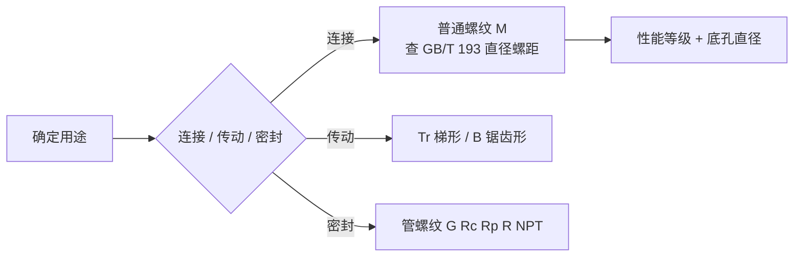

# 螺纹基础（分类、尺寸公式、性能等级）

## 一句话定义

**螺纹**是在圆柱或圆锥表面沿螺旋线形成的、具有相同牙型的连续凸起；按用途分连接螺纹、传动螺纹、密封（管）螺纹。本页依据微信公众号「紧固件全接触」的入门手册（2024-04-10）整理，并用 Python 重算了其中的公式和数值表（见「核心原理」）。

## 英文缩写速查

| 缩写 | 含义 | 说明 |
|------|------|------|
| M | 普通（公制）螺纹 | 牙型角 60° |
| G / Rp / Rc / R | 55° 管螺纹 | G 非密封；Rp 圆柱内、Rc 圆锥内、R 圆锥外（密封） |
| NPT | 60° 圆锥管螺纹 | 美制，锥度 1:16 |
| Tr | 梯形螺纹 | 传动用，牙型角 30° |
| B | 锯齿形螺纹 | 单向受力传动，3° / 30° 非对称牙侧 |
| P | 螺距 | 相邻牙对应点轴向距离 |
| d / d1 / d2 | 大径 / 小径 / 中径 | 外螺纹 |

## 为什么重要

- 机器人本体里螺纹连接、传动（丝杠、行星滚柱丝杠）、管路接头无处不在；选紧固件等级、定底孔直径、查标准号都靠这些基础量。
- 与本库关节、轴承、公差页互补：[人形机械布局](./humanoid-mechanical-layout-design.md)、[关节方案选型](./robot-joint-scheme-selection.md)、[关节轴承选型](./robot-joint-bearing-selection.md)、[行星滚柱丝杠](./planetary-roller-screw-humanoid-leg-actuation.md)、[公差仿真](./structure-tolerance-simulation-toolchain.md)。

## 核心原理

**普通螺纹基本尺寸**（文章公式，已重算）：H = 0.866P；d2 = d − 0.6495P；d1 = d − 1.0825P。系数分别为 √3/2、3√3/8、5√3/8，重算一致。

**本库重算结果**（Python，非一手来源）：
- 55° 圆锥管螺纹 Rc 8 行：d1 = d − 2h，h = 0.640327P，P = 25.4/n，与文章一致（差 ≤ 0.001 mm）。
- 梯形螺纹 8 行（d3、d2、D4、D1，h3 = 0.5P + ac）与文章一致。
- 性能等级 4.6、5.6、6.8、8.8、9.8 与「前数 ×100 = σb，后数 ×10% = 屈强比」一致；3.6、4.8、5.8、10.9、12.9 表值略高于名义值（推测与最小值取法有关，未核标准）。

**性能等级表（文章）：** 3.6–12.9，σb 最小 330…1220 MPa，σs 最小 190…1100 MPa。

**攻丝与套丝经验式（文章）：** 底孔直径 塑性材料 D − P、脆性材料 D − (1.05~1.1)P；盲孔深度需加约 0.7D；套丝杆径 D − 0.13P。

**ISO / GB/T 对照**（Mechtool 螺纹页）：基本牙型 ISO 68-1 ↔ GB/T 192-2003；直径螺距 ISO 261 ↔ GB/T 193-2003；公差 ISO 965-1 ↔ GB/T 197-2003。

## 工程实践

- 底孔、等级、拧紧力矩可先用 [Mechtool](../entities/mechtool.md) 的「螺栓连接设计校核」或其外链紧固件小工具粗算，关键件仍以现行标准和供应商资料为准。
- 引用标准号前核对版本：文章用 GB/T 192-81、7306-87、5796.3-86 等旧号，Mechtool 螺纹页列的是 -2003 版，其普通螺纹资料页公差一栏又标 GB/T 197-2018。
- 文章给出的经验数据（原文表格，未核标准）：普通螺纹旋合长度分 S / N / L 三组，N 不标注；公差带优选 6H / 6g（中等精度）、带 * 者优先；底孔 / 套丝圆杆直径、通孔 H12 / H13 / H14 三档（如 M8 为 8.4 / 9 / 10 mm）、余留长度与扳手空间按螺距 / 规格查表；标记示例如 M12×1.5 LH—7H—L、Tr52×8(P4)LH—7H—L、Rc1/2、NPT3/8-LH。
- 螺纹规格（粗牙 / 细牙、左右旋、公差带）要在图纸标注里写全。

## 局限

- **原文已读完（文字 + 36 张图）**，但**没有对照任何标准原文**：文章各表值（含 GB/T 196-81、7306-87、5796.3-86 等旧版号下的数据）是否与现行标准一致未核；重算只证明文章内部自洽。
- **锯齿形螺纹牙侧角（待核疑点，未解决）：** 文章写「常用牙形角 33°，工作的牙型斜角 30°，非工作面 3°」。GB/T 13576.1 标题为「锯齿形（3°、30°）螺纹 第 1 部分 牙型」；本次检索到的仅有第三方技术文章（[baer.tools](https://baer.tools/en/blog/detail/b0f20123719f4400bfefbf0761e164b4)），称承载牙侧 3°、非承载 30°，与文章相反。第三方文章不是标准条文，标准全文本次未能读到，因此**不下定论**，设计时以标准图示为准。
- **标准版本：** 检索确认 GB/T 13576.1-2008（2008-07-30 发布，2009-02-01 实施，替代 1992 版）；未检索到更新替代版本，但未在国家标准全文公开系统核实现行状态。Mechtool 螺纹页列的基本牙型 / 直径螺距 / 公差为 -2003 版，其「普通螺纹」资料页另标 GB/T 197-2018（公差）与旧版 GB/T 197-2003，故 GB/T 197 以 2018 版为准的说法见该站页面（站点自述，未核标准原文）。
- 文章分类表里 ZM 米制锥螺纹一行与 NPT 同写「及 55° 圆锥管螺纹相似，但牙形角为 60°」，未核。

## 关联页面

- [Mechtool 在线机械设计工具](../entities/mechtool.md)
- [人形机械布局](./humanoid-mechanical-layout-design.md) · [关节方案选型](./robot-joint-scheme-selection.md) · [关节轴承选型](./robot-joint-bearing-selection.md) · [行星滚柱丝杠](./planetary-roller-screw-humanoid-leg-actuation.md) · [公差仿真工具链](./structure-tolerance-simulation-toolchain.md)

## 参考来源

- [紧固件全接触：常用螺纹基础知识](../../sources/blogs/fastener_quanjiechu_thread_basics_2024-04-10.md)
- [Mechtool 站点目录归档](../../sources/sites/mechtool_cn_catalog_2026-11-07.md)

## 继续阅读

- 现行 GB/T 192 / 193 / 197、GB/T 13576.1-2008、GB/T 3098.1（性能等级）原文（本次未读，是下一步核对锯齿形牙侧角疑点的入口）。
