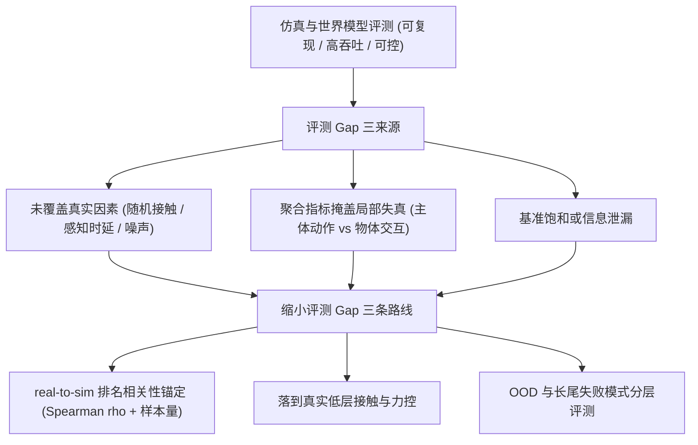

# 概念：仿真评测可复现性 ↔ 真实世界代表性取舍（sim↔real 评测 gap）

## 一句话定义

> **一句话**：仿真评测的可复现性、吞吐与可控性，不能独自证明结果能外推到真机；是否覆盖真实接触、感知误差和目标任务分布，需要在[评测基准选型闭环](../queries/embodied-eval-benchmark-selection-loop.md)的「④ sim↔real 校准层」用专门证据检验。

## 英文缩写速查

| 缩写 | 英文全称 | 简要说明 |
|------|----------|----------|
| sim2real | Simulation-to-Real | 仿真到真机的迁移与外推 |
| real-to-sim | Real-to-Simulation | 用真机数据校准/构建仿真，锚定二者相关性 |
| OOD | Out-of-Distribution | 分布外，部署时相对评测集的分布漂移 |
| WM | World Model | 世界模型，也可当策略评估器，同样受 gap 约束 |

## 为什么重要

- 选型与迭代常以仿真分数为信号；若可复现性是用代表性换来的，榜单名次可能不能外推到真机，直接影响「该不该上真机、该信哪个榜」。
- 世界模型被当作策略评估器时同样受约束：[Fidelity Gap](../entities/paper-fidelity-gap-egocentric-video.md) 原文表明，3 万小时数据下手保真度趋近上限，物体交互保真度收敛在远低处，评估结论不能只看视觉指标。

## 为什么单独立这一页

「仿真里测出来的结论能不能信」这个问题，横跨[评测基准选型闭环](../queries/embodied-eval-benchmark-selection-loop.md)的每一层：认知评测、世界模型保真度评测、策略成功率评测最终都要回答「这个分数在真机上还成立吗」。可复现性与真实代表性是两个验收维度：固定种子有助于复现，加入有依据的感知与物理扰动有助于覆盖目标分布；二者可能共同改善，也可能增加建模和测量成本，不能仅凭复现容易就断言代表性更差。

## 可复现性 ↔ 代表性：这道 gap 的代价表

下表列出评测配置可能遗漏的真实因素；这些遗漏需要逐项检查，并非每个仿真器都会同时存在：

| 仿真评测优势 | 需要另行覆盖或验证的真实因素 |
|--------------|--------------------------|
| 可复现（固定种子/初值，结果确定） | 真机的随机接触、传感器噪声、初始条件抖动 |
| 高吞吐（GPU 并行成千上万 rollout） | 真机每次 rollout 的物理磨损/标定漂移成本 |
| 可控（任意重置场景、注入干扰） | 真实长尾分布：罕见物体、极端光照、退化接触 |
| 干净观测（无标定误差、无遮挡噪声） | 真实感知链路的时延、抖动、缺失与错配 |
| 可自动打分（成功判据程序化） | 真实「做成」的语义模糊与人工判定成分 |

核心结论：**可复现的代理指标仍须通过目标任务验证外推能力**。[RoboBench](../entities/robo-bench.md) 专门验证认知分与下游 VLA 成功率的相关性；[GigaWorld-1](../entities/paper-gigaworld-1-policy-evaluation.md) 检查长时序动作忠实度与评估器质量。[Fidelity Gap](../entities/paper-fidelity-gap-egocentric-video.md) 给出了视觉指标不足以证明交互保真度的反例：在 LPIPS 等感知质量基本持平时，视频世界模型对被操作物体的结构忠实度（SCS）仍明显落后于手部，30,000 小时数据也未追平；用作仿真任务判定器时，成功判定一致率只有 0.67（改进后 0.81）。这些是各自实验的证据，不构成“复现越容易，代表性必然越低”的定律。

## 核心原理

评测 gap 的机制可压成三点（前两点来自上文代价表与 Fidelity Gap 原文，第三点为本页归纳）：

1. **未覆盖因素带来偏差**：若评测配置省略了影响任务的接触、噪声或长尾因素，就可能遗漏真机失败模式；确定性与并行本身不是失真的证明。
2. **聚合指标掩盖局部失真**：Fidelity Gap 把世界模型保真度拆成「手」与「被操作物体」两项，手的结构一致性（SCS）可达约 0.79–0.81 渐近，物体渐近约 0.57（骨架条件化设置）；单一成功率或感知指标会把两者混成一个数。
3. **难度依赖**（推断）：同一论文在人形仿真中物体 SCS 达 0.70–0.79，作者归因于仿真物体刚性且较大；说明保真度结论取决于评测环境难度，跨环境不可直接横比。

## 把 gap 讲成「评测结论能否外推」的物理根因

评测 gap 的物理根因和 [Sim2Real](../concepts/sim2real.md)、[物理保真度 sim2real gap](../concepts/physics-fidelity-sim2real-gap.md) 同源，但落点不同：

- **策略迁移 gap** 问的是「策略在真机上还能不能跑」；
- **评测 gap** 问的是「用仿真给策略打的分，在真机上排名还成不成立」。

即使仿真绝对成功率有偏差，只要在目标任务与策略集合上验证了 sim↔real **排名相关**，仿真仍可能提供选型信号（见[仿真评测基础设施](../concepts/simulation-evaluation-infrastructure.md)）。训练中使用评测样本、反复按评测集调参，或基准饱和，都会损害结论可信度；仅仅训练与评测来自同一分布，不能单独据此判定存在信息泄漏。

## 缩小评测 gap 的三条工程路线

在「不假装仿真等于真机」的前提下，让仿真评测结论更能外推：

1. **real-to-sim 相关性锚定**：用真机 rollout 校准仿真评测，报告 **sim↔real 排名相关性**、样本量与适用任务；将训练、调参与评测数据隔离，并另设分布外评测检验泛化。
2. **落到真实低层控制**：把「魔法抓取」等抽象化实现替换为真实接触/力控（如 [ManiSkill-HAB](../entities/paper-notebook-maniskill-hab-a-benchmark-for-low-level-manipula.md) 的低层控制），减少「简化换来的虚高」。
3. **分布外 + 长尾分层评测**：加入 OOD 测试集与按失败模式/物体分层的成功率，避免用均值成功率和饱和榜单掩盖长尾崩溃与分布漂移。

## RoboLab 更新带来的校准与统计约束

[RoboLab v4 原文与 v0.3.3 核对归档](../../sources/papers/robolab_arxiv_2604_09860.md) 补充了高保真仿真作为评测器的具体边界：

- **排序与绝对分分开。** 与 RoboArena 真机 Elo 的 Spearman ρ=0.94 表示该对照中的相对排序相关，不能解释成仿真成功率等于真机成功率。
- **样本量约束结论。** 单任务 N=10 时，50% SR 附近的 95% CI 半宽约 ±30 个百分点；小差值或逐任务研究建议至少 100 回合/任务，并将完整成功率 SR 与子目标 Score 分开。
- **版本与扰动是评测条件。** v0.3.3 增加初始位姿随机化和灯光预设；对比结果时应锁定版本、机器人/策略配置和扰动范围。相机扰动是该基准分析的重要因素，不能只提高几何外观质量。

这些结果限定于对应基准与实验设置，不把单个相关系数推广为通用保证。

## 常见误判速查

| 误判 | 真相 |
|------|------|
| 仿真榜单接近满分 = 真实场景就绪 | 基准饱和 ≠ 场景就绪，多半是分布太窄或泄漏 |
| 仿真绝对成功率高 = 真机会成 | 该看 sim↔real 排名相关性，而非绝对分 |
| 仿真更逼真就一定评得更准 | 视觉逼真 ≠ 动作忠实，评测质量由后者主导 |
| 训练与评测同分布就一定泄漏 | 需检查样本、场景与调参流程是否泄漏；分布外泛化是另一个验收维度 |

## 工程实践

- 报告评测结果时同时给出 sim↔real 排名相关性与样本量（如 PRM-as-a-Judge 的 Spearman ρ 区间），不单报仿真绝对分。
- 评估世界模型时分开度量主体动作与物体交互（如 SCS），并用感知指标（LPIPS）做对照，确认差异不来自画质。
- 用世界模型做成功判定时，抽样人工复核判定一致率；Fidelity Gap 的 0.67→0.81 仅基于七个任务、42 段、单评审的小样本，应视为方向性证据。

## 局限

- 本页的量化数字多来自单篇论文（Fidelity Gap 的评测集来自单一采集协议、规模有限，作者称其上限估计偏乐观），不宜当作通用常数。
- 三条缩小 gap 的路线是工程归纳，未经统一实验横向比较。
- 潜空间预测类世界模型是否同样受限，原文明确留作开放问题。

## 关联页面

- [运控模型评测指标](./motion-control-policy-evaluation-metrics.md) — 运控模型侧的指标体系，其仿真绝对分同样受本页 gap 约束

- [具身大模型评测基准选型闭环](../queries/embodied-eval-benchmark-selection-loop.md) — 本页是其「④ sim↔real 校准层」的取舍根因，双向回链
- [PRM-as-a-Judge](../entities/paper-prm-as-a-judge.md) — 冻结 RoboDojo 上过程指标 Sim–Real Spearman ρ 约 0.18–0.58
- [仿真评测基础设施](../concepts/simulation-evaluation-infrastructure.md) — 用可信仿真当闭环评测引擎的前提正是本页的 sim↔real 相关性
- [Sim2Real](../concepts/sim2real.md) — 策略迁移 gap，本页评测 gap 与其同源不同落点
- [分布外（OOD）泛化与 OOD 指标怎么读](./out-of-distribution-generalization.md) — 本页「加入 OOD 测试集」那一条的展开：OOD 相对谁、为何跨论文不可横比
- [物理保真度 sim2real gap](../concepts/physics-fidelity-sim2real-gap.md) — 接触/物理层面 gap 的物理根因
- [GigaWorld-1（世界模型策略评估器）](../entities/paper-gigaworld-1-policy-evaluation.md) — 「动作忠实 > 视觉逼真」是评测代表性的直接证据
- [Fidelity Gap](../entities/paper-fidelity-gap-egocentric-video.md) — 手部像了、物体交互没跟上：世界模型当评估器时需单独度量交互保真度
- [具身大模型分类学选型闭环](../queries/embodied-fm-taxonomy-loop.md) — WM 世界模型家族被当作策略评估器时，这条评测 gap 是其「世界模型推演层」选型可信度的前提
- [RoboFQE](../entities/paper-robofqe.md) — 不做 rollout、在离线轨迹上拟合 Q 估计策略回报并保持排序，真机相关性 r=+0.90（作者报告）

## 参考来源

- [RoboLab v4 / v0.3.3 核对归档](../../sources/papers/robolab_arxiv_2604_09860.md) — 高保真评测的排序相关、统计不确定性与版本边界
- [wechat_embodied_ai_lab_robot_training_stack_layers_2026.md](../../sources/blogs/wechat_embodied_ai_lab_robot_training_stack_layers_2026.md) — 训练栈分层视角下「仿真作可扩展闭环评测、real-to-sim 相关性」的论述
- [robo_bench_arxiv_2510_17801.md](../../sources/papers/robo_bench_arxiv_2510_17801.md) — RoboBench 对「认知代理指标↔下游真机成功率相关」的专门验证，佐证上层易测指标外推需证据
- [fidelity_gap_arxiv_2610_12464.md](../../sources/papers/fidelity_gap_arxiv_2610_12464.md) — 视频世界模型「主体动作 vs 物体交互」保真度分离测量与成功判定一致率

## 继续阅读

- 原文：[What 30,000 Hours of Ego-Centric Video Does Not Teach](https://arxiv.org/abs/2610.12464)（通读归档见 [fidelity_gap_reading_arxiv_2610_12464_simreal_eval.md](../../sources/papers/fidelity_gap_reading_arxiv_2610_12464_simreal_eval.md)）
- [物理保真度 sim2real gap](../concepts/physics-fidelity-sim2real-gap.md) — 物理层面的 gap 分解
