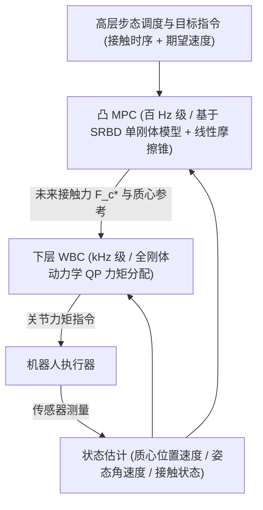

# SRBD + 凸 MPC + WBC

飞书 Know-How 条目 **「单刚体动力学模型 + 凸模型预测控制 + WBC」** 指：用 **SRBD（Single Rigid Body Dynamics）** 近似整机质心运动，在 **凸 MPC** 中优化未来接触力与质心轨迹，再由 **WBC** 在全刚体模型下分配关节力矩。MIT Cheetah、多款人形开源栈采用此类分层架构。

## 一句话定义

把身体先当成一个刚体算质心怎么动，再让全身关节去实现这个质心计划。

## 英文缩写速查

| 缩写 | 英文全称 | 简要说明 |
|------|----------|----------|
| SRBD | Single Rigid Body Dynamics | 单刚体质心近似 |
| MPC | Model Predictive Control | 滚动时域优化 |
| WBC | Whole-Body Control | 下层 QP 力矩分配 |
| QP | Quadratic Programming | 凸 MPC 与 WBC 常用形式 |
| LIP | Linear Inverted Pendulum | 更简化的 SRBD 特例 |
| NMPC | Nonlinear Model Predictive Control | 高保真升级路径 |

## 为什么重要

- **实时可解**：凸 QP/SQP 结构适合 kHz 级 WBC + 百 Hz 级 MPC。
- **飞书主链位置**：在 WBC/TSID 之后、CD-NMPC 之前，代表「可跑起来的工程折中」。
- **与 RL 对照**：理解模型派上限，便于 hybrid 设计。

## 核心原理

- **SRBD 状态：** 质心位置/速度、姿态/角速度；输入为接触力/力矩（或足端力）。
- **凸化：** 摩擦锥线性化、固定步态时序、质心高度缓变假设。
- **分层：** MPC 输出 $F_c^*, \dot p^*$ → WBC 跟踪并满足全刚体动力学。

## 工程实践

- 阅读 cheetah software / humanoid 开源 MPC+WBC 模块对照飞书伪代码。
- 调 **MPC 时域、权重、摩擦系数** 与 WBC 任务优先级一致性。
- 需要大跨步/跑步时评估是否升级 [Centroidal NMPC](../methods/centroidal-nmpc-wbc-stack.md)。

## 局限与风险

- **单刚体误差**：快上身摆动、大臂负载时近似变差。
- **接触调度**：错误步态模式使 MPC 参考不可跟踪。
- **保守摩擦线性化**：可能限制急转/急停能力。

## 关联页面

- [MPC 与 WBC 集成](./mpc-wbc-integration.md)
- [Model Predictive Control](../methods/model-predictive-control.md)
- [Centroidal NMPC + WBC 栈](../methods/centroidal-nmpc-wbc-stack.md)
- [Know-How 技术地图](../overview/humanoid-motion-control-know-how-technology-map.md)

## 参考来源

- [humanoid_motion_control_know_how.md](../../sources/papers/humanoid_motion_control_know_how.md)
- [mpc.md](../../sources/papers/mpc.md)

## 推荐继续阅读

- Di Carlo et al., *Dynamic Locomotion in the MIT Cheetah 3 Through Convex Model-Predictive Control*
- 平台总览：[MIT Mini Cheetah](../entities/mit-mini-cheetah.md)（含 `Cheetah-Software` 与开源边界）
