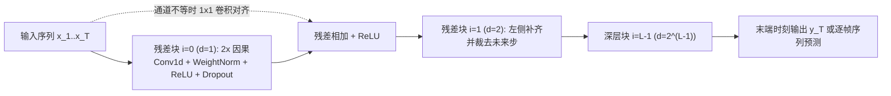

# TCN（Temporal Convolutional Network，时间卷积网络）

**TCN**（Bai, Kolter & Koltun, 2018）是将一维全卷积网络（FCN）、严格**因果卷积**（Causal Convolution）、**指数膨胀卷积**（Dilated Convolution）与**残差块**结合形成的通用时序建模架构，在无需维护递推隐状态的条件下沿时间轴做可并行的确定性窗口滤波。

## 一句话定义

在时间轴上构造严格不看未来的因果膨胀一维卷积残差栈，以固定可计算的感受野将变长序列映射为等长特征序列，替代传统 RNN 的串行隐状态递推。

## 英文缩写速查

| 缩写 | 英文全称 | 简要说明 |
|------|----------|----------|
| TCN | Temporal Convolutional Network | 因果膨胀一维卷积序列建模架构 |
| FCN | Fully Convolutional Network | 维持输入输出序列时间长度一致的全卷积网络 |
| RF | Receptive Field | 有效感受野，决定当前步最多可回溯的历史长度 |
| WeightNorm | Weight Normalization | 卷积核权重的幅值-方向解耦归一化，原版 TCN 核心稳定手段 |
| GLU | Gated Linear Unit | 门控线性单元，曾用于消融替代 ReLU 但双倍计算量 |
| IMU | Inertial Measurement Unit | 惯性测量单元，机器人中最典型的固定窗口时序输入之一 |

## 为什么重要

- **打破“序列建模默认 RNN”惯性**：Bai et al. (2018) 在 11 项跨模态基准上的实证表明，配置常规超参的通用 TCN 在准确率、训练稳定性与可并行性上大面积超越同尺度标准 LSTM/GRU，并将有效记忆从数十至百余步（Copy Memory 上 LSTM <50、GRU <200）推至 1000+ 步且几乎无梯度消失。
- **高度匹配机器人本体与接触物理窗口**：在足式/人形机器人全身控制与状态估计中（如 [全身跟踪管线](./whole-body-tracking-pipeline.md)、[SONIC 运动跟踪](../methods/sonic-motion-tracking.md)），高频本体状态（关节角/速度、IMU、足端触觉）的关键物理记忆通常集中于最近 0.5–2 s 固定视野内，与 TCN 严格因果、硬件友好且静态图易部署的归纳偏置天然契合。
- **架构选型分界点**：它提醒工程团队在转向复杂动态注意力（[Transformer](./transformer.md)）或选择性状态空间（[Mamba](./mamba.md)）之前，先校验任务需求究竟是“定长平滑与延迟关联”还是“按内容动态索引未知长度的远距离语义”。

## 核心机制

论文将泛型时序卷积浓缩为方程 $\text{TCN} = \text{1D FCN} + \text{causal convolutions}$（§3.1–§3.3）：

1. **严格因果与输出等长**：各隐藏层输出与输入序列等长；通过对左侧零填充 $(k-1)d$ 个零元（并在双向 padding 后裁去右侧未来步），确保时刻 $t$ 仅依赖 $\le t$ 的观测，彻底杜绝信息泄漏。
2. **指数膨胀卷积算子（Eq. 2）**：给定一维输入 $\mathbf{x} \in \mathbb{R}^n$ 与滤波器 $f:\{0,\dots,k-1\}\to\mathbb{R}$，在索引 $s$ 上膨胀因子为 $d$ 的卷积定义为：
   $$F(s) = (\mathbf{x} *_{d} f)(s) = \sum_{i=0}^{k-1} f(i) \cdot \mathbf{x}_{s - d \cdot i}$$
   第 $i$ 个残差块采用 $d = 2^i$ 指数膨胀；当存在 $L$ 个残差块且每块含两个同膨胀卷积层时，整网理论历史感受野随深度呈指数级扩张：
   $$\mathrm{RF} = 1 + 2(k - 1)(2^L - 1)$$
3. **残差稳定堆叠**：每个残差块内串接两组「膨胀因果卷积 → WeightNorm → ReLU → Spatial Dropout（整通道随机置零）」，在输入/输出通道数不匹配时补充 $1 \times 1$ 卷积旁路投影：$o = \mathrm{Activation}(x + \mathcal{F}(x))$。

## 实验与评测

基于 Bai et al. (2018) 原文 11 项基准与关键消融（均对比规范化调优前的同级标准 LSTM/GRU/RNN）：

| 评测任务 / 消融维度 | TCN 实测表现 | 对照基线 / 消融结论 |
|------|------|------|
| Sequential MNIST / P-MNIST | **99.0%** / **97.2%** | LSTM: 87.2% / 85.7%；GRU: 96.2% / 87.3% |
| Adding Problem ($T=600$) | 损失 **5.8e-5** | 通用 LSTM / GRU / RNN 均未学成收敛 |
| Copy Memory ($T=1000$) | 损失 **3.5e-5**（图5全程 ~100% 精度） | LSTM 在 $T<50$ 跌破 20%，GRU 在 $T<200$ 失效 |
| WikiText-103 / LAMBADA（ppl↓） | **45.19** / **1279** | 优于同规模标准 LSTM（48.4 / 4186） |
| Word-level PTB（ppl↓） | **88.68** | 落后于重度特调正则化的专门 LSTM（78.93） |
| 卷积核宽 $k$ 消融（Table 2） | Copy/P-MNIST 在 $k \le 3$ 失败，Word PTB 最优为 $k=3$ | 核大小需与任务跨度耦合，不能盲目定死小核 |
| 残差连接与 GLU 门控消融（Fig. 6, Table 5） | 残差旁路显著加速并稳定深网收敛 | GLU 略降 PTB 至 87.94，但卷积算力翻倍且 Copy Memory 退化至 0.00508 |

## 源码实现剖析

逐文件核对官方仓库 [locuslab/TCN](https://github.com/locuslab/TCN)（`TCN/tcn.py`、`TCN/adding_problem/model.py`）：

- **`Chomp1d` 实现严格因果裁剪**：PyTorch 的 `nn.Conv1d` 默认在序列左右两侧同时添加等量 `padding = (kernel_size - 1) * dilation_size`，`Chomp1d(chomp_size)` 在卷积后执行 `x[:, :, :-self.chomp_size].contiguous()` 直接切掉右侧冗余未来步，等效转化为纯单侧因果卷积。
- **`TemporalBlock` 与 `TemporalConvNet` 构造**：每个 `TemporalBlock` 顺序封装两套 `weight_norm(nn.Conv1d(...)) -> Chomp1d -> ReLU -> Dropout`，当 `n_inputs != n_outputs` 时建立 `nn.Conv1d(..., 1)` 作为 `downsample` 恒等替代，并对所有卷积施加均值为 0、标准差 0.01 的正态初始化（`normal_(0, 0.01)`）；`TemporalConvNet` 按 `i = 0 .. len(num_channels) - 1` 自动赋值 `dilation_size = 2 ** i`。
- **序列末步读出范式**：在 `TCN/adding_problem/model.py` 等分类/回归任务中，前向传播跑完因果卷积后直接截取末帧 `y1[:, :, -1]` 输入线性分类/回归头，无需额外池化且严格保真历史因果依赖。

## 工程实践

- **从控制周期反推感受野公式**：设机器人控制器步长 $\Delta t = 20\,\text{ms}$（50 Hz），需要完整覆盖 $2\,\text{s}$（即 $100$ 步）历史。利用 $\mathrm{RF} = 1 + 2(k-1)(2^L-1) \ge 100$，若选 $k=3$，则 $L=5$（$\mathrm{RF}=125 \ge 100$）；若用更大的 $k=5$，只需 $L=4$（$\mathrm{RF}=121$）。
- **先跑窗口拼接基线（MLP-on-stack）**：在低维本体历史短窗口任务上，把历史堆叠拼接后直接过 MLP 的推理耗时通常低于多层空洞卷积，应以 MLP-on-stack 作为必跑基线验证 TCN 时序平移不变性是否真正带来增益。
- **注意推理期的流式边界缓存或整窗重算**：`locuslab/TCN` 原版默认针对整段窗口并行运行（输入尺寸 `[B, C, L]`）；在高频机载部署中，若输入窗口固定为 `RF`，最稳健且易导出 TensorRT/ONNX 的方式是维护长度固定的环形滚动输入窗执行定长前向推理（或改写为逐层边界状态队列缓存以消除重复算子）。
- **避免 `weight_norm` 迁移陷阱与未来步泄漏**：新版 PyTorch 中旧式 `torch.nn.utils.weight_norm` 已被标注弃用，工程实现需迁移至 `torch.nn.utils.parametrizations.weight_norm` 或 LayerNorm 替代；自定义因果卷积时切勿漏掉 `Chomp1d` 右侧裁剪，否则仿真训练期就会“偷看未来观测”，上真机必崩。

## 常见误区与局限

- **推理期须缓存完整历史（§3.5 第一固有局限）**：与 RNN 在推理时只需保留固定隐状态 $h_t$ 即可丢弃过去观测不同，TCN 评估与在线控制必须保存至少覆盖有效感受野长度的历史输入或激活张量，因此高维视觉/长视野场景的运行时缓存显著高于循环架构。
- **跨领域迁移时感受野不可自适应外推（§3.5 第二固有局限）**：当任务切换至需要更长记忆跨度的场景时，基于固定 $k, d, L$ 训好的 TCN 会因有效感受野硬性截断而性能骤降，无法像状态空间或注意力机制那样自然延展上下文窗口。
- **静态卷积核缺乏内容选择性**：卷积权值与当前输入特征内容无关，既无法按输入自适应门控写入/清零记忆（[Mamba](./mamba.md) 的强项），也无法像 [Transformer](./transformer.md) 那样对遥远特定 token 做动态跳转关联。
- **网格伪影与过小核敏感（Table 2）**：若膨胀率过高而核宽过小（如 $k=2, 3$），不仅容易出现空洞网格采样稀疏盲区（checkerboard），在 Copy Memory 与乱序序列上也会因无法跨过局部压缩瓶颈而彻底失效。

## 关联页面

- [卷积神经网络（CNN）](./convolutional-neural-network.md)
- [循环神经网络（RNN / LSTM / GRU）](./recurrent-neural-network.md)
- [GRU](./gru.md)
- [Transformer](./transformer.md)
- [Mamba](./mamba.md)
- [全身跟踪管线](./whole-body-tracking-pipeline.md)
- [SONIC 运动跟踪](../methods/sonic-motion-tracking.md)
- [RNN vs CNN vs Transformer vs Mamba 对比](../comparisons/rnn-cnn-transformer-mamba.md)
- [AI 架构地图](../overview/ai-architecture-map.md)

## 参考来源

- [TCN 一手论文精读与源码核对归档（arXiv:1803.01271）](../../sources/papers/tcn_reading_arxiv_1803_01271.md)
- [Bai et al. TCN 原始来源索引](../../sources/papers/bai_tcn_arxiv_1803_01271.md)
- [AI 架构地图一手论文簇](../../sources/papers/ai_architecture_foundations.md)
- Bai, Kolter & Koltun, *An Empirical Evaluation of Generic Convolutional and Recurrent Networks for Sequence Modeling*, arXiv:1803.01271v2（2018）：<https://arxiv.org/abs/1803.01271>
- 官方代码库（`TCN/tcn.py`, `TCN/adding_problem/model.py`）：<https://github.com/locuslab/TCN>

## 推荐继续阅读

- [RNN vs CNN vs Transformer vs Mamba 对比](../comparisons/rnn-cnn-transformer-mamba.md)
- [AI 架构地图](../overview/ai-architecture-map.md)
- [Bai et al. TCN 原论文（arXiv:1803.01271）](https://arxiv.org/abs/1803.01271)
