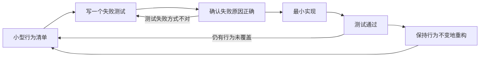

# 测试驱动开发（TDD）

**测试驱动开发（Test-Driven Development, TDD）** 是一种开发者工作流：先用一个自动化测试表达当前要实现的行为，让它失败，再写刚好让它通过的最小生产代码，之后整理设计并继续下一项。

## 英文缩写速查

| 缩写 | 英文全称 | 简要说明 |
|------|----------|----------|
| TDD | Test-Driven Development | 用测试驱动小步实现与设计 |
| RED | Failing test state | 新测试按预期失败，证明测试能识别尚未实现的行为 |
| GREEN | Passing test state | 最小实现通过当前测试和已有回归 |
| SUT | System Under Test | 当前测试观察其外部行为的系统或组件 |
| CI | Continuous Integration | 自动构建、运行测试与质量检查的集成流程 |

## RED → GREEN → REFACTOR

Kent Beck 对 canonical TDD 的说明强调：维护一个短测试清单，每次只取下一项转成失败测试；不是先把所有测试写完，再一次性实现。

1. **Red：** 为一个行为写自动化测试，运行并确认它因预期原因失败。
2. **Green：** 写最少的生产代码让测试通过；避免在此步骤顺手实现清单之外的行为。
3. **Refactor：** 在测试仍通过时改进命名、模块边界和重复结构；行为不变。
4. 将发现的边界条件追加进清单，再从下一个最小测试开始。

### 流程总览

## TDD 帮助解决什么问题

- **快速反馈：** 在模块内部错误扩散前定位不符合预期的行为。
- **切片与设计：** 为可观察的行为设计调用边界，降低一次性大改的风险。
- **回归保护：** 将已经做出的行为选择变成可重复检查的自动化证据。
- **错误恢复：** 先复现故障，再让失败测试驱动最小修复，最后保留为回归用例。

## 常见误区

- **误区：TDD = 追求覆盖率。** 覆盖率是执行覆盖统计，不说明断言是否抓住需求或错误边界。
- **误区：先设计完实现，再补测试也叫 test-driven。** 那属于 tests-after；TDD 的测试必须实际影响设计与实现推进。
- **误区：测试通过就证明系统正确。** 测试只覆盖写出的模型与断言；未建模条件、环境差异和集成问题仍可能存在。
- **误区：越多 mock 越快。** 若测试只验证 mock 调用或实现细节，重构容易造成误报，真实接口错误反而逃过检查。
- **误区：一开始就写巨型端到端测试。** TDD 的价值依赖快速反馈；昂贵、脆弱的 E2E 适合放在较外层，而非每一步都运行。

## 机器人软件中的位置

TDD 尤其适合快速、可重复的纯逻辑与接口边界：例如命令限幅、坐标变换、状态机转换、错误处理、日志解析和配置校验。控制器或策略效果则需要仿真和真机验证；单元测试不能替代动力学、接触、安全和时序评估。可把整套功能验收写在 [SDD 规格](./specification-driven-development.md)，用 [BDD / ATDD](./behavior-and-acceptance-driven-development.md) 与跨角色确认任务结果，再用 TDD 驱动组件级实现。

## 结论

**TDD 的核心产物不是更多测试文件，而是一个由测试失败与通过节拍控制的实现/设计反馈环；它能降低局部变更风险，不能独立证明需求完整或系统可部署。**

1. 每轮只挑一个足够小的行为，并观察测试先红后绿。
2. 确认失败是断言捕捉到预期行为，而非语法、环境或测试配置错误。
3. 绿灯后再重构；不要把新行为和结构整理混为一个难以归因的大改。
4. 用公共可观察行为选择测试 seam，少测私有实现细节。
5. 把单元 TDD 与集成、仿真、硬件在环和真机验证分层组合。

## 关联页面

- [SDD：规格驱动开发](./specification-driven-development.md)
- [BDD 与 ATDD：行为及验收测试驱动开发](./behavior-and-acceptance-driven-development.md)
- [SDD / TDD / BDD / ATDD 对照](../comparisons/sdd-tdd-bdd-development-methods.md)
- [Matt Pocock 的 TDD skill](../entities/mattpocock-tdd-skill.md)

## 参考来源

- [Kent Beck, Canon TDD](../../sources/blogs/kent-beck-canon-tdd.md)

## 推荐继续阅读

- [Kent Beck, Test-Driven Development: By Example](https://www.pearson.com/en-us/subject-catalog/p/Beck-Test-Driven-Development-By-Example/P200000009421/9780321146533)
- [Agile Alliance: What is TDD?](https://agilealliance.org/glossary/tdd/)
