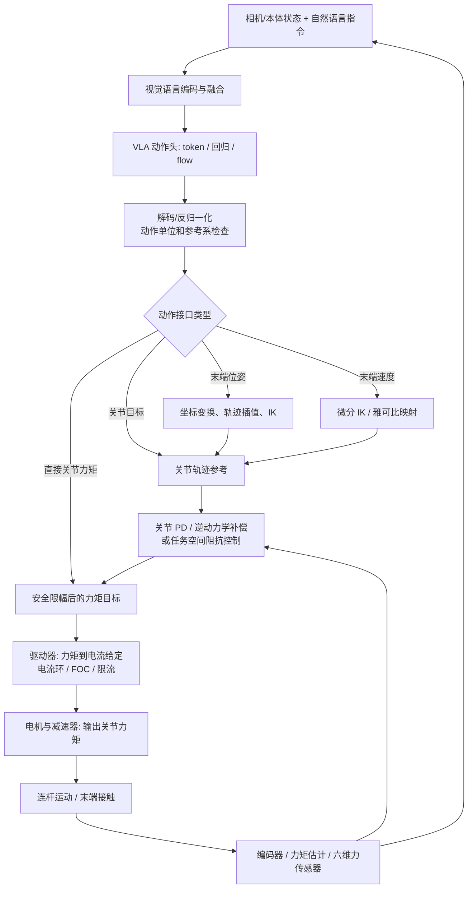

# VLA 动作到关节力矩的执行链路（From VLA Actions to Joint Torque）

## 一句话定义

**VLA-to-torque 控制链路**是将视觉与语言条件下生成的动作张量，按机器人约定转换为有单位的运动目标，再由运动学、轨迹生成、反馈控制与伺服驱动，最终让电机形成力矩的工程执行流程；**VLA 本身通常不是电流环控制器**。

## 英文缩写速查

| 缩写 | 英文全称 | 简要说明 |
|---|---|---|
| VLA | Vision-Language-Action | 由观测和指令生成机器人动作的模型 |
| EE | End Effector | 末端执行器及其任务空间参考系 |
| IK | Inverse Kinematics | 从期望末端位姿求关节位形 |
| PD | Proportional-Derivative | 基于位置和速度误差的反馈 |
| WBC | Whole-Body Control | 有多任务与动力学约束时的全身控制 |
| DoF | Degrees of Freedom | 机器人可独立运动的自由度 |
| FOC | Field-Oriented Control | 典型伺服驱动中的矢量电流控制 |

## 为什么重要

- 只有明确 **动作语义、单位、坐标系、模式与时间戳**，模型生成的浮点数才可被可靠执行；“输出一串数”不等于“直接产生力矩”。
- 高层动作模型与低层伺服有不同实时期限：感知推理若超时，不能阻塞电机电流环。
- 精密接触装配的安全上限常由标定、运动规划、顺应控制、传感和硬件限流共同决定；不能只看 VLA 离线任务成功率。

## 核心原理

### 1. 视觉、语言与动作头

视觉编码器提供环境特征；语言条件可以是高层技能或融合到多模态主干的任务约束。模型出口并不固定为“下一个词表 token”：主干可连接 **离散动作 token/码本**、**连续回归头** 或 **扩散/流匹配动作专家**。训练数据的动作标注和后处理配置共同定义输出语义。

| 动作约定 | 示例 | 控制器入口 |
|---|---|---|
| 关节空间 | `q_des`、`Δq`、`dq/dt` | 关节轨迹 / PD / 动力学控制 |
| 任务空间 | `Δx, ΔR`、末端绝对位姿、末端 twist | 轨迹生成 + IK 或微分 IK |
| 物体相对空间 | 夹爪相对目标物体的位姿差 | 目标检测/跟踪 + 坐标变换 + IK |
| 力与力矩 | 期望末端 wrench 或 `τ_des`（特定策略） | 力/阻抗/直接力矩接口，需额外安全约束 |

**注意**：常见“7 维末端动作”指三平移 + 三旋转参数 + 一夹爪量；若旋转改用四元数则标量数不同。模型归一化输出必须按训练配置反归一化，并确认基座/相机/世界/末端参考系与旋转参数化。

### 2. 完整执行路径

图中不同出口是**可选分支**而非每台机器人都必须经过的固定七步。若执行器只暴露位置模式，`PD/电流环` 可在驱动器内部实现，主机不直接发送电流或力矩。

### 3. 从运动学到动力学

- **位姿入口**：给定末端目标 `T_des`，通过 `FK(q)` 的逆问题求 `q_des`；冗余关节用零空间目标处理限位与偏好，接近奇异时可加阻尼。
- **速度入口**：末端 twist `V=J(q)·q_dot`；数值伪逆与阻尼最小二乘可求关节速度参考。
- **力/接触入口**：末端 wrench `F` 的关节广义力贡献为 `τ_ext=J(q)^T F`（同一坐标系约定，符号取决于内外力定义）；它**不是**惯性、重力与驱动等全部力矩的唯一公式。
- **跟踪与前馈**：例如 `τ_cmd = Kp(q_des-q) + Kd(qdot_des-qdot) + g(q) + τ_ff`；若采用计算力矩控制，`τ_ff` 还可包含 `M(q)qddot_des + C(q,qdot)qdot` 等项。表达式只是可选控制律之一，需处理关节限位、重力符号和饱和。
- **电机驱动**：在常见 PMSM/FOC 的简化模型中，电机轴转矩近似 `τ_motor=K_t·I_q`；经过减速器后的关节输出力矩还取决于传动比、方向、效率与摩擦。并非所有驱动器的外部接口都提供直接电流给定。

### 4. 推理、动作块和伺服的时间尺度

将三个独立概念分开：**动作生成更新周期**、**执行/重规划周期**、**底层位置/速度/电流环周期**。原文列出的约 1–20 Hz VLA 与 500–1000 Hz 伺服仅是场景示例；实际平台取决于硬件与任务。电流内环还可能比位置环更快，不能一概并列。

若每个动作块有 `H` 个采样点、参考执行频率是 `f_exec`，动作块时长为 `T_chunk = H / f_exec`。要避免 buffer underflow，还需考虑推理时延、传输抖动、重叠执行和触发下一次推理的时刻。长块并不必然要求整块开环播放，具体见 [Action Chunking](../methods/action-chunking.md) 和 [控制频率与推理频率解耦](./control-inference-frequency-decoupling.md)。

### 5. 接触工况

位置刚性跟踪容易在被环境挡住时累积大接触力。**阻抗**规定偏差与期望力/动态顺应之间关系，**导纳**按外力反馈修正运动参考；两者的传感、带宽和接口要求不同。末端力控还需考虑碰撞检测、软硬限位、力/力矩上限和通信中断时的安全动作。

## 工程实践

| 验收环节 | 必须核对 |
|---|---|
| 模型动作定义 | `action_dim`、每维单位、绝对/相对量、参考系、夹爪编码、归一化统计 |
| 时间与数据一致性 | 图像/状态时间戳、模型实际延迟（P50/P99）、队列剩余时长、过期动作丢弃 |
| 运动学求解 | IK 可达性、关节限位、奇异裕度、坐标变换和外参误差 |
| 动力学与伺服 | 位置/速度/力矩模式、`Kp/Kd`、重力前馈、软限位、电机持续与峰值扭矩 |
| 真机接触 | 力阈值、阻抗或导纳参数、急停/看门狗、插入/抓取失败回退 |
| 分层观测 | 跟踪误差、关节力矩/电流、接触力、VLA 推理周期、队列延迟 |

**可复现实验建议**：同一任务比较（A）VLA + 关节位置 PD，（B）VLA + 任务空间阻抗；固定模型和数据，测碰撞峰值力、成功率、跟踪误差、P99 延迟，并记录安全停机次数。具体增益须实测，不能从控制结构推断。

## 局限与风险

- “语言模型只会输出符号”过度简化：token ID 是离散的，网络中间表征连续；不少 VLA 直接生成连续向量。
- 模型内部张量可能无量纲，但动作后处理后的目标**有单位与标定语义**；错误反归一化可能比推理误差更危险。
- `J^T F` 是外力向关节广义力的几何映射；不能代替完整逆动力学，也不能解释所有驱动力矩。
- “必须走 7 维末端 → IK → 雅可比 → 电流”的串行说法不普适，实际有多种旁路与设备控制模式。
- 控制环带宽受相位裕度、采样率、通信和机械共振共同影响，不能把“内外环不可同频”视作唯一稳定性定律。
- 原文正文由用户完整提供，**配图未核对**；本文对工程边界的补充不是原作者的实验结论。

## 关联页面

- [VLA 方法](../methods/vla.md) — 视觉语言到动作头的模型侧。
- [Action Chunking](../methods/action-chunking.md) — 长动作块与短执行视野的区别。
- [控制频率与推理频率解耦](./control-inference-frequency-decoupling.md) — 异步推理/伺服线程时域接口。
- [逆运动学](../formalizations/inverse-kinematics.md) · [机器人雅可比](../formalizations/robot-jacobian.md) — 末端与关节之间的几何桥。
- [计算力矩控制](../methods/computed-torque-control.md) · [导纳控制](../methods/admittance-control.md) — 控制器层。
- [VLA 与底层控制器融合](../queries/vla-with-low-level-controller.md) — 真机系统级接线与选型。
- [VLA 纵深路线](../../roadmap/depth-vla.md) — Stage 4 部署与系统整合。
- [接触力旋量闭环知识链](../queries/contact-wrench-closed-loop.md) — 末端接触力 `τ_ext = J(q)^T F`、阻抗/导纳顺应与接触安全闭环。
- [具身大模型分类学选型闭环](../queries/embodied-fm-taxonomy-loop.md) — VLA 在 VLM/VLN/VLA/VLX/World-Model 五层分类中的执行层定位。

## 参考来源

- [深蓝具身智能：把 VLA 拆到最后一层（2026-11-18，来源归档）](../../sources/blogs/wechat_shenlan_vla_action_to_joint_torque_2026-11-18.md)。

## 推荐继续阅读

- [原文：深蓝具身智能《把 VLA 拆到最后一层》](https://mp.weixin.qq.com/s/7y68p49geMiCop5gw2Btyw)
- [Modern Robotics — Robot Control（开放教材）](https://modernrobotics.northwestern.edu/chapters/chapter11/)
- [Real-Time Execution of Action Chunking Flow Policies](https://arxiv.org/abs/2506.07339)
