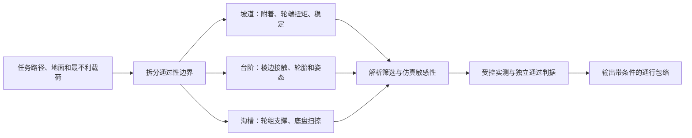

# 轮式移动机器人通过性：坡道、台阶与沟槽 / Wheeled Robot Traversability: Slopes, Steps, and Gaps

## 一句话定义

通过性不是底盘的一项额定值，而是给定载荷、质心、地面、速度和接近方向时，机器人仍能满足牵引、动力和支撑要求的一组边界。

## 英文缩写速查

| 缩写 | 英文全称 | 简要说明 |
| --- | --- | --- |
| UGV | Unmanned Ground Vehicle | 本页讨论的轮式地面机器人 |
| CoM | Center of Mass | 质心位置决定静态稳定余量与轴荷 |
| AWD | All-Wheel Drive | 全轮驱动；不等于轮端扭矩一定能理想分配 |
| RWD | Rear-Wheel Drive | 后轮驱动；附着取决于后轮组承担的法向载荷 |

## 为什么重要

二维地图上能连通，不代表底盘有足够的抓地力或支撑。把三个数字做平均会掩盖局部硬约束：坡道能力有余量的底盘，也可能无法过门槛，或者在沟沿托底。文章把坡道作为优先试验项的建议适合坡道或易滑路面频繁的场地；若关键通路有绕不开的门槛或沟槽，先由对应硬约束淘汰方案。

## 核心原理

| 工况 | 先检查的边界 | 典型失效 |
| --- | --- | --- |
| 坡道 | 驱动轮附着、持续驱动扭矩、质心投影与支撑域，各取最紧 | 纵向滑移、动力不足、后翻或侧翻 |
| 台阶 | 棱边接触换点、准静态轮端扭矩、接近角与俯仰稳定性 | 棱边卡滞、空转、前悬碰撞或后翻 |
| 横沟 | 单轮桥接、整车有效支撑跨距、全车离地间隙和摆姿 | 轮陷、连续丢失支撑、触底或跌落 |

- **坡道估算。** 匀速、直上、刚性平坡条件下，总需求近似为 `F_req = m g (sinθ + f cosθ)`，其中 `m` 包含载荷、`f` 为滚阻系数。轮径 `r` 相同且均分驱动力的 `n` 个驱动轮，单轮需约 `F_req r/n`。另需满足 `F_req ≤ μ N_d`，`N_d` 为驱动轮组实际法向载荷。仅在全轮驱动、有效载荷分配、忽略滚阻与加速等理想条件下简化为 `tanθ ≤ μ`。后驱不能把前轴比例直接当作后轴附着系数的乘数，上坡、加速和质心变化还会改变轴荷。
- **支撑与倾覆。** 平面准静态近似下，纵坡稳定边界可由 `tanθ < x/h_cg` 估算，`x` 沿坡面从下坡侧支点到质心在底盘平面的投影，`h_cg` 为质心相对支撑面的高度。横坡另验横向投影；只有质心横向居中、支撑近似刚性且无动态载荷转移时，才可用半轮距作为横向距离。
- **台阶估算。** 刚轮与锐边、轮心未抬起时，半径 `r` 的轮绕高度 `h` 的棱边的水平力臂为 `sqrt(2rh − h²)`（`0 ≤ h ≤ r`）。用有效载荷乘该力臂只给出重力矩量级；多轮推力、胎体形变和受载变化会改变结果。文章的附着简式把法向力近似成轮重，并以轴端扭矩除以轮半径估算切向力，因此不能直接把其 `h/r` 数字当作轮组通用上限。
- **横沟估算。** 等高刚性沟沿的单轮弦跨模型为 `w = 2 sqrt(2rc − c²)`，其中 `c` 是允许轮心下沉量（`0 ≤ c ≤ r`），并不总等于标称离地间隙。复算：`r=150 mm, c=60 mm` 为 **240 mm**；把 `c` 改到 90 mm 为 **约 275 mm**（原文称超过 300 mm）；保持 60 mm，把 `r` 改到 200 mm，则为 **约 286 mm**。两参数都影响结果；整车还需要验算有效支撑跨距、悬架压缩、俯仰及最低点扫掠。原文的折半或轴距比例是经验建议，不能作为统一安全系数。

### 流程总览

## 工程实践

| 工况 | 验收口径示例（数据需实测） |
| --- | --- |
| 坡道 | 给出角度档位、坡面材料及状态、载荷与质心、进坡速度和持续时间。分开验证坡中起步与稳定行驶；同时记录电流、轮速、独立地速和姿态，用来区分滑移与限扭。 |
| 台阶 | 按明确高度档位验证；记录棱边圆角、轮胎及胎压、接近方向和速度，区分准静态攀越与靠惯性越过；要求整车通过并记录卡滞、持续空转及车体接触。 |
| 横沟 | 记录槽宽、沿口状态、接近方向、保护装置是否施力与托底检测方式；保护性支撑介入不能计为无辅助通过，独立记录支撑丢失和底盘接触。 |

仿真先扫轮径、边缘形状、载荷及附着，再检查时间步、接触柔度与驱动限制对临界结果的敏感性。对照试验要固定实际采用的驱动协议，不用任意提高伺服增益来扩大数字。临界几何与接触冲击需要仪器化实测校准；本文未执行硬件或仿真复现。

## 局限与风险

- 坡道滑移也可能演变成不可恢复事故，不能假设总能退回。将倾覆、跌落与持续失控作为停止边界，不把过载或冲击样机作为必要验收步骤。
- 台阶与沟槽不是与载荷无关。轴荷、轮胎与悬架压缩、质心位置、底盘姿态都会改变整车通过边界。同一设备的临界高度还可能表现为带离散度的通过率，而不是每次在同一点跳变。
- 仿真接触误差的方向取决于配置，不能假设一定偏乐观；文中的典型摩擦系数、测试档位和论文以外的经验数字不作合规声明。

## 关联页面

- [地形适应](./terrain-adaptation.md) · [移动任务](../tasks/locomotion.md)
- [基于 DEM 的 UGV 地形感知局部规划](../entities/paper-terrain-aware-ugv-dem-local-planning.md)
- [导航纵深路线：路径规划](../../roadmap/depth-navigation.md)

## 参考来源

- [Zane Hub 全文核对与算例说明](../../sources/blogs/wechat_zane_hub_wheeled_robot_traversability_2026-11-25.md)

## 推荐继续阅读

- [NIST 地面应急机器人测试方法](https://www.nist.gov/el/intelligent-systems-division-73500/test-methods)：参考如何把坡面、离散阶梯地形与沟槽拆成可重复工况。
- [ISO 7176-10](https://www.iso.org/standard/45984.html)：轮椅障碍攀越试验范围，仅作为方法类比。
