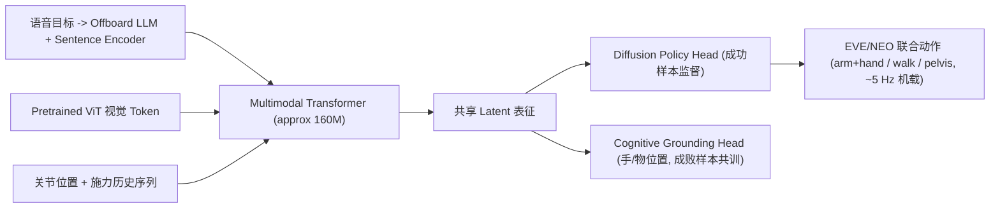

# 1X Redwood AI 控制策略

## 一句话定义

Redwood AI 是 1X 面向 EVE / NEO 的机载视觉语言动作策略，把移动、双臂操作与骨盆姿态联合预测；它与同名 World Model 是不同发布物。

## 英文缩写速查

| 缩写 | 英文全称 | 简要说明 |
| --- | --- | --- |
| VLA | Vision-Language-Action | 视觉和语言条件下生成动作 |
| WBC | Whole-Body Control | 全身平衡、运动与接触协调 |
| GPU | Graphics Processing Unit | 机载并行推理硬件 |

## 为什么重要

- 将家庭移动和操作联合学习，避免导航把机器人停在无法有效抓取的位置。
- 以约 160M 参数和机载执行说明能力、数据与实时性如何取舍。

## 核心原理

| 环节 | 官方公开的机制 |
| --- | --- |
| 输入 | offboard LLM 抽取语音目标后的句子嵌入、预训练 ViT 视觉 token、关节位置与施力历史的本体嵌入 |
| 表征 | 多层 transformer 聚合多模态信息，得到跨本体共享 latent（约 160M 参数） |
| 动作 | diffusion policy 解码到 EVE 或 NEO；联合预测手臂/灵巧手、步行与骨盆姿态指令 |
| 辅助目标与失败数据 | 预测手与目标物体在图像中的位置等认知目标；成功样本监督动作+认知，失败 rollout 仅监督认知头以抗过拟合 |

训练包含 EVE / NEO 在办公室与员工家庭采集的遥操作与自主轨迹。官方展示靠墙支撑、开门、动态选左手/右手/双手取物等多接触移动操作行为；共享表征不表示两个本体的动作维度完全相同。

## 源码运行时序图

**不适用（商业闭源机载策略）。** 官方发布页（<https://www.1x.tech/discover/redwood-ai>）未公开模型源码、推理权重或训练数据集下载链接，因此无法绘制基于真实源码入口的运行时序图。

## 工程实践

1. 区分策略与世界模型：此页回答“如何出动作”，[1XWM](paper-1xwm-redwood-world-model.md) 回答“给动作后会发生什么”。
2. 官网报告 **160M 参数、机载约 5 Hz**，这是 Redwood 策略推理频率，不能当成电机控制频率。
3. **开放范围（2026-10-05）**：官方发布页未列策略代码、权重或训练数据下载；无法按公开材料复现整个控制栈。

## 局限与风险

- 官网以演示和架构介绍为主，没有足以横比其他公司策略的统一重复试验成功率表。
- Redwood 与 ArchitectLabs 同名训练加速项目无关。
- 约 5 Hz 的上层模型需要下层执行器接口支持；公开材料不足以确定完整高频控制实现。

## 方法与任务关联

- [视觉语言动作策略（VLA）](../methods/vla.md)：Redwood 的多模态输入与动作生成属于 VLA 应用，但具体训练与模型权重尚未公开，不能按通用 VLA 开源实现复现。
- [移动操作（Loco-Manipulation）](../tasks/loco-manipulation.md)：Redwood 将步行、骨盆姿态与手臂操作联合预测，区别于只做静态桌面抓取的策略。

## 关联页面

- [1X 公司与 EVE / NEO](./1x-technologies.md)
- [1X 世界模型](./paper-1xwm-redwood-world-model.md)
- [移动操作](../tasks/loco-manipulation.md)

## 参考来源

- [Redwood 官方发布与开放核查](../../sources/sites/1x-redwood-policy.md)

## 推荐继续阅读

- [Redwood AI 官方博客](https://www.1x.tech/discover/redwood-ai)
