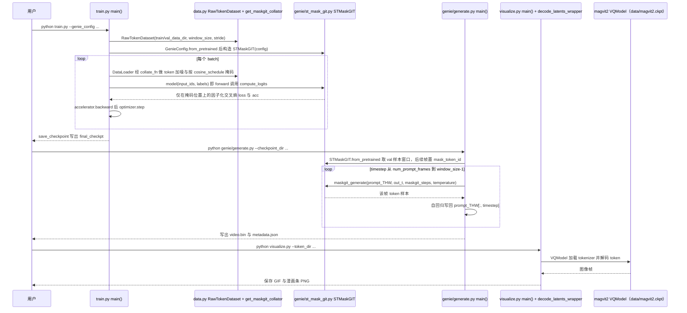

---

type: entity
tags: [hardware, humanoid, industry, teleoperation, 1x-technologies]
status: complete
updated: 2026-10-08
related:
  - ../overview/wam-motion-control-five-paths.md
  - ./paper-1xwm-redwood-world-model.md
  - ./humanoid-robot.md
  - ./figure-ai.md
  - ../queries/humanoid-hardware-selection.md
  - ../queries/humanoid-robot-data-collection-landscape.md
  - ../tasks/loco-manipulation.md
sources:
  - ../../sources/sites/company-roadmap-date-audit-2026-10-08.md
  - ../../sources/blogs/wechat_embodied_ai_lab_wam_motion_control_five_paths.md
  - ../../sources/blogs/leoinai_humanoid_robot_datacollection_2026-09-06.md
  - ../../sources/papers/1x_world_model_redwood.md
  - ../../sources/repos/1x-technologies.md
  - ../../sources/repos/1xgpt.md
summary: "1X Technologies（前身为 Halodi Robotics）是一家挪威与美国双总部的通用人形机器人公司，产品覆盖轮式人形 EVE 与面向家庭场景的双足 NEO，强调真实世界部署数据与 AI 能力迭代。"
---

# 1X Technologies

## 一句话定义

**1X Technologies** 专注于「能在真实环境里长期运行的人形机器人」，当前公开产品线以 **轮式人形 EVE**（面向仓储 / 安防 / 医疗等结构化场景）与 **双足 NEO**（强调家庭与通用场景）为主轴。

## 英文缩写速查

| 缩写 | 英文全称 | 简要说明 |
|------|----------|----------|
| AI | Artificial Intelligence | 人工智能 |
| URDF | Unified Robot Description Format | 统一机器人描述格式 |
| SDK | Software Development Kit | 软件开发工具包 |
| VLA | Vision-Language-Action | 视觉-语言-动作多模态基础策略方向 |
| Manipulation | Robot Manipulation | 抓取、移动、操作物体的任务总称 |

## 为什么重要

- **硬件形态分叉**：同时押注「轮式 + 上半身人形」与「双足全身人形」，反映了商业化上对续航、通过性与成本的权衡。
- **数据闭环叙事**：家庭场景产品常与大规模真实交互数据、模仿学习与遥操作数据采集联系在一起（具体能力与时间表以官方为准）。LeoInAI Substack（2026-09）转述其使用 **Meta Quest 3** 让操作员完成困难任务以供机器人复现。
- **产业节点**：与美国人形赛道（Figure、Tesla、Agility 等）并行，代表欧洲与美国西海岸混合供应链路线的一支独立力量。

## 产品与路线（归纳）

| 系列 | 典型定位 | 备注 |
|------|-----------|------|
| **EVE** | 机构 / 工业场景的轮式人形 | 强调可部署性与导航–操作组合 |
| **NEO** | 家庭与通用场景的双足平台 | Beta / Gamma 等代际迭代见官网；面向消费者的交付与条款变化较快 |

## 常见误区或局限

- **不要把融资报道当规格书**：估值与融资轮次与整机参数无直接对应关系。
- **学术可得性**：与 Unitree 等科研平台相比，1X 更偏产品与试点部署，论文级 URDF / SDK 开放度需单独核实。
- **自主 vs 遥操作**：公开演示中常见 VR 遥操作与高监督采集；「完全自主居家」仍是整个行业未解决的问题。

## 公司路线中的版本定位

- [Redwood 控制策略（与 World Model 区分）](./1x-redwood-policy.md)：与本页互补，按独立发布物核对架构和开放范围。

## 源码运行时序图

本图对应公司路线中与 1X World Model Challenge 配套的开源基线仓库 `1x-technologies/1xgpt`（GENIE 风格时空 Transformer + MaskGIT 采样），不覆盖 NEO/Redwood 等闭源产品栈。

入口：`./build.sh` 建环境并下载数据 → `python train.py --genie_config genie/configs/magvit_n32_h8_d256.json --output_dir data/genie_model` → `python genie/generate.py --checkpoint_dir <ckpt>` → `python visualize.py --token_dir <dir>`

图依据：1x-technologies/1xgpt@0069734，读过 `README.md`、`build.sh`、`train.py`（主循环与数据加载段）、`data.py`、`genie/st_mask_git.py`、`genie/generate.py`、`genie/evaluate.py`（`GenieEvaluator` 前段）、`visualize.py`。`train.py` 中 Llama 分支为注释/可选，未画。

## 关联页面

- [1X World Model（1XWM）](./paper-1xwm-redwood-world-model.md)
- [Robbyant（蚂蚁灵波）](./robbyant.md) — LingBot-World 动作条件视频世界模型对照
- [WAM×运动控制五路径](../overview/wam-motion-control-five-paths.md)
- [人形机器人](./humanoid-robot.md)
- [Figure AI](./figure-ai.md)（美国人形与 VLA 路线的可比节点）
- [Query：人形机器人硬件怎么选](../queries/humanoid-hardware-selection.md)
- [人形数据采集产业地图](../queries/humanoid-robot-data-collection-landscape.md)
- [Loco-Manipulation](../tasks/loco-manipulation.md)

## 公司路线日期口径

1X 官方公告：2024-08-30 发布 NEO Beta；是家庭双足原型事件，不是 EVE 首发或 NEO 商业交付日。 [日期证据](https://www.1x.tech/discover/announcement-1x-unveils-neo-beta-a-humanoid-robot-for-the-home)。详见[本轮日期核查](../../sources/sites/company-roadmap-date-audit-2026-10-08.md)；版本事件与原始产品首发分别记录。

## 参考来源

- [公司路线日期核查](../../sources/sites/company-roadmap-date-audit-2026-10-08.md)

- [1X Technologies 原始资料](../../sources/repos/1x-technologies.md)
- [1XWM 技术报告归档](../../sources/papers/1x_world_model_redwood.md)
- [1xgpt Challenge 归档](../../sources/repos/1xgpt.md)
- 源码核对（2026-11-02）：1x-technologies/1xgpt@0069734，读过 README.md、build.sh、train.py、data.py、genie/st_mask_git.py、genie/generate.py、genie/evaluate.py、visualize.py；时序图依据以上文件，未运行代码。

## 推荐继续阅读

- [1X 官网 About](https://1x.tech/about)
- [IEEE Robots — EVE](https://robots.ieee.org/robots/eve)
