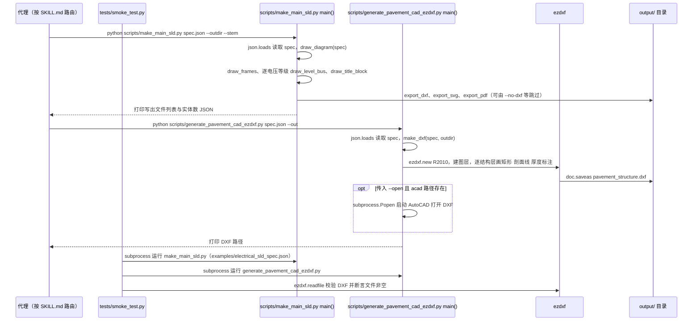

# CAD Operations Skill（2836048681/cad-operations-skill）

## 一句话定义

CAD Operations Skill（2836048681/cad-operations-skill）是便携 Codex 技能面向 CAD 操作、DXF/PDF 生成，含 AutoCAD/FreeCAD 说明和 SolidWorks MCP 工作流。

## 英文缩写速查

| 缩写 | 英文全称 | 简要说明 |
|------|----------|----------|
| CAD | Computer-Aided Design | 计算机辅助设计与几何建模 |
| MCP | Model Context Protocol | 代理调用 CAD/可视化工具的协议 |
| FEM | Finite Element Method | 结构有限元分析方法 |

## 为什么重要

对 CAE 自动化而言，代理能否稳定完成任务，取决于工程步骤是否清楚、工具边界是否明确、结果是否保留可审查证据。便携 Codex 技能面向 CAD 操作、DXF/PDF 生成，含 AutoCAD/FreeCAD 说明和 SolidWorks MCP 工作流。

## 核心原理

**项目自身范围：** Portable Codex skill for CAD operations and drawing-file generation.

**工作流：** 代理遵循技能说明生成或检查 CAD 相关产物，再借助本地 CAD 程序或 SolidWorks MCP 完成软件侧操作。

**仓库映射说明：** 文章未给出该项目完整的 owner/repository URL；此处按文章中的项目名/描述与公开 GitHub 仓库匹配。引用时请以本页链接的仓库 README 为准。

## 工程实践

1. 从目标问题识别所需的 Skill、MCP、CLI 或软件接口，不把指导文件当成求解器。
2. 依照仓库 README 检查安装前提、软件/许可证、输入文件和输出证据。
3. 小规模运行并逐项核对几何、网格、边界、求解状态和物理量，再决定是否扩大任务。

文章所述的项目特征：便携 Codex 技能面向 CAD 操作、DXF/PDF 生成，含 AutoCAD/FreeCAD 说明和 SolidWorks MCP 工作流。

## 局限与风险

DXF/PDF 文件生成不等于模型几何与出图符合工程标准；具体软件接口取决于本地环境。

源码状态核验：该 GitHub 仓库于 2026-10-07 可公开访问。仓库 API 报告许可证为 MIT。 

## 源码运行时序图

入口：`python scripts/make_main_sld.py examples/electrical_sld_spec.json --outdir output/sld --stem demo_sld`（电气主接线图）与 `python scripts/generate_pavement_cad_ezdxf.py examples/pavement_structure_spec.json --out output/pavement`（路面结构图）；CI 入口为 `python tests/smoke_test.py`。仓库的 `SKILL.md` 只是让 Codex 按任务类型选择上述脚本的路由说明，本身不是可运行程序。

图依据：2836048681/cad-operations-skill@e430a57，读过 `README.md`、`SKILL.md`、`scripts/make_main_sld.py`（`draw_diagram` 与 `main`，导出函数仅读签名）、`scripts/generate_pavement_cad_ezdxf.py`、`tests/smoke_test.py`、`.github/workflows/smoke-test.yml`。`generate_pavement_cad.py`、`audit_sld.py` 与 SolidWorks MCP 相关 `references/` 未逐行读，未画。

## 关联页面

- [CAE / CFD 代理工具项目总览](../overview/cae-cfd-agent-skills-landscape.md)
- [SolidWorks Automation Skill](./wzyn20051216-solidworks-automation-skill.md)

## 参考来源

- [公众号文章原始资料归档](../../sources/blogs/wechat_cae_cfd_agent_skills_2026-10-07.md)
- [GitHub 仓库资料归档](../../sources/repos/2836048681-cad-operations-skill.md)
- [2836048681/cad-operations-skill 官方仓库](<https://github.com/2836048681/cad-operations-skill>)
- 源码核对（2026-11-02）：2836048681/cad-operations-skill@e430a57，读过 README.md、SKILL.md、scripts/make_main_sld.py、scripts/generate_pavement_cad_ezdxf.py、tests/smoke_test.py、.github/workflows/smoke-test.yml；时序图依据以上文件，未运行代码。

## 推荐继续阅读

- [项目 README](<https://github.com/2836048681/cad-operations-skill/blob/main/README.md>)