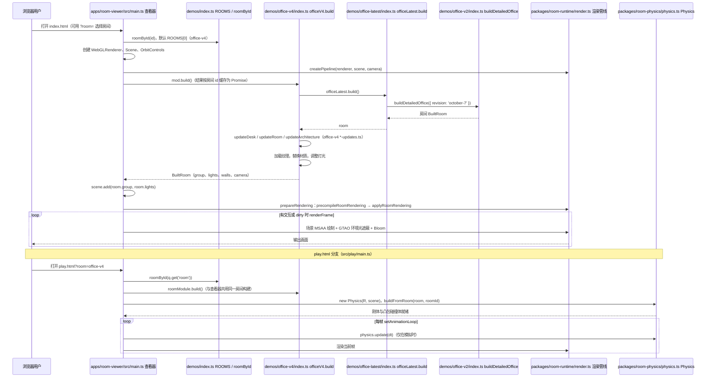

# 3D Model Anything：室内场景重建

## 一句话定义

3D Model Anything 采集房间的 LiDAR 几何与照片，再由编程智能体借助测量和照片比对，迭代生成可编辑的 Three.js 场景。

## 英文缩写速查

| 缩写 | 英文全称 | 简要说明 |
|------|----------|----------|
| LiDAR | Light Detection and Ranging | 采集空间几何 |
| AI | Artificial Intelligence | 编程智能体辅助场景建模 |
| API | Application Programming Interface | 场景和工具的程序接口 |

## 工作流程

1. 用带 LiDAR 的 iPhone 或 iPad 采集空间几何和照片并导出。
2. 使用仓库的 `scan-to-threejs` skill，让智能体根据测量构造场景。
3. 将相机对齐后的渲染与原图逐步比对并调整；浏览器支持多视角查看。

与 [3DCodeVerse](./paper-3dcodeverse.md) 侧重从提示生成并验证代码不同，此项目重点利用实景扫描证据重建房间。对 Real2Sim 资产准备有启发，但仓库介绍的是浏览器场景重建，不能推断输出已包含可用的机器人仿真碰撞体和物理参数。

## 工程实践与局限

- 代码、采集应用和 skill 已公开；代码使用 MIT 许可，示例素材另有条款。
- 这是需要智能体参与的迭代流程，不是一键生成精确模型；遮挡、测量和纹理误差需要人工检查。
- 官方示例不分发原始扫描和照片；示例页面中的扫描叠加功能因此不可用。
- 采集自己的场景需要支持 LiDAR 的设备；非 LiDAR 设备可导入与查看扫描。

## 源码运行时序图

入口：`npm run dev`（即 `vite --config apps/room-viewer/vite.config.ts`；`index.html` 加载 `apps/room-viewer/src/main.ts`，`play.html` 加载 `apps/room-viewer/src/play/main.ts`）

图依据：wesbos/3d-model-anything@31b2dc9，实际读过 `package.json`、`apps/room-viewer/index.html`、`apps/room-viewer/vite.config.ts`、`apps/room-viewer/src/main.ts`、`apps/room-viewer/src/play/main.ts`（局部）、`demos/index.ts`、`demos/office-latest/index.ts`、`demos/office-v4/index.ts`、`packages/room-runtime/render.ts`、`packages/room-physics/physics.ts`（局部）。

## 关联页面

- [3DCodeVerse](./paper-3dcodeverse.md) — 可执行三维代码生成与验证。
- [Gitingest](./gitingest.md) — 整理仓库上下文以辅助阅读代码。

## 参考来源

- [官方仓库归档](../../sources/repos/3d-model-anything.md)
- [在线演示归档](../../sources/sites/3d-model-anything.md)
- 源码核对（2026-11-02）：wesbos/3d-model-anything@31b2dc9，读过 package.json、apps/room-viewer/index.html、apps/room-viewer/vite.config.ts、apps/room-viewer/src/main.ts、apps/room-viewer/src/play/main.ts（局部）、demos/index.ts、demos/office-latest/index.ts、demos/office-v4/index.ts、packages/room-runtime/render.ts、packages/room-physics/physics.ts（局部）；时序图依据以上文件，未运行代码。

## 推荐继续阅读

- [官方仓库及使用说明](https://github.com/wesbos/3d-model-anything)
- [在线办公室演示](https://wesbos.github.io/3d-model-anything/)
