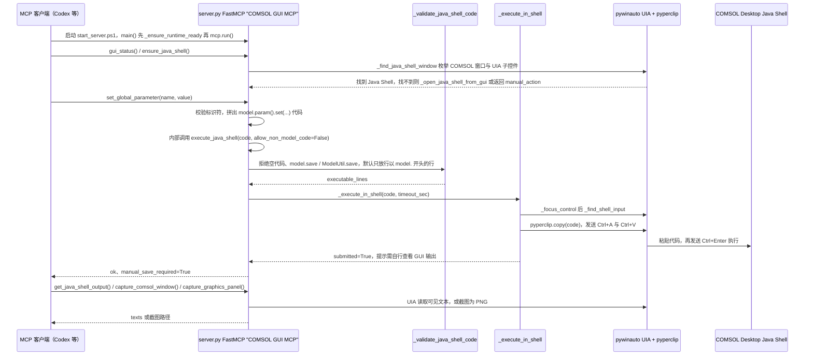

# COMSOL MCP（777gegewu/comsol-mcp）

## 一句话定义

COMSOL MCP（777gegewu/comsol-mcp）是非官方 COMSOL MCP 学习项目，通过 Java Shell 控制已经打开的 COMSOL Desktop GUI。

## 英文缩写速查

| 缩写 | 英文全称 | 简要说明 |
|------|----------|----------|
| MCP | Model Context Protocol | 代理与工程软件工具的交互协议 |
| CAE | Computer-Aided Engineering | 计算机辅助工程软件与分析 |
| API | Application Programming Interface | 软件可供自动化调用的接口 |

## 为什么重要

对 CAE 自动化而言，代理能否稳定完成任务，取决于工程步骤是否清楚、工具边界是否明确、结果是否保留可审查证据。非官方 COMSOL MCP 学习项目，通过 Java Shell 控制已经打开的 COMSOL Desktop GUI；和独立求解服务相比，它依赖现有桌面会话。

## 核心原理

**项目自身范围：** Unofficial COMSOL MCP learning project controlling an open Desktop session through Java Shell.

**工作流：** 代理经 MCP 将操作交给 Java Shell，再由正在运行的 COMSOL Desktop 执行并返回结果。

## 工程实践

1. 从目标问题识别所需的 Skill、MCP、CLI 或软件接口，不把指导文件当成求解器。
2. 依照仓库 README 检查安装前提、软件/许可证、输入文件和输出证据。
3. 小规模运行并逐项核对几何、网格、边界、求解状态和物理量，再决定是否扩大任务。

文章所述的项目特征：非官方 COMSOL MCP 学习项目，通过 Java Shell 控制已经打开的 COMSOL Desktop GUI；和独立求解服务相比，它依赖现有桌面会话。

## 局限与风险

文章对它的定位是同类学习项目；依赖已启动 GUI、本机软件和许可证，不能按官方支持的稳定接口理解。

源码状态核验：该 GitHub 仓库于 2026-10-07 可公开访问。仓库 API 报告许可证为 MIT。 涉及商业软件时，安装包和有效许可证需由使用者自行提供。

## 源码运行时序图

入口：`.\start_server.ps1`（调用 `.venv\Scripts\python.exe server.py`，进入 `server.py` 的 `main()`，经 `mcp.run()` 以 FastMCP 提供 MCP 工具；运行前需已打开 COMSOL Desktop 与目标模型）

图依据：777gegewu/comsol-mcp@5ef5a94，读过 `README.md`、`start_server.ps1`、`server.py`（运行时检查、窗口与 Java Shell 查找、`_validate_java_shell_code`、`_execute_in_shell` 及全部 `@mcp.tool()` 函数）。`_open_java_shell_from_gui` 与截图辅助函数仅读到签名，其内部点击与截图细节未画。

## 关联页面

- [CAE / CFD 代理工具项目总览](../overview/cae-cfd-agent-skills-landscape.md)
- [COMSOL Multiphysics MCP](./wjc9011-comsol-multiphysics-mcp.md)

## 参考来源

- [公众号文章原始资料归档](../../sources/blogs/wechat_cae_cfd_agent_skills_2026-10-07.md)
- [GitHub 仓库资料归档](../../sources/repos/777gegewu-comsol-mcp.md)
- [777gegewu/comsol-mcp 官方仓库](<https://github.com/777gegewu/comsol-mcp>)
- 源码核对（2026-11-02）：777gegewu/comsol-mcp@5ef5a94，读过 README.md、start_server.ps1、server.py；时序图依据以上文件，未运行代码。

## 推荐继续阅读

- [项目 README](<https://github.com/777gegewu/comsol-mcp/blob/main/README.md>)