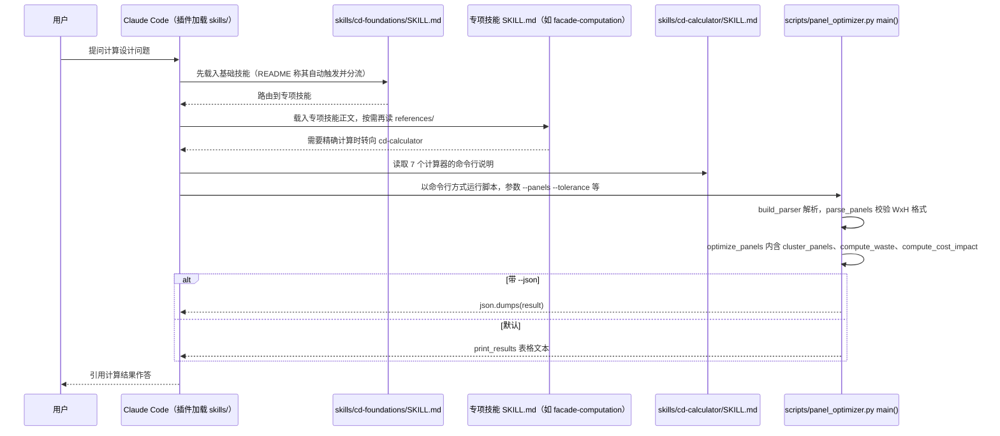

# Claude Skills for Computational Designers（Abhinavbwj/Claude-skills-for-Computational-Designers）

## 一句话定义

Claude Skills for Computational Designers（Abhinavbwj/Claude-skills-for-Computational-Designers）是面向建筑/AEC 计算设计者，含力密度法、动力松弛、推力网络、有限元基础、壳与张拉结构、拓扑优化和 Python 计算器。

## 英文缩写速查

| 缩写 | 英文全称 | 简要说明 |
|------|----------|----------|
| CFD | Computational Fluid Dynamics | 计算流体力学证据或流程 |
| CAD | Computer-Aided Design | 参数化工程几何设计 |
| AI | Artificial Intelligence | 辅助设计或研究的人工智能能力 |

## 为什么重要

对 CAE 自动化而言，代理能否稳定完成任务，取决于工程步骤是否清楚、工具边界是否明确、结果是否保留可审查证据。面向建筑/AEC 计算设计者，含力密度法、动力松弛、推力网络、有限元基础、壳与张拉结构、拓扑优化和 Python 计算器。

## 核心原理

**项目自身范围：** Claude skills for computational design and structural form-finding.

**工作流：** 根据建筑结构问题加载相应技能或脚本，辅助形式找形、结构分析和优化计算。

## 工程实践

1. 从目标问题识别所需的 Skill、MCP、CLI 或软件接口，不把指导文件当成求解器。
2. 依照仓库 README 检查安装前提、软件/许可证、输入文件和输出证据。
3. 小规模运行并逐项核对几何、网格、边界、求解状态和物理量，再决定是否扩大任务。

文章所述的项目特征：面向建筑/AEC 计算设计者，含力密度法、动力松弛、推力网络、有限元基础、壳与张拉结构、拓扑优化和 Python 计算器。

## 局限与风险

示例计算器和技能说明不是结构设计签章；荷载组合、材料规范与边界条件必须由工程师复核。

源码状态核验：该 GitHub 仓库于 2026-10-07 可公开访问。仓库 API 报告许可证为 MIT。 

## 源码运行时序图

入口：`claude --plugin-dir "<仓库路径>"`（加载 `.claude-plugin/plugin.json`），或把 `skills/` 复制到 `.claude/skills/`；可执行代码只有 `skills/cd-calculator/scripts/` 下 7 个命令行脚本，例如 `python skills/cd-calculator/scripts/panel_optimizer.py --panels "1200x800,1200x810" --tolerance 10 [--json]`。其余 17 个技能是 SKILL.md 与参考文档，由 Claude 读取，不是程序。

图依据：Abhinavbwj/Claude-skills-for-Computational-Designers@7a090c9，读过 `README.md`（How It Works 一节）、`.claude-plugin/plugin.json`、`skills/cd-calculator/SKILL.md`（开头与目录说明）、`skills/cd-calculator/scripts/panel_optimizer.py`（`main` 与参数解析、函数清单）、`skills/cd-calculator/scripts/structural_checker.py`（`main` 与参数解析）。技能路由与何时调用脚本是 Claude Code 依据 SKILL.md 的运行时行为，仓库内无对应代码，此处按 README 描述绘制；其余 6 个计算器与 17 个技能正文未逐一读。

## 关联页面

- [CAE / CFD 代理工具项目总览](../overview/cae-cfd-agent-skills-landscape.md)
- [FreeCAD Engineering](./v0v1kkk-freecad-engineering.md)

## 参考来源

- [公众号文章原始资料归档](../../sources/blogs/wechat_cae_cfd_agent_skills_2026-10-07.md)
- [GitHub 仓库资料归档](../../sources/repos/abhinavbwj-claude-skills-for-computational-designers.md)
- [Abhinavbwj/Claude-skills-for-Computational-Designers 官方仓库](<https://github.com/Abhinavbwj/Claude-skills-for-Computational-Designers>)
- 源码核对（2026-11-02）：Abhinavbwj/Claude-skills-for-Computational-Designers@7a090c9，读过 README.md、.claude-plugin/plugin.json、skills/cd-calculator/SKILL.md、skills/cd-calculator/scripts/panel_optimizer.py、skills/cd-calculator/scripts/structural_checker.py；时序图依据以上文件，未运行代码。

## 推荐继续阅读

- [项目 README](<https://github.com/Abhinavbwj/Claude-skills-for-Computational-Designers/blob/main/README.md>)