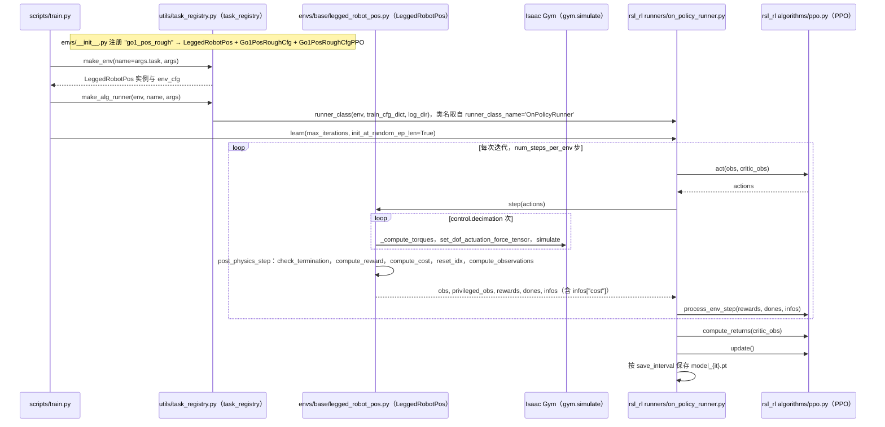

# ABS（Agile But Safe）

**ABS（Agile But Safe）**（[GitHub](https://github.com/LeCAR-Lab/ABS)）来自 [古月居转载的四足机器人开源项目综述](https://mp.weixin.qq.com/s/pRGoPm41qYCNyHPWR6Dl6A)，属「强化学习」组。

## 一句话定义

**ABS 是「Agile But Safe: Learning Collision-Free High-Speed Legged Locomotion」（RSS 2024）的官方实现：在 legged_gym / rsl_rl 之上训练高速且无碰撞的四足运动。**

## 英文缩写速查

| 缩写 | 英文全称 | 简要说明 |
|------|----------|----------|
| ABS | Agile But Safe | 敏捷但安全 |
| RSS | Robotics: Science and Systems | 机器人顶会 |

## 为什么重要

- 综述把它放在「强化学习」这条技术路线下，作为可读源码的参照项目；横向对比见 [四足机器人开源项目技术地图：从极简运动学到研究级硬件（36 个 GitHub 项目）](../overview/quadruped-open-source-projects-technology-map.md)。
- 文中星标：（文中未给）（文章表述，入库日未复核）。

## 核心信息

| 项 | 内容 |
|----|------|
| **仓库** | [LeCAR-Lab/ABS](https://github.com/LeCAR-Lab/ABS) |
| **最近提交** | 2024-07-11 |
| **可达性** | `git ls-remote` 可达（2026-11-01） |
| **文章归类** | 强化学习 |

## 文章说法核对

- **文章：** 文章称其由 CMU 与 ETH 联合开发，3–4 m/s 奔跑，感知层用 RealSense D435i 与轻量 CNN 输出局部占据栅格，规划层用 MPPI，控制层为 RL 低层控制器。
- **README / 核查：** README 标注 RSS 2024，作者含 Tairan He、Chong Zhang、Guanya Shi 等（README 未标机构）；代码按 CC BY-NC 4.0 许可（禁止商用），继承 Legged Gym 与 RSL RL（ETH Zurich / NVIDIA）的许可；建议先跑通 RSL 版 Legged Gym。
- **差异与保留：** 文章的「CMU+ETH 联合」「MPPI 规划」「D435i + CNN 占据栅格」等在已读 README 段落中未见，来自文章，未核实；README 另限制商业用途。

## 源码运行时序图

入口：`cd training/legged_gym/legged_gym && python scripts/train.py --task=go1_pos_rough --max_iterations=4000`（README「Training in Simulation」；`go1_pos_rough_ppo_lagrangian` 任务改用 `OnPolicyRunnerCost` 与 `PPOLagrangian`，此处只画 PPO 路径）。

图依据：ABS@9b95329，读过 `README.md`、`training/legged_gym/legged_gym/scripts/train.py`、`envs/__init__.py`、`utils/task_registry.py`、`envs/base/legged_robot.py`（step、post_physics_step）、`envs/base/legged_robot_pos.py`（方法列表与 compute_cost）、`envs/go1/go1_pos_config.py`（PPO 配置类）、`training/rsl_rl/rsl_rl/runners/on_policy_runner.py` 与 `on_policy_runner_cost.py`（learn）、`algorithms/ppo.py`（方法签名）。`testbed.py`（Reach-Avoid 网络）、`camrec.py` 与 `deployment/` 未读，未画。

## 关联页面

- [legged-gym](../entities/legged-gym.md)
- [rsl-rl](../entities/rsl-rl.md)
- [reinforcement-learning](../methods/reinforcement-learning.md)
- [locomotion](../tasks/locomotion.md)
- [sim2real](../concepts/sim2real.md)
- [quadruped-open-source-projects-technology-map](../overview/quadruped-open-source-projects-technology-map.md)

## 参考来源

- [abs_agile_but_safe.md](../../sources/repos/abs_agile_but_safe.md)
- [wechat_guyueju_quadruped_opensource_deep_dive_2026-11-01.md](../../sources/blogs/wechat_guyueju_quadruped_opensource_deep_dive_2026-11-01.md)
- [原文（微信公众号）](https://mp.weixin.qq.com/s/pRGoPm41qYCNyHPWR6Dl6A)
- 源码核对（2026-11-02）：LeCAR-Lab/ABS@9b95329，读过 README.md、training/legged_gym/legged_gym/{scripts/train.py,envs/__init__.py,utils/task_registry.py,envs/base/legged_robot.py,envs/base/legged_robot_pos.py,envs/go1/go1_pos_config.py}、training/rsl_rl/rsl_rl/{runners/on_policy_runner.py,runners/on_policy_runner_cost.py,algorithms/ppo.py}；时序图依据以上文件，未运行代码。

