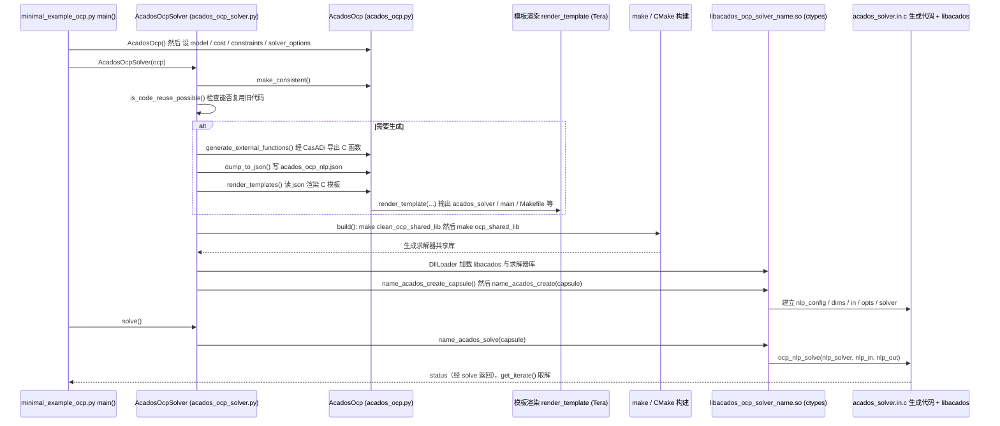

# acados

[**acados**](https://github.com/acados/acados) 是面向 **模型预测控制（MPC）** 与 **最优控制问题（OCP）** 的开源求解框架：用 **Real-Time Iteration（RTI）** 与结构 exploiting QP 求解器，在毫秒级控制环内求解非线性 MPC，常见于腿足 / 机械臂 **WBC / NMPC** 栈。

## 一句话定义

**嵌入式 NMPC 求解后端** — 把 OCP 编译成高效 C 代码 + Python/MATlab 模板，服务约束优化步态与传统人形控制。

## 英文缩写速查

| 缩写 | 英文全称 | 简要说明 |
|------|----------|----------|
| MPC | Model Predictive Control | 滚动时域优化控制 |
| OCP | Optimal Control Problem | 最优控制问题形式化 |
| RTI | Real-Time Iteration | 单步 SQP 近似实时求解 |
| QP | Quadratic Programming | acados 内部子问题类型 |
| NMPC | Nonlinear MPC | 非线性模型上的 MPC |

## 为什么重要

- **与传统 WBC 衔接：** 文章将其与 [Pinocchio](./pinocchio.md) 并列为「看懂雅可比 / MPC 步态」的基础库。
- **嵌入式友好：** 相对通用 NLP 求解器更强调 **固定结构 + 实时性**，适合真机 500Hz–1kHz 环。
- **生态接口：** `acados_template` 生成 C 代码；可与 CasADi 等建模前端组合。

## 工程实践

1. 文档入口：<https://docs.acados.org/>
2. 动力学前端常接 Pinocchio / CasADi；复现前核对 README 的 `pip install` 与编译依赖（BLAS 等）。
3. 与 RL 步态栈（[rsl-rl](./rsl-rl.md)）分工：**acados 偏模型驱动 MPC**，RL 偏数据驱动策略。

## 局限与使用注意

- **不是仿真器：** 需自备 MuJoCo / Isaac 等环境与模型。
- **建模成本：** OCP  formulation 与约束调参需要控制背景；非「pip install 即跑 demo 步态」。

## 关联页面

- [Model Predictive Control](../methods/model-predictive-control.md)
- [Pinocchio](./pinocchio.md)
- [Whole-Body Control](../concepts/whole-body-control.md)

## 源码运行时序图

入口：`python minimal_example_ocp.py`（`examples/acados_python/getting_started/`，Python 接口 `acados_template`）

图依据：acados/acados@51db6db，读过 `README.md`、`examples/acados_python/getting_started/minimal_example_ocp.py`、`interfaces/acados_template/acados_template/acados_ocp_solver.py`（`generate` / `build` / `__init__` / `solve`）、`acados_ocp.py`（`render_templates` / `dump_to_json` / `generate_external_functions`）、`c_templates_tera/acados_solver.in.c`（`acados_solve` 调用 `ocp_nlp_solve`）。

## 参考来源

- [sources/repos/acados.md](../../sources/repos/acados.md)
- [wechat_robot_yanfa_opensource_algorithms_compendium.md](../../sources/blogs/wechat_robot_yanfa_opensource_algorithms_compendium.md)
- 源码核对（2026-11-02）：acados/acados@51db6db，读过 README.md、examples/acados_python/getting_started/minimal_example_ocp.py、interfaces/acados_template/acados_template/{acados_ocp_solver.py,acados_ocp.py,c_templates_tera/acados_solver.in.c}；时序图依据以上文件，未运行代码。

## 推荐继续阅读

- GitHub：<https://github.com/acados/acados>
- 文档：<https://docs.acados.org/>
