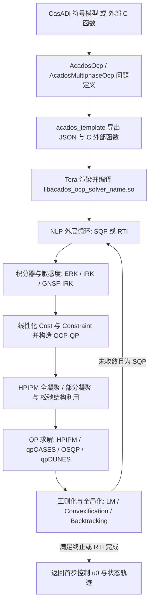
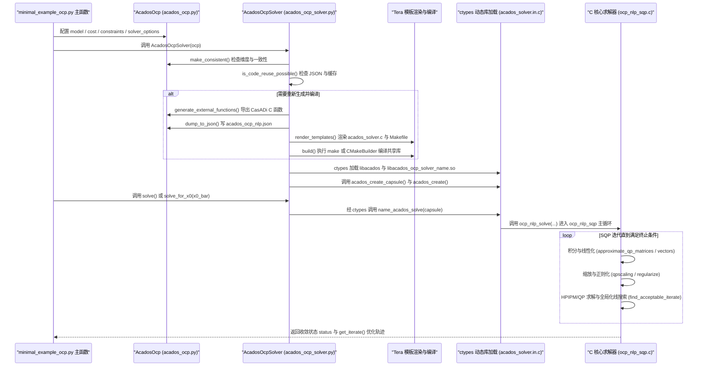

# acados

[**acados**](https://github.com/acados/acados) 是由弗莱堡大学（University of Freiburg）SYSCOP 等团队发起并持续维护的开源非线性最优控制软件框架（BSD-2-Clause）。它专注于将非线性模型预测控制（NMPC）、滚动时域估计（MHE）与多阶段最优控制问题（OCP）转化为紧凑的 C 代码与模块化 C 求解库，借助面向中小矩阵的线性代数库 **BLASFEO** 与结构利用二次规划（QP）求解器 **HPIPM**，在嵌入式硬件与真机控制环中实现毫秒级乃至亚毫秒级求解。

## 一句话定义

**嵌入式非线性最优控制（NMPC/OCP/MHE）模块化 C 求解框架** — 通过 CasADi 导数生成、BLASFEO 高性能线性代数、HPIPM 部分凝聚 QP 与 SQP/RTI 算法家族，在毫秒级控制环内求解带非线性约束的轨迹优化问题。

## 英文缩写速查

| 缩写 | 英文全称 | 简要说明 |
|------|----------|----------|
| MPC | Model Predictive Control | 滚动时域模型预测控制 |
| NMPC | Nonlinear Model Predictive Control | 非线性动力学或约束下的 MPC |
| OCP | Optimal Control Problem | 多重打靶离散化的最优控制问题 |
| MHE | Moving Horizon Estimation | 滚动时域状态与参数估计 |
| SQP | Sequential Quadratic Programming | 序列二次规划，迭代线性化近似求解 |
| RTI | Real-Time Iteration | 实时迭代，每采样步执行单次 SQP 近似 |
| QP | Quadratic Programming | SQP/RTI 每步线性化后求解的二次规划子问题 |
| BLASFEO | Basic Linear Algebra Subroutines for Embedded Optimization | 面向嵌入式中小规模矩阵的汇编级优化线性代数库 |
| HPIPM | High-Performance Interior-Point Method | 基于 BLASFEO 的高性能内点法 QP 求解器 |
| DAE | Differential-Algebraic Equation | 微分代数方程模型 |

## 为什么重要

1. **填补高精度与实时性之间的空白：** 通用稀疏 NLP 求解器（如 IPOPT）虽然精度高但内存开销和耗时较大，而早期代码生成工具（如 ACADO）在代码膨胀、部分凝聚灵活性与算法组合扩展性上受限。acados 以运行时模块化 C 库与针对性生成外部函数兼顾性能与可维护性。
2. **机器人 WBC / NMPC 栈的核心 QP/SQP 后端：** 在腿足、机械臂与无人机领域，常与 [Pinocchio](./pinocchio.md)（动力学与雅可比计算）、CasADi（符号微分与 C 代码生成）组成模型驱动控制主干，负责质心动力学、全身或接触调度型 NMPC 求解。
3. **持续演进的控制与 RL 接口：** 根据 `docs.acados.org`（2026-11-13 构建），除传统 `AcadosOcp` 与 MHE 外，acados 已支持多阶段问题 `AcadosMultiphaseOcp`、解敏感度（solution sensitivities）以及与 `leap-c` 等强化学习框架结合的可微 MPC 层。

## 核心原理

acados 将连续时间最优控制问题通过**直接多重打靶法（Direct Multiple Shooting）**离散化为带块状稀疏（block-sparse）结构的非线性规划（NLP），再通过解耦的「线性代数层 — 积分器层 — QP 求解器层 — NLP 策略层」逐级求解：

### 四层核心架构（基于论文 `arXiv:1910.13753v3` 与 `1d682b2` 源码）

1. **高性能线性代数后端 BLASFEO：** 通用 BLAS（如 OpenBLAS）针对超大矩阵缓存优化，在 MPC 常见的 `10×4` 到 `100×100` 矩阵尺度反而因分块调度开销低效；纯粹代码生成则会导致指令缓存失效。BLASFEO 针对 300×300 以下中小矩阵手写汇编内核与缓存友好的面板布局（panel-major layout），在该尺度显著超越 OpenBLAS 与代码生成线性代数。
2. **结构利用 QP 引擎与凝聚（HPIPM）：** 支持稠密 QP、最优控制带状 QP（OCP-QP）和树状 QP（Tree-QP）。借助 **部分凝聚（Partial Condensing）** 可在完整离散化与全消元之间调节凝聚块大小，并将 QP 松弛变量（slack variables）保留在结构化接口内避免增广状态维度。除默认 HPIPM 外，也可切换 `qpOASES`、`HPMPC`、`qpDUNES` 与 `OSQP`。
3. **多类积分器与一二阶敏感度：** 内置显式 Runge-Kutta（`ERK`）、隐式 Runge-Kutta（`IRK`）、`Lifted IRK` 及针对机械系统与 DAE 专门优化结构的 `GNSF-IRK`（Generalized Nonlinear Static Feedback），支持前向与伴随敏感度以提供 Hessian 或精确线性化矩阵。
4. **SQP 与 RTI 策略演进：**
   - 论文对比了 Gauss-Newton、Convex-over-Nonlinear（SCQP）及精确 Hessian 的三种处理方式（Project / Mirror / Convexification）。
   - 在当前代码库（commit `1d682b2`）的 `acados/ocp_nlp/ocp_nlp_sqp.c` 中，主迭代已包含 Levenberg-Marquardt 阻尼项（`ocp_nlp_add_levenberg_marquardt_term`）、QP 尺度缩放（`ocp_nlp_qpscaling_scale_qp`）、Hessian 正则化（`config->regularize->regularize`）及全局化线搜索（`config->globalization->find_acceptable_iterate`，如 `MERIT_BACKTRACKING`）；`ocp_nlp_sqp_rti.c` 则支持 Preparation/Feedback 分阶段及多步近似迭代（`as_rti_level`、`as_rti_iter`）。

## 实验与评测

根据官方核心论文 `arXiv:1910.13753v3` 中的三组标准基准与硬件在环（HIL）验证（具体硬件与问题规模依原论文实验配置）：

| 实验场景 | 对比基线与关键指标 | 核心结论 |
|------|------|------|
| 质点弹簧链 NMPC（Chain of Masses，`N=40, M=5`） | acados 中位单步耗时 `1.05 ms`（最小 `0.87 ms`、最大 `2.23 ms`），相对次优残差 `RCSO = 1.01e-4`；GRAMPC 耗时 `1.06 ms` 但 `RCSO = 7.17e-2`；ACADO 耗时 `1.97 ms`；IPOPT 耗时 `59.84 ms` | 在相当或更高求解精度下实现近似 GRAMPC 的毫秒级速度，且比通用稀疏 NLP 快约一个量级以上 |
| 倒立摆摆起 Hessian 策略对比（Cart-Pole） | 精确 Hessian 凸化（Convexification）总耗时 `66.034 ms`，投影法（Project）`103.65 ms`，镜像法（Mirror）`174.32 ms` | 非凸精确 Hessian 在多步最优控制中采用结构保留凸化策略可明显减少迭代与计算量 |
| dSPACE MicroAutoBoxII（900 MHz PowerPC 嵌入式 HIL） | 发动机空燃比 NMPC，时域 `N=20`、步长 `dt=0.05 s` | 验证生成 C 代码与 BLASFEO 定点/嵌入式构建链路可在车规级嵌入式处理器中实时闭环 |

## 源码运行时序图

入口：`examples/acados_python/getting_started/minimal_example_ocp.py`（Python 接口 `acados_template`，通过 CasADi 定义模型、`NONLINEAR_LS` 代价、`IRK` 积分器、`PARTIAL_CONDENSING_HPIPM`、`SQP` 与 `MERIT_BACKTRACKING` 全局化，并编译运行生成 C 库）

图依据：`acados/acados@1d682b2`，实际核查过 `README.md`、`examples/acados_python/getting_started/minimal_example_ocp.py`、`interfaces/acados_template/acados_template/acados_ocp_solver.py`（`__init__`、`generate`、`build`、`solve`、`solve_for_x0`、`get_iterate`）、`interfaces/acados_template/acados_template/c_templates_tera/acados_solver.in.c`（`{{ name }}_acados_solve`）、`acados/ocp_nlp/ocp_nlp_sqp.c` 与 `acados/ocp_nlp/ocp_nlp_sqp_rti.c`。

## 工程实践

1. **安装与 BLASFEO 目标架构选择：** 从源码构建 C 核心时需注意 `-DBLASFEO_TARGET=...`（如 x86_64 AVX2 或 ARM Cortex-A 系列），选型错误会回退通用 C 内核导致求解耗时显著上升；Python 侧安装需同步配置 `ACADOS_SOURCE_DIR` 与 `LD_LIBRARY_PATH` 并指向 `t_renderer`（Tera 渲染二进制）。
2. **从高斯-牛顿起步再引入正则化：** 工程落地建议优先使用 `GAUSS_NEWTON` + `PARTIAL_CONDENSING_HPIPM` + `SQP_RTI`（面向 500Hz–1kHz 固定周期闭环）；若出现非线性强导致发散，再启用 `SQP` 配合 `MERIT_BACKTRACKING` 全局化及 `CONVEXIFY` 正则化。
3. **与动力学/仿真环境协同：** acados 不包含刚体碰撞物理引擎，常规工程中由 [Pinocchio](./pinocchio.md)（或 CasADi 导出的简化质心模型）构建 OCP 模型，再在 MuJoCo / Isaac Lab 或真机上闭环验证；若需强化学习与 MPC 结合，可参考文档中的 `leap-c` 解敏感度接口。

## 常见误区与局限

- **误区：acados 自带物理仿真器或机器人模型：** 实际上它仅是数值最优控制求解器，机器人 URDF、接触模型与仿真环境需外部通过 Pinocchio / CasADi / MuJoCo 自行准备。
- **误区：`pip install acados_template` 后即可开箱运行所有示例：** 用户仍需事先编译底层 C 库、配置环境变量与 Tera 模板渲染器，交叉编译至 ARM 板卡还需正确设置 CMake 工具链与 BLASFEO 目标。
- **局限：非平滑接触与高维全身动力学的建模门槛：** 面向高频实时控制时，多重打靶仍要求强光滑性假定（除固定接触序列分段外，通用强碰撞突变常需混合模式切换或与接触调度/WBC 解耦）；此外 OCP 约束缩放与权重整定仍依赖较强控制工程经验。

## 关联页面

- [Model Predictive Control](../methods/model-predictive-control.md)
- [Nonlinear Model Predictive Control](../methods/nonlinear-model-predictive-control.md)
- [Trajectory Optimization](../methods/trajectory-optimization.md)
- [Pinocchio](./pinocchio.md)
- [Whole-Body Control](../concepts/whole-body-control.md)
- [MPC-WBC Integration](../concepts/mpc-wbc-integration.md)
- [rsl-rl](./rsl-rl.md)

## 参考来源

- [sources/papers/acados_arxiv_1910_13753.md](../../sources/papers/acados_arxiv_1910_13753.md) — `acados: a modular open-source framework for fast embedded optimal control`（Verschueren 等，Mathematical Programming Computation 2022 / arXiv:1910.13753v3）通读归档
- [sources/repos/acados.md](../../sources/repos/acados.md) — `acados/acados@1d682b2` 源码与 Sphinx 官方文档（2026-11-13）核查归档
- [wechat_robot_yanfa_opensource_algorithms_compendium.md](../../sources/blogs/wechat_robot_yanfa_opensource_algorithms_compendium.md) — 机器人研发开源算法谱系外部线索

## 推荐继续阅读

- GitHub 仓库：<https://github.com/acados/acados>
- 官方文档：<https://docs.acados.org/>
- 核心论文（MPC 2022 / arXiv:1910.13753）：<https://arxiv.org/abs/1910.13753>
