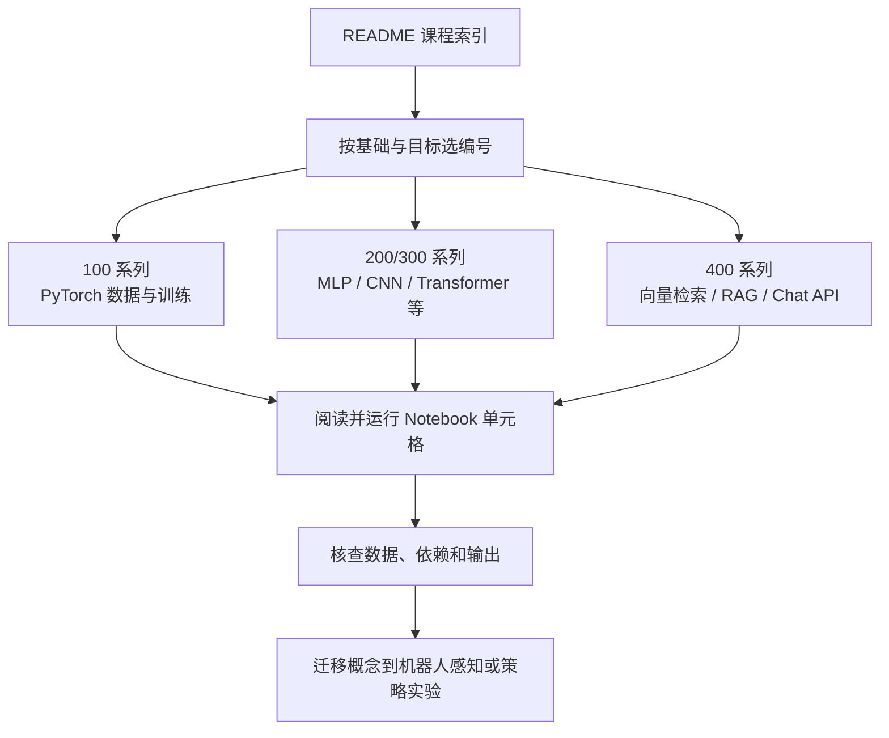
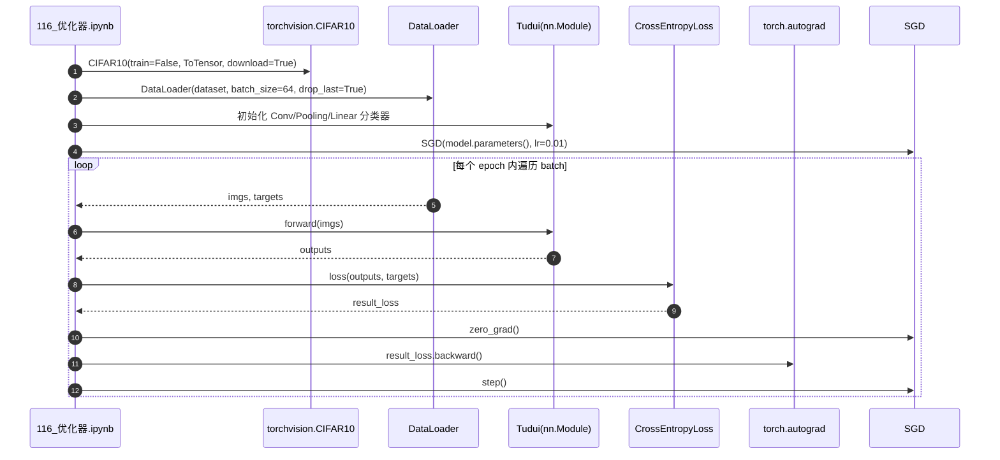

# AccumulateMore/CV：深度学习与 CV/NLP/Agent 中文笔记（Deep Learning Notebook Collection）

## 一句话定义

**AccumulateMore/CV** 是 [AccumulateMore](https://github.com/AccumulateMore/CV) 维护的中文深度学习课程笔记合集：通过按课程编号组织的 `ipynb`，练习 PyTorch、计算机视觉、NLP、Transformer 和大模型检索/对话。虽然仓库名含 CV，内容并非只讲计算机视觉。

## 英文缩写速查

| 缩写 | 英文全称 | 简要说明 |
| --- | --- | --- |
| CV | Computer Vision | 计算机视觉，图像分类、检测与分割等 |
| CNN | Convolutional Neural Network | 卷积神经网络，对图像做局部特征提取 |
| NLP | Natural Language Processing | 自然语言处理，序列模型与文本表示 |
| RAG | Retrieval-Augmented Generation | 检索增强生成，使用外部文档为语言模型提供上下文 |
| API | Application Programming Interface | 通过接口调用语言模型服务 |
| SGD | Stochastic Gradient Descent | PyTorch 示例的随机梯度下降优化器 |

## 为什么重要

- **分层学习入口：** 100 系列从加载图像与训练循环开始；200 系列覆盖经典网络骨干和视觉任务；300 系列提供深度学习专项练习；400 系列延伸到向量检索与对话 API。
- **与机器人知识库互补：** 图像预处理、CNN/ResNet、Transformer、梯度优化是机器人感知和策略模型的前置知识；本仓库不提供机器人实机任务。
- **代码可直接阅读：** 部分短 Notebook 展示可跟踪的 PyTorch/LangChain 调用链，便于查概念；示例依赖、数据划分和代码质量仍须单独审核。

## 核心原理

| 课程编号 | 主要模块 | 读者可以学到什么 |
| --- | --- | --- |
| 100–122 | PyTorch：`Dataset`、`DataLoader`、`nn.Module`、优化器、验证 | 数据到训练循环的基本调用结构 |
| 200–268 | MLP、CNN、ResNet、检测、分割、RNN、Transformer、BERT | 网络骨干与视觉/序列任务 |
| 300–354 | 基础深度学习、优化、CNN、序列模型、作业练习 | 以专题练习查漏补缺 |
| 400–409 | 向量表示、Chroma、RAG、LangChain、API | 从外部文本检索到对话交互的应用示例 |
| 500–5XX | README 规划项 | 仍为占位，不能视为已上线教材 |

### 学习使用流程（根据 README 与 Notebook 课程索引整理）

这是**课程阅读与实践流程**，不是上游提供的一条统一训练/推理流水线；不同编号的 Notebook 相互独立。

## 工程实践

- **PyTorch 起步：** 先读 `103` 的 `Dataset`，再读 `116` 的 `DataLoader → nn.Module → CrossEntropyLoss → SGD`，最后回看 `214` 的自定义网络模块。
- **视觉骨干：** 按 200 系列的卷积、经典网络、检测与分割条目复习，再转向 [视觉骨干](../concepts/vision-backbones.md)、[目标检测](../methods/object-detection.md) 等专题进行机器人任务选型。
- **RAG/Agent：** `402` 演示 `SentenceTransformer` 嵌入与相似度；`403` 引入 Chroma；`404/405` 组合检索增强；`408/409` 演示对话 API 与消息历史。相关资源依赖本地模型、服务密钥和外部包，不能直接视为经过端到端部署验证的应用。
- **上机前：** 固定 PyTorch/torchvision 版本，独立划分训练与测试样本，确认所用 Notebook 的输入路径与依赖；实际机器人感知还需测试相机数据分布与机载推理延迟。

## 源码运行时序图

以下直接依据上游 [`116_优化器.ipynb`](https://github.com/AccumulateMore/CV/blob/e05116c8336e8dd4da56118970ae45a3e358e0d3/116_优化器.ipynb) 代码单元所列调用顺序，不代表其他 Notebook 的通用入口。

具体代码中，样本来自 `train=False` 的 CIFAR-10 数据分区；另一个示例将 `StepLR.step()` 放在每个 batch 内，因此**不能照搬为标准的训练/测试与 epoch 调度方案**。

## 局限与风险

- **不是统一算法库：** 没有仓库级训练 CLI、机器人控制接口、统一环境锁文件或基准测试；Notebook 中的示例不能自动互相运行。
- **实际源码问题：** 优化器 Notebook 在更新参数时使用 CIFAR-10 `train=False` 数据；`StepLR` 示例在 batch 内推进，需根据预期调度粒度修改。
- **依赖外部资产：** 示例包含数据下载、`Data/`、`model_dir/`、`my_knowledge/` 等相对路径及 `DEEPSEEK_API_KEY`；不同单元格可能需要额外配置。
- **复用权限待核实：** 核对版本的根目录未列出 `LICENSE` 文件；部分笔记映射第三方课程，不等于其图片/教学内容均允许再分发。
- **核对覆盖有限：** 本页参考 README、根目录清单与九份代表性 Notebook 的原始单元格，**没有逐本测试整个课程集**，未作任何性能或成功率声明。

## 关联页面

- [深度学习基础](../concepts/deep-learning-foundations.md) · [反向传播](../concepts/backpropagation.md) · [卷积神经网络](../concepts/convolutional-neural-network.md)
- [PyTorch](./pytorch.md) · [Transformer](../concepts/transformer.md)
- [视觉骨干](../concepts/vision-backbones.md) · [目标检测](../methods/object-detection.md)
- [模型架构纵深路线](../../roadmap/depth-model-architecture.md) — Stage 0–1 的入门补课资料

## 参考来源

- [AccumulateMore/CV 一手仓库资料归档](../../sources/repos/accumulatemore-cv.md)
- [上游 README（固定提交）](https://github.com/AccumulateMore/CV/blob/e05116c8336e8dd4da56118970ae45a3e358e0d3/README.md)
- [103 数据加载 Notebook](https://github.com/AccumulateMore/CV/blob/e05116c8336e8dd4da56118970ae45a3e358e0d3/103_Pytorch加载数据.ipynb)
- [116 优化器 Notebook](https://github.com/AccumulateMore/CV/blob/e05116c8336e8dd4da56118970ae45a3e358e0d3/116_优化器.ipynb)
- [403 向量检索 Notebook](https://github.com/AccumulateMore/CV/blob/e05116c8336e8dd4da56118970ae45a3e358e0d3/403_基于向量的语义检索RAG.ipynb)

## 推荐继续阅读

- [PyTorch 官方入门教程](https://pytorch.org/tutorials/beginner/basics/intro.html) — 与上游笔记对照核验最新 API。
- [Deep Learning: Dive into Deep Learning](https://d2l.ai/) — 200 系列关联课程的系统学习参考。
