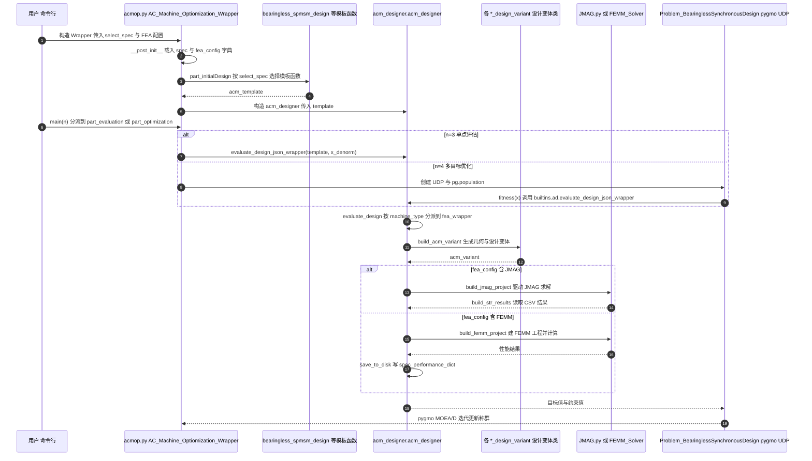

# ACMOP（交流电机自动优化框架）

## 一句话定义

**ACMOP**（[horychen/ACMOP](https://github.com/horychen/ACMOP)，*Alternating Current Machine Optimization Project*）是一套 **交流电机几何参数化 + 有限元自动优化** 研究代码：对接 **FEMM** 与 **JMAG**，含材料 BH 曲线、多目标优化与设计报告生成。

## 英文缩写速查

| 缩写 | 英文全称 | 简要说明 |
|------|----------|----------|
| ACMOP | Alternating Current Machine Optimization Project | 本项目名称 |
| FEMM | Finite Element Method Magnetics | 开源 2D 电磁有限元 |
| JMAG | JMAG Designer | 商业电机电磁仿真套件 |
| Pareto | Pareto front | 多目标非支配解集 |
| BH | B–H curve | 磁化曲线 |

## 为什么重要

- 展示「如何 **自动改** 槽宽、齿宽、磁钢厚度 → 跑 FEA → 比力矩/效率/损耗/脉动 → 出 Pareto」的完整研究工作流。
- 同时保留 **免费 FEMM** 与 **商业 JMAG** 两条求解路径，便于对照 [仿真软件选型](../comparisons/motor-em-simulation-software.md)。
- 与 [PYLEECAN](./pyleecan.md) / [axfluxmdo](./axfluxmdo.md) 同属工具层；ACMOP 更偏作者自用优化框架与轴承电机等研究案例。

## 核心原理

`codes3/` 含截面类、`FEMM_Solver.py`、`JMAG.py`、多种 PMSM/轴承电机问题定义；`BH/` 提供材料曲线。

## 工程实践

| 项 | 说明 |
|----|------|
| 何时用 | 已有 FEMM/JMAG 基础，要研究自动优化与约束处理 |
| 何时不用 | 第一次学关节电机——先 Ironless / FEMM-FOC / PYLEECAN |
| 环境 | README 指向偏旧 JMAG 17.1 与 Anaconda/Python；升级需自测 API |
| 许可 | 仓库无 SPDX；引用与再分发前自行确认 |

## 局限与风险

- **研究代码成熟度**：依赖旧工具链；约束与重启逻辑 README 自列多项 TODO。
- **不是人形硬件仓**：无面向髋膝的固定 CAD/BOM/台架。
- 磁钢涡流等效应在 FEMM 路径上仍有作者自述缺口。

## 源码运行时序图

入口：`python codes3/acmop.py`（文件底部 `main(n)`：`n=3` 单点评估，`n=4` 多目标优化，`n=31` 几何绘制；仓库默认分支 HEAD，见下方依据）

图依据：horychen/ACMOP@745c241（默认分支 HEAD），实际读过 `README.md`、`codes3/acmop.py`、`codes3/acm_designer.py`、`codes3/Problem_BearinglessSynchronousDesign.py`；`codes3/population.py`、`codes3/FEMM_Solver.py`、`codes3/JMAG.py` 仅按函数名检索。未运行代码。

## 关联页面

- [开源力矩电机电磁设计完整度对比](../comparisons/open-source-torque-motor-em-design.md)
- [PYLEECAN](./pyleecan.md) · [axfluxmdo](./axfluxmdo.md) · [FEMM-FOC](./femm-foc-simulation.md)
- [电机电磁仿真软件选型](../comparisons/motor-em-simulation-software.md)

## 参考来源

- [sources/repos/acmop.md](../../sources/repos/acmop.md)
- [开源力矩电机电磁设计策展](../../sources/personal/open_source_torque_motor_em_design_curator.md)
- 源码核对（2026-11-02）：horychen/ACMOP@745c241（默认分支 HEAD），读过 README.md、codes3/acmop.py、codes3/acm_designer.py、codes3/Problem_BearinglessSynchronousDesign.py、test.py；codes3/population.py、codes3/FEMM_Solver.py、codes3/JMAG.py 仅按函数名检索；时序图依据以上文件，未运行代码。

## 推荐继续阅读

- 仓库（分支 `better_framework`）：<https://github.com/horychen/ACMOP>
- FEMM 损耗参考（README）：<http://www.femm.info/wiki/SPMLoss>
