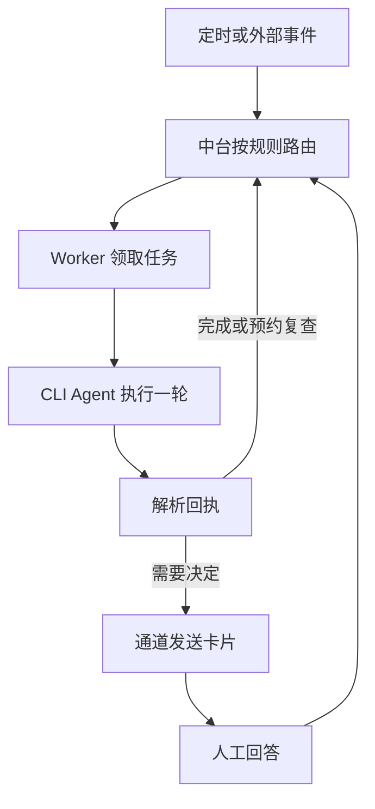
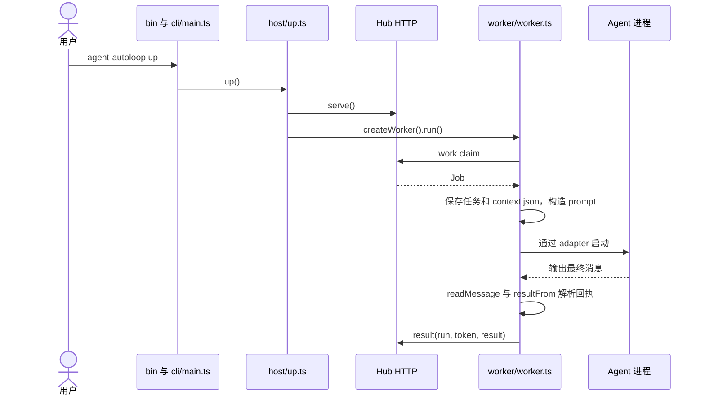

# Agent Autoloop（智能体自动闭环）

## 一句话定义

基于本地规则和事件调度命令行 Agent 的开源工具，将任务回执、人工决定和定时复查连接为持续事项。

## 英文缩写速查

| 缩写 | 英文全称 | 简要说明 |
|---|---|---|
| CLI | Command-Line Interface | 命令行接口 |
| HTTP | Hypertext Transfer Protocol | 中台与插件通信协议 |
| JSON | JavaScript Object Notation | 规则、事件和回执格式 |
| TTL | Time To Live | 限制事件链跳数的类比 |

项目由 GitHub 用户 [KKKKhazix](https://github.com/KKKKhazix) 的个人账号发布；机构归属未注明。

## 核心机制

事件来自定时、Webhook 或其他来源，规则决定 Agent、工作目录和权限；同一事项的事件可以合并处理。Agent 每轮作为进程执行，最后一条消息可包含 `ask`、`notice`、`resolve`、`later` 和 `events` 回执。提问后本轮结束，回答作为新事件触发后续工作，会话接续失败时可启用新会话。

事件内容写入上下文文件并标作数据；规则控制执行环境，但官方协议明确指出这不能阻止所有提示注入。系统按至少一次语义运行，有副作用的任务需要核对当前状态以避免重复执行。SQLite 保存状态，等待人工回答期间 Agent 进程退出，后台中台仍运行。

## 流程总览

## 源码运行时序图

源码路径基于 `cecec75` 的 `host/up.ts`、`worker/worker.ts` 和 `worker/contract.ts`；图展示有任务时的主路径，不表示每次轮询都返回任务。

## 工程实践与局限

- 官方要求 Node.js 24、Git、curl 和已配置的命令行 Agent；支持 macOS、Linux。源码 MIT 开放，模型使用与权限由用户环境决定。
- 官方称 Claude Code、Codex、ACP 的多轮会话与飞书通道经过实测；其他 Webhook 模板只在本地模拟服务验证，通用 Agent 命令未逐个实测。
- 这是任务编排工具，不是机器人实时控制器。规则授权、消息通道及副作用幂等应由部署者验证。
- 协议全文尚未逐节复核，未实机运行；性能数字和全部故障恢复路径尚未独立验证，本页保留草稿。

## 关联页面

- [LangGraph](./langgraph.md)：状态图与持久工作流编排。
- [Multi-Agent CAD](./multi-agent-cad.md)：面向 CAD 的多阶段 Agent 工作流。

## 参考来源

- [仓库归档](../../sources/repos/agent-autoloop.md)
- [README 固定版本](https://github.com/KKKKhazix/agent-autoloop/blob/cecec75be3ca26e6ca1d6833b50152ee9450088d/README.md)
- [协议固定版本](https://github.com/KKKKhazix/agent-autoloop/blob/cecec75be3ca26e6ca1d6833b50152ee9450088d/docs/protocol.md)

## 推荐继续阅读

- [插件开发说明](https://github.com/KKKKhazix/agent-autoloop/blob/cecec75be3ca26e6ca1d6833b50152ee9450088d/docs/plugins.md)
