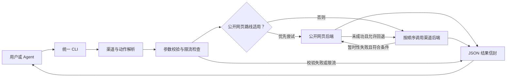
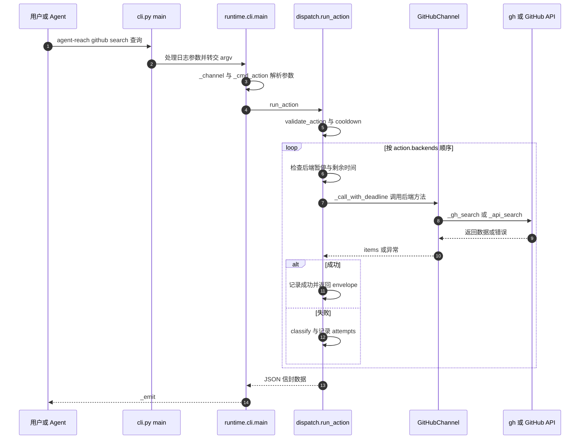

# Agent Reach：统一互联网访问工具链（Unified Internet Access for AI Agents）

## 一句话定义

Agent Reach 是面向 AI Agent 的开源互联网只读工具链：用统一 CLI 将平台搜索、网页阅读、仓库与视频信息访问交给按动作配置的后端，并以 JSON 返回结果、错误和尝试轨迹。核对版本为 1.6.1（[8d9ecc1](https://github.com/Panniantong/Agent-Reach/commit/8d9ecc1f5521fe7d223cde782aaa4005695e2671)）。

## 英文缩写速查

| 缩写 | 英文全称 | 简要说明 |
|------|----------|----------|
| CLI | Command-Line Interface | 命令行接口 |
| JSON | JavaScript Object Notation | 结构化输出格式 |
| MCP | Model Context Protocol | Agent 工具接入协议 |
| API | Application Programming Interface | 应用程序编程接口 |
| LLM | Large Language Model | 大语言模型，常作高层任务/语言接口 |

## 为什么重要（对本知识库读者）

- **文献与代码调研侧**：机器人论文、开源仓库、教程视频、社区讨论（Reddit / X / 中文社区）常分散在多站；本工具链把 **字幕抽取、公开网页清洗阅读、GitHub 检索、RSS 订阅、微信公众号全文（Camoufox / Exa）** 等接到同一套 CLI/MCP 习惯里，便于代理辅助 **ingest 与交叉验证**（仍须遵守各平台 ToS 与学术引用规范）。本站经 `wechat-article-for-ai`（Camoufox）抓取多篇 `mp.weixin.qq.com` 长文（如 [Humanoid Hardware 101](../../sources/blogs/wechat_human_five_humanoid_hardware_101.md)、[Jason Peng 灵活运动技能学习](../../sources/blogs/wechat_human_five_jason_peng_flexible_motion_skills.md)、[世界模型训练闭环](../../sources/blogs/wechat_embodied_ai_lab_robot_world_model_training_loop.md)、[训练栈分层解读](../../sources/blogs/wechat_embodied_ai_lab_robot_training_stack_layers_2026.md)、[李群/李代数/四元数基础](../../sources/blogs/wechat_shenlan_lie_group_lie_algebra_quaternion.md)）时，Jina Reader 常返回 CAPTCHA，与公开 README 一致。
- **与「代理工程规约」相邻**：和 [Superpowers（obra）](superpowers-obra.md) 这类 **软件交付流程技能库** 不同，Agent Reach 解决的是 **外网只读/检索型工具链**；和 [CLI-Anything](cli-anything.md)（为 Blender/FreeCAD 等 **专业软件生成 CLI harness**）以及 [Articraft](articraft.md)（**3D 资产生成 SDK**）也不同，但同属 **把代理能力边界写进可版本化外围** 的实践谱系。
- **安全与运维意识**：1.6.1 的官方会话文档强调专用浏览器与日常浏览器分离、按站点复用登录的前提、用户亲自登录及账户风险；自动化不代表取得额外访问授权。

## 核心机制与组件结构

| 层次 | 内容 |
|---|---|
| 分发 | Python 3.10+；MIT；通过 uv 安装官方 GitHub release ZIP 后执行 `agent-reach setup`，安装默认渠道及技能；同名 PyPI 包不是本项目。 |
| 统一入口 | `agent-reach <渠道> <动作> [参数]`；`agent-reach read <URL>` 自动选渠道；1.6 起每次调用输出一个 JSON 对象。 |
| 渠道与动作 | 默认：B 站、V2EX、GitHub、YouTube、网页；可选及实验渠道按 README 矩阵，部分能力需要登录或转录服务 Key。 |
| 调度 | runtime/dispatch.py 验证参数、管理共享时间预算、检查冷却、按 action.backends 顺序执行；终止型错误停止回退，满足条件的暂时性故障才尝试公开网页路线。 |
| 结果与诊断 | JSON 信封提供 ok、result、error 及 meta.attempts；channels、check、doctor 用于发现能力与诊断。 |
| 会话 | 专用浏览器优先 CloakBrowser，必要时回退 Chrome；按站点管理会话，已有登录复用依赖 OpenCLI 扩展连接，用户本人登录。 |

### 项目流程总览

### 工程实践：从 1.5 迁移到 1.6

旧版主要作为安装、诊断和技能分发脚手架；1.6.1 已具备统一运行时调度。旧记录中本站独立使用 wechat-article-for-ai 的实践仍属历史环境，不应据此推断新版默认支持微信公众号。安装与升级以[官方安装文档](https://github.com/Panniantong/Agent-Reach/blob/8d9ecc1f5521fe7d223cde782aaa4005695e2671/docs/install.md)为准。

- **与 REA 的分工：** [REA](./rea.md) 把本机程序/二进制调查接入 Agent，侧重证据化逆向；本页的 Agent Reach 则安装外网检索与内容读取渠道，解决的是资料发现和抓取。两者都提供 CLI/MCP 外围能力，但目标和数据来源不同。

## 局限与工程实践

- **只读边界：** 官方 README 明确不发帖、不评论、不点赞、不私信；平台的登录、地域、授权和访问规则仍适用。
- **稳定性：** 可选及实验渠道可能受上游工具与平台变化影响；不要把配置成功等同于实际动作成功。限流时应遵守平台冷却提示，而非持续重试。
- **开源状态：** 官方 GitHub 已公开 MIT 许可的 Python CLI 与渠道调度源码；本次核对未运行外部服务，不宣称各平台均可用。
- **凭据：** 用户本人完成登录及 Key 输入，不把 Cookie、密码或 Key 写入聊天、知识库或运行日志。
- **知识库应用：** 适合作为资料发现与读取层；最终仍应核对原论文、官方文档和源码。没有直接匹配的机器人技术纵深路线，不强行挂载。

## 源码运行时序图

入口由 pyproject.toml 注册为 agent_reach.cli:main；以下以 GitHub 搜索动作举例，后端顺序来自 channels/github.py。

图依据：1.6.1、提交 8d9ecc1；核对 pyproject.toml、agent_reach/cli.py、runtime/cli.py 的动作入口及 runtime/dispatch.py 的实际后端循环，并核对 channels/github.py 的 GitHub 后端入口。循环遇成功或终止型错误即退出；此图不展开其他渠道的公开网页回退路径。未运行代码。

## 关联页面

- [Superpowers（obra）](superpowers-obra.md) — 编码代理 **交付流程** 技能库（与本页「外网工具链」互补）
- [Hermes Agent](hermes-agent.md) — **完整代理运行时**（内置 web/MCP/终端与网关；与本页「读搜脚手架」互补）
- [CLI-Anything（HKUDS）](cli-anything.md) — **专业软件 → agent-native CLI**（与本页「读搜渠道」互补）
- [DeepTutor（HKUDS）](deeptutor.md) — **辅导工作区 + 内置 web/paper search**（与本页「外网读搜脚手架」互补）
- [Articraft](articraft.md) — 另一类 **harness + SDK** 型代理外围（3D 资产域）
- [graphify（Graphify Labs）](graphify.md) — **本地/仓库内** 多模态知识图（与本页「外网读搜」互补）
- [LLM Wiki（Karpathy 模式）](../concepts/llm-wiki-karpathy.md) — 持久化知识结构与 **人类策展** 范式

## 参考来源

- [Agent Reach 仓库源归档（本站）](../../sources/repos/panniantong_agent_reach.md)
- [Panniantong/Agent-Reach（GitHub）](https://github.com/Panniantong/Agent-Reach)
- [官方源码（8d9ecc1）](https://github.com/Panniantong/Agent-Reach/tree/8d9ecc1f5521fe7d223cde782aaa4005695e2671) — 版本与核对范围见来源归档；2026-11-25 核对。

## 推荐继续阅读

- [Agent Reach README（main 分支）](https://github.com/Panniantong/Agent-Reach/blob/main/README.md) — 支持平台矩阵、统一入口与安全说明
