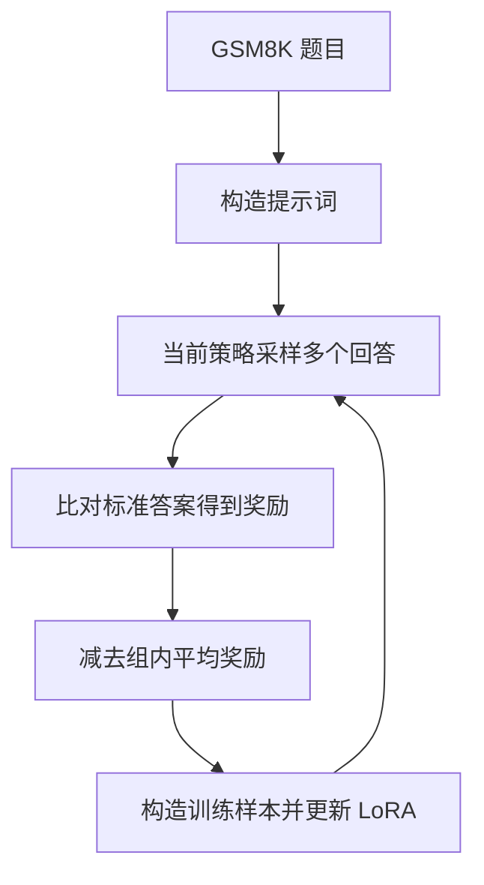
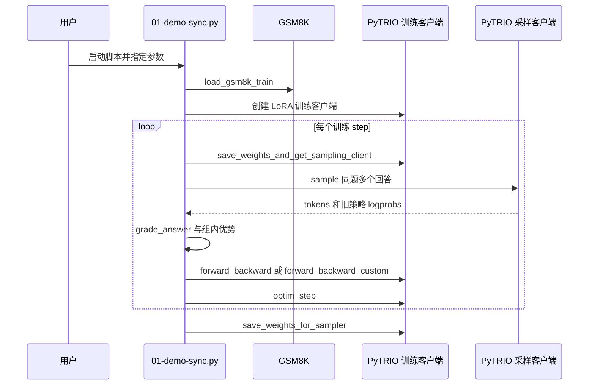

# Agentic RL Lab（智能体强化学习实验室）

Datawhale 的公开实验手册以 PyTRIO 为基础，结合算法讲解和代码探索大语言模型与智能体强化学习。

## 英文缩写速查

| 缩写 | 英文全称 | 简要说明 |
|------|----------|----------|
| RL | Reinforcement Learning | 强化学习 |
| LLM | Large Language Model | 大语言模型 |
| GRPO | Group Relative Policy Optimization | 通过同题采样结果的相对奖励构造优势 |
| LoRA | Low-Rank Adaptation | 低秩参数高效微调 |

## 课程地图

截至 2026-11-04，网站首页列出 16 个实验：基础与优化包括 Loss Functions、GRPO、DAPO、GSPO；蒸馏包括 General OPD、Medical OPD、OPSD；工具与环境包括 Search-R1、ReTool、ALFWorld、Tournament-GRPO；多模态与其他主题包括 Vision GRPO、PyTrio-Jev、AgentOPSD、TEMPO、Spec-o3。各实验有独立说明和运行入口。

## 流程总览：GRPO 示例

这是 GRPO 同步示例的流程，不代表全部实验。示例用 reward 减去组内均值，未除以标准差；组内奖励全相同时优势全为零，该组被跳过。

## 源码运行时序图

依据 [GRPO 同步脚本](https://github.com/datawhalechina/agentic-rl-lab/blob/8493321013c02eef6cf79ca2594811f53c6fdac1/experiments/grpo/01-demo-sync.py) 与 [启动说明](https://github.com/datawhalechina/agentic-rl-lab/blob/8493321013c02eef6cf79ca2594811f53c6fdac1/experiments/grpo/start.md)：

脚本还可通过 SwanLab 记录指标；CISPO 走自定义 loss 分支。运行依赖 PyTRIO 服务与数据访问，实际费用和环境条件以官方说明为准。

## 局限与使用建议

- 项目主要面向 LLM 和 agent 实验；ALFWorld 使用文本环境，不能直接视为机器人真机或 Isaac Lab 运动控制训练方案。
- GRPO 示例使用答案匹配奖励；回答格式和答案归一化会影响评分，组内奖励完全相同则不产生相对优势信号。
- 当前仅核对仓库 README、站点首页、GRPO 章节及同步脚本；其余章节和实验结果尚待逐篇通读，训练也未实际运行。

## 关联页面

- [Agent Lightning](./agent-lightning.md) — agent RL 训练基础设施。
- [动手学强化学习](./hands-on-rl-book.md) — 强化学习基础教材。
- [强化学习](../methods/reinforcement-learning.md) — 方法概览。

## 参考来源

- [仓库归档](../../sources/repos/agentic-rl-lab.md)
- [在线手册归档](../../sources/sites/agentic-rl-lab.md)
- [GRPO 实验原文](https://github.com/datawhalechina/agentic-rl-lab/blob/8493321013c02eef6cf79ca2594811f53c6fdac1/experiments/grpo/readme.md)

## 推荐继续阅读

- [实验手册](https://datawhalechina.github.io/agentic-rl-lab/) — 原始实验及运行入口。
