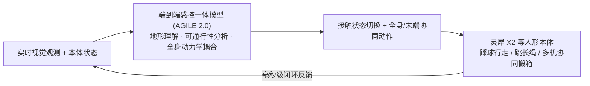

# AGILE（智元感控一体）

**AGILE**（全称 **AGIBOT Generative Intelligent Locomotion Engine**）是智元在 [2026-06 发布地图](../overview/agibot-june-2026-release-technology-map.md) 中推出的 **感控一体能力底座**（[官方发布稿](https://www.agibot.com.cn/news/company/agile2-0-220)，早期演示：[B站 BV1SmGD6xEPS](https://www.bilibili.com/video/BV1SmGD6xEPS/)），后续于 2026-09 演进为 **AGILE 2.0** 视觉端到端方案，在灵犀 X2 上通过《杂技BOT》验证“睁眼运动”与全身协同。

## 一句话定义

**眼–身闭环接口**——看见环境之后，控制策略能否及时随视觉反馈调整全身与末端动作。

## 英文缩写速查

| 缩写 | 英文全称 | 简要说明 |
|------|----------|----------|
| WBC | Whole-Body Control | 协调全身关节满足多任务/约束的控制层 |
| VLA | Vision-Language-Action | 视觉-语言-动作多模态策略 |
| IL | Imitation Learning | 从示范轨迹学习策略 |

## 为什么重要

- **能力底座位：** 与 [BFM-2](./agibot-bfm-2.md) 并列的 **两个能力底座之二**。
- **分工：** BFM-2 更偏 **运动小脑 / 动作过渡**；AGILE 更偏 **视觉进入控制过程**。
- **连续执行：** 真实任务中环境变化要求 **感知–控制同环**，否则高层 VLA 规划易被底层偏差打断。

## 核心原理

依据智元官方发布稿（[agibot-agile-official.md](../../sources/sites/agibot-agile-official.md)），AGILE 旨在消除“视觉采集/推理延迟”与“电机毫秒级响应”之间的同步错位：

1. **AGILE 1.0 → 2.0 架构跃迁：** 1.0 先行打通感知与运动链路（移动与操作并行）；2.0 去掉人工阶段拆分与中间模块转译，形成视觉端到端一体化闭环。
2. **全链路耦合：** 在统一闭环内同时处理环境观测、地形理解、动态可通行性分析、全身运动控制、接触状态切换与上下肢协同操作，并支持跨机器人状态感知及人员闯入时的安全防护与自主恢复。

## 工程实践

| 项 | 核查与实践要点 |
|----|----------------|
| **开源状态** | **确认未开源** — 截至 2026-11-21 仅官方发布稿与公开视频演示，无公开论文、GitHub 代码或权重 |
| **源码运行时序图** | **不适用**（闭源商业能力底座，无可读取源码入口） |
| **典型验证场景** | 官方在灵犀 X2《杂技BOT》展示踩球行走、钻火圈、抖空竹、三人跳长绳、抛三球及双人协作搬箱等高动态视觉闭环任务 |
| **体系分工** | 与 [BFM-2](./agibot-bfm-2.md) 互补：BFM-2 偏纯本体状态空间运动过渡小脑，AGILE 偏视觉进入全身控制闭环 |

## 局限与风险

- **闭源与量化缺失：** 官方未披露模型结构、训练数据规模、推理延迟或标准化任务成功率对比表，无法第三方复现或独立 benchmark。
- **演示视频不等于通用鲁棒性：** 杂技与多机协同演示属于受控场景验证，开放工业/家庭环境下的泛化与长时稳定性仍需实测证据。
- **命名辨析：** 本页 **AGILE** 指智元 **感控一体产品/模型**；仓库内另有论文实体含 “agile” 字样（如四足/人形移动论文），**勿合并节点**。

## 命名辨析

- 本页 **AGILE** 指智元 **感控一体产品/模型**；仓库内另有论文实体含 “agile” 字样（如四足/人形 loco 论文），**勿合并节点**。

## 信息边界

- 截至 ingest 时，公开材料主要为 **视频标题与简介**；机制细节须以后续技术报告为准。

## 关联页面

- [身体能力底座分类 hub](../overview/agibot-release-category-05-body-foundations.md)
- [全身控制](../concepts/whole-body-control.md)

## 参考来源

- [AGILE / AGILE 2.0 官方发布归档](../../sources/sites/agibot-agile-official.md)
- [wechat_embodied_ai_lab_agibot_june_2026_release.md](../../sources/blogs/wechat_embodied_ai_lab_agibot_june_2026_release.md)

## 推荐继续阅读

- [智元官方发布：AGILE 2.0 感控一体模型](https://www.agibot.com.cn/news/company/agile2-0-220)
- [AGILE 公开视频](https://www.bilibili.com/video/BV1SmGD6xEPS/)
