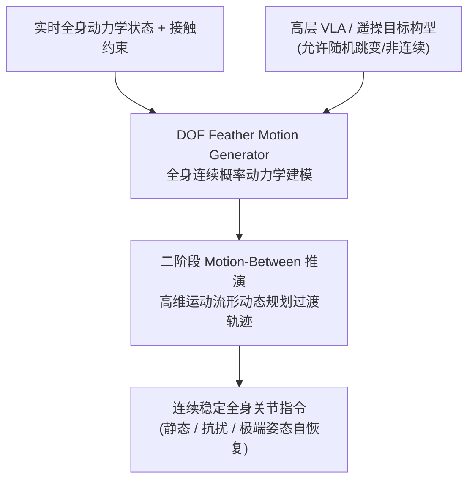

# BFM-2（智元运控基座）

**BFM-2** 是智元在 [2026-06 发布地图](../overview/agibot-june-2026-release-technology-map.md) 中推出的 **运动小脑 / 运控基座模型**（公开视频：[B站 BV1ZzGe6oEmk](https://www.bilibili.com/video/BV1ZzGe6oEmk/)）。文内称其为 **二阶段 Motion-Between 运控基座**，可在静态、预设动作或随机输入等状态下完成 **高稳定性动作插值与动态任务闭环**。

## 一句话定义

**补「动作与动作之间」的身体底座**——单个动作能做出不等于系统能连续运行；BFM-2 强调过渡、插值与肌肉记忆式闭环。

## 英文缩写速查

| 缩写 | 英文全称 | 简要说明 |
|------|----------|----------|
| BFM | Behavior Foundation Model | 行为基础模型，可复用身体能力接口 |
| WBC | Whole-Body Control | 协调全身关节满足多任务/约束的控制层 |
| RL | Reinforcement Learning | 通过与环境交互最大化长期回报来学习策略 |

## 为什么重要

- **能力底座位：** 与五个开源项目并列的 **两个能力底座之一**（另一为 [AGILE](./agibot-agile.md)）。
- **小脑叙事：** 高层规划完整时，身体层仍可能在 **动作衔接、随机扰动、动态闭环** 上失败。
- **产业语境：** [BFM 41 篇地图](../overview/bfm-41-papers-technology-map.md) 已记录智元把 **BFM-2** 推为运控基座并预告 BFM-3；本页补 **同发布会七段链路** 中的落点。

## 核心原理

依据智元官方发布稿（[Motion-Between BFM-2](../../sources/sites/motion-between-bfm-2.md)），BFM-2 面向全身运动控制底座，核心设计包含两层：

1. **连续概率动力学状态空间建模（DOF Feather Motion Generator）：** 引入端到端生成式训练机制，对全身动力学状态空间做连续概率建模，支持从任意当前杂乱姿态（仰躺、趴地、大幅倾斜、悬空偏移或受外力踹击）演化到任意随机指令构型。
2. **二阶段 Motion-Between 架构：** 结合实时全身动力学状态、接触约束状态与高层任务指令，在高维运动流形中动态规划完整过渡轨迹，而非调用有限的固定“摔倒恢复”脚本，从而吸收高层 VLA 输出跳变并向底层执行输出连续稳定轨迹。

## 工程实践

| 项 | 核查与实践要点 |
|----|----------------|
| **开源状态** | **确认未开源** — 截至 2026-11-21 仅公开发布新闻稿与 B 站演示视频，无公开论文、GitHub 仓库或模型权重 |
| **源码运行时序图** | **不适用**（闭源商业能力底座，无可读取源码入口） |
| **系统接口定位** | 处于高层语义策略（如 VLA）与底层电机控制之间，吸收指令跳变并维持接触约束下的运动连续性 |
| **后续路线** | 官方预告 **BFM-3** 将从纯本体状态输入扩展至融合视觉、触觉、语音与环境拓扑的多模态运动基座 |

## 局限与风险

- **闭源与证据边界：** 截至 2026-11-21，官方仅披露新闻稿与演示视频，未公布控制频率、网络参数量、跨本体迁移范围及定量抗扰评测基准，不可独立复现。
- **信息时效：** 公开技术细节仍待后续论文或 SDK 文档补充，工程选型时勿将新闻稿叙事直接等同于已开源可控组件。
- **命名区分：** 本页 **BFM-2** 为智元商业运控基座，与学术界 `awesome-bfm-papers` 索引实体及通用概念页 [行为基础模型](../concepts/behavior-foundation-model.md) 无直接代码等价关系。

## 命名辨析（必读）

| 名称 | 含义 |
|------|------|
| **BFM-2（本页）** | 智元 **产品/基座** 代号 |
| [paper-bfm-*](./phc.md) 等 | [awesome-bfm-papers](https://github.com/friedrichyuan/awesome-bfm-papers) **学术论文索引实体** |
| [行为基础模型](../concepts/behavior-foundation-model.md) | 跨机构 **概念** 页 |

## 核心机制与全状态推演

依据智元 2026-05-26 官网发布披露，BFM-2 引入端到端 **DOF Feather Motion Generator** 生成式训练机制与 **二阶段 Motion-Between 架构**：

1. **实时状态与接触条件化：** 结合全身动力学状态、接触约束状态以及高层随机/离散目标构型，在高维运动流形中连续概率建模并推演过渡轨迹。
2. **全状态空间演化而非单一跌倒脚本：** 覆盖仰躺、趴地、大幅倾斜、悬空偏移及外力踹击/指令跳变后的动态重规划，解决上层 VLA 离散跳变与底层全身控制须连续稳定间的接口矛盾（未来规划演进为多模态输入 BFM-3）。

## 工程实践

- **把 BFM-2 当作衔接 VLA 与底层全身执行器的中间插值底座：** 用于吸收遥操作或上层规划器发出的离散/稀疏子目标跳变，而非替代带传感器闭环的高频底层安全保护。
- **产品宣传参数须等开源仓库或白皮书核验后上线：** 在正式披露控制频率、跨本体支持列表与鲁棒恢复率前，应结合独立测试场景评估负载边界。

## 常见误区或局限（信息边界）

- 截至 2026-11 官网文章核查，公开材料主要为官方发布通稿与演示动画，**未公开模型网络权重、控制频率、训练算力及跨本体定量消融指标**；技术细节仍须以后续论文或开源仓库为准。

## HMI 开源主表入口

[Motion-Between BFM-2](https://www.agibot.com.cn/article/315/detail/161.html) 收录于具身智能研究室 [开源项目主表](https://github.com/RealXiaoze/humanoid-motion-intelligence/blob/main/%E8%AE%BA%E6%96%87%E4%B8%8E%E9%A1%B9%E7%9B%AE/%E5%BC%80%E6%BA%90%E9%A1%B9%E7%9B%AE%E4%B8%BB%E8%A1%A8.md)。

主表定位：当前全身动力学、接触状态与高层目标构型条件化二阶段 Motion-Between，为 VLA 提供身体层执行接口；公开材料尚不足以判断控制频率与跨本体范围。本库以本页为详情节点，不另建重复实体。

覆盖核对见 [HMI 开源项目主表覆盖索引](../queries/hmi-opensource-projects-coverage.md)。

## 关联页面

- [身体能力底座分类 hub](../overview/agibot-release-category-05-body-foundations.md)
- [运动小脑技术地图](../overview/humanoid-motion-cerebellum-technology-map.md)
- [Whole-Body Motion Tracking · 人形全身动作跟踪](../methods/whole-body-motion-tracking.md)：作为人形运动小脑基座，在动力学与接触约束下实现高稳定性动作过渡与全身运动控制。
- [Balance Recovery（平衡恢复）](../tasks/balance-recovery.md)：支持从仰躺、趴地或外力扰动等任意姿态动态规划连续恢复轨迹，提升全身平衡恢复能力。

## 参考来源

- [Motion-Between BFM-2 官方发布归档](../../sources/sites/motion-between-bfm-2.md)
- [wechat_embodied_ai_lab_agibot_june_2026_release.md](../../sources/blogs/wechat_embodied_ai_lab_agibot_june_2026_release.md)
- [wechat_embodied_ai_lab_bfm_41_papers_survey.md](../../sources/blogs/wechat_embodied_ai_lab_bfm_41_papers_survey.md)

## 推荐继续阅读

- [智元官方发布：Motion-Between BFM-2](https://www.agibot.com.cn/article/315/detail/161.html)
- [机器人论文阅读笔记：TWIST2](https://imchong.github.io/Robot_Learning_Paper_Notebooks/papers/07_Teleoperation/TWIST2__Scalable_Portable_and_Holistic_Humanoid_Data_Collection_System/TWIST2__Scalable_Portable_and_Holistic_Humanoid_Data_Collection_System.html)
- [机器人论文阅读笔记：SENTINEL](https://imchong.github.io/Robot_Learning_Paper_Notebooks/papers/04_Loco-Manipulation_and_WBC/SENTINEL__A_Fully_End-to-End_Language-Action_Model_for_Humanoid_Whole_Body_Control/SENTINEL__A_Fully_End-to-End_Language-Action_Model_for_Humanoid_Whole_Body_Control.html)
- [机器人论文阅读笔记：Agility Meets Stability](https://imchong.github.io/Robot_Learning_Paper_Notebooks/papers/04_Loco-Manipulation_and_WBC/Agility_Meets_Stability__Versatile_Humanoid_Control_with_Heterogeneous_Data/Agility_Meets_Stability__Versatile_Humanoid_Control_with_Heterogeneous_Data.html)
- [BFM-2 公开视频](https://www.bilibili.com/video/BV1ZzGe6oEmk/)
