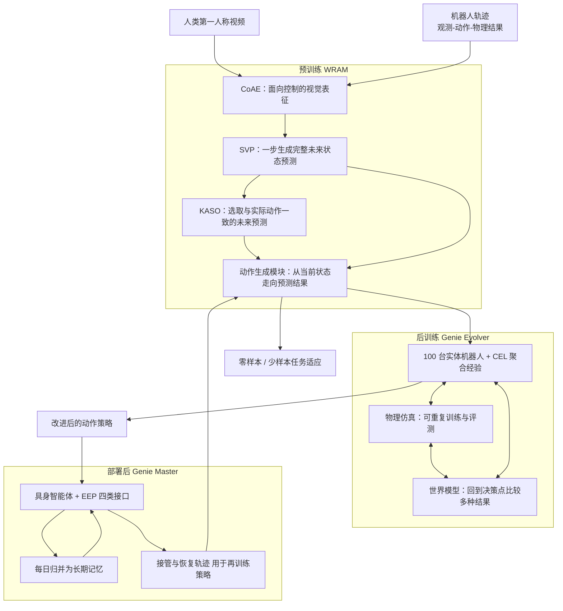

# AGIBOT GO-3 Preview（智元全生命周期具身基础模型，预览公告）

**GO-3 Preview** 是智元（AGIBOT）在 2026-10-29（官网）/ 2026-11-03（PR Newswire 转发）发布的具身基础模型预览公告，来源是[新闻稿归档](../../sources/blogs/agibot_go3_preview_prnewswire_2026-11.md)。**本条没有论文、没有可运行源码、没有权重**；下文凡「作者表述」均为厂商说法，榜单数字为本库 2026-11-06 对官方榜单公开数据的核对结果。

## 一句话定义

**GO-3 Preview 是以 WRAM（World Reasoning Action Model）为底座的操作基础模型，配套 Genie Evolver（后训练）与 Genie Master（部署后智能体），厂商称其覆盖预训练、后训练、部署后三个阶段的「全生命周期扩展」。**

## 英文缩写速查

| 缩写 | 英文全称 | 简要说明 |
|------|----------|----------|
| WRAM | World Reasoning Action Model | GO-3 的底层架构：统一任务理解、未来状态预测、动作生成（作者表述） |
| CoAE | Control-Oriented Autoencoder | 面向控制的视觉表征，保留物体位置、形状与空间关系（作者表述） |
| SVP | 稿中未展开全称 | 基于当前观测与任务条件，一步生成完整未来状态预测（作者表述） |
| KASO | 稿中未展开全称 | 选取与训练时实际动作更一致的未来预测用于联合学习（作者表述） |
| CEL | Collective Experience Learning | Genie Evolver 中聚合多机器人执行经验的机制 |
| EEP | Embodied Execution Protocol | Genie Master 的接口协议：capabilities / guidance / feedback / continuity |
| RSI | Recursive Self-Improvement | 递归自我改进；稿中称「Physical RSI」为物理世界中的该类自改进 |
| VLA | Vision-Language-Action | 视觉-语言-动作模型 |

## 为什么重要

- 智元模型谱系的新一代：GO-1（ViLLA，见 [AGIBOT WORLD / Colosseo](./paper-sa-2503-06669-agibot-world-colosseo-a-large-scale-manipulation.md)）→ GO-2（动作思维链 + 异步双系统，见 [GO-2](./go-2.md)）→ GO-3 Preview（世界预测 + 后训练系统 + 部署后智能体，稿中的谱系叙述）。
- 路线上属于「世界模型 + 动作」联合建模一类，可与 [World Action Models](../concepts/world-action-models.md) 对照；同时把后训练和真实部署的经验回流写进产品叙事，与 [Physical RSI](./physical-rsi.md) 话题相邻。
- 它是公开榜单上 AGIBOT 自家模型的一次集中亮相：在 RoboTwin 2.0 默认榜、RoboColiseum manip 榜、RoboDojo 仿真 Precision 项排名第一（见下文核对）。
- 需要谨慎：这是预览公告，不是发布。稿中没有任何分数、参数量、数据规模或结构图，复现与同口径比较目前无从谈起。

## 核心方法 / 机制

以下全部是新闻稿的描述（作者表述），稿中没有给出网络结构、损失函数、参数量、训练数据规模或算力。

**预训练：WRAM**

- CoAE：提取面向机器人控制的视觉表征，保留物体位置、形状、空间关系，作为未来状态预测和动作生成的基础。
- SVP：给定当前观测与任务条件，一步生成完整的未来状态预测；动作生成模块学习从当前状态走向预测结果。
- KASO：物理环境存在多种可能结果，KASO 选取与训练中实际所执行动作更一致的未来预测，用于联合学习，使未来预测与动作生成对齐。
- 数据：人类第一人称视频提供物体交互示例，机器人轨迹提供观测—动作—物理结果的联系。
- 适应：零样本（稿称无需在实体机器人上做任务特定监督微调）与少样本（LEGO 装配示例：少量示教 + 微调，由具身智能体编排步骤）。

**后训练：Genie Evolver**

- 分布式混合环境训练系统：100 台实体机器人 + 物理仿真 + 世界模型。
- 实体机器人侧用 CEL 聚合多机执行经验：成功轨迹作为有效动作示例，失败上下文用于定位改进点，经检索与更新共享策略让单机经验惠及机群。
- 仿真侧用于可重复的训练与评测；世界模型侧可回到关键决策点，试不同动作、预测并比较结果，再把反馈用于改进策略并回到真机验证。
- 演示（稿中无量化数字）：桌面冰壶（称几小时练习后胜率高于普通人类玩家）、抽积木、向移动篮筐投球。

**部署后：Genie Master**

- 具身智能体框架，连接规划、执行、反馈与经验保留；EEP 标准化四类接口 capabilities、guidance、feedback、continuity，让智能体知道有哪些机器人能力、如何执行、结果是否达标、还有哪些未完成工作。
- 两条回流通路：每日把成功与失败经验归并为长期记忆，供相似任务检索；执行中的接管、恢复轨迹与反馈用于进一步训练动作策略。
- 演示：Genie G2 在真实便利店环境运行，称能找出失败原因、调整策略并累积经验，无需人类示教或手工调参（作者表述，稿中无量化数字，也无独立复核）。

## 流程总览

下图只依据新闻稿的文字描述绘制，模块间的具体张量接口稿中未披露，因此仅表示「阶段与数据流向」，不是网络结构图。

## 实验与评测

新闻稿**没有给出任何榜单分数、名次数字、榜单 URL 或评测口径**。以下为本库 2026-11-06 对三个榜单官方公开数据的核对（数据来源与抓取方式见[归档](../../sources/blogs/agibot_go3_preview_prnewswire_2026-11.md)）。榜单上的条目名为「GO-3 Nano Preview」，新闻稿通篇只写「GO-3 Preview」；二者是否为同一个模型，稿中没有说明（推测：同一系列的预览版，但属推测）。

| 榜单 | 榜单官方页 | 口径 | GO-3 Nano Preview 成绩（榜单数据） | 与稿件「第一」是否一致 |
|------|-----------|------|------------------------------------|--------------------------|
| RoboTwin 2.0 | [leaderboard](https://robotwin-platform.github.io/leaderboard) | Aloha-AgileX，50 条 demo_clean × 50 任务训练，每任务 100 次试验，easy = demo_clean，hard = demo_randomized；Co-train 赛道 | easy 88.54，hard 81.48，二者均值 85.01（我计算）；Co-train 28 条中 Average 第 1、hard 第 1、easy 第 6 | 一致（默认的 Average 榜；easy 单项不是第一，PrismWAM* 为 91.84） |
| RoboColiseum | [leaderboard](https://robocoliseum.ai/leaderboard) | 智元 Genie Sim 3.0 在线仿真挑战赛，四个独立分榜，API 无总榜 | manip 0.688 第 1/37（第 2 Prime-0 0.6613）；robust 0.8278 第 5/36；spatial 0.7462 第 7/36；instruction 0.891 第 9/56 | 仅 manip 分榜一致；其余三个分榜不是第一。UI 是否另有总榜未能核实 |
| RoboDojo | [robodojo-benchmark.com](https://robodojo-benchmark.com) | 42 个仿真任务 + 18 个真机任务；仿真榜分 Generalization / Precision / Long-Horizon / Memory / Open 等维度 | 仿真 Average score 61.9（成功率 56.42%），按 Average 第 2/66（第 1 为 Q0-Preview 74.2）；Precision 78.65 第 1；Long-Horizon 68.21 第 2；Open 61.71 第 2；Generalization 36.45 第 6；Memory 64.5 第 6；真机榜 14 条中未见 GO-3 | 抓取时点 Average 不一致；Precision 单项一致。Q0-Preview 上榜时间无法确定（推测：可能晚于新闻稿发布） |

补充观察：

- 榜单页面和 JSON 的更新日期：RoboTwin 页面 updated 2026-10-30，GO-3 条目 listed_at 26.10.25；RoboDojo updatedAt 2026.11.03；RoboColiseum 提交时间为 2026-10-26。稿中「三榜第一」应是公告时刻（2026-10-29）的声明，之后榜单有变化是可能的，本库无法回溯历史快照。
- RoboTwin 榜单的收录政策写明须公开代码、权重与技术报告，而 GO-3 的这三项我都没找到；两者的张力原因未知（本库不作判断）。
- 对手并非同口径：RoboTwin 与 RoboDojo 经 [XPolicyLab](./xpolicylab.md) 统一接口评测，RoboColiseum 走 Genie Sim 托管网关与 WebSocket 隧道，评测协议各异，不可跨榜比较分数。

## 局限

- **厂商声明为主**：稿中无分数、无对手名单、无消融，名次一栏仅在上表经过本库复核；复核只覆盖 2026-11-06 的榜单状态。
- **未开放**：论文 / 技术报告、GitHub、Hugging Face、许可、项目页均未找到（核查方式见归档）。唯一与开放相关的表述是稿中的「将于 2026 年底前完全开源」，无仓库、无许可、无范围细则（作者表述）。
- **名称对不上**：榜单为「GO-3 Nano Preview」，稿中为「GO-3 Preview」，规模与关系未披露。
- **日期不一致**：官网稿 2026-10-29，PR Newswire 页面 2026-11-03。
- **演示无量化**：冰壶、抽积木、投球、便利店场景均为描述，没有成功率、样本数、对照基线；「无人类参与的自主改进」「Physical RSI」是厂商自述。
- 稿中完全没有网络结构、参数量、数据量、算力、推理频率的信息，因此本页不给这些数字。

## 源码运行时序图

**不适用**：没有论文、没有公开代码仓库、没有权重，无可运行的官方实现，无法依据真实源码绘制时序图。已克隆检查 [AgibotTech/genie_sim](https://github.com/AgibotTech/genie_sim)（静态阅读、未运行），仓内未出现 GO-3 相关字样，因此不能把 Genie Sim 的流程当作 GO-3 的运行入口。待官方发布代码后再补。

## 与相关工作对比

| 对象 | 关系 |
|------|------|
| [GO-2](./go-2.md) | 同一厂商上一代：动作思维链 + 异步双系统，已有论文与开源；GO-3 稿中强调的是世界预测与全生命周期学习 |
| [AGIBOT WORLD / GO-1](./agibot-world-2026.md) | GO-1 的 ViLLA 与开源 GO-1 / GO-1 Air；GO-3 在稿中被描述为其后续代际 |
| [Genie Sim 3.0](./genie-sim-3.md) | RoboColiseum 所基于的智元仿真平台 |
| [World Action Models](../concepts/world-action-models.md) | 世界预测与动作联合建模的方法族；GO-3 的 WRAM 属同一方向，具体结构未披露 |
| [Physical RSI](./physical-rsi.md) / [Compounding Physical RSI](./paper-compounding-physical-rsi.md) | 稿中把便利店演示称为 Physical RSI；该主题在库内另有研究节点，两者不是同一工作 |
| [企业路线对比](../comparisons/robot-foundation-model-company-paths-2026.md) | 可在同页对照各家开放状态，GO-3 目前应记为「预览、承诺开源、未发布」 |

## 关联页面

- [RoboDojo](./robodojo.md)、[RoboTwin 2.0](./robotwin.md)、[RoboColiseum](./robocoliseum.md)、[XPolicyLab](./xpolicylab.md)
- [智元 2026-06 发布地图](../overview/agibot-june-2026-release-technology-map.md)
- [仿真评测基础设施](../concepts/simulation-evaluation-infrastructure.md)、[通用后训练](../concepts/universal-post-training-robotics.md)、[递归自我改进](../concepts/recursive-self-improvement.md)
- [VLA 方法总览](../methods/vla.md)

## 参考来源

- 新闻稿：[PR Newswire APAC，2026-11-03](https://www.prnewswire.com/apac/news-releases/agibot-unveils-go-3-preview-takes-top-spot-on-three-embodied-ai-benchmarks-302927277.html)
- 智元官网同稿：<https://www.agibot.com/article/231/detail/133.html>（发布时间标注 2026-10-29）
- 榜单：[RoboTwin 2.0 Leaderboard](https://robotwin-platform.github.io/leaderboard)、[RoboDojo](https://robodojo-benchmark.com)、[RoboColiseum Leaderboard](https://robocoliseum.ai/leaderboard)
- 本库归档：[sources/blogs/agibot_go3_preview_prnewswire_2026-11.md](../../sources/blogs/agibot_go3_preview_prnewswire_2026-11.md)

## 推荐继续阅读

- [GO-2](./go-2.md) 与 [AGIBOT WORLD / Colosseo](./paper-sa-2503-06669-agibot-world-colosseo-a-large-scale-manipulation.md)：了解 GO-1 / GO-2 的论文级细节，作为 GO-3 发布后的对照基线。
- [RoboDojo](./robodojo.md) 与 [XPolicyLab](./xpolicylab.md)：理解两个榜单共用的评测接口与收录规则。
- GO-3 正式发布论文 / 代码后，应补充结构、数据规模、同口径消融，并重新核对榜单。
