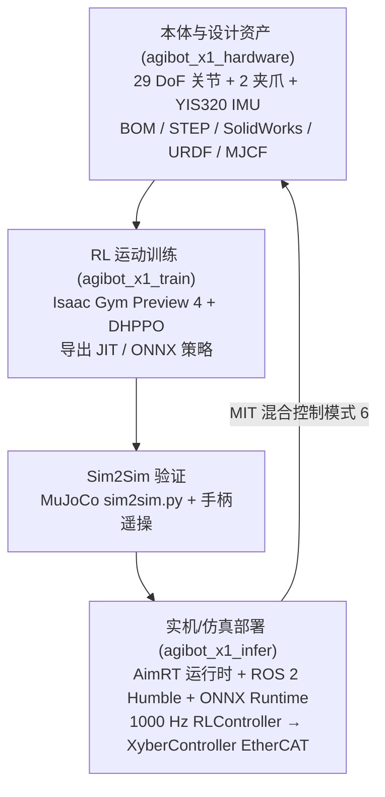
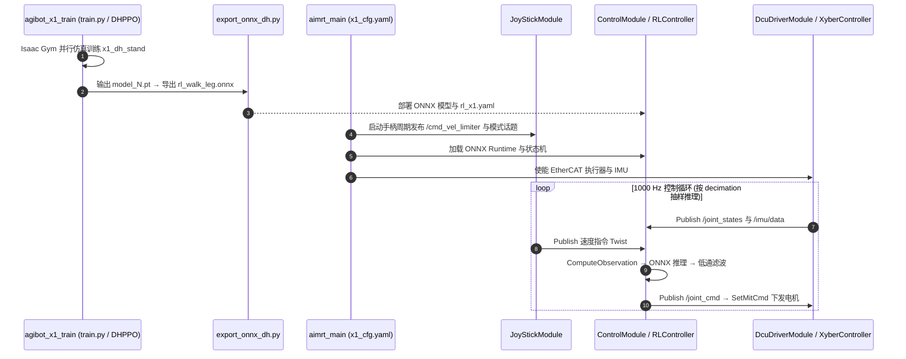

# 智元灵犀 X1（Agibot 开源人形）

## 一句话定义

**灵犀 X1** 是智元机器人 **Agibot** 品牌的开源人形方案：以 **[文档中心](https://www.agibot.com.cn/DOCS)** 提供 BOM、整机图纸、装机 SOP、推理与训练相关代码索引；源码与项目组织入口在 **[AgibotTech](https://github.com/AgibotTech)**。

## 英文缩写速查

| 缩写 | 英文全称 | 简要说明 |
|------|----------|----------|
| BOM | Bill of Materials | 物料清单，硬件零部件列表 |
| SOP | Standard Operating Procedure | 标准操作流程，如渐进式真机验证 |
| AVQA | Audio-Visual Question Answering | 音视频问答；X-Lab omni 预览模型曾登 Daily-Omni 榜 |

## 为什么重要

- **整机 + 工具链叙事**：与具身学习里 **Agibot-World** 等数据子集可在同一研究语境下出现（见 [EWMBench](./ewmbench.md)）。
- **复现前 checklist**：文档中心将组装、调试、部署串成流程，适合实验室 onboarding。
- **多模态读榜**：AGIBOT X-Lab **WITA-Omni Preview** 曾登 [Daily-Omni](./paper-daily-omni.md) AV 全模态榜首（闭源预览，非本页硬件仓）。

## 核心原理

依据 [官方开发指南](../../sources/sites/agibot-lingxi-x1-docs.md)，**灵犀 X1** 是模块化高自由度双足人形平台，全身配置 **29 个关节执行器**（`R86-2×9`、`R86-3×6`、`R52×10`、`L28×4`）与 2 个夹爪（可扩展 3 自由度头部），下肢 DCU 通过串口接入 **YIS320 IMU**（921600 波特率），并采用「Isaac Gym 仿真 RL 训练 → MuJoCo Sim2Sim 验证 → AimRT 实时推理部署」的闭环链路：

## 源码运行时序图

训练入口 `python humanoid/scripts/train.py --task=x1_dh_stand --run_name=<name> --headless`（`agibot_x1_train`），导出 ONNX 后由 `agibot_x1_infer` 的 `./aimrt_main --cfg_file_path=./cfg/x1_cfg.yaml` 驱动真机闭环：

图依据：`AgibotTech/agibot_x1_train@e6651b9`（`README.md`、`humanoid/scripts/train.py`）与 `AgibotTech/agibot_x1_infer@9e0b818`（`README.md`、`src/module/control_module/src/rl_controller.cc`），细节见 [agibot_x1_train](./cn-os-agibot-x1-train.md) 与 [agibot_x1_infer](./cn-os-agibot-x1-infer.md)；未运行硬件或训练。

## 工程实践

| 阶段 | 官方入口 / 工具 | 实操要点 |
|------|------------------|----------|
| **硬件设计** | [agibot_x1_hardware](https://github.com/AgibotTech/agibot_x1_hardware) | 获取 BOM、STEP、SolidWorks、URDF/MJCF 与装机 SOP（官网亦提供网盘镜像） |
| **执行器确认** | `REF-CLI v1.0.3.exe`（Windows USB-C） | 装机前逐颗核对 SN 版本号（V2 固件 `3.2.7` / V3 `3.2.9`）、设为模式 6（MIT 混合控制）、改 CAN ID 并失能后 `save_config()`；L28 上电自动回零、不支持手动标零 |
| **桌面联调** | `xyber_dcu_test_v0.1.3.zip`（Ubuntu 22.04 RT） | 改 `x1_test_cfg.yaml` 网卡名，跑 `./run_x1_test.sh` 测通信与正反转（可用 `move_actuator: false` 只使能不动） |
| **策略训练** | [agibot_x1_train](https://github.com/AgibotTech/agibot_x1_train) | Python 3.8 + PyTorch 1.13 + Isaac Gym Preview 4；训练后先跑 `sim2sim.py`（MuJoCo）验证再导出 ONNX |
| **实机部署** | [agibot_x1_infer](https://github.com/AgibotTech/agibot_x1_infer) | GCC-13 + CMake ≥3.26 + ONNX Runtime + ROS 2 Humble + Linux 实时内核补丁；支持 `url_gitee.bashrc` 加速 AimRT 依赖拉取 |

## 局限与风险

- **实时与系统依赖较重：** 训练依赖已停止更新的 **Isaac Gym Preview 4**（Python 3.8 + CUDA 11.7），部署端依赖 **Ubuntu 22.04 实时内核补丁 + ROS 2 Humble + GCC-13**，环境迁移与编译门槛较高。
- **硬件组装与标定敏感：** 仅启用下肢 DCU 连接的 YIS320 IMU（需预调 921600 波特率与最大输出频率）；桌面联调脚本会直接使能并正反转关节，官方明确警告**严禁在已装配整机上直接运行联调运动测试**。
- **开源覆盖范围：** 开源仓主攻双足运动控制（如 `x1_dh_stand`）与本体硬件设计，不包含高层 VLA 操作模型或闭源商业固件源码。

## 开源入口（官方汇总）

| 类型 | 链接 |
|------|------|
| 文档中心（中文 / 英文） | [agibot.com.cn/DOCS](https://www.agibot.com.cn/DOCS) · [agibot.com/DOCS/X1](https://agibot.com/DOCS/X1) |
| 硬件仓库 | [AgibotTech/agibot_x1_hardware](https://github.com/AgibotTech/agibot_x1_hardware) |
| 训练仓库 | [AgibotTech/agibot_x1_train](https://github.com/AgibotTech/agibot_x1_train) |
| 部署推理仓库 | [AgibotTech/agibot_x1_infer](https://github.com/AgibotTech/agibot_x1_infer) |

## 关联页面

- [Humanoid Locomotion (人形机器人移动)](../tasks/humanoid-locomotion.md) — 灵犀本体的模型、训练和推理资料应围绕双足运动的接触与稳定性核对。
- [Reinforcement Learning (RL, 强化学习)](../methods/reinforcement-learning.md) — 从训练到实机推理需保持关节映射和观测/动作契约，不把硬件资料开放等同策略可直接复现。

- [人形机器人](./humanoid-robot.md)
- [开源人形硬件方案对比](./open-source-humanoid-hardware.md)
- [agibot_x1_train（训练框架详页）](./cn-os-agibot-x1-train.md)
- [agibot_x1_infer（推理运行时详页）](./cn-os-agibot-x1-infer.md)
- [agibot_x1_hardware（本体资产详页）](./cn-os-agibot-x1-hardware.md)
- [机器人开源宝库（微信策展第01期）索引](../overview/robot-open-source-wechat-issue01-curator.md)
- [Daily-Omni](./paper-daily-omni.md) — X-Lab WITA-Omni Preview 登榜语境

## 推荐继续阅读

- [智元灵犀 X1 官方开发指南](https://www.agibot.com.cn/DOCS)
- [AgibotTech/agibot_x1_train](https://github.com/AgibotTech/agibot_x1_train)
- [EWMBench](./ewmbench.md)（评测与 Agibot-World 数据子集）

## 参考来源

- [智元灵犀 X1 官方文档中心归档](../../sources/sites/agibot-lingxi-x1-docs.md)
- [agibot_x1_train 源码归档](../../sources/repos/agibot_x1_train.md)
- [agibot_x1_infer 源码归档](../../sources/repos/agibot_x1_infer.md)
- [wechat_jixie_robot_open_source_treasury_issue01_10_robots.md](../../sources/blogs/wechat_jixie_robot_open_source_treasury_issue01_10_robots.md)
