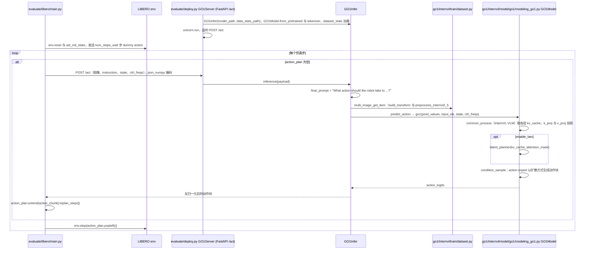

# AGIBOT WORLD 2026

**AGIBOT WORLD 2026** 是智元在 [Agibot-World](https://agibot-world.com/) 生态下发布的 **真实环境机器人学习数据集**（Hugging Face：[agibot-world/AgiBotWorld2026](https://huggingface.co/datasets/agibot-world/AgiBotWorld2026)）。文内强调 **100% 真实环境** 采集，覆盖商业空间、酒店餐饮、家居、安防、工业物流等场景，并记录遮挡、杂乱、光照变化与动态干扰等部署因素。

## 一句话定义

**面向模仿学习的真实多模态操作数据入口**——不只堆成功轨迹，还试图保留 **全身参与、力控、失败与修正** 等更接近现场的能力信号。

## 英文缩写速查

| 缩写 | 英文全称 | 简要说明 |
|------|----------|----------|
| IL | Imitation Learning | 从示范轨迹学习策略 |
| RGB-D | RGB-Depth | 彩色图与深度图组合传感 |
| IMU | Inertial Measurement Unit | 惯性测量单元 |
| LiDAR | Light Detection and Ranging | 激光雷达距离传感 |

## 为什么重要

- **数据入口位：** 在 [智元 2026-06 发布地图](../overview/agibot-june-2026-release-technology-map.md) 中承担 **落地链路第一段**——后续 Genie Sim、GE-Sim、GO-2 均假设有可信真机数据供给。
- **多模态传感：** 精灵 G2 + Swift Picker 夹爪、OmniHand 灵巧手、多视角 RGB(D)、触觉、LiDAR、IMU、全身关节与力传感等。
- **采集范式：** 全身控制、超视距遥操作、力控采集；首期开源主题 **模仿学习**，并提及 **自由采集** 以减少固定脚本僵硬感。
- **重定向就绪度：** 数据直接在 **精灵 G2** 本体上以全身遥操作采集，记录于该形态自身的动作/关节空间，可作为 **同形态策略的训练输入** 直接喂入，无需跨形态 **重定向**；迁移到异构本体时仍需按目标 **骨架/morphology** 适配。

## 与 Agibot-World / EWMBench

| 条目 | 关系 |
|------|------|
| [Agibot-World 站点](../../sources/sites/agibot-world.md) | 品牌与生态入口 |
| [EWMBench](./ewmbench.md) | 基于 Agibot-World 数据的 **世界模型生成评测**；与本数据集 **互补**（评测 vs 新一轮 IL 入口） |

## 常见误区

1. **与 EWMBench 混为同一数据集** — EWMBench 是 **评测基准**；AGIBOT WORLD 2026 是 **2026 轮 IL 数据发布**。
2. **「数据越多越好」** — 文内强调须反映真实部署的 **物理过程与失败修正**。

## 源码运行时序图

说明：下图对应仓库中可运行的 GO-1 模型代码（推理服务与 LIBERO 评测），不是 AGIBOT WORLD 2026 数据发布本身的处理流程；仓库 README 没有给出 2026 数据集的下载/处理脚本入口。

入口：服务端 `python evaluate/deploy.py --model_path <ckpt> --data_stats_path <dataset_stats.json> --port <PORT>`，客户端 `bash evaluate/libero/eval_libero.sh <TASK_SUITE> <SAVE_NAME> <HOST> <PORT>`（调用 `evaluate/libero/main.py`）。

图依据：OpenDriveLab/AgiBot-World@98f136e（README 中指向 AgibotTech/AgiBot-World），读过 `README.md`、`evaluate/deploy.py`、`evaluate/libero/main.py`、`evaluate/libero/eval_libero.sh`、`go1/shell/train.sh`、`go1/internvl/model/go1/modeling_go1.py`（仅 `forward`）；`condition_sample`、`latent_planner` 内部与 `go1_train.py` 训练流程未逐行读。

## 关联页面

- [数据入口分类 hub](../overview/agibot-release-category-01-data-entry.md)
- [模仿学习](../methods/imitation-learning.md)

## 参考来源

- [AgiBot-World 源码归档](../../sources/repos/agibot_world_2026.md)（<https://github.com/AgibotTech/AgiBot-World>）

- [AgiBot-World 源码归档](../../sources/repos/agibot-world.md)（<https://github.com/AgibotTech/AgiBot-World>）

- [wechat_embodied_ai_lab_agibot_june_2026_release.md](../../sources/blogs/wechat_embodied_ai_lab_agibot_june_2026_release.md)
- [agibot-world.md](../../sources/sites/agibot-world.md)
- 源码核对（2026-11-02）：OpenDriveLab/AgiBot-World@98f136e，读过 README.md、evaluate/deploy.py、evaluate/libero/main.py、evaluate/libero/eval_libero.sh、go1/shell/train.sh、go1/internvl/model/go1/modeling_go1.py（仅 forward）；时序图依据以上文件，未运行代码。

## 推荐继续阅读

- [AGIBOT WORLD 2026 官网](https://agibot-world.com)
- [Hugging Face 数据集](https://huggingface.co/datasets/agibot-world/AgiBotWorld2026)
