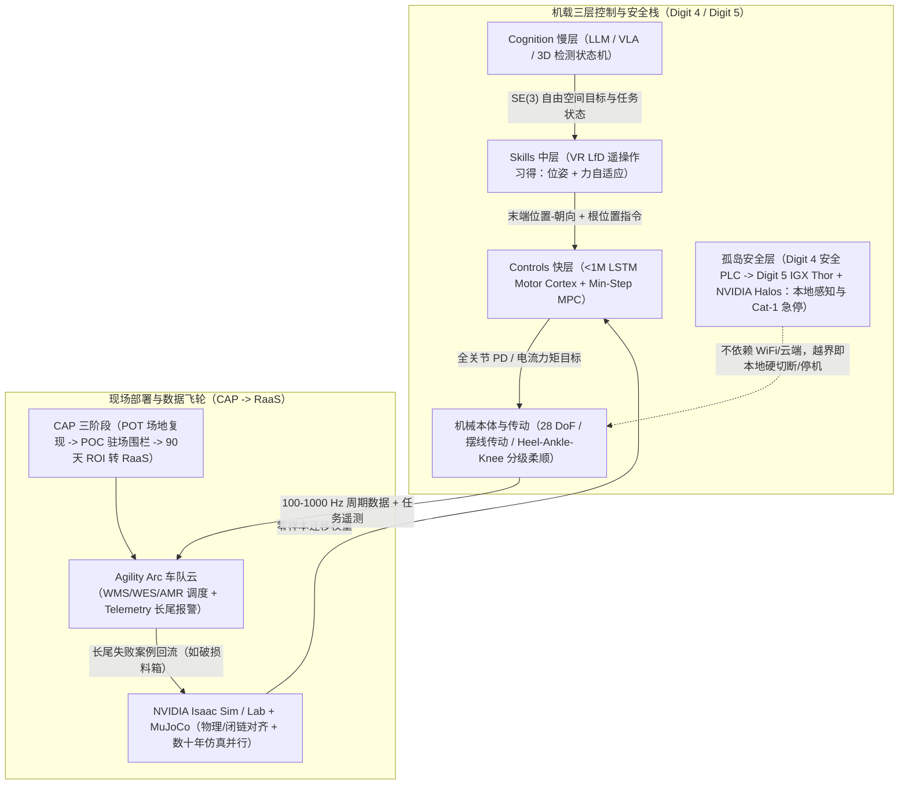

# 敏捷机器人（Agility Robotics）

## 一句话定义

**Agility Robotics（2015 年成立，Nasdaq: AGLT）是从俄勒冈州立大学动态机器人实验室（DRL）演进出的工业人形机器人公司，以「机械动力学与被动柔顺优先、`<1M` 参数仿真实体直迁 Motor Cortex、可量化的现场安全与 CAP/RaaS 商业闭环」为核心护城河。**

## 英文缩写速查

| 缩写 | 英文全称 | 简要说明 |
| --- | --- | --- |
| WBC | Whole-Body Control | 统筹双足平衡与双臂负载操作的全身协调控制 |
| CAP | Customer Acceleration Program | 敏捷机器人的三阶段客户导入流程（POT → POC → 90 天运营验收） |
| RaaS | Robots-as-a-Service | 机器人即服务多年期商业订阅交付模式 |
| NRTL | Nationally Recognized Test Lab | 美国 OSHA 认可的国家测试实验室，Digit 4 工作站通过其现场安全检验 |
| COT | Cost of Transport | 运输代价指标，用于衡量足式机体的机械能效比 |
| DFM | Design for Manufacturing | 面向规模化冲压/铸造与可维护性的工业产品工程设计（Digit 5 重点） |
| LfD | Learning from Demonstration | 通过 VR 头显遥操作示教获取中层技能策略的模仿学习环节 |

## 为什么重要

1. **学术动力学正统与商业收敛的典型对照：** 从早期的弹簧质量（SLIP）与珠鸡盲踩深坑仿生理论（ATRIAS → Cassie → Digit 1），到为适应工业产线连续作业果断**放弃**户外自动驾驶送货上门（Ford 合作场景），转向仓库/工厂固定节拍的料箱与物流节点连接，并在 GXO 单厂累积逾 **100,000 次料箱搬运**、全车队运营超 **65,000 小时**（截至 2026-11 上市公告）。
2. **明确质疑「单一超大 VLA + YouTube 炫技」叙事：** 首席机器人官 Jonathan Hurst 在 *Science Robotics*（2026-08）与 *IEEE Spectrum*（2026-05）中系统论证 **Hardware First** 与 **Moravec 悖论**——编排表演只证明低层防摔有效，真正限制工业与家庭落地的是数据维数灾难、多模型协调（Agentic AI 调度专门策略）与力透明执行器，而非单一模型参数规模。
3. **把「合规与协作安全」写成一等架构约束：** 在行业少数把工业安全作为工程硬阻断而非宣传后缀的公司中，Agility 经历了「外部急停（Digit 3）→ 机载安全 PLC + Cat-1 停机 + 围栏工作站 NRTL 认证（Digit 4）→ **NVIDIA IGX Thor + NVIDIA Halos** 孤岛安全计算机 + AI 人体检测（Digit 5）」，并主导 **ISO 25785-1** / **ANSI TR R15.108** / **ISO/IEC TS 22440** 等标准制定。

---

## 核心原理

### 1. 机体谱系与硬件第一性演化（ATRIAS → Cassie → Digit 5）

Agility 的整机形态并非出于外形拟人执念，而是足式机动性与物理交互约束逐步叠加的结果：

| 代际 / 平台 | 关键参数与构造 | 核心动力学设计问题与取舍 |
| --- | --- | --- |
| **ATRIAS**（OSU/CMU/UMich） | `72.5 kg`，四连杆机构 + 玻璃纤维弹簧，`7.6 km/h`，`COT 1.13` | 验证弹簧–质心模型能以接近生物（人类 `0.2` 量级）能耗实现拟人动态步态 |
| **Cassie**（2016–2017，已 EOL） | `31 kg`，双腿各 **5 驱动电机 + 2 被动弹簧**，`5 km/h`，`100–300 W` / 5h | 解决无上身条件下的商业级耐摔行走；但无躯干导致**偏航（yaw）惯量与控制权不足** |
| **Digit 1 / Digit 3** | Cassie 下肢 + 直立 LiDAR 感知躯干 + 双臂 | 双臂起源于类似鸵鸟双翼的**左右对称偏航平衡尾**，同时兼顾高空跌倒减速支架与双臂抓取；叶簧利于奔跑缓冲但增加站立操作动力学复杂度 |
| **Digit 4**（2023–2026 商用主力） | **28 DoF**，用**刚性连杆**替代叶簧、新增机载安全 PLC 与 4 接触点优化脚底 | 专注站立–行走混合 **loco-manipulation**；闭链脚趾连杆在仿真中需高保真建模；需配合物理围栏 workcell 与 NRTL 认证运行 |
| **Digit 5**（2026-09 发布） | `129 kg` 整机、`23 kg (50 lb)` 负载、`2.2 m` 臂展、**9 分钟快充**（10:1 运行充电比，20h/24h）、**人形式近腿布局** | **自研摆线传动**满足高扭矩且抑制齿轮摩擦以实现绕组电流力控；用 **Heel（柔顺块）→ 低惯量踝电机 → 膝大电机** 的「分级冲击架构」吸收着地脉冲；可快换夹爪优先保证耐摔与工时 ROI；IGX Thor + Halos 内建孤岛安全算力瞄准无围栏协作安全 |

### 2. 三层控制与研发分析主线（Research + Analysis & Engineering）

Agility 在官方 *Research + Analysis* 专栏（7 篇公开文献）与 2024–2026 工程博客中形成完整闭环思想：

- **三层异步软件栈（Agility and AI，2026-03）：**
  1. **Cognition（慢思考任务规划）：** 使用 LLM/VLA 与开放词表 3D 语义识别做任务步拆解（例如在 GTC 2025 用 3D 物体检测+状态机提示抓取杂货，或在内部使用 Gemini 预览输出物体自由空间位置，而非重造大模型本身）。
  2. **Skills（实时中层操作技能）：** 工程师通过 VR 头显 + 双手柄对 Digit 进行 **LfD 遥操作**，同步录制相机、关节位置、力/力矩与末端轨迹，学会面对料箱内物品重心滑动的自适应握持与身体微调。
  3. **Controls（亚毫秒级身体反射）：** 在 NVIDIA Isaac Sim / Isaac Lab 训练 **<1M 参数轻量 LSTM「Motor Cortex」** 并零样本迁移真机（详见专页 [Agility WBC Foundation Model](./agility-wbc-foundation-model.md)）；搭配 2025-10 上线的 **全局最优最小步数 + MPC 导航栈**，实现重负载狭小工位内的极简步态规划。
- **Research + Analysis 专栏 7 篇脉络：**
  - **2019–2023（物理形态与跌倒工程观）：** *Building Robots That Can Go Where We Go*（2019，ATRIAS→Cassie→Digit）→ *Getting Back to Work*（2021，舍弃 Ford 送货转向仓储物流、双臂即对称偏航尾）→ *Totally Fine to Fall Down*（2023，ProMat 臂编码器 bug 复盘、手臂防摔减震设计、"倒下时保护旁人且让机器人自主跌倒"）。
  - **2026（宏观政策、WEF 情景与硬件基石判断）：** *Next-Generation Physical Autonomy*（2026-04 WEF 白皮书，警告过度炒作导致 *Tech disillusionment* 与结构化稳健部署 *Proven deployment* 的 2031 情景分化）→ *ChatGPT Moment*（2026-05，YouTube-to-Reality Gap、Agentic 多模型协调、2.4 亿次仿真样本数据鸿沟与力控执行器短板）→ *Safeguarding America's Humanoid Future*（2026-06，6 项美国本土制造 RoboFab 1 万台产能规划、NRC/NIST/NTIA、DoW 5000.94 政策主张）→ [*Physical AI Is Enabled By Mechanical Hardware*](./paper-physical-ai-mechanical-hardware.md)（2026-08 *Science Robotics*，论证力学底座限制高阶物理 AI 天花板）。

### 3. 全栈系统与商业安全闭环图

---

## 源码运行时序图

**不适用。**

原因说明（依据 `github.com/agilityrobotics` 与 `huggingface.co/agilityrobotics` 实测核查，详见 [官网归档](../../sources/sites/agility-robotics.md)）：
1. **官方现役软件栈完全闭源：** Digit 控制律、`<1M` LSTM Motor Cortex 推理/训练脚本、导航 MPC、Agility Arc 车队协调及 NVIDIA Halos 集成代码均未开源，Hugging Face 公开模型数为 `0`。
2. **唯一机器人公开仓已停止支持：** `agilityrobotics/cassie-doc`（61 stars）仅含早期 **Cassie** 平台的历史文档与旧版软件包，其官方 README 已明确标注 **`End of Life`**，其余 8 个组织仓库全部为 CI / Kubernetes / Bazel 基础设施 fork。
3. 学界基于早期硬件开展的第三方研究（例如 UC Berkeley 开源的 [Digit 人形 RL 行走](./paper-digit-humanoid-locomotion-rl.md)）属于外部学术工作，不代表 Agility 商用现役运行入口。

---

## 工程实践

### 1. 商用导入漏斗（CAP → RaaS）与 2026 上市口径

- **需求反向筛选：** CTO Pras Velagapudi 明确会在首轮剔除「固定臂或纯 AMR 更划算」的伪人形场景，仅聚焦连接自动化孤岛的「dull / dirty / dangerous」流程。
- **三阶段落地：** **POT**（Agility 内部复制客户料箱重力/按键/空间并生成首批真机训练数据）→ **POC**（现场 WiFi、cybersecurity、Arc 地图与**客户端团队变更管理与员工"禁止扶机器、让机器自主跌倒"安全培训**）→ **90 天运营影响期**（度量节拍、上线率与 ROI 后转多年期 RaaS；据 SEC S-1 档案，前期 CAP 试点含约 50 万美元参与费）。
- **商业化数字边界（2026-11-05 Nasdaq `AGLT` 公告口径）：**
  - 已合作或上线客户包括 **GXO**（佐治亚单厂超 10 万料箱、约定 2027 年初再扩 2 座美国仓）、**Schaeffler**、**Toyota Motor Manufacturing Canada（TMMC）**、**AGCO**（2027 试点）及 3 家匿名大型制造付费试用客户；全车队累计运行逾 **65,000 小时**。
  - SPAC（Churchill Capital Corp XI）总募集约 **4.65 亿美元**（含 Foxconn 领投 PIPE），披露 **Digit 5 逾 3 亿美元多年期承诺订单**；公司官方前瞻性声明明确提示该订单**受限于合同里程碑、产品性能与规格验收**（目标 2027H1 抢先体验、2027 年底全面商用），不可直接视作已确认收入。

### 2. 机队方差处理：标定 vs 域随机化边界

Jonathan Hurst 在 Digit 5 AMA 中总结量产机队工程经验：**不可对所有参数无差别域随机化（DR 越宽、策略平均性能与能效越保守，如同时刻假设踩在冰面上）**。因此工程上拆成两条路：
- **个体出厂标定：** 针对制造后恒定的差异（电机力矩常数、机身零件实际质量），逐台标定；
- **策略鲁棒适应：** 仅针对随时间/温度/环境变化的不可控量（地面摩擦、高度起伏、料箱未知重量）做随机化。

---

## 局限与风险

1. **协作安全伴随硬件质量与体积惩罚：** 为容纳碰撞保护传感外壳、AI 人体检测算力与孤岛安全计算机，Digit 5 整机重量攀升至 **`129 kg`**，不仅增加了摔倒动能治理难度，也对高减速比摆线关节及电池倍率提出严苛热管理要求（虽通过 9 分钟 Nyobolt 快充与年度老化余量设计缓解，但仍需以换电/换电池维护为常规运维）。
2. **现役核心软件与模型完全黑盒：** 外界无法审计其 `Cognition/Skills/Controls` 策略泛化边界、Sim2Real 真实微调比例或故障恢复失效率；官方仅公布「clear bin/tote task 可达 ~99% 可靠性」（AMA 口述），缺少标准开放基准的第三方实测复现。
3. **从单品刚性料箱（Totes）向复杂混杂件扩域仍处于早期：** 目前可验证的高置信吞吐仍集中在相对规整的料箱搬运（10 万箱 GXO 案例）；转向箱内分拣（kitting/item picking）与柔损纸箱仍高度依赖规模化部署后的数据飞轮与可快换末端迭代，且已主动回避需高成本维修的纯五指灵巧手工业场景。
4. **交付节奏与合规窗口风险：** Digit 5 无围栏协作安全与 >$3 亿订单兑现取决于 2027 年上半年早期客户交付及 **ISO 25785-1 / EU Machinery Regulation 2023/1230** 的同步落地；在公共/家庭非结构化环境，Hurst 个人判断早期实用家用机器人更可能是轮式静稳定形态而非双足。

---

## 关联页面

- [Agility WBC Foundation Model（Digit Motor Cortex 与 Isaac Lab Sim2Real）](./agility-wbc-foundation-model.md) — 深挖 `<1M` LSTM Motor Cortex、4 接触点脚底碰撞修复与自由空间 SE(3) 接口
- [Physical AI × 机械硬件（SciRob 2026）](./paper-physical-ai-mechanical-hardware.md) — Hurst 2026-08 *Science Robotics* 观点的单篇技术拆解
- [Digit 人形 RL 行走（UC Berkeley，arXiv:2303.03381）](./paper-digit-humanoid-locomotion-rl.md) & [Cassie RL 论文](./paper-cassie-biped-versatile-locomotion-rl.md) — 外部学界基于 Agility 早期硬件的公开研究对比
- [Agility Robotics（策展节点）](./painode-041-agilityrobotics.md) — `awesome-physical-ai` 原始索引存根
- [人形整机机械布局设计](../concepts/humanoid-mechanical-layout-design.md) & [人形硬件设计纵深](../../roadmap/depth-humanoid-hardware-design.md) — 摆线传动、分级冲击柔顺与 DFM 工程对照
- [Loco-Manipulation（移动操作任务）](../tasks/loco-manipulation.md) & [Humanoid Locomotion（人形行走任务）](../tasks/humanoid-locomotion.md) — 面向仓储料箱衔接的带负载移动操作与双足稳定任务基准
- [强化学习（Reinforcement Learning）](../methods/reinforcement-learning.md) & [模型预测控制（MPC）](../methods/model-predictive-control.md) — 支撑 Motor Cortex 亚毫秒反射与最小步数导航的底层方法底座
- [全身控制（Whole-Body Control）](../concepts/whole-body-control.md) & [Sim2Real](../concepts/sim2real.md) — 本页底层控制与迁移方法基础
- [机器人基础模型与通用人形：公司技术路线对照（2026）](../comparisons/robot-foundation-model-company-paths-2026.md) — 横向对照 Agility 与 Figure、1X、Unitree 等公司的三视角定位与开放边界
- [具身智能商业落地 FDE / RaaS 模式（2026）](../comparisons/embodied-fde-deployment-business-models-2026.md) — 对比 Agility CAP/RaaS 与国内外驻场交付成本结构
- [市面知名机器人平台纵览](../overview/notable-commercial-robot-platforms.md) — 商业人形阵营与行业定位汇总

---

## 参考来源

- [Agility Robotics 官网、Research + Analysis 7 篇全文、工程博文、Digit 5 与 Nasdaq/GitHub/HF 核查归档（2026-11-20）](../../sources/sites/agility-robotics.md)
- [公司官方技术入口与开放程度汇总索引（2026）](../../sources/sites/robot-foundation-model-company-research-2026.md)
- [具身 FDE 驻场交付一手证据汇总（含 Agility SEC S-1 CAP 口径）](../../sources/sites/robot-fde-delivery-primary-evidence-20261119.md)
- [SciRob 2026 论文原文归档（Physical AI is enabled by mechanical hardware）](../../sources/papers/physical_ai_mechanical_hardware_scirobotics_aee2921_2026.md)

---

## 推荐继续阅读

- **技术架构与 Sim2Real 深潜：** [Agility WBC Foundation Model](./agility-wbc-foundation-model.md) 与官方博文 [*Crossing the Sim2Real Gap With NVIDIA Isaac Lab*](https://www.agilityrobotics.com/content/crossing-sim2real-gap-with-isaaclab)
- **行业路线与安全反思：** [*Will Robotics Have a ChatGPT Moment?*（IEEE Spectrum 2026-05）](https://spectrum.ieee.org/robotics-ai-breakthrough) 与 [*Built for the Real World*（2026-06）](https://www.agilityrobotics.com/content/built-for-the-real-world)
- **全站知识图谱与路线对照：** [Loco-Manipulation 纵深路线](../../roadmap/depth-loco-manipulation.md) · [Sim2Real 纵深路线](../../roadmap/depth-sim2real.md)
