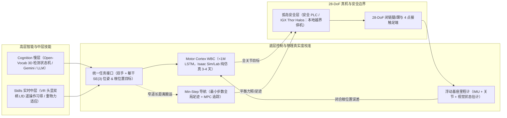

# Agility WBC Foundation Model（Digit Motor Cortex 与 Isaac Lab Sim2Real）

## 一句话定义

**Agility WBC Foundation Model（官网称 Digit 「Motor Cortex」）是一个 `<1M` 参数的轻量 LSTM 全身强化学习控制器：先通过高保真闭链脚尖碰撞与传动物理对齐跨过 Isaac Lab Sim2Real 断层，再以「均匀工作空间采样 + 根位置跟踪 + 自由空间 SE(3) 任务态提示」作为高层 AI 与 28-DoF 硬件之间的常驻安全平衡接口。**

## 英文缩写速查

| 缩写 | 英文全称 | 简要说明 |
| --- | --- | --- |
| WBC | Whole-Body Control | 协调下肢支撑平衡与上肢接触操作的全身控制范式 |
| RL | Reinforcement Learning | 在大规模并行物理仿真中优化鲁棒策略的强化学习方法 |
| MPC | Model Predictive Control | 模型预测控制，Agility 用于精准追踪全局最小步数足迹规划 |
| IK / ID | Inverse Kinematics / Inverse Dynamics | 逆运动学与逆动力学，传统基于精确物理模型的求解链路 |
| SE(3) | Special Euclidean Group in 3D | 三维空间刚体位置与朝向（6D 位姿）的自由空间表示 |
| DoF | Degrees of Freedom | 机器自由度，官方博客披露 Digit 整机共 28 DoF |
| LSTM | Long Short-Term Memory | 循环神经网络结构，Agility Motor Cortex 的主体网络（`<1M` 参数） |

## 为什么重要

1. **反制 RL 工程中最常见的「胶带奖励（Duct-Tape Rewards）」反模式：** 大多数 Sim2Real 教程强调靠重重域随机化和惩罚奖励压制仿真打滑/抖动；Agility CTO Pras Velagapudi 在 2024-10 公开复盘指出，面对 **Digit 闭链脚踝连杆 + 混沌脚尖撞地**引发的真机狂滑，靠补丁奖励只能获得不可组合、行为诡异的脆弱策略，必须下沉 6 个月从物理层面修准碰撞几何与传动能耗。
2. **指明工业 Loco-Manipulation 与纯娱乐全身模仿（Dance / Kung Fu）的三处分水岭：** 相较基于 AMASS / LAFAN1 离线人运动库的学界全身跟踪路线（如 GMT、TWIST），Agility 系统性解释了为什么物流重物搬运必须同时切换**工作空间采样分布**、**根位置而非纯根速度指令**以及**任务空间而非关节空间接口**。
3. **轻量化与高层解耦的参考坐标：** `<1M` 参数的机上高速反射网络证明，全身平衡与抗扰底层不一定依赖大参数量视觉–语言主干；它作为一个 **始终在线的安全与运动基座**，向上承接 Gemini 预览、3D 开放词表状态机或 VR 遥操作 LfD 技能。

---

## 核心原理

### 1. 工程突破一：6 个月物理根因排查，跨过 Isaac Lab Sim2Real 鸿沟

早期 Digit 的传统控制链路依赖「简化刚体模型预测落脚点 + 逆动力学（ID）实时算关节力矩」，在平滑地面的常规工况稳定，但面对**绊脚/勾挂、地面突然打滑、无法在线准确观测干扰力矩的「迈步恢复（Step Recovery）」**时极易失效。团队切入 NVIDIA **Isaac Lab** 大规模 GPU 并行 RL 后，发现早期策略在仿真里步态自信，上真机却剧烈打滑失稳。

团队拒绝靠叠加 `"禁止晃脚"` / `"强迫站直"` 类**胶带奖励**绕行，历时 **6 个月**在 Isaac Sim 与 **MuJoCo** 交叉验证中定位出三大物理仿真失真源：

| 失真层 | 具体物理现象与根因 | 工程修正与收益 |
| --- | --- | --- |
| **碰撞几何简化** | Digit 每步靠脚尖踏板（toe-plate）触地，撞地是混沌物理过程；传统整块鞋底纹路几何在接触边缘与地面摩擦力传播失真 | 改用 **4 接触点脚底概念** 替换传统鞋面几何，消除局部接触奇异点 |
| **执行器能量传播不准** | 电机绕组电流经减速传动向足端传递的耗散与惯量特性在早期仿真中与硬件不一致 | 按实测能量传递曲线重新标定仿真执行器/传动链路 |
| **闭链运动学求解失稳** | Digit 脚趾踏板与跗骨（tarsus）通过连杆构成**独特闭链运动学机构**，默认约束求解器在高频冲击下震荡 | 针对性修正闭链约束求解稳定性与时间步处理 |

修正物理底座后，最终训练奖励得以精简回归**能耗最小化与步态对称性**等少数直观物理项，同时反哺指导下一代 Digit 硬件形态迭代（Simulation → Hardware Co-design）。

### 2. 工程突破二：Digit 「Motor Cortex」三大体系选择（vs 学界常规人类 MoCap 路线）

2025-08 发布的 WBC 基础模型本质是一枚 **小于 1M 参数的轻量 LSTM 策略**，在 NVIDIA Isaac Sim 内于 **3–4 天累积数十年等效仿真经验**，纯仿真训练后**零样本直接迁移真机**，在 GTC 2025 杂货分拣与重载搬运上完成实证。它与主流学界全身跟踪路线（如 GMT、TWIST 等）刻意拉开了三道架构边界：

| 设计维度 | 主流学术全身跟踪常见做法 | Agility Motor Cortex 方案与工程理由 |
| --- | --- | --- |
| **1. 训练分布来源** | 离线人体动捕库（**AMASS / LAFAN1**），自然拟人且动态极限动作丰富 | **全工作空间均匀随机采样**：在双手与躯干可达空间均匀随机选取 **SE(3) 位置与朝向** 并生成随机平移/旋转速度轨迹，以末端平移与旋转误差作奖励，确保极限高/低位抓取区域不被人类日常动作稀疏区漏掉 |
| **2. 移动跟踪目标** | 根速度指令（`vx, vy, yaw`；如 VMP、AMOR、FALCON、ExBody/2、HumanPlus、GMT、R2S2、MHC），奖励信号温和 | **根位置跟踪**（对标 CLONE、OmniH2O、HOVER 等支持位置追踪路线）：让机器人在空间定锚停留；**遭人大力推挤会自主迈步缓冲并回到原目标位置**，避免纯速度控发生位置漂移需上层高频纠偏。代价是**真机必须配备高精度浮动基座里程计 / 状态估计** |
| **3. 上层提示接口** | 关节构型空间（Joint Configuration Space）目标，上层必须掌握机器人运动学构型并套用 Retargeting / MoCap 服 | **自由空间 SE(3) 任务空间提示**（手与躯干 6D 目标）：与上游视觉目标检测（如 GTC 2025 开放词表 2D→3D 提升）、VLM/Gemini 位置预测及人类 VR 遥操作 LfD 原生对齐，**规划器无需绑定特定机器人关节角** |

### 3. 混合共治与系统数据流：Motor Cortex + 最小步数 MPC 导航 + 安全孤岛

Motor Cortex 并非一夜之间取代全部经典控制。2025-10 GXO 部署一周年发布的 ***Digit's Next Steps*** 明确指出：当 Digit 在 GXO 极狭窄货架/AMR 通道携带重载转身时，公司新版导航栈采用**「全局最优最小步数路径规划 + 高精度 MPC 追踪」**，以尽可能少的落地转身步完成重物搬运并支持动态暂存溢出料箱；而在三层架构（2026-03 *Agility and AI*）中，Cognition / Skills / Controls 按异步节拍协同，并由物理孤岛安全层做硬件兜底：

---

## 源码运行时序图

**不适用。**

原因说明（核查自 [官网归档](../../sources/sites/agility-robotics.md)）：
1. *Crossing the Sim2Real Gap With NVIDIA Isaac Lab*（2024-10-31）与 *Training a Whole-Body Control Foundation Model*（2025-08-28）均为工程技术博客总结；截至 2026-11-20，Agility Robotics 的 **GitHub 组织（仅 `cassie-doc` EOL 及 8 个运维 fork）与 Hugging Face（0 个公开模型）均未释放 Motor Cortex LSTM 权重、Isaac Lab 资产 USD/MJCF 模型或闭链约束求解配置**。
2. 不可强行将外部基于早期 Digit 的研究仓（如 UC Berkeley [`paper-digit-humanoid-locomotion-rl`](./paper-digit-humanoid-locomotion-rl.md) 中的 Transformer 50 Hz 行走控制器）混同为 Agility 官方现役 WBC Motor Cortex 运行入口。

---

## 工程实践

1. **先做闭链与接触物理校验，再加奖励函数：** 在 Isaac Lab / MuJoCo 引入带连杆、推杆（四连杆/脚踝并联推杆）的机器人时，一旦出现仿真极稳、真机滑步，优先排查 **collision proxy 接触点几何（例如四点脚垫 vs 全底网格）、闭链约束刚度/迭代次数以及传动能量耗散模型**，不要靠堆叠平滑惩罚奖励强行收敛。
2. **「个体标定 vs 域随机化」切分原则（Hurst 2026-10 AMA 口径）：**
   - 机队制造公差中的**不变量**（电机力矩常数、零件实测质量）应当通过单机出厂标定固化；
   - **随机化只留给现场运行时真不可控的变量**（地形微高差、料箱实际重量、地面摩擦系数及温度漂移），否则策略被迫按"永远在冰面行走"的极端保守状态牺牲常规负载效率。
3. **跨仿真器回归：** Agility 在定位脚尖 Sim2Real gap 时同步交叉使用 **Isaac Sim / Isaac Lab 与 MuJoCo**（也是其 2026-03 文章明确提及的物理工具组合），避免单一物理引擎接触求解器偏置误导策略学到不可迁移的"作弊接触力"。

---

## 局限与风险

1. **闭源架构不可独立复现验证：** 官网文章未公布 LSTM 隐层维度、观测向量全表、控制周期精确频率、Isaac Sim 域随机化区间或 GTC 演示外的定量消融成功率表（如工作空间各区域位置追踪 RMSE）。
2. **根位置追踪强依赖高频里程计不飘移：** 官方明确承认，选择「根位置目标」而非「速度指令」时，真机测试强依赖浮动基座状态估计器精度；在长距离搬运、高反光地坪或粉尘打滑仓库中，如何融合足底接触里程计与机载视觉不累积漂移，决定上层位置指令是否会产生静差或强行迈步冲突。
3. **重接触与高冲击极端操作边界未知：** Motor Cortex 目前在公开案例中突出展示「手/躯干自由空间 SE(3) + 搬运重物与站立推挤复原」；面对高频工具敲击、插拔或全躯干靠墙借力等显式接触力目标任务（需要精确外力反馈而非纯位置空间提示），单靠任务空间 SE(3) 位姿提示存在力控表现上限（未来或依赖 Skills 层的力传感与 Digit 5 摆线电流透明度协同解决）。

---

## 关联页面

- [敏捷机器人（Agility Robotics）](./agility-robotics.md) — 公司全栈硬件演化、安全合规框架与商用进程总览
- [Physical AI × 机械硬件（SciRob 2026）](./paper-physical-ai-mechanical-hardware.md) — 解释为何机械构型与动力学决定底层控制能走多远
- [Digit 人形 RL 行走（UC Berkeley，arXiv:2303.03381）](./paper-digit-humanoid-locomotion-rl.md) — 对照学界早年基于 Digit 的纯本体感觉 Transformer 行走工作
- [Loco-Manipulation（移动操作）](../tasks/loco-manipulation.md) & [平衡恢复（Balance Recovery）](../tasks/balance-recovery.md) — 重载料箱移动操作与未知打滑/绊脚迈步恢复任务场景
- [强化学习（Reinforcement Learning）](../methods/reinforcement-learning.md)、[模仿学习（Imitation Learning）](../methods/imitation-learning.md) & [模型预测控制（MPC）](../methods/model-predictive-control.md) — 三层控制中 Controls（Isaac Lab RL）、Skills（VR 遥操作 LfD）与最小步数导航追踪的方法底座
- [System Identification（系统辨识）](../concepts/system-identification.md) & [Sim2Real 概念页](../concepts/sim2real.md) — 闭链对齐与执行器能量传递建模的理论底座
- [Sim2Real 纵深路线](../../roadmap/depth-sim2real.md) — Stage 1「资产与执行器对齐」工业级闭源标杆对照案例
- [Loco-Manipulation 纵深路线](../../roadmap/depth-loco-manipulation.md) — Stage 1「上下身解耦接口」另类方案（自由空间 SE(3) + 根位置）
- [Domain Randomization](../concepts/domain-randomization.md) & [奖励函数设计](../concepts/reward-design.md) — 理解 Hurst 标定与随机化分工及避免胶带奖励反模式
- [Whole-Body Control（WBC）](../concepts/whole-body-control.md) & [Whole-Body Tracking Pipeline](../concepts/whole-body-tracking-pipeline.md) — 对照基于人动作库的全身跟踪管线（GMT / TWIST / HOVER）
- [机器人基础模型与通用人形：公司技术路线对照（2026）](../comparisons/robot-foundation-model-company-paths-2026.md) — 与 1X Redwood、Figure Helix S0、LimX WBT 等公司小脑对比

---

## 参考来源

- [Agility Robotics 官网、Research + Analysis、Isaac Lab Sim2Real 与 WBC Foundation Model 归档（2026-11-20）](../../sources/sites/agility-robotics.md)
- [SciRob 2026 论文原文归档（Physical AI is enabled by mechanical hardware）](../../sources/papers/physical_ai_mechanical_hardware_scirobotics_aee2921_2026.md)

---

## 推荐继续阅读

- **原文博客（Sim2Real）：** [*Crossing the Sim2Real Gap With NVIDIA Isaac Lab*（Pras Velagapudi，2024-10-31）](https://www.agilityrobotics.com/content/crossing-sim2real-gap-with-isaaclab)
- **原文博客（WBC）：** [*Training a Whole-Body Control Foundation Model*（2025-08-28）](https://www.agilityrobotics.com/content/training-a-whole-body-control-foundation-model)
- **外部综述延伸：** [Alan Fern — *The Emerging Humanoid Motor Cortex: An Inventory of RL-Trained Controllers*](https://gofai2robots.substack.com/p/the-emerging-humanoid-motor-cortex)（官网文末直接推荐延伸阅读）
