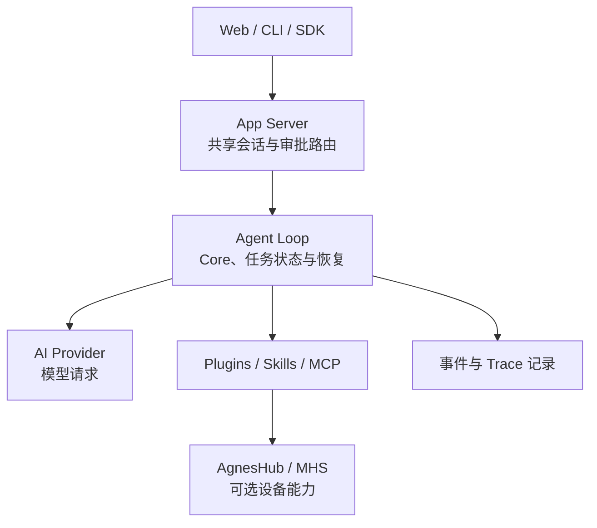

# Agnes Harness（AGH）

## 一句话定义

**Agnes Harness（AGH）** 是面向 Forward Deployed Engineering（FDE）的可插拔 agent runtime：把模型调用、工具、任务状态、跨端会话、人工审批与执行记录放进一个可复用的部署底座，并提供可选的物理设备接入路径。

## 英文缩写速查

| 缩写 | 英文全称 | 简要说明 |
|------|----------|----------|
| AGH | Agnes Harness | 本项目；管理 agent 运行、扩展与部署记录 |
| FDE | Forward Deployed Engineering | 在客户现场集成系统并交付持续迭代软件的工程方式 |
| MCP | Model Context Protocol | AGH 支持的外部工具/服务连接方式之一 |
| MHS | Model Hardware Standard | AGH 自有设备协议；同名但不等同于 Anthropic / HHMI Janelia 的 MHS |
| MOS | Model Observation Standard | AGH 设备侧观测数据约定，如图像、地图与地点 |
| SDK | Software Development Kit | AGH 提供的共享后端客户端入口之一 |

## 为什么值得关注

AGH 的机器人相关性在 **系统集成与高层设备编排**，不在运动控制算法：它展示了如何把 Web/终端工作台、模型、工具、工作流状态和设备能力置于同一任务记录下。部署到不同客户或实验室时，差异可通过插件和 Skills 承载，避免把每个连接器都写进 agent 核心。

把设备工具纳入 agent 任务流也会放大软件执行错误的物理影响，因此它适合与 [LLM 机器人控制接口](../concepts/llm-robotics-control-interfaces.md) 和 [Safety Filter](../concepts/safety-filter.md) 一起阅读：agent 保持在任务级编排，实时运动闭环和安全停机仍归设备控制器。

## 核心结构

| 层 | 作用 | 当前状态 / 入口 |
|----|------|------------------|
| **Web / CLI / SDK** | 创建任务、查看结果、跨端续接同一会话 | README 标为开发预览可用；客户端共享后端 session |
| **App Server 与 Agent Loop** | 会话、任务提交、事件分发、审批路由；执行模型与工具调用、状态恢复 | 内置 Core loop 为当前主分支默认路径；Jev 结构化决策仍在集成 |
| **插件与 Skills** | backend tools/services、Web panels、hooks、MCP 与可复用任务方法 | 示例包括工具、前端面板和 full-stack plugin |
| **审批与 Trace** | 在支持的命令执行路径上等待用户批准，并记录模型调用、工具调用和审批过程 | 提供审计线索；不构成任意插件代码的隔离边界 |
| **AgnesHub / MHS** | 将设备状态、工具和观测接入任务流 | 可选插件；设备以 WebSocket 注册能力，MOS 表达观测数据 |

## 流程总览

下图概括 README 与架构指南描述的高层请求路径；具体模块边界以官方架构文档和当前源码为准。



AGH 是任务级协调层。即使任务目标由语言模型生成，设备驱动仍应在设备侧维护实时控制、互锁和急停；agent 任务取消不保证硬件已停止。

## 源码运行入口

README 当前给出的源码构建路径（**文档核对，未在本机执行**）：

```bash
pnpm install --frozen-lockfile
pnpm --filter @agnes/cli build:local
node packages/cli/dist/local/agnes.mjs serve
```

官方 README 要求 Node.js 24.10+、pnpm 10.34.5 和平台原生构建工具。启动 Web 服务后，在回环地址配置模型并创建任务；CLI 可连接同一后端会话。没有模型账号时可运行仓库中的 simulated-model demo，探索插件与任务执行。

## 设备协议：同名 MHS 的消歧

AGH 使用 **Agnes MHS（Model Hardware Standard）** 指代自己的设备协议：设备通过 WebSocket 连接 AgnesHub，注册状态、工具和数据源；MOS 表达设备观测。官方说明该协议独立于 MCP，也独立于厂商 SDK。

这与 [Anthropic / HHMI Janelia 的 MHS 概念页](../concepts/model-hardware-standard.md) **不是同一协议**。它们恰好共用 “Model Hardware Standard” 全称与 MHS 缩写，组织、接口描述和发布状态均不同；不要据此推断协议兼容、代码复用或标准关系。

## 工程实践与安全边界

- **源码可用，产品仍在预览期：** 仓库公开且项目代码采用 Apache-2.0，但发布形态仍是 source build / pre-alpha；没有公开包发行、安装器或生产支持承诺。
- **插件是可信进程内代码：** 安装插件前检查来源、版本、完整性摘要、能力 hash 和许可证。命令审批及 sandbox 约束适用于指定执行路径，不隔离普通 backend plugin。
- **物理安全必须落在设备层：** MHS 合规测试不等同于设备安全认证；保留设备控制器的实时闭环、互锁和急停，并针对断连、超时和 agent 取消单独验证。
- **平台支持要按目标机验证：** README 记录 macOS / Node 24 检查，并明确 Linux 与 Windows 需要独立验收。
- **接口可能变化：** pre-alpha API、配置和插件接口仍在演进，不宜按稳定依赖或生产升级路径处理。
- **外部 PR 受限：** README 当前称代码和文档 PR 限受邀内部开发者；公开 Issues 仍可提交问题和用例建议。

## 局限与风险

- AGH 是 FDE agent harness 与设备集成平台，不是 ROS 2 驱动集合、VLA、运动策略、实时总线或安全认证。
- 模型连接和工具插件能扩展软件能力，但不能自动带来物理接触推理、确定性延迟或硬件安全保证。
- 项目所称 MHS 是其自有接口，不要与 Anthropic/HHMI 同名 MHS 或 MCP 混为一谈。

## 关联页面

- [Model Hardware Standard（Anthropic / HHMI Janelia）](../concepts/model-hardware-standard.md) — 与 AGH 同名但彼此独立的协议概念
- [LLM 机器人控制接口](../concepts/llm-robotics-control-interfaces.md) — agent 的抽象层级及控制边界
- [Safety Filter](../concepts/safety-filter.md) — 物理动作的约束与安全层
- [Muse Gadgets](./muse-gadgets.md) — 语言助手经边缘 SDK 访问设备的开源案例
- [Agent Lightning](./agent-lightning.md) — 真实 agent harness 的轨迹采集与 RL 训练设施

## 参考来源

- [Agnes Harness 仓库与 README 摘录](../../sources/repos/agnes-harness.md)

## 推荐继续阅读

- [Agnes Harness 官方仓库](https://github.com/AgnesAI-Labs/agnes-harness)
- [架构指南](https://github.com/AgnesAI-Labs/agnes-harness/blob/main/docs/guide/architecture.md)
- [安全与信任指南](https://github.com/AgnesAI-Labs/agnes-harness/blob/main/docs/guide/security.md)
- [MHS 与设备指南](https://github.com/AgnesAI-Labs/agnes-harness/blob/main/docs/guide/mhs.md)
