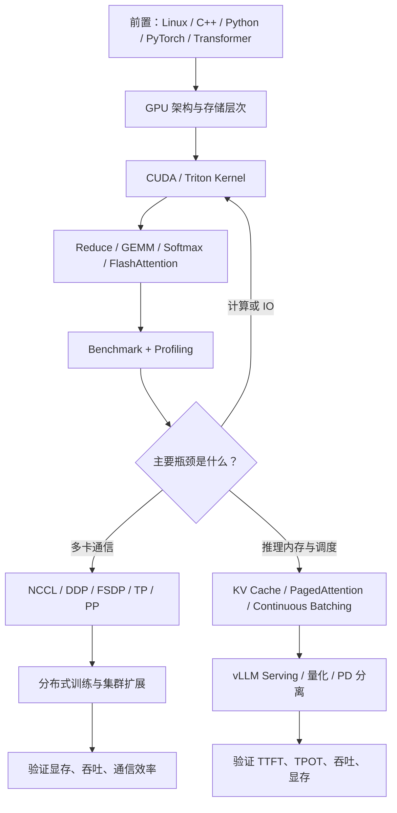
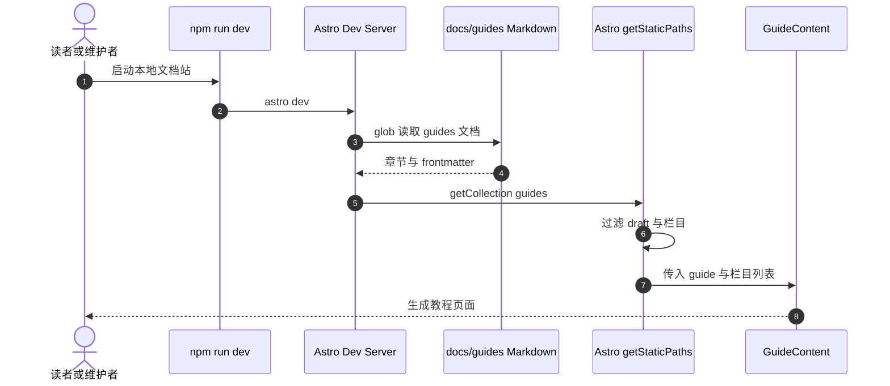

# AIInfraGuide（AI 基础设施全栈学习指南 / AI Infrastructure Guide）

## 一句话定义

**AIInfraGuide** 是 [caomaolufei/AIInfraGuide](https://github.com/caomaolufei/AIInfraGuide) 提供的开源教程站，按「前置知识 → CUDA 算子优化 → 分布式训练 → 推理与部署」建立 AI Infra 工程学习路径，而不是一个直接可调用的训练或推理框架。

## 英文缩写速查

| 缩写 | 英文全称 | 简要说明 |
|---|---|---|
| AI Infra | Artificial Intelligence Infrastructure | AI 模型所依赖的计算、存储、通信与服务系统工程 |
| GPU | Graphics Processing Unit | 算子、模型训练与推理的主要执行设备 |
| CUDA | Compute Unified Device Architecture | NVIDIA GPU 编程与计算平台 |
| HBM | High Bandwidth Memory | GPU 的高带宽存储，影响数据搬运效率 |
| GEMM | General Matrix Multiplication | Transformer 线性层等的核心矩阵算子 |
| NCCL | NVIDIA Collective Communications Library | 多 GPU 集合通信与同步基础 |
| DDP | Distributed Data Parallel | 多卡复制模型并同步梯度的数据并行 |
| FSDP | Fully Sharded Data Parallel | 分片保存参数等训练状态以节省显存 |
| TP / PP | Tensor / Pipeline Parallelism | 张量切分 / 按层切分两类模型并行 |
| KV Cache | Key-Value Cache | 自回归推理存储历史注意力键值 |
| TTFT / TPOT | Time to First Token / Time per Output Token | 首 Token 延迟与后续 Token 生成速度指标 |

## 为什么重要

- **算子与系统跨层联动：** 算法里的一次 Attention，会落到 GEMM、Softmax、数据搬运和 Kernel 调度；多卡还要同步通信。
- **明确性能瓶颈归因：** 同样的吞吐下降，可能是 SM 没吃满、HBM 带宽耗尽、KV Cache 碎片、卡间通信或服务调度失衡，不能只凭模型参数量推断。
- **具身部署关联：** VLA / 机器人侧模型也面临端侧显存、推理延迟与通信预算；但其动作时延和控制闭环指标不应直接套用 LLM 的 tokens/s。

## 核心原理

### 三类资源与优化代价

| 瓶颈 | 代表问题 | 典型机制 | 可能代价 |
|---|---|---|---|
| 计算 | Kernel 利用率低、launch 过多 | 融合算子、Tensor Core、调整线程/Tiling | 寄存器占用、实现复杂度 |
| 显存 / IO | HBM 反复读写、KV Cache 占满 | Shared Memory 复用、FlashAttention、量化、缓存分页 | 更多片上资源、数值精度/管理开销 |
| 通信 | AllReduce、TP、跨节点传输阻塞 | DDP/FSDP、TP/PP 分组、通信计算重叠 | 同步与数据重排开销 |

**三种经典实例：** FlashAttention 通过 Tiling 与 Online Softmax 避免物化完整注意力分数矩阵；ZeRO/FSDP 用通信换单卡显存容量；PagedAttention 以块表管理 KV Cache 的非连续物理页，减少分配碎片。它们分别发生在算子 IO、训练状态分片和推理显存管理层，不是同一种加速技巧。

### 教程体系与工程学习主流程

下图概括**官方课程组织与附件导读共同描述的技术栈**，是知识路线图，并非单个系统的真实执行调用图。

### 官方文档站源码运行时序图

以下时序**仅描述已核对的 Astro 站点路径**：`package.json` 的 `npm run dev`、`src/content/config.ts` 的 Markdown glob loader、`src/pages/guides/[...slug].astro` / `src/pages/cuda/[...slug].astro` 的 `getCollection` 和 `GuideContent`。不是 CUDA Kernel、vLLM 或训练框架的执行时序；也没有宣称已经在本地运行网站。

## 工程实践

按官方学习路线/附件的建议，重点不是背术语，而是为每段建立可测的产物：

1. **单卡 Baseline：** 记录 GPU 型号、CUDA/PyTorch、Shape、dtype、batch、耗时与结果正确性；先实现简单 Reduce/GEMM。
2. **Profiling 定位：** 用 Nsight Systems 看 CPU/GPU 空档与 kernel launch，用 Nsight Compute 分析带宽、occupancy、访存合并与 Tensor Core；不将无条件提频视为通用优化。
3. **多卡扩展：** 计算参数/梯度/优化器状态显存及 AllReduce/AllGather 通信量，再选择 DDP、FSDP、TP/PP；同一实验对比每步时间与扩展效率。
4. **服务侧：** 分开测量 Prefill 与 Decode，记录 TTFT、TPOT、请求吞吐、KV Cache 占用；再评估连续批处理、量化与 PD 分离的收益/代价。
5. **机器人应用：** 联合 [LLM 推理显存估算](../concepts/llm-inference-vram-estimation.md) 与 [VLA 真机部署指南](../queries/vla-deployment-guide.md)，额外统计动作频率、最坏时延、失败回退和传感/执行器 I/O。

## 局限与风险

- **资料属性：** 这是不断更新的**教学知识库**，不是 GPU/集群软硬件的完整基准数据集；不可凭网页例子直接给机器人实时性保证。
- **开源边界：** 官方网站及 Markdown 教程公开；本站 Astro 代码可执行，不意味着每一篇算子教程均附独立可复现 Benchmark。
- **原文核验范围：** 本次已读官方 README、学习主线及代表性的 GEMM 章节概览并查看网站源码入口；**其余进阶章节尚未逐篇精读**，源码 Kernel 数值正确性与实际性能未实测。本页 `status: complete` **仅指对官方完整《AI Infra 学习路线》及开源站点结构的知识归纳已完成**，不代表整个上游教程仓库已精读或性能实验已复现。
- **迁移边界：** LLM 的 TTFT / TPOT 不等于动作控制闭环的 deadline、尾延迟与安全指标；部署到 VLA 时仍需独立评测。

## 关联页面

- [LLM 推理显存估算](../concepts/llm-inference-vram-estimation.md) — 从 KV/权重/激活切到单卡显存可行性
- [VLA 真机部署指南](../queries/vla-deployment-guide.md) — 从大模型推理进入机器人动作控制的时延与工程约束
- [模型架构纵深路线 Stage 5](../../roadmap/depth-model-architecture.md) — 把 AI Infra 学习路线映射到规模、效率与部署验证

- [AI 模型与智能体基准评测](../methods/ai-benchmark-evaluation.md)：对照数据、评测协议与指标。
- [AI 模型推理与服务部署](../methods/ai-model-serving-inference.md)：对照运行时接口、延迟与资源。

## 参考来源

- [官方《AI Infra 学习路线》全文核对与适用边界](../../sources/courses/aiinfraguide-learning-route-20261115.md) — 本页健康度的主原文范围仅限此完整文档
- [AIInfraGuide 官方仓库与源码核验](../../sources/repos/aiinfraguide.md) — 官方 README、学习路线、教程概览与 Astro 站点路径
- [AIInfraGuide 官方在线文档](../../sources/sites/aiinfraguide.md) — 公开文档站与源码开放边界
- [AI Infra Guide 公众号导读 PDF 归档](../../sources/blogs/wechat_ai_infra_guide_20261115.md) — 用户提供的 14 页中文导读，属二手材料

## 推荐继续阅读

- [AIInfraGuide 官方学习路线](https://caomaolufei.github.io/AIInfraGuide/guides/ai-infra学习路线/) — 各阶段的具体练习与检验标准
- [NVIDIA CUDA 官方文档](https://docs.nvidia.com/cuda/)
- [PyTorch Distributed 官方文档](https://pytorch.org/docs/stable/distributed.html)
- [vLLM 官方文档](https://docs.vllm.ai/)
