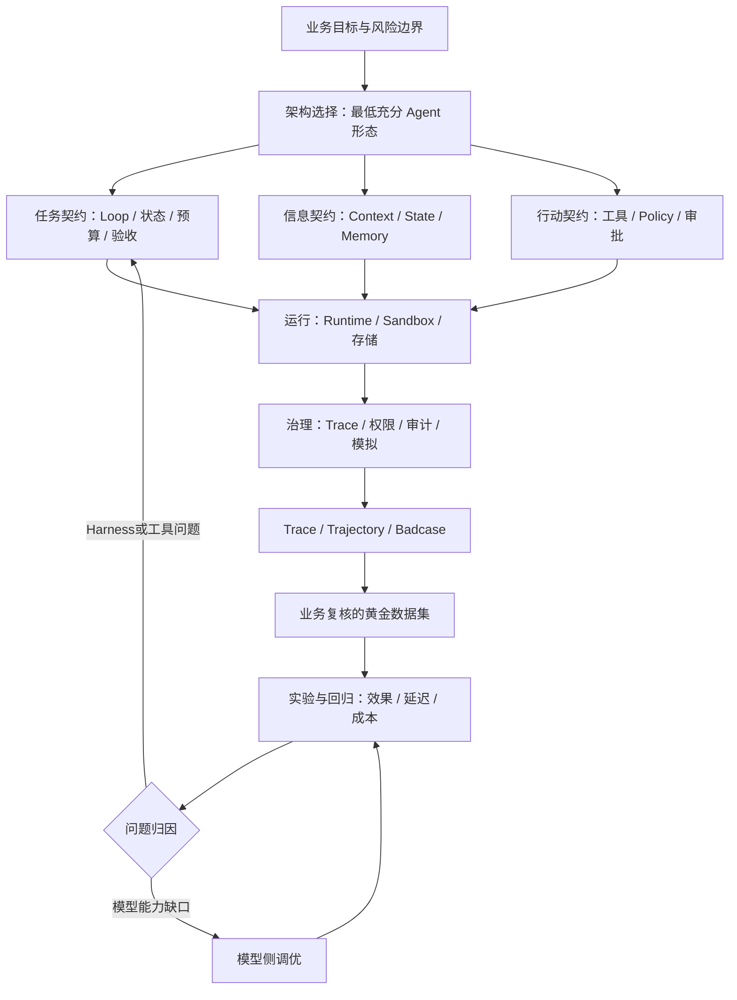

# AI Agent Handbook（阿里云企业级智能体工程白皮书）

## 一句话定义

**AI Agent Handbook** 是阿里云（Alibaba Cloud）与社区共同维护的**企业级 Agent 工程实践指南**，围绕架构、构建、运行、治理、调优五个责任域，解释如何把模型能力组织为可运行、可审计、可验收并可持续改进的任务系统；它是**开源文档**，不是可直接部署的 Agent 框架。

## 英文缩写速查

| 缩写 | 英文全称 | 简要说明 |
|---|---|---|
| LLM | Large Language Model | Agent 使用的模型能力，需与外部 Harness 配合 |
| MCP | Model Context Protocol | 工具与上下文能力接入协议，不等于整个 Agent 平台 |
| HITL | Human in the Loop | 敏感行动或关键门禁中的人工确认 |
| RAG | Retrieval-Augmented Generation | 将外部知识检索引入信息供给 |
| SFT | Supervised Fine-Tuning | 模型侧调优方式，需与 Harness 问题归因区分 |

## 为什么重要

实际应用失败不一定是模型推理不足，也可能是**状态丢失、工具权限过宽、上下文缺失、环境不可复现或验收规则不清**。白皮书把模型与 Harness 分开，面向开发、架构、平台、安全和业务团队建立一致的工程边界；相比只收集 Agent 工具清单，它更适合做生产系统的设计评审与质量门禁。

官方 README 写明**每周收录新实践、不定期更新旧内容**。本仓库 GitHub 创建时间为 2026-09-11；找到的阿里云正式发布文章日期为 **2026-10-23**。**2025 年 9 月**指前身《AI 原生应用架构白皮书》，不是当前 Handbook 的发布日期。

## 核心原理

### 架构：Model 与 Harness 共同形成 Agent

- **最低充分架构：** Workflow、单 Agent、Long-Horizon、Multi-Agent 按目标、确定性、风险和成本选择，不以“越自主越先进”作为唯一标准。
- **三个架构视图：** 组件视图核对能力，平台视图分清谁负责，生命周期视图确保可持续运行与优化。
- **任务契约：** Agent Loop 用 Prepare → Model → Act → Observe → Verify 推进；状态机、预算、规划、受控委派与恢复机制约束长任务。
- **信息契约：** Context Builder 动态编译模型可见信息；Session、Task State、Workspace、Memory、Knowledge 分工，避免把模型窗口当唯一真实状态。
- **行动契约：** 工具意图经过 Schema、身份、策略、审批、执行、观察与 Trace；Sandbox 约束副作用，完成由环境证据判定。

### 运行、治理与持续调优

| 责任域 | 核心对象 | 需要验证的工程事实 |
|---|---|---|
| 运行（07–12 章） | Runtime、Sandbox、状态存储、AI 网关、异步任务、多 Agent 通信 | 出错能恢复；跨请求任务不会丢失；网络与工具权限可控 |
| 治理（13–16 章） | Metrics、Logs、Trace、审计、资产与版本、安全、上线前模拟 | 谁做了什么可复核；高风险动作有边界；变更前能演练 |
| 调优（17–24 章） | 模型调优与 Agent 数据飞轮 | 能把 Harness 故障和模型能力缺口分开归因 |
| 实践（25–29 章） | 企业场景、Jev/Personal Agent/FDE 专题 | 案例能说明具体工程取舍，但案例不等于通用效果保证 |
| 展望（30 章） | Agentic Application 与 Agentic OS | 是架构方向的讨论，不是已有产品的成熟度认证 |

**黄金数据集（第 21 章）**不只是问答题：每条任务还要有经业务确认的完成判据。候选集中的真实失败经过专家复核，写入参考结果与 rubric，形成版本化黄金集，用于模型或 Prompt/Skill 更新后的实验、回归；参与调优的题应与最后独立验收的题分开。

## 流程总览

图依据官方 README、架构/构建/运行/治理/调优篇导读以及第 21 章的工程关系提炼；是**书中责任域与改进闭环的知识编译**，不表示上游发布了一个同名可执行流水线。

## 源码运行时序图

**不适用（Agent 推理/控制运行时）**：原仓库公开的是 Markdown 书稿、VitePress 站点、在线闯关与站点测试脚本，不是一个实现 Model → Agent Loop → Tools 的统一运行时。虽然站点工程有构建/测试入口，但以它绘制“Agent 推理时序”会混淆**文档网站代码**与**被介绍的技术架构**；未对站点构建脚本做运行验证。

## 工程实践

1. **立项时：** 先用第 01–02 章回答 Workflow 是否足够、Agent 需要多少自主权，明确完工的可验证定义。
2. **开发时：** 按第 04–06 章列出状态持久化、上下文清单、工具权限和审批门禁；避免“模型停了 = 任务完成”。
3. **上线时：** 按第 07–16 章核查隔离、Checkpoint、Trace、审计、资产版本、发布前模拟。
4. **迭代时：** 将真实 Trace 与失败样本转成带 rubric 的黄金集，对 Prompt、Skill、工具、模型变更跑回归，并记录成本与延迟。
5. **机器人迁移（本库推论）：** 把受控执行映射到**仿真/真机任务层**的 reset、权限、交付证据与策略评测；**不**据此把 LLM Agent 当成毫秒级电机控制器，设备侧安全联锁仍须独立设计。

官方在线阅读：<https://aliyun.github.io/ai-agent-handbook/>；上游许可证 Apache-2.0。版本核验点：`aliyun/ai-agent-handbook@a1dd02ec080c4e18930660c0154da1ef589df639`。

## 局限与风险

- **文档不是独立实测：** 原书企业案例、产品能力介绍不能推导出本库已复现实验或通用性能增益。
- **更新节奏不是保证：** README 的“每周收录”是维护承诺，不保证每周同一天提交，也不能固定章节/案例数。
- **核对范围：** 已通读官方 README、前言、六篇导读及第 21 章；抽样检查第 04、05、06、13 章；**30 章全文并未逐章通读**。归档标记的“通读已完成”仅针对已明确列出的核心一手材料，不应扩写成“整本白皮书已全量深读”。
- **适用对象：** 主体是企业软件 Agent 工程；机器人真机执行周期、物理安全与实时控制不属于本次官方案例的独立验证范围。

## 关联页面

- [AI Agent 评测](../concepts/ai-agent-evaluation.md)：补充 golden dataset、回归与评估闭环的全生命周期位置。
- [Agentic Coding 软件工程基础](../concepts/agentic-coding-software-fundamentals.md)：与 Harness 的架构权责、交付验证形成对照。
- [Data Flywheel](../concepts/data-flywheel.md)：Trajectory 和 Badcase 反馈回路的机器人数据侧迁移。
- [Agnes Harness](agnes-harness.md)：可执行 Agent runtime 项目；与本书的文档定位不同。

## 参考来源

- [阿里云上游仓库资料归档](../../sources/repos/aliyun-ai-agent-handbook.md)
- [官方在线阅读站点归档](../../sources/sites/aliyun-ai-agent-handbook.md)
- [Alibaba Cloud AI Agent Handbook 官方 GitHub](https://github.com/aliyun/ai-agent-handbook)
- [阿里云官方发布文章（2026-10-23）](https://developer.aliyun.com/article/1774447)

## 推荐继续阅读

- [官方固定版本（2026-11-11）](https://github.com/aliyun/ai-agent-handbook/tree/a1dd02ec080c4e18930660c0154da1ef589df639)
- [第 21 章 Agent 黄金数据集](https://github.com/aliyun/ai-agent-handbook/tree/a1dd02ec080c4e18930660c0154da1ef589df639/05-optimization)
- [官方在线闯关](https://aliyun.github.io/ai-agent-handbook/challenges/)
