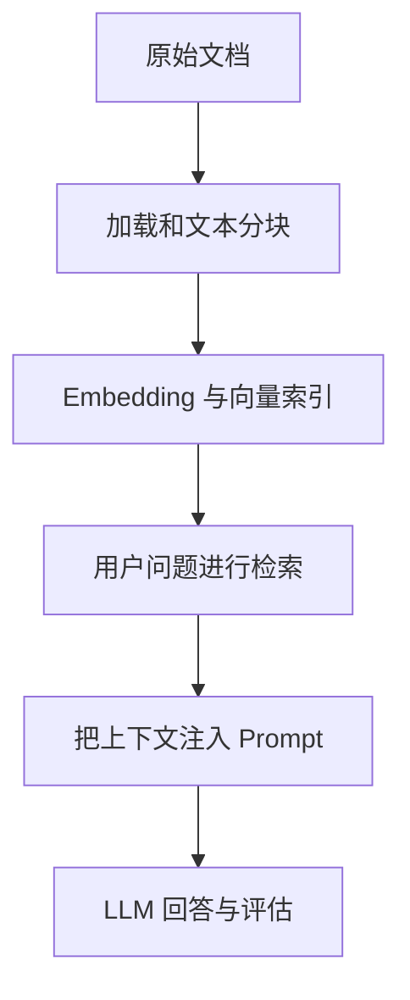
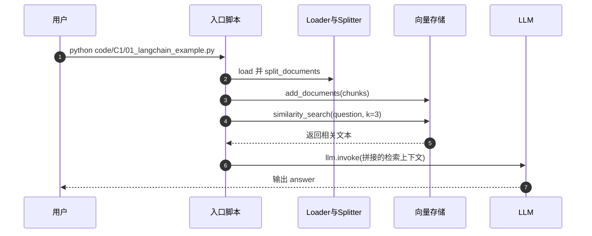

# All-in-RAG：RAG 技术全栈指南

## 一句话定义

All-in-RAG 将 Retrieval-Augmented Generation 的数据准备、索引、查询和生成分为连贯章节；本节点是官方课程入口的结构化阅读地图。

## 英文缩写速查

| 缩写 | 英文全称 | 简要说明 |
|---|---|---|
| RAG | Retrieval-Augmented Generation | 检索增强生成 |
| LLM | Large Language Model | 接收检索证据并生成回答 |
| API | Application Programming Interface | 模型服务调用接口 |

## 为什么重要

RAG 的最终回答依赖从数据到证据的多步链路。只调 LLM API 并不等于完成 RAG，检索召回、分块质量和来源可追溯性是独立的工程变量。

## 核心原理

README 将课程分为 RAG 基础、索引构建、检索技术、生成评估和高级项目。作者的 code/C1/01_langchain_example.py 实际使用 UnstructuredMarkdownLoader 读取 Markdown、RecursiveCharacterTextSplitter 切块、HuggingFaceEmbeddings 嵌入、InMemoryVectorStore 存储；查询时 similarity_search(k=3)，再把检索文本组成 prompt 用 ChatOpenAI 生成回答。

### 官方课程结构/执行思路

## 源码运行时序图

下图仅依据已核对的**代表性入口**，不把未阅读的其他子项目一并视为已复现。

## 工程实践

代表代码为 code/C1/01_langchain_example.py，涉及环境变量、中文嵌入模型与网络模型 API。先检查路径 ../../data/C1/markdown/easy-rl-chapter1.md 是否存在，再固定查询和检索 k=3，检查引用片段，最后才评估生成答案。

## 局限与风险

入门脚本使用内存向量索引和线上模型端点，不能从单次答案推断大规模检索的吞吐和准确率；高级 GraphRAG 需要单独的实验与索引维护。

**原文通读范围：** 本页是课程入口的概览节点；`original` 仅对应已完整核对的官方 README，其他课程单篇仍可能未逐篇核验。节点健康度 3/3 不等于全课程实操结业。

## 关联页面

- [retrieval-augmented-generation](../concepts/retrieval-augmented-generation.md) — 相关概念、工具或工程路线。
- [langchain](./langchain.md) — 相关概念、工具或工程路线。
- [easy-vibe](./easy-vibe.md) — 相关概念、工具或工程路线。

## 参考来源

- [官方 README 原文核对和范围](../../sources/repos/all-in-rag-course-overview-read-20261113.md)
- [上游资料索引](../../sources/repos/all-in-rag.md)
- [官方仓库](https://github.com/datawhalechina/all-in-rag)

## 推荐继续阅读

- [官方课程原始页面](https://github.com/datawhalechina/all-in-rag)
