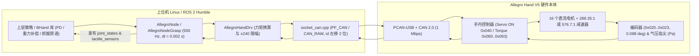
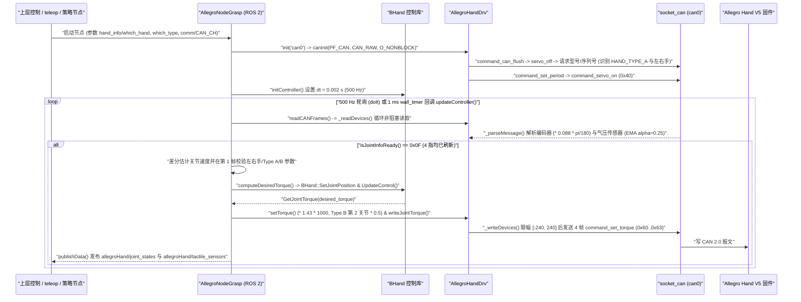

# Allegro Hand（Wonik Robotics）

## 一句话定义

**Allegro Hand** 是韩国 Wonik Robotics 推出的科研与工程通用仿人灵巧手平台，经典 V4/V5(4F) 构型采用 **4 指、共 16 个独立主动自由度**（食指、中指、无名指与拇指各 4 关节），无前臂肌腱箱即可紧凑安装于常见协作臂末端，并通过 CAN 2.0 总线向 PC 开放 **500 Hz（V5）/ 333 Hz（V4）底层电流力矩控制与编码器反馈**。

## 英文缩写速查

| 缩写 | 英文全称 | 简要说明 |
|---|---|---|
| DoF | Degrees of Freedom | 自由度；V5(4F) 与 V5 Plus 均为 4 指 16 个独立主动 DoF |
| CAN | Controller Area Network | 车规级串行控制总线（1 Mbps），Allegro Hand V5 以 500 Hz 收发位置与电流指令 |
| SocketCAN | Linux SocketCAN Subsystem | Linux 内核原生 `PF_CAN` 网络套接字接口，ROS 2 V5 驱动据此免装专有 PCAN 模块 |
| PCAN | PEAK-System CAN Interface | 官方推荐的 USB 转 CAN 适配器（`IPEH-002021` 无隔离 / `IPEH-002022` 光电隔离） |
| PD | Proportional-Derivative Control | 比例-微分关节位置闭环；在 Allegro 上由上位机计算后下发力矩指令 |
| BHand | Barret/Wonik BHand Control Library | 驱动随附的 C++ 抓握与重力补偿控制库（支持抓握原语与 `gravcomp`） |

## 为什么重要

在灵巧操作（Dexterous Manipulation）与手中物体重定向（In-Hand Reorientation）研究中，团队需要在**机械耐用度、力矩透明度、采购维护成本与开源生态**之间取得平衡：

- **紧凑无前臂与全关节独立驱动：** 相比把 20 台电机安置在长前臂箱内、依赖复杂对抗肌腱的平台（如 [Shadow Hand](./shadow-hand.md)），Allegro Hand 将直流电机与减速器直接集成在掌指结构内（V5 重 **1000 g**、V5 Plus 重 **1024 g**），可直接使用法兰挂载到 UR5e、Franka FR3、KUKA iiwa 等桌面协作臂末端。
- **高带宽电流力矩透明度：** 控制器固件仅直接接收电流型目标力矩（`[mA]`），把 PD、重力补偿（`gravcomp`）与策略力矩输出完全留给上位机实时循环计算，极适合部署基于 RL/Sim2Real 的高频关节位置或柔顺阻抗策略（包括大规模在手转魔方/多面体基准与触觉操作任务）。
- **低维护门槛与 V5 迭代升级：** 官方手册 V5(4F) / V5(4F) Plus 将标称抓持负载提升至 **10 kg / 15 kg**，控制链路升级为 **500 Hz（2 ms）**，可选配量程 **30–125 kPa** 的全向硅胶气压指尖触觉传感器，并支持基于 Linux 内核 `peak_usb` SocketCAN 的 ROS 2 Humble 开源驱动与 Isaac Sim 仿真联动。

## 核心原理

### 硬件规格与代际/型号对照

根据官方手册 `AllegroHandV5(4F)UserManual_v1.2.1.pdf`（2025-03）与 `allegrohand.com` 产品目录：

| 规格维度 | Allegro Hand V5(4F) | Allegro Hand V5(4F) Plus | 说明 / V4 对照 |
|---|---|---|---|
| **手指与自由度** | 4 指（食/中/无名指 + 拇指）× 4 关节 = **16 个独立主动自由度** | 同左（16 DoF） | 驱动枚举 `AllegroHandDef.h` 依次记为 `INDEX` / `MIDDLE` / `PINKY`（物理无名指槽位）/ `THUMB` |
| **减速比** | 全关节 `288.35 : 1` | 非拇指第 2 关节 `576.7 : 1`，其余 `288.35 : 1` | ROS 2 驱动 `HAND_TYPE_A=false` 时自动对索引 `1, 5, 9` 力矩系数减半 |
| **堵转 / 标称力矩** | `0.92 Nm` / `0.23 Nm` | 第 2 关节 `1.84 Nm` / `0.46 Nm`，其余同左 | 驱动层 `AllegroHandDrv::setTorque()` 另施加软件电流限幅 |
| **最大抓持负载** | **10 kg** | **15 kg** | 早期 V4 负载与减速强度显著低于 V5 系列 |
| **整手重量** | **1000 g** | **1024 g** | 含指尖气压传感器壳体后整手依然紧凑轻便 |
| **位置传感器精度** | `0.088 deg` 编码器分辨率 | 同左 | 弧度换算：`pos_data * pi * 0.088 / 180` |
| **通信总线与周期** | CAN 2.0（1 Mbps），**500 Hz（2 ms）** | 同左 | V4 `allegro_hand_ros_v4` 为 `0.003 s`（**333 Hz**）与 `/dev/pcan*` |
| **可选指尖触觉** | 硅胶全向气压传感器（30–125 kPa，基准 101.3 kPa，精度 6 Pa） | 同左 | 官网另公布后续产品线 **V5 Sense**（9-DoF 相关感知版本）、**V6 V** 与 **V6 F** |
| **供电需求** | 24 V DC / 5 A（120 W） | 同左 | 隐藏式内部 USB-C 接口用于 `115200` 8N1 Y-modem 固件升级 |

### 控制系统与 CAN 通信架构

- **上位机计算力矩、手内电流闭环：** 手部控制器收到 PC 下发的 `[mA]` 目标力矩指令后执行电流环驱动电机，所有运动学正解、PD 刚度阻尼调节与多指捏持力分配均在 PC 侧的 `AllegroNode` 中运行。
- **V5 SocketCAN 与 CAN 帧约定：** 手册规范定义了 `0x040`/`0x041`（Servo ON/OFF）、`0x060–0x063`（4 指电流指令）、`0x020–0x023`（4 指编码器位置）、`0xF0`/`0xF2`（指尖气压 Pa 值）与 `0xEE`（错误帧）；在 `allegro_hand_ros2_v5` 源码中，`socket_can.cpp` 利用 Linux 主线内核 `peak_usb` 打开 `can0`（`O_NONBLOCK`），对 CAN ID 执行 `(id << 2)` / `(can_id >> 2)` 移位编码，驱动头文件 `candef.h` 则将指尖数据宏定义在 `ID_CMD_FINGERTIP_1..4`（`0x50..0x53`）。

## 源码运行时序图

以下时序严格对齐 `allegro_hand_ros2_v5` 仓库源码（`allegro_node.h`、`allegro_node.cpp`、`allegro_node_grasp.cpp`、`AllegroHandDrv.cpp` 与 `socket_can.cpp`）：

## 工程实践

1. **V5 推荐架构（ROS 2 Humble + SocketCAN）：** 直接使用 Linux 内核内置 `peak_usb` 驱动拉起 `can0`（1 Mbps bitrate），运行 `allegro_hand_ros2_v5`，无需再像 V4 年代编译安装 PEAK 专有 `/dev/pcan*` 字符设备驱动。同时切勿混用 V3/V4 与 V5 上位机代码（控制周期、机械减速比与传感器接口均有改动）。
2. **Type A vs Type B（V5 vs V5 Plus）校验：** 启动参数 `hand_info/which_hand` 与 `hand_info/which_type` 必须与手掌序列号一致；`AllegroNode::updateController()` 会在首帧读到硬件序列号后核对左/右手及非齿轮加倍版本，若不匹配会立即报错并断开 `canDevice`。
3. **软件调试与安全限幅细节：** 查阅源码可见：`AllegroHandDrv::init()` 中仍残留源于 V4 的 `{3, 0, 0}` 历史周期配置注释，而 `allegro_node.h` 实际按 `ALLEGRO_CONTROL_TIME_INTERVAL = 0.002`（500 Hz）计算速度和控制步长；`_writeDevices()` 当前硬限幅在 `[-240, 240]` 之间（测试高负载极限力矩前务必核对具体固件版本对应的 `setTorque()` 标定系数）。
4. **Sim2Real 与多模态触觉扩展：** 仓库内置 `allegro_hand_isaacsim` 桥接包，便于策略先在 Isaac Sim 中验证话题命名后再部署真机；若有高空间分辨率触觉需求，科研团队常将指尖替换为 [GelSlim](./gel-slim.md) 视触觉传感器，或结合原厂 30–125 kPa 气压指尖实施[触觉阻抗控制](../methods/tactile-impedance-control.md)。

## 局限与风险

- **无手掌内收与部分拟人自由度：** 整手为 4 指 16 主动自由度设计，相比人手结构缺少第 5 根小指掌面弯曲及独立腕部驱动（需依靠机械臂末端腕轴代偿），且整手尺寸偏大于普通成年人手掌，影响狭窄容器内抓取与部分人手遥操作直接 1:1 映射。
- **反驱刚度与齿隙效应：** V5（288.35:1）与 V5 Plus（局部 576.7:1）的大减速比在大幅提高 10–15 kg 抓持负载的同时，也限制了纯粹机械被动背驱柔顺性，高速碰撞或强约束接触更依赖软件阻抗与力矩限制保护。
- **高速 CAN 轮询负载：** 虽然 500 Hz CAN 2.0 已显著优于 V4 333 Hz，但在同时高频采集多路触觉流与全 16 关节状态时，单 USB-CAN 通道仍可能成为上位机时间抖动（jitter）来源，工程上建议使用独立光电隔离型 PCAN（`IPEH-002022`）并固定 ROS 2 实时优先级。

## 与其他页面的关联

- 核心任务与控制方法：[Manipulation](../tasks/manipulation.md)、[Bimanual Manipulation](../tasks/bimanual-manipulation.md)、[In-Hand Reorientation](../methods/in-hand-reorientation.md)、[Tactile Impedance Control](../methods/tactile-impedance-control.md)、[Computed Torque Control](../methods/computed-torque-control.md)
- 灵巧手硬件对比与触觉生态：[Shadow Hand](./shadow-hand.md)、[ORCA Hand](./orca-hand.md)、[RUKA v2](./ruka-v2-hand.md)、[Kyber Labs](./kyber-labs.md)、[GelSlim](./gel-slim.md)
- 基础概念：[Dexterous Kinematics](../concepts/dexterous-kinematics.md)、[Dexterous Hand Payload Core Metrics](../concepts/dexterous-hand-payload-core-metrics.md)

## 参考来源

- 官方硬件与协议手册归档：[wonik-allegro-hand-v5-manual.md](../../sources/sites/wonik-allegro-hand-v5-manual.md)（通读 `AllegroHandV5(4F)UserManual_v1.2.1.pdf` 全文与 `allegrohand.com`）
- ROS 2 / ROS 1 驱动源码归档：[wonik-allegro-hand-ros2.md](../../sources/repos/wonik-allegro-hand-ros2.md)（通读 `allegro_hand_ros2_v5` 驱动与控制器源码并对照 `allegro_hand_ros_v4`）
- Wonik Robotics 官网：<https://www.allegrohand.com/>

## 推荐继续阅读

- 遥操作灵巧手阶段：[Teleoperation Depth Roadmap](../../roadmap/depth-teleoperation.md)（Stage 4：手指与灵巧手遥操作）
- 工业与研究灵巧手对比：[Dexterous Hand Industry Core Players](../concepts/dexterous-hand-industry-core-players.md)
