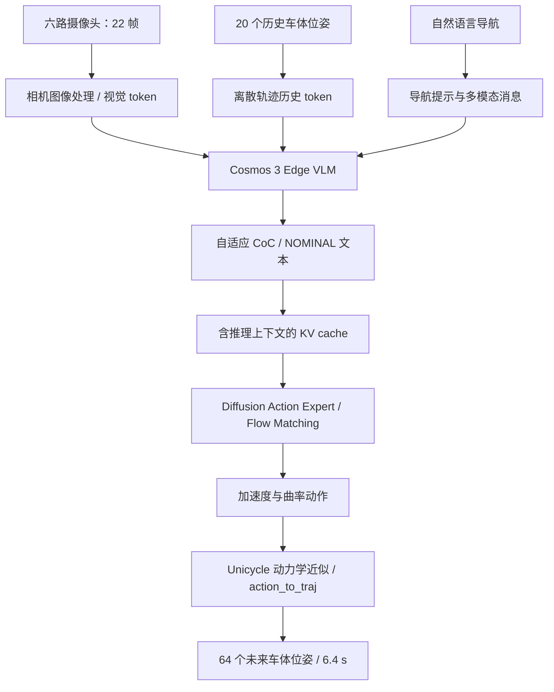
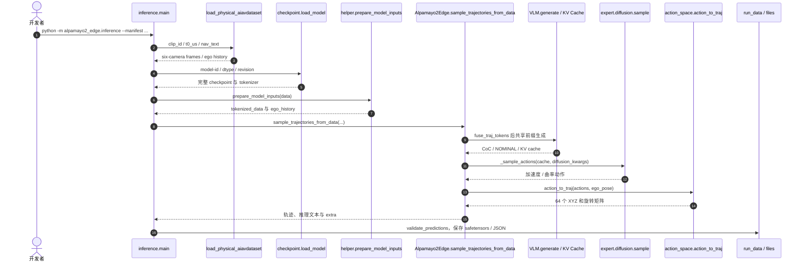

# Alpamayo 2 Edge：面向车端实时规划的自适应推理 VLA（NVIDIA）

**英文名称：** NVIDIA Alpamayo 2 Edge — In-Vehicle Reasoning Vision-Language-Action Model  
**中文名称：** Alpamayo 2 Edge：面向车载实时自动驾驶的自适应推理视觉—语言—动作模型  
**官方入口：** [模型卡 / 权重](https://huggingface.co/nvidia/Alpamayo2-Edge) · [源码](https://github.com/NVlabs/alpamayo2-edge) · [技术博客](https://developer.nvidia.com/blog/running-av-reasoning-models-within-onboard-compute-and-latency-limits/) · [开发配方](https://github.com/NVlabs/alpamayo-recipes)

## 一句话定义

**Alpamayo 2 Edge 是将自适应因果推理与扩散轨迹专家结合的紧凑型自动驾驶 VLA，使用六路相机、历史自车运动及导航文本条件输出因果说明和未来 64 个车体位姿。**

## 英文缩写速查

| 缩写 | 英文全称 | 简要说明 |
|---|---|---|
| VLA | Vision-Language-Action | 视觉和语言条件下直接生成车辆动作/轨迹的模型 |
| VLM | Vision-Language Model | Cosmos 3 Edge 多模态推理主干 |
| CoC | Chain-of-Causation | 与驾驶动作相关的因果链解释 |
| FM | Flow Matching | 扩散轨迹专家生成连续控制变量的训练/采样框架 |
| SFT | Supervised Fine-Tuning | 公开联合微调配方 |
| RL | Reinforcement Learning | 使用 AlpaGym 闭环后训练的策略优化方法 |
| KV | Key-Value | VLM 注意力缓存；被动作专家复用 |
| FP8 | 8-bit Floating Point | TensorRT Edge-LLM 车端量化方案 |

## 为什么重要

- **算力受限时保留推理能力：** 日常驾驶不必每次生成长篇解释；官方以自适应推理在任务复杂度和车端延迟间取舍。
- **动作输出不是只生成语言：** 基于共享 VLM KV cache 的 diffusion action expert 生成可积分成车体轨迹的动作变量。
- **可追溯的开放路径：** 模型卡、权重、独立 PyTorch 推理、联合 SFT 配方、DRIVE AGX Thor 部署配方均有官方入口，可分别核查复现。
- **闭环不等于离线回放：** 官方通过 AlpaGym 在仿真里优化驾驶行为，与纯 open-loop 轨迹拟合形成互补。

## 核心信息

| 项目 | 官方资料核对 |
|---|---|
| 研发方 | NVIDIA |
| 公开时间 | 2026-10-21 发布消息；2026-11-10 技术详解和公开 checkpoint |
| 参数规模 | 官方简称 **2B**；模型卡分列约 **2.45B backbone + 0.2B expert**，数字口径不同，不能简单写成精确 2B 全模型 |
| 主干 | 基于 Nemotron 的 Cosmos 3 Edge backbone（语言/视觉编码与投影） |
| 输入 | 六路相机共 **22 帧** + **20 个历史自车位姿** + 自然语言导航 |
| 输出 | 因果链 CoC 或 NOMINAL；**64 个未来位姿**（0.1 s 间隔，0.1–6.4 s） |
| 动作表示 | action expert 预测加速度/曲率，经过车体 unicycle 运动学转换为 XYZ 和 rotation |
| 模型权重许可 | OpenMDW-1.1；推理源码 Apache-2.0 |
| 数据 | 使用 NVIDIA PhysicalAI-AV 数据格式；样例数据访问需接受数据集条款 |

## 核心原理

### 输入与两阶段生成

六摄像头不采用统一 22 帧/相机：前向与前向长焦各读取 5 个时间点（−2、−1、−0.5、−0.1、0 秒），其余四路各 3 帧（−1、−0.1、0 秒），**合计 22 张相机图像**。另有 20 个以 0.1 秒间隔排列的历史车体位置与旋转矩阵，以及导航文字。

1. **多模态编码：** 历史自车轨迹被离散轨迹 token 编码并与摄像头/导航提示一起送入 VLM。
2. **自适应因果推理：** VLM 生成 CoC 轨迹解释；常规场景可使用 `NOMINAL` 简略路径，以减少 token 生成。
3. **共享上下文条件：** VLM 生成到未来轨迹起始锚点后的 KV cache 被 action expert 使用；每个候选可有独立的推理延续。
4. **动作专家：** 专家通过 flow-matching 采样加速度与曲率序列，再由 `action_to_traj` 积分到未来空间位姿。
5. **返回多候选：** 代码允许设置 `num_traj_sets` 与 `num_traj_samples`，输出形状为 batch × sets × samples × 64 × 3（位置）及相应旋转矩阵。

### 流程总览



> 流程只描述官方 PyTorch 推理调用链；闭环仿真 RL 是训练阶段，不应误画成线上每次推理步骤。与 [Cosmos 3](./cosmos-3.md) 的通用世界模型 Generator/Reasoner 不同，这里是面向驾驶轨迹的专用 VLA。

## 源码运行时序图

以下步骤逐函数对照 [`inference.py`](https://github.com/NVlabs/alpamayo2-edge/blob/main/src/alpamayo2_edge/inference.py)、[`helper.py`](https://github.com/NVlabs/alpamayo2-edge/blob/main/src/alpamayo2_edge/helper.py)、[`checkpoint.py`](https://github.com/NVlabs/alpamayo2-edge/blob/main/src/alpamayo2_edge/checkpoint.py) 与 [`models/alpamayo2_edge.py`](https://github.com/NVlabs/alpamayo2-edge/blob/main/src/alpamayo2_edge/models/alpamayo2_edge.py)。



## 工程实践

### 最短可核对的官方复现入口

```bash
# Linux / Python 3.12 / BF16 GPU；模型与数据集需要 HF 访问权限
uv sync --locked --extra dataset --dev
hf auth login
python -m alpamayo2_edge.inference \
    --model-id nvidia/Alpamayo2-Edge \
    --manifest examples/nav_samples.json \
    --output outputs/edge
```

- 推理包要求 Linux 和支持 BF16 的 GPU，README 建议 **至少 16 GB 显存**；未把建议写成在所有设备上已验证可跑。
- 默认使用 PyTorch SDPA；可选 `--attn-implementation flash_attention_2`。加速模式 `--accel compile` / `--accel tuned` 需要 FlashAttention 2、CUDA/BF16；首次遇到新 shape 需编译/捕获，不应把冷启动和稳态延迟混用。
- `run_data` 保存 `output.safetensors`、`packed.safetensors`、`prompt.txt`、`output.json` 和 `report.json`；包含预测 shape 与非有限值检查。
- [SFT 官方配方](https://github.com/NVlabs/alpamayo-recipes/tree/main/recipes/alpamayo2edge_sft)：针对原生任务优先 `sft_joint_nav_cot`；VLM 学习文本/离散未来轨迹，专家通过 flow matching 学加速度/曲率，专家条件与 VLM 梯度分离。
- [Thor 部署配方](https://github.com/NVlabs/alpamayo-recipes/tree/main/recipes/alpamayo2edge_edgellm)：host 端 shim → FP8 量化 → TensorRT Edge-LLM 引擎导出；Thor 端 `thor/run.py` 使用共享 prefill、DFlash2 speculative decoding 与专家访问 KV pool。

### 评测指标与版本边界

| 指标 | 官方数字 | 解读 |
|---|---|---|
| 闭环 RL 收益 | **+48.9%**（相对最佳 RL 前检查点） | NVIDIA 博客中的闭环评测结论，不是对任意基线提升 |
| PhysicalAI-AV open-loop | **minADE_6 @ 5s = 0.52 m**（1,392 样本） | 模型卡的轨迹误差指标；不等于真实道路安全概率 |
| AlpaSim 闭环场景 | **875** 场景 × **3** rollouts | 模型卡给出每责任事故间距离约 **15.15 ± 0.04 km** |
| DRIVE AGX Thor | **160–190 ms** | NVIDIA 官方特定量化/TRT/Thor 测试配置，不可推广至所有 GPU |

## 结论

**Alpamayo 2 Edge 的关键工程选择是在车端低时延预算内，通过按需文本推理与独立扩散动作专家共同产生可解释的车辆规划轨迹。**

1. 把 **CoC 与实际动作轨迹** 放在同一个 VLA 主体里评测，不能只看语言解释正确率。
2. 选车端推理路径时区分标准 PyTorch BF16 与 Thor FP8/TensorRT，两者算力及冷启动假设不同。
3. 轨迹 expert 的加速度/曲率输出依赖车体运动学假设；轮式车规划不能直接当做人形或机械臂通用 action space。
4. 尽量用闭环仿真指标对照 open-loop ADE，但不以仿真收益代替真车安全验证。
5. 训练数据不等于全部开放；复现前确认权重、样例数据许可和硬件环境。

## 与其他工作对比

| 对照 | 关系和区别 |
|---|---|
| [Cosmos 3](./cosmos-3.md) | 上游多模态 Physical AI 模型族；Alpamayo 2 Edge 使用 Cosmos 3 Edge/Nemotron 作为驾驶推理底座，而非 Cosmos 3 视频生成通用路线 |
| [NVIDIA Cosmos](./nvidia-cosmos.md) | 更广的世界模型、数据处理与推理生态；本项目专注自动驾驶轨迹/导航 |
| [VLA](../methods/vla.md) | 属于端到端视觉–语言–动作策略的一种车端实例；输出的是驾驶轨迹，不是关节 PD 目标 |
| [World Action Models](../concepts/world-action-models.md) | 关联预测与动作；本模型主要产出动作轨迹，不宜描述成同时生成未来视频的完整 WAM |

## 局限与风险

- **安全关键风险：** 模型卡属于开发与研究用途，不能单凭开源权重、仿真结果或 CoC 解释视为经过生产级功能安全认证。
- **场景覆盖：** 数据分布和闭环仿真设置不能保证覆盖天气、传感器故障、法规、极端交通交互等真车边界。
- **运动学简化：** action expert 经 unicycle 模型恢复轨迹，限制了三维动力学、z 变化及侧偏等适用性。
- **开放边界：** 有权重、推理及配方，但样例数据要求接受条款，不能推定 115k 小时全部训练数据均公开。
- **跨规模误判：** 宣传「2B」与模型卡组件合计口径不同；不要把 Alpamayo 2 Super 的 34B 性能归给 Edge。
- **复现状态：** 已核对官方原文与关键源码调用链；本知识页未在本地执行 checkpoint 推理、真实车辆测试或 Thor 硬件验证。

## 关联页面

- [Cosmos 3：全模态 Physical AI 世界模型](./cosmos-3.md)
- [NVIDIA Cosmos 平台](./nvidia-cosmos.md)
- [NVIDIA Physical AI 数据集](./nvidia-physical-ai-datasets.md)
- [VLA：视觉—语言—动作模型](../methods/vla.md)
- [World Action Models](../concepts/world-action-models.md)

## 参考来源

- [官方技术博客（NVIDIA，2026-11-10）](https://developer.nvidia.com/blog/running-av-reasoning-models-within-onboard-compute-and-latency-limits/)
- [Hugging Face 模型卡与开放权重](https://huggingface.co/nvidia/Alpamayo2-Edge)
- [官方代码仓](https://github.com/NVlabs/alpamayo2-edge)
- [NVIDIA 开发与部署配方](https://github.com/NVlabs/alpamayo-recipes)
- [产品页、模型卡原始资料归档](../../sources/sites/nvidia-alpamayo2-edge.md)
- [源码与入口逐项核对归档](../../sources/repos/nvidia-alpamayo2-edge.md)

## 推荐继续阅读

- [NVIDIA：Running AV Reasoning Models within Onboard Compute and Latency Limits](https://developer.nvidia.com/blog/running-av-reasoning-models-within-onboard-compute-and-latency-limits/) — 自适应推理、闭环优化、车端部署的官方详解。
- [Alpamayo 2 Edge PyTorch README](https://github.com/NVlabs/alpamayo2-edge/blob/main/README.md) — 完整 BF16 推理环境、输入数据剖面及加速参数。
- [Alpamayo 2 Edge TensorRT Edge-LLM 配方](https://github.com/NVlabs/alpamayo-recipes/tree/main/recipes/alpamayo2edge_edgellm) — Thor 上导出、量化与推理的具体实现。
