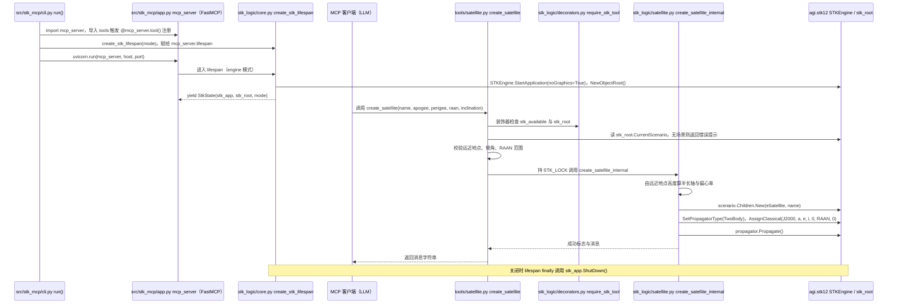

# STK MCP（alti3/stk-mcp）

## 一句话定义

STK MCP（alti3/stk-mcp）是将 Ansys/AGI Systems Tool Kit 的任务工程能力暴露给 MCP 客户端，仓库含 CLI、Desktop/Engine 模式和轨道、覆盖、可见性分析能力。

## 英文缩写速查

| 缩写 | 英文全称 | 简要说明 |
|------|----------|----------|
| MCP | Model Context Protocol | 代理与工程软件工具的交互协议 |
| CAE | Computer-Aided Engineering | 计算机辅助工程软件与分析 |
| API | Application Programming Interface | 软件可供自动化调用的接口 |

## 为什么重要

对 CAE 自动化而言，代理能否稳定完成任务，取决于工程步骤是否清楚、工具边界是否明确、结果是否保留可审查证据。将 Ansys/AGI Systems Tool Kit 的任务工程能力暴露给 MCP 客户端，仓库含 CLI、Desktop/Engine 模式和轨道、覆盖、可见性分析能力；文章未给 owner，仓库映射据项目名匹配。

## 核心原理

**项目自身范围：** MCP server for interacting with Ansys/AGI STK simulation software.

**工作流：** 客户端通过 MCP/CLI 控制 STK Desktop 或 Engine，设置情景、卫星和传感器对象，再运行轨道与任务分析。

**仓库映射说明：** 文章未给出该项目完整的 owner/repository URL；此处按文章中的项目名/描述与公开 GitHub 仓库匹配。引用时请以本页链接的仓库 README 为准。

## 工程实践

1. 从目标问题识别所需的 Skill、MCP、CLI 或软件接口，不把指导文件当成求解器。
2. 依照仓库 README 检查安装前提、软件/许可证、输入文件和输出证据。
3. 小规模运行并逐项核对几何、网格、边界、求解状态和物理量，再决定是否扩大任务。

文章所述的项目特征：将 Ansys/AGI Systems Tool Kit 的任务工程能力暴露给 MCP 客户端，仓库含 CLI、Desktop/Engine 模式和轨道、覆盖、可见性分析能力；文章未给 owner，仓库映射据项目名匹配。

## 局限与风险

STK API/安装/许可证要求随 Desktop/Engine 模式而异；文章仅给通用项目名，alti3 归属是匹配推断。

源码状态核验：该 GitHub 仓库于 2026-10-07 可公开访问。仓库 API 未报告 SPDX 许可证，应检查仓库内 LICENSE 与依赖许可。 涉及商业软件时，安装包和有效许可证需由使用者自行提供。

## 源码运行时序图

入口：`stk-mcp run --mode engine`（`pyproject.toml` 中 `stk-mcp = "stk_mcp.cli:app"`；Windows 默认 `desktop` 模式，Linux 为 `engine`）。下图以 `create_satellite` 工具为例。

图依据：alti3/stk-mcp@b36a95f，读过 pyproject.toml、src/stk_mcp/cli.py、app.py、tools/__init__.py、tools/satellite.py、stk_logic/core.py、stk_logic/decorators.py、stk_logic/satellite.py；未读 scenario、analysis、location、objects、health 等其它工具实现。

## 关联页面

- [CAE / CFD 代理工具项目总览](../overview/cae-cfd-agent-skills-landscape.md)
- [Mechanical MCP（PyMechanical gRPC）](./codersag-mechanical-mcp.md)

## 参考来源

- [公众号文章原始资料归档](../../sources/blogs/wechat_cae_cfd_agent_skills_2026-10-07.md)
- [GitHub 仓库资料归档](../../sources/repos/alti3-stk-mcp.md)
- [alti3/stk-mcp 官方仓库](<https://github.com/alti3/stk-mcp>)
- 源码核对（2026-11-02）：alti3/stk-mcp@b36a95f，读过 pyproject.toml、src/stk_mcp/cli.py、app.py、tools/__init__.py、tools/satellite.py、stk_logic/core.py、decorators.py、satellite.py；时序图依据以上文件，未运行代码。

## 推荐继续阅读

- [项目 README](<https://github.com/alti3/stk-mcp/blob/main/README.md>)