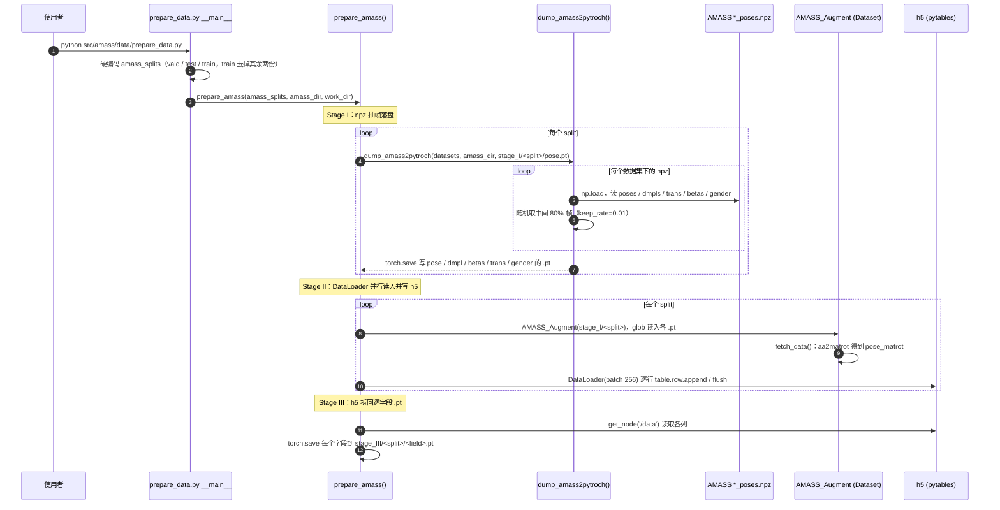

---

type: entity
title: AMASS（统一 SMPL 表示的大规模人体动捕档案）
tags: [dataset, mocap, smpl, human-motion, deep-learning, animation, mpi-tuebingen, max-planck]
summary: "AMASS 将多份光学标记动捕数据通过 MoSh++ 拟合到 SMPL 参数序列，形成可合并训练的人体运动档案；站点提供注册下载与教程代码，是机器人学习里常见的人体参考运动来源之一。"
updated: 2026-09-15
status: complete
related:
  - ../concepts/motion-retargeting.md
  - ./mimickit.md
  - ./protomotions.md
  - ./kimodo.md
  - ../methods/amp-reward.md
  - ./dataset-bfm-phuma.md
  - ./omomo-dataset.md
  - ./robot-retargeter.md
  - ../comparisons/humanoid-reference-motion-datasets.md
  - ./paper-egohtr.md
  - ./exercises-dataset.md
  - ./paper-humantracker.md
original:
  - ../../sources/papers/amass_reading_arxiv_1904_03278_am7.md
sources:
  - ../../sources/sites/amass-dataset.md
  - ../../sources/papers/egohtr_arxiv_2607_13472.md
---

# AMASS（Archive of Motion Capture as Surface Shapes）

## 一句话定义

**AMASS** 是 MPI-IS Perceiving Systems 维护的 **人体运动元数据集**：把多份独立 **光学标记动捕** 序列转换到统一的 **SMPL**（及网格）参数化上，使动画、可视化与机器学习可以在同一表示下吃「合并后的」人类动作分布。

## 英文缩写速查

| 缩写 | 英文全称 | 简要说明 |
|------|----------|----------|
| AMASS | Archive of Motion Capture as Surface Shapes | 大规模统一人体动捕数据集 |
| SMPL | Skinned Multi-Person Linear Model | 常见人体参数化模型与重定向源 |
| MoCap | Motion Capture | 动作捕捉，参考动作与演示数据的主要来源 |
| AMP | Adversarial Motion Prior | 用对抗判别约束状态转移接近专家运动分布的先验 |
| Retargeting | Motion Retargeting | 将人体/动物动作映射到目标机器人骨架 |
| BFM | Behavior Foundation Model | 大规模行为数据预训练的可复用全身行为先验 |
| G1 | Unitree G1 Humanoid | 宇树入门级教育科研人形平台 |

## 为什么重要？

- **打破数据集孤岛**：不同实验室 MoCap 的标记布局与后处理各异；统一到 SMPL 后，便于与 **重定向**、**生成模型**、**判别式运动先验（如 AMP）** 等下游共享同一接口。
- **规模与覆盖**：官网摘要对规模给出 **40+ 小时**、**300+ 被试**、**11000+ 动作** 等叙述量级（细节以论文与数据版本为准）。
- **与 SMPL 生态绑定**：人体形状与姿态参数可直接对接大量视觉与图形学工具链，降低从「原始标记」到「网络张量」的摩擦。

## 工程实践

- **取用字段**：论文给出每帧含 SMPL 形状 16 维、DMPL 软组织 8 维、159 维姿态（含手与根平移）；机器人侧通常只取姿态与根平移，忽略形状与软组织（论文明确允许）。
- **体型归一化**：可把所有被试替换为同一 SMPL 形状再取关节位置，便于后续重定向（论文 §1 的用法说明；具体管线见上文时序图与 [Motion Retargeting](../concepts/motion-retargeting.md)）。
- **子集选择**（推断）：表 1 中 KIT、BMLrub、CMU 体量最大；按任务（行走、舞蹈、手部）挑选子集并做质量过滤，再进入 AMP / 跟踪训练。

## 流程总览（概念级）

## 常见误区或局限

- **原论文自述的限制**：论文承认 MoSh++ 非实时，手部拟合无真值只能定性评估；标记互换等问题靠人工检查修正或剔除，数据质量因子集而异。

- **不是「开箱即用的机器人关节角」**：SMPL 系人体轨迹通常仍需 **[Motion Retargeting](../concepts/motion-retargeting.md)** 与动力学修正才能上机；否则易出现脚滑、穿透与力矩不可行。
- **许可与用途**：下载与使用受站点 **License** 约束；商业或再分发场景必须自行核对条款与引用要求。
- **与「视频估计人体」不同**：AMASS 主体来自 **标记动捕** 拟合，分布与单目视频估计的 SMPL 轨迹在噪声与偏差特性上并不相同。

## 与其他页面的关系

- **[ProtoMotions](./protomotions.md)**：官方文档把 AMASS 作为大规模并行训练的典型数据来源之一。
- **[MimicKit](./mimickit.md)**：研究管线中常出现从 AMASS（SMPL）到目标骨架的重定向工具链叙述。
- **[AMP 奖励与运动先验](../methods/amp-reward.md)**：MoCap 风格先验训练常以 AMASS 类统一表示为输入。
- **[HumanTracker](./paper-humantracker.md)**：指出常用 tracking 测试仍是 AMASS 约 140 条，覆盖与诊断都不够；其 153 h 四族集是评测层补充，不是 AMASS 训练替代。

## 源码运行时序图

入口：`python src/amass/data/prepare_data.py`（运行前需把脚本内的 `amass_dir`、`work_dir` 占位路径改成本地路径；依赖 `human_body_prior`，不在本仓库内）

图依据：AMASS@36d86b5，读过 `src/amass/data/prepare_data.py`、`src/amass/data/dfaust_synthetic_mocap.py`、`README.md`、`setup.py`；未运行代码（需要 licence-gated 的 SMPL+H 模型与 AMASS 数据）。

## 参考来源

- [AMASS 站点与论文索引归档](../../sources/sites/amass-dataset.md)
- Mahmood et al., *AMASS: Archive of Motion Capture as Surface Shapes* (ICCV 2019) — 论文 PDF 见站点链接
- AMASS 官网：<https://amass.is.tue.mpg.de/>
- 教程代码仓库：<https://github.com/nghorbani/amass>
- **ingest 档案：** [sources/papers/bfm_humanoid_arxiv_2509_13780.md](../../sources/papers/bfm_humanoid_arxiv_2509_13780.md) — BFM：AMASS 重定向轨迹作为 Unitree G1 行为基础模型的蒸馏输入
- 源码核对（2026-11-02）：nghorbani/amass@36d86b5，读过 `src/amass/data/prepare_data.py`、`src/amass/data/dfaust_synthetic_mocap.py`、`README.md`、`setup.py`；时序图依据以上文件，未运行代码。

## 关联页面

- [Motion Retargeting](../concepts/motion-retargeting.md)
- [ProtoMotions](./protomotions.md)
- [MimicKit](./mimickit.md)
- [Kimodo](./kimodo.md)
- [DART（DartControl）](../methods/dart-control.md) — 在 AMASS 上训练的自回归人体运动原语潜扩散（ICLR 2025）
- [LaFAN1 动捕数据集](./lafan1-dataset.md)
- [PHUMA](./dataset-bfm-phuma.md) — PhySINK 重定向后的 G1 locomotion 对照
- [OMOMO](./omomo-dataset.md) — 人–物交互 MoCap 源
- [五集选型对比](../comparisons/humanoid-reference-motion-datasets.md)
- [EgoHTR](./paper-egohtr.md) — 有场景 mesh 的 rough-terrain 4D 对照（规模远小于 AMASS；[HF 数据已发布](https://huggingface.co/datasets/leggedrobotics/egohtr)）
- [Exercises Dataset](./exercises-dataset.md) — 健身动作目录/GIF；**不是** MoCap 参考库
- [HumanTracker](./paper-humantracker.md) — 四族光学评测集；批评 AMASS-140 测试协议

## 推荐继续阅读

- SMPL 官方项目与文档（与 AMASS 参数字段对齐）
- [MoSh++ 与 AMASS 论文 PDF](http://files.is.tue.mpg.de/black/papers/amass.pdf)（方法细节与评测）
