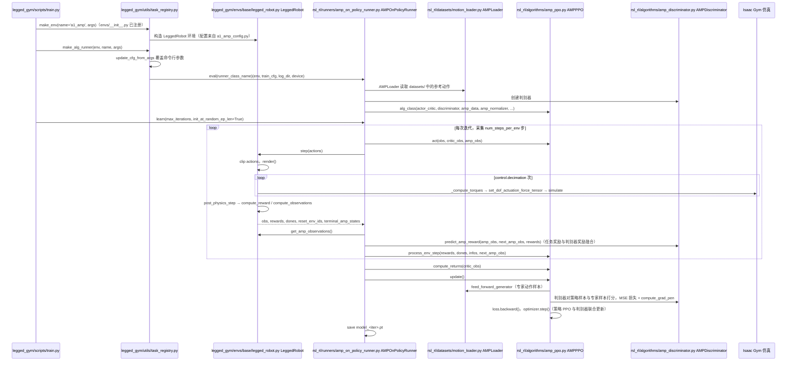

---

type: entity
tags: [repo, quadruped, amp, legged-gym, isaac-gym, nvidia]
status: complete
updated: 2026-06-08
summary: "Alescontrela/AMP_for_hardware 将 Adversarial Motion Priors 落到 Isaac Gym 四足硬件训练栈，是 MetalHead 等项目的上游 fork。"
related:
  - ../methods/amp-reward.md
  - ./legged-gym.md
  - ./metalhead.md
  - ../tasks/locomotion.md
sources:
  - ../../sources/repos/amp_for_hardware.md
---

# AMP_for_hardware

**AMP_for_hardware**（<https://github.com/escontra/AMP_for_hardware>）由 Alejandro Escontrela（GitHub：`escontra`）维护，是把 **AMP（对抗式运动先验）** 从角色动画领域 **工程化到四足机器人 + Isaac Gym** 的早期开源实现，建立在 [legged_gym](./legged-gym.md) 与 [rsl_rl](https://github.com/leggedrobotics/rsl_rl) 之上。论文项目页见 [bit.ly/3hpvbD6](https://bit.ly/3hpvbD6)（Escontrela et al., 2022）。

## 英文缩写速查

| 缩写 | 英文全称 | 简要说明 |
|------|----------|----------|
| AMP | Adversarial Motion Prior | 判别器约束策略状态分布接近参考运动 |
| RL | Reinforcement Learning | PPO 训练四足策略 |
| MoCap | Motion Capture | 风格参考动作库 |
| Sim2Real | Simulation to Real | 训练后迁移真机四足 |

## 为什么重要

- **参考运动 → 风格策略**：管线包含如何把 MoCap/参考轨迹整理为 AMP 判别器输入，是四足「重定向产物如何消费」的标准范式之一。
- **下游 fork**：[MetalHead](./metalhead.md) 等在 A1 上实现 jump/recovery 等技能。

## 源码运行时序图

入口：`python legged_gym/scripts/train.py --task=a1_amp`（训练）；`python legged_gym/scripts/play.py --task=a1_amp`（回放）。

图依据：escontra/AMP_for_hardware@bfb0dbd，实际读过 `README.md`、`legged_gym/scripts/train.py`、`legged_gym/scripts/play.py`（局部）、`legged_gym/utils/task_registry.py`（局部）、`legged_gym/envs/__init__.py`（局部）、`legged_gym/envs/base/legged_robot.py`（step、post_physics_step、get_amp_observations 等局部）、`rsl_rl/rsl_rl/runners/amp_on_policy_runner.py`（局部）、`rsl_rl/rsl_rl/algorithms/amp_ppo.py`（update 局部）、`rsl_rl/rsl_rl/algorithms/amp_discriminator.py`（局部）、`rsl_rl/rsl_rl/datasets/motion_loader.py`（类与函数列表）。未运行代码。

## 关联页面

- [AMP 奖励设计](../methods/amp-reward.md)
- [legged_gym](./legged-gym.md)
- [MetalHead](./metalhead.md)
- [Locomotion](../tasks/locomotion.md)

## 参考来源

- [AMP_for_hardware 仓库归档](../../sources/repos/amp_for_hardware.md)
- 源码核对（2026-11-02）：escontra/AMP_for_hardware@bfb0dbd，读过 README.md、legged_gym/scripts/train.py、legged_gym/scripts/play.py（局部）、legged_gym/utils/task_registry.py（局部）、legged_gym/envs/base/legged_robot.py（局部）、rsl_rl/rsl_rl/runners/amp_on_policy_runner.py（局部）、rsl_rl/rsl_rl/algorithms/amp_ppo.py（局部）、rsl_rl/rsl_rl/algorithms/amp_discriminator.py（局部）、rsl_rl/rsl_rl/datasets/motion_loader.py（结构）；时序图依据以上文件，未运行代码。

## 推荐继续阅读

- GitHub（作者维护仓）：<https://github.com/escontra/AMP_for_hardware>
- [AMP 方法页](../methods/amp-reward.md)
